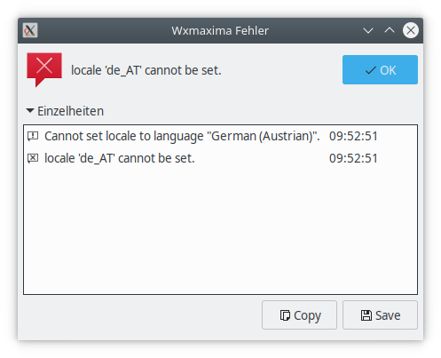

# Das Handbuch von wxMaxima

WxMaxima ist ein graphisches Benutzerinterface (GUI) für das
Computer-Algebrasystem Maxima. wxMaxima erlaubt die Nutzung aller Funktionen
dieses Programms und bietet Assistenten für dessen wichtigste Funktionen
an. Dieses Handbuch beschreibt die Features, die wxMaxima zu einer der
beliebtesten graphischen Benutzerumgebung für Maxima gemacht haben.

{ id=img_wxMaximaLogo }

______________________________________________________________________

# Einführung in wxMaxima

## _Maxima_ und wxMaxima

Im Open-Source-Bereich ist es üblich, große Systeme in kleine Projekte
aufzuteilen, die jeweils klein genug sind, dass eine endliche Menge an
Entwicklern ausreicht, um sie weiterzuentwickeln. Beispielsweise ist ein
CD-Brennprogramm aus einem Kommandozeilentool zusammengesetzt, das die CDs
brennt und eine graphische Benutzerumgebung, die dieses Tool bedient. Ein
Vorteil dieses Ansatzes ist es, daß dasselbe Kommandozeilenprogramm von
vielen Stellen aus genutzt werden: Das Brennprogramm, ein "Sende an die
CD"-Knopf und beispielsweise ein Backup-Tool. Ein weiterer Vorteil ist es,
dass auf diese Weise für eine Funktionalität mehrere Benutzerinterfaces
angeboten werden können.

Ein Computer-Algebrasystem (CAS) wie _Maxima_ ist hervorragend für diesen
Ansatz geeignet: Es kann die Logik hinter einem Taschenrechner liefern, der
mit beliebig langen Zahlen hantieren kann, Formeln für ein größeres System,
z.B. [Sage](https://www.sagemath.org/) umstellen. Alternativ kann es direkt
verwendet werden. Dies kann von der Kommandozeile aus geschehen, oder von
wxMaxima aus, das eine komfortablere Bedienung unterstützt.

### _Maxima_

Maxima ist ein komplettes Computer-Algebrasystem (CAS): Ein Programm, das
die Formel, nicht nur die Zahl sucht, die ein mathematisches Problem
löst. Auch wenn es darauf  spezialisiert ist, mit Buchstaben zu rechnen,
bietet es auch eine Menge an Funktionen, die Probleme lösen, für die nur
numerische Lösungen existieren.

{
id=img_maxima_screenshot }

Eine umfangreiche Dokumentation von _Maxima_ ist  [im Internet verfügbar](https://maxima.sourceforge.io/documentation.html). Ein Teil davon ist auch über das Hilfe-Menü von wxMaxima erreichbar. Ein Druck auf die Hilfe-Taste (auf den meisten Systemen die Taste <kbd>F1</kbd>) lässt die kontextsensitive Hilfe von _wxMaxima_ automatisch zu der Seite im Handbuch von _Maxima_ springen, die den Befehl unter dem Cursor beschreibt.

### WxMaxima

_wxMaxima_ ist ein graphisches Benutzer-Interface, das die komplette
Funktionalität und Flexibilität von Maxima zu nutzen erlaubt. Zudem bietet
es viele Funktionalitäten an, die die Verwendung von _Maxima_ einfacher
gestalten. Beispielsweise kann es den Inhalt eines Arbeitsblattes, einer
Zelle des Arbeitsblatts oder einen Teil einer Formel nach LaTeX, MathML oder
in eine RTF-Formel für eine Textverarbeitung konvertieren. Dokumentation für
wxMaxima kann [im
Internet](https://wxMaxima-developers.github.io/wxmaxima/help.html) gefunden
werden, oder über das Hilfemenü.

{ id=img_wxMaximaWindow }

_wxMaxima_ lässt alle Berechnungen im Hintergrund durch das
Kommandozeilen-Werkzeug _Maxima_ durchführen.

## Grundlagen zum Arbeitsblatt

wxMaxima ist größtenteils selbsterklärend. [Diese
Internetseite](https://wxMaxima-developers.github.io/wxmaxima/help.html)
bietet einige Beispiele an, wovon das "10-Minuten-Tutorial" besonders zu
empfehlen ist. Dieses Handbuch beschreibt einige zusätzliche Aspekte von
wxMaxima.

### Das Arbeitsblatt-Konzept

Eine der Sachen, die neue Benutzer oft verwirrt, ist, dass das Arbeitsblatt
von wxMaxima in Zellen aufgeteilt ist, die nur auf Befehl vom Benutzer an
_Maxima_ gesendet werden. Wenn eine Zelle ausgewertet wird, werden alle
Maxima-Befehle (nur) dieser Zelle als Batch-Befehle ausgewertet. Man kann
auch mehrere Zellen auswählen und gleichzeitig auswählen. Oder das gesamte
Arbeitsblatt auf einmal auswerten _WxMaxima_'s Ansatz für die Auswertung von
Befehlen mag seltsam erscheinen. Es vereinfacht aber die Arbeit mit großen
Dokumenten (wo man nicht jede Änderung eine komplette Neu-Evaluierung des
ganzen Dokuments auslösen will. Ausserdem ist dieser Ansatz für die
Fehlersuche praktisch.

Wenn Text in _wxMaxima_ eingegeben wird, erzeugt er automatisch eine neue
Zelle des Arbeitsblattes. Wenn dies eine Code-Zelle ist, kann ihr Inhalt an
_Maxima_ gesendet werden und das Resultat dieser Aktion wird unter der Zelle
angezeigt, wie unten abgebildet.

{ id=img_InputCell }

Wird eine Code-Zelle ausgewertet, weist ihr _Maxima_ eine Marke zu
(standardmäßig ist diese in roter Schrift gehalten und beginnt mit einem
`%i`), über das sie später wieder referenziert werden kann. Für die Ausgabe
wird eine Marke generiert, die standardmäßig mit `%o` beginnt und nicht
angezeigt wird, außer der Benutzer hat der Formel einen sprechenden Namen
gegeben, der stattdessen angezeigt werden kann. Der `%o`-Label den Maxima
automatisch erzeugt, ist trotzdem verwendbar.

Außer Code-Zellen kennt wxMaxima auch Textzellen und solche mit Bildern oder
Überschriften. Jede Zelle hat ihren eigenen Speicher für das
Rückgängigmachen von Aktionen, was sich oft als hilfreich erwiesen
hat. Zudem besitzt, wie in fast allen Applikationen, das Arbeitsblatt einen
eigenen Speicher für die Rückgängigmachen-Funktion.

Die nun folgende Abbildung zeigt verschiedene Zelltypen (Titelzellen,
Untertitelzellen, Textzellen, Eingabe/Ausgabezellen und eine Bildzelle).


### Zellen

Das Arbeitsblatt ist in Zellen aufgeteilt. WxMaxima kennt die folgenden
Zelltypen:

- Mathematik-Eingabezellen beinhalten eine oder mehrere Eingabe-Zeilen für
  _Maxima_
- Ausgaben oder Fragen von _Maxima_.
- Bild-Zellen.
- Text-Zellen, die beispielsweise für Dokumentation verwendet werden können.
- Ein Titel, Überschrift oder Unterüberschrift. 6 unterschiedliche
  Überschriftenebenen sind möglich.
- Seitenumbrüche.

Wenn Text eingegeben ist, erzeugt _wxMaxima_ normalerweise gleich eine
Code-Zelle. Andere Zelltypen können über das "Zellen"-Menü, die dort
dokumentierten Tastenkombinationen oder über die Werkzeugleiste erzeugt
werden. Wenn eine nicht-mathematische Zelle (Überschrift, Text, etc.)
erzeugt wurde, wird alles was eingetippt wird, als Text interpretiert.

Ein
[Kommentar](https://maxima.sourceforge.io/docs/manual/maxima_singlepage.html#Comments)
(wie in der Programmiersprache C) kann als Teil einer
Mathematik-Eingabezelle eingegeben werden: `/* Dieser Kommentar wird von
Maxima ignoriert */`.

"`/*`" markiert den Beginn des Kommentars, "`*/`" das Ende.

### Horizontale und vertikale Cursor

Wenn in einer Textverarbeitung versucht wird, einen Satz auszuwählen, wird
diese versuchen, Beginn und Ende der Auswahl so zu verschieben, dass ganze
Wörter ausgewählt sind. _wxMaxima_ wird aus diesem Grund, wenn mehr als eine
Zelle ausgewählt wird, die Auswahl auf ganze Zellen ausdehnen.

Was ungewöhnlich erscheinen kann ist, dass _wxMaxima_ alternativ einen
vertikalen oder einen horizontalen Cursor darstellen kann. _wxMaxima_
wechselt zwischen ihnen nach Bedarf:

- Der Cursor wird vertikal dargestellt wird, wenn er zwischen zwei Zellen zu
  liegen kommt.
- Innerhalb einer Zelle wird der Cursor vertikal dargestellt. Der Cursor
  wird mit dem Mauszeiger oder den Cursortasten in einer Textzelle aktiviert
  und funktioniert ähnlich wie in einem Text-Editor.

Nach dem Start von wxMaxima ist nur der blinkende horizontale Cursor zu sehen. Sobald man zu tippen beginnt, wird automatisch eine Mathe-Zelle angelegt, und der Cursor wird zu einem gewöhnlichen vertikalen Cursor (als „Prompt“ ist ein Pfeil nach rechts zu sehen; nachdem die Mathe-Zelle ausgewertet wurde (<kbd>CTRL</kbd>+<kbd>ENTER</kbd>), erscheinen die Labels, z. B. `(%i1)`, `(%o1)`).

{ id=img_horizontal_cursor_only }

Möglicherweise wollen Sie einen anderen Zelltyp erzeugen (im "Zellen" Menü),
vielleicht eine Titelzelle oder Textzelle, die beschreibt, was das
Arbeitsblatt machen wird, wenn Sie beginnen, ein Arbeitsblatt zu erstellen.

Wenn Sie zwischen den Zellen navigieren, sehen Sie den (blinkenden)
horizontalen Cursor. An dieser Stelle können Sie eine Zelle einfügen -
entweder eine mathematische Eingabezelle, indem einfach der Maxima-code
eingegeben wird), oder eine andere Zelle (unter Verwendung des
Zellen-Menüs).

{
id=img_horizontal_cursor_between_cells }

### Zellen an Maxima schicken

Der Befehl in einer Code-Zelle wird ausgeführt, sobald <kbd>CTRL</kbd>+<kbd>ENTER</kbd>, <kbd>SHIFT</kbd>+<kbd>ENTER</kbd> oder die <kbd>ENTER</kbd>-Taste im Ziffernblock gedrückt wird. In der Standardeinstellung schickt _wxMaxima_ Befehle ab, wenn <kbd>CTRL</kbd>+<kbd>ENTER</kbd> oder <kbd>SHIFT</kbd>+<kbd>ENTER</kbd> gedrückt wird; _wxMaxima_ lässt sich aber auch so einstellen, dass Befehle schon auf <kbd>ENTER</kbd> hin ausgeführt werden.

### Automatische Vervollständigung von Befehlen

_WxMaxima_ enthält eine automatische Vervollständigung, die über das Menü (Zellen/Vervollständige Befehl) oder alternativ über die Tastenkombination <kbd>CTRL</kbd>+<kbd>SPACE</kbd> aufgerufen wird. Die Vervollständigung berücksichtigt den Kontext: Innerhalb einer Einheitenangabe für ezUnits bietet sie zum Beispiel eine Liste passender Einheiten an.

{ id=img_ezUnits }

Neben der Vervollständigung eines Dateinamens, eines Einheitennamens oder des aktuellen Befehls- oder Variablennamens kann die automatische Vervollständigung für die meisten Befehle auch ein Muster anzeigen, das Typ (und Bedeutung) der Parameter angibt, die der Befehl erwartet. Dazu <kbd>SHIFT</kbd>+<kbd>CTRL</kbd>+<kbd>SPACE</kbd> drücken oder den entsprechenden Menüeintrag (Zellen/Zeige Muster) wählen.

#### Griechische Buchstaben

Computer speichern Zeichen meist als 8-Bit-Werte, was maximal 256
unterschiedliche Typen von Zeichen erlaubt. Die meisten Sprachen nutzen
inklusive Steuerzeichen, Ziffern und ein paar Zeichen, aus denen Graphiken
zusammengesetzt werden können, weniger als dies.

Für die Mehrzahl der Länder ist aus diesem Grund eine Codepage mit 256
Zeichen definiert worden, die allerdings in den meisten Ländern
beispielsweise keine griechischen Buchstaben beinhaltet, die in der
Mathematik oft verwendet werden. Um diese Begrenzung zu umgehen, wurde
[Unicode](https://home.unicode.org/) entwickelt: Eine Zeichencodierung, die
englischen Text wie gewohnt aussehen lässt, aber viel mehr als 256 Zeichen
ermöglicht.

Wenn Maxima mit einem Lisp-Compiler generiert wurde, der Unicode unterstützt
oder sich nicht darum kümmert, auf welche Weise Zeichen codiert werden,
unterstützt es Unicode. Da meist eine dieser Bedingungen gegeben ist, bietet
_WxMaxima_ eine Methode an, griechische Zeichen mit der Tastatur einzugeben:

- Ein griechischer Buchstabe kann eingegeben werden, indem erst auf die
  <kbd>ESC</kbd>-Taste gedrückt wird, und dann sein Name einzugeben begonnen
  wird.
- Ebenso kann er eingegeben werden, indem <kbd>ESC</kbd> gedrückt wird, ein
  Buchstabe (bzw. zwei für den griechischen Buchstaben omicron) und dann
  erneut <kbd>ESC</kbd>. In diesem Fall werden die folgenden Zeichen
  unterstützt:

| Zeichen | Griechischer Buchstabe | Zeichen |Griechischer Buchstabe | Zeichen | Griechischer Buchstabe |
| :-----: | :--------------------: | :-----: | :-------------------: | :-----: | :--------------------: |
|  a      |    alpha               |  i      |     iota              |  r      |     rho                |
|  b      |     beta               |  k      |    kappa              |  s      |    sigma               |
|  g      |    gamma               |  l      |    lambda             |  t      |     tau                |
|  d      |    delta               |  m      |      mu               |  u      |   upsilon              |
|  e      |   epsilon              |  n      |      nu               |  f      |     phi                |
|  z      |     zeta               |  x      |      xi               |  c      |     chi                |
|  h      |     eta                | om      |   omicron             |  y      |     psi                |
|  q      |    theta               |  p      |      pi               |  o      |    omega               |
|  A      |    Alpha               |  I      |     Iota              |  R      |     Rho                |
|  B      |     Beta               |  K      |    Kappa              |  S      |    Sigma               |
|  G      |    Gamma               |  L      |    Lambda             |  T      |     Tau                |
|  D      |    Delta               |  M      |      Mu               |  U      |   Upsilon              |
|  E      |   Epsilon              |  N      |      Nu               |  P      |     Phi                |
|  Z      |     Zeta               |  X      |      Xi               |  C      |     Chi                |
|  H      |     Eta                | Om      |   Omicron             |  Y      |     Psi                |
|  T      |    Theta               |  P      |      Pi               |  O      |    Omega               |

Griechische Buchstaben lassen sich auch über die Seitenleiste „Griechische
Buchstaben“ eingeben.

##### Achtung: Zum Verwechseln ähnliche Zeichen

Einige lateinische Buchstaben sehen aus wie griechische, z. B. der
lateinische Buchstabe „A“ und der griechische Buchstabe „Alpha“. Obwohl sie
gleich aussehen, sind es zwei verschiedene Unicode-Zeichen, die durch
verschiedene Unicode-Codepunkte (Nummern) dargestellt werden.

Das kann zum Problem werden, wenn man der Variablen A einen Wert zuweist und
später mit dem griechischen Buchstaben Alpha etwas mit dieser Variablen
anstellen will – besonders auf Ausdrucken.  Auch für den griechischen
Buchstaben My (der zugleich als Vorsatz für Mikro dient) gibt es zwei
verschiedene Unicode-Codepunkte.

Die Seitenleiste „Griechische Buchstaben“ bietet deshalb die Möglichkeit,
zum Verwechseln ähnliche Zeichen auszublenden (umschaltbar über ein
Rechtsklick-Menü).

Derselbe Mechanismus erlaubt es auch, einige andere mathematische Symbole
einzugeben:

| Zeicheneingabe | Mathematisches Symbol                                 |
| -------------- | ----------------------------------------------------- |
| hbar           | Planck constant: a h with a horizontal bar above it   |
| Hbar           | a H with a horizontal bar above it                    |
| 2              | squared                                               |
| 3              | to the power of three                                 |
| /2             | 1/2                                                   |
| partial        | partial sign (the d of dx/dt)                         |
| integral       | integral sign                                         |
| sq             | square root                                           |
| ii             | imaginary                                             |
| ee             | element                                               |
| in             | in                                                    |
| impl implies   | implies                                               |
| inf            | infinity                                              |
| empty          | empty                                                 |
| TB             | big triangle right                                    |
| tb             | small triangle right                                  |
| and            | and                                                   |
| or             | or                                                    |
| xor            | xor                                                   |
| nand           | nand                                                  |
| nor            | nor                                                   |
| equiv          | equivalent to                                         |
| not            | not                                                   |
| union          | union                                                 |
| inter          | intersection                                          |
| subseteq       | subset or equal                                       |
| subset         | subset                                                |
| notsubseteq    | not subset or equal                                   |
| notsubset      | not subset                                            |
| approx         | approximately                                         |
| propto         | proportional to                                       |
| neq != /= or # | not equal to                                          |
| +/- or pm      | a plus/minus sign                                     |
| \<= or leq     | equal or less than                                    |
| >= or geq      | equal or greater than                                 |
| \<\< or ll     | much less than                                        |
| >> or gg       | much greater than                                     |
| qed            | end of proof                                          |
| nabla          | a nabla operator                                      |
| sum            | sum sign                                              |
| prod           | product sign                                          |
| exists         | there exists sign                                     |
| nexists        | there is no sign                                      |
| parallel       | a parallel sign                                       |
| perp           | a perpendicular sign                                  |
| leadsto        | a leads to sign                                       |
| ->             | a right arrow                                         |
| -->            | a long right arrow                                    |

Diese mathematischen Symbole lassen sich auch über die Seitenleiste
„Symbole“ eingeben.

Fehlt ein bestimmtes Symbol in der Liste, kann man beliebige Unicode-Zeichen eingeben, indem man <kbd>ESC</kbd> \[Nummer des Zeichens (hexadezimal)\] <kbd>ESC</kbd> drückt. Außerdem hat die Seitenleiste „Symbole“ ein Rechtsklick-Menü, das eine Liste aller verfügbaren Unicode-Symbole anzeigt, die man dieser Werkzeugleiste oder dem Arbeitsblatt hinzufügen kann.

<kbd>ESC</kbd><kbd>6</kbd><kbd>1</kbd><kbd>ESC</kbd> therefore results in an `a`. While you type the number, the list of symbols shows the character it stands for and its Unicode name.

If the number also is the beginning of a symbol's name (`be` could be the start of `beta`, or the character ¾ with the number `be`), the name wins. A leading `0` or `u+` makes it a number: <kbd>ESC</kbd>`u+be`<kbd>ESC</kbd> and <kbd>ESC</kbd>`00be`<kbd>ESC</kbd> both result in a `¾`.

A letter with an accent that Unicode has no character of its own for, like a t with a bar on top of it, is a letter followed by a "combining" accent: <kbd>t</kbd><kbd>ESC</kbd><kbd>3</kbd><kbd>0</kbd><kbd>4</kbd><kbd>ESC</kbd> results in `t̄`, which _Maxima_ treats as a variable name like any other.

Symbols one needs often can be added to the "Symbols" sidebar in the "Options" tab of the configuration dialog (Edit -> Configure), where they can also be given a keyboard shortcut. A letter with accents counts as one symbol there and gets one button. The Greek letters and the symbols the sidebars show anyway can be given a keyboard shortcut there, too, or by right-clicking their button in the sidebar. A shortcut has to contain <kbd>Ctrl</kbd> or <kbd>Alt</kbd> or be a function key, and types its symbol while the worksheet has the keyboard focus. The configuration dialog warns if a menu entry already uses the same keys.

Viele der Unicode-Symbole (mit der Ausnahme der logischen Verknüpfungen)
haben keine direkte Entsprechung in _Maxima_ und werden daher als normale
Zeichen interpretiert. Falls _Maxima_ eine Lisp-Version verwendet, die
Unicode nicht unterstützt, kann das eine Fehlermeldung verursachen.

Es kann vorkommen, dass z. B. griechische Buchstaben oder mathematische Symbole in der gewählten Schriftart nicht enthalten sind; dann können sie nicht angezeigt werden.
In diesem Fall hilft es, andere Schriftarten zu wählen (über: Bearbeiten -> Einstellungen -> Stil).

### Unicode-Ersetzung

wxMaxima will replace several Unicode characters with their respective Maxima expressions, e.g. `²` with `^2`, `³` with `^3`, `≠` with `#` or `≤` with `<=`.

Unicode characters that stand for a Maxima name are instead defined as
_Maxima_ aliases of that name when wxMaxima starts _Maxima_: `π` for `%pi`,
`ⅈ` for `%i`, `ⅇ` for `%e`, `∞` for `inf`, the (mathematical) Sigma sign
(which is not the same Unicode character as the corresponding Greek letter)
for `sum`, `∏` for `product`, `∫` for `integrate`, the square root sign for
`sqrt` and `⋀`, `⋁`, `⊻`, `⊼`, `⊽`, `⇒`, `⇔` and `¬` for `and`, `or`, `xor`,
`nand`, `nor`, `implies`, `equiv` and `not`. This means they work in files
loaded by `batch()` or `load()`, too, and `aliases` lists the names they
stand for. As _Maxima_ reads these characters as letters they need to be
separated from neighbouring names by spaces in such a file: `a⋀b` is a
variable name, `a ⋀ b` means `a and b`. In an input cell wxMaxima adds these
spaces automatically. It also puts parenthesis around a number or a variable
that directly follows the square root sign, so `√2` means `sqrt(2)`.

Unicode enthält einige „gebräuchliche“ Brüche als jeweils einen einzigen
Unicode-Codepunkt: `¼, ½, ¾, ⅐, ⅑, ⅒, ⅓, ⅔, ⅕, ⅖, ⅗, ⅘, ⅙, ⅚, ⅛, ⅜, ⅝, ⅞`

wxMaxima ersetzt sie durch ihre Maxima-Darstellung, z. B. `(1/4)`, bevor die
Eingabe an Maxima geschickt wird. Außerdem gibt es noch `⅟`, das durch `1/`
ersetzt wird, und `↉` (im Baseball verwendet), das durch `(0/3)` ersetzt
wird.

In Eingabezellen sollte man besser **Maxima-Code** verwenden (nicht diese
Unicode-Codepunkte). Begründung: (a) Es kann sein, dass die Schriftart für
die Mathe-Eingabe diese Zeichen nicht enthält; (b) ein als `wxm`-Datei
gespeichertes Dokument kann normalerweise auch von Maxima (auf der
Kommandozeile) gelesen werden, wo diese Ersetzungen natürlich nicht
funktionieren. Sie können aber auftauchen, wenn man eine Formel aus einem
anderen Dokument per Ausschneiden und Einfügen übernimmt.

### Seitenleisten

Die meisten _Maxima_-Befehle, ein Inhaltsverzeichnis, Debug-Meldungen oder
die Liste der zuletzt verwendeten Befehle werden in Seitenleisten angeboten,
die über das "Ansicht"-Menü aktiviert und an beliebige Stellen in oder
außerhalb des _wxMaxima_-Fensters verschoben werden können. Ebenso kann eine
Seitenleiste mit griechischen Buchstaben geöffnet werden, die eine
alternative Methode anbietet, griechische Buchstaben einzugeben.

{ id=img_SidePanes
}

In der Seitenleiste „Inhaltsverzeichnis“ lässt sich eine Überschrift höher-
oder herabstufen, indem man sie mit der rechten Maustaste anklickt und den
nächsthöheren oder nächstniedrigeren Überschriftentyp wählt.

{
id=Sidepane-TOC-convert-headings }

### MathML-Ausgabe

Einige Textverarbeitungen verstehen entweder
[MathML](https://www.w3.org/Math/) oder (wie LibreOffice) haben einen
Formeleditor, der die Option “importiere MathML aus der Zwischenablage”
unterstützt. Andere unterstützen Mathematik im RTF-Format. _wxMaxima_ bietet
daher einige entsprechende Optionen im Rechtsklick-Menü an. 

### Pasting LaTeX or MathML formulas

**Edit → Paste LaTeX/MathML as Maxima Code** (also in the right-click menu) converts a formula from the clipboard into a _Maxima_ command, for example one copied from a paper, a web page or an equation editor. LaTeX may come with or without `$…$`, `\(…\)` or `\[…\]` around it, so `\int_0^1 \frac{\sin x}{x}\,dx` becomes `integrate(sin(x)/x,x,0,1)`. The command goes where the cursor is, or into a new code cell. MathML pasted into a code cell with the ordinary **Paste** is converted the same way, since nobody wants the XML in a code cell. If MathML copied with **Copy as MathML** is pasted back, the result is the original command: _wxMaxima_ adds it to the MathML as an annotation.

LaTeX and MathML describe what a formula looks like, not what it means, so
the conversion has to interpret it. Fractions, roots, powers, subscripts
(`x_1` becomes the name `x_1`, `a_{n+1}` the array element `a[n+1]`),
functions with or without parentheses (`\sin 2x`), `\frac{d}{dx}`, `f'(x)`,
integrals ending in `dx`, sums and products with limits, `\lim_{x\to 0}`,
`|x|` and matrices are understood. An `e` is Euler’s number, but an `i` is
only the imaginary unit when set upright (`\mathrm{i}`), as it more often is
an index. A product of a name and parentheses, like `x(y+1)`, is taken as a
product unless the name is `f`, `g`, `h` or longer than one letter. Anything
without a single meaning, like `\pm`, `\dots` or text, isn’t guessed at:
_wxMaxima_ says what it couldn’t convert instead. Check the command before
evaluating it.

### Markdown-Unterstützung

_WxMaxima_ unterstützt einige
[Markdown](https://en.wikipedia.org/wiki/Markdown)-Kommandos, die nicht mit
Konstrukten kollidieren, die in mathematischen Formeln vorkommen. Eines
dieser Elemente sind Aufzählungen:

```text
Normaler Text
 * Ein Punkt auf der ersten Einrückungsebene
 * Ein weiterer Punkt auf der ersten Einrückungsebene
   * Ein Punkt auf einer zweiten Einrückungsebene
   * Ein zweiter Punkt auf der zweiten Einrückungsebene
 * Ein dritter Punkt auf der ersten Einrückungsebene
Normaler Text
```

_WxMaxima_ erkennt Text, der mit `>`-Zeichen beginnt, als Zitat:

```text
Normaler Text
> Zitat Zitat Zitat Zitat
> Zitat Zitat Zitat Zitat
> Zitat Zitat Zitat Zitat
Normaler Text
```

Die TeX- und HTML-Ausgabe von _WxMaxima_ erkennt außerdem `=>` und ersetzt es durch das entsprechende Unicode-Zeichen:

```text
cogito => sum.
```

Weitere Symbole, die der HTML- und TeX-Export erkennt, sind `<=` und `>=` für Vergleiche, ein Doppelpfeil mit zwei Spitzen (`<=>`), einfache Pfeile (`<->`, `->` und `<-`) sowie `+/-` als entsprechendes Zeichen. Bei der TeX-Ausgabe werden zusätzlich `<<` und `>>` erkannt.

### Links in text cells

A web address in a text cell that starts with `http://`, `https://` or `mailto:` is shown as a link. Since clicking into a text cell places the cursor there, a link is followed by <kbd>CTRL</kbd>+clicking it (<kbd>CMD</kbd>+clicking on macOS), or by right-clicking it and choosing "Open Link"; hovering over it shows where it leads. The HTML export turns it into a link, the TeX export into a `\url{}`. Links are always recognized from the text itself, so nothing about them is stored in the file.

Links in a code cell's comments (`/* ... */`) work the same way. Elsewhere
in code, for example inside a string, an address is Maxima syntax and is not
a link.

The same goes for web addresses in _Maxima_'s output, for example in a string printed by `print("See https://wxmaxima-developers.github.io/wxmaxima/")`: <kbd>CTRL</kbd>+clicking the address or choosing "Open Link" from its context menu opens it, while a plain click still selects the output.

### Bold, italic, underlined and struck-through text

Text in a text cell, a title or a section heading can be made bold, italic,
underlined or struck through. Select the text and press the respective
button in the toolbar; pressing the button again removes that formatting
from the selection. With nothing selected the button switches the formatting
on or off for what is typed next. The buttons are hidden by right-clicking
the toolbar and unchecking "Text formatting buttons". Code cells cannot be
formatted: their colors already show the syntax of the code.

Superscript and subscript buttons work the same way: they make the text
smaller and raise it above or lower it below the line, as in E = mc² or
H₂O. A character cannot be both, so switching one of them on switches the
other off. A line that contains a superscript, a subscript or a character
that is taller than the font's usual ones, for example an emoji, gets as
much additional room as it needs.

The formatting is saved in `.wxmx` files. Older versions of _wxMaxima_ open
such a file without the formatting but keep all of the text. `.wxm` files,
the exports and the clipboard contain the text without its formatting.

### Tastenkürzel

Die meisten Tastenkürzel entstammen den Menüs, was bedeutet, dass sie mit
diesen übersetzt werden können, falls die Tastatur der aktuellen Sprache
dies erforderlich macht. Nicht dort dokumentiert ist:

- <kbd>CTRL</kbd>+<kbd>SHIFT</kbd>+<kbd>DELETE</kbd> löscht eine komplette
  Zelle.
- <kbd>CTRL</kbd>+<kbd>TAB</kbd> oder
  <kbd>CTRL</kbd>+<kbd>SHIFT</kbd>+<kbd>TAB</kbd> aktiviert die
  Auto-Vervollständigung.
- <kbd>SHIFT</kbd>+<kbd>SPACE</kbd> fügt ein nicht-umbrechbares Leerzeichen
  ein.

### Exploring output with the keyboard

A cell's output can be selected, and explored part by part, without a mouse:

- <kbd>DOWN</kbd> at the end of a cell's input selects the first result of
  its output. Further presses of <kbd>DOWN</kbd> and <kbd>UP</kbd> step
  through the results; past the last one the cursor leaves the cell. If you
  prefer <kbd>DOWN</kbd> to skip over the output, switch on "Up/Down keys
  skip over output" in the Worksheet tab of the configuration dialog.
- <kbd>ENTER</kbd> goes into the selected expression and selects its first
  part: the expression without its label, the numerator of a fraction, the
  name of a function, the first entry of a matrix, ... If the selection has
  no parts, <kbd>ENTER</kbd> opens a new input cell holding it, as it always
  did.
- <kbd>ESCAPE</kbd> selects what the selection is a part of. From a whole
  result it goes back into the cell's input.
- <kbd>LEFT</kbd> and <kbd>RIGHT</kbd> select the previous or next part at
  the same level. In a matrix all four arrow keys move from entry to entry.
- <kbd>SHIFT</kbd>+<kbd>LEFT</kbd> and <kbd>SHIFT</kbd>+<kbd>RIGHT</kbd>
  grow or shrink the selection over the neighbouring parts; in a matrix,
  <kbd>SHIFT</kbd> and any arrow key grow the selected entry into a block of
  entries.
- The context-menu key or <kbd>SHIFT</kbd>+<kbd>F10</kbd> opens the
  right-click menu for the selection, so it can be copied in any format.

### TeX-Code direkt im TeX-Export

Wenn eine Textzelle mit "TeX:" beginnt, wird der Rest ihres Inhalts bei der
Konvertierung des Dokuments nach TeX unverändert ausgegeben.

## Dateiformate

Das Arbeitsblatt kann auf verschiedene Weisen gespeichert werden:

### .mac

.mac-Dateien sind Textdateien mit _Maxima_-Befehlen. Sie können über
Maxima's `batch()` oder `load()`-Befehl oder in wxMaxima über "Datei/Batch
File laden" gelesen werden.

Unten ist ein Beispiel zu sehen. `Quadratic.mac` definiert eine Funktion und
erzeugt danach mit `wxdraw2d()` einen Plot.  Anschließend wird der Inhalt
der Datei `Quadratic.mac` ausgegeben und die neu definierte Funktion `f()`
ausgewertet.

{ id=img_BatchImage }

Achtung: Obwohl die Datei `Quadratic.mac` eine übliche Maxima-extension hat
(`.mac`), kann sie nur durch wxMaxima verarbeitet werden, der Befehl
`wxdraw2d()` ist eine wxMaxima-Erweiterung für
_Maxima_. (Kommandozeilen)-Maxima wird den unbekannten Befehl ignorieren und
ihn als Ausgabe erneut ausgeben.

`.mac`-Dateien eignen sich dafür, eine Bibliothek von Maxima-Befehlen
aufzubauen. Ausreichend Information über die Struktur eines
_wxMaxima_-Arbeitsblatts, dass sie es erlauben, dieses wieder zu
rekonstruieren, enthalten sie aber nicht.

### .wxm

`.wxm`-Dateien enthalten das Arbeitsblatt ohne die Ausgaben von _Maxima_. Ab Maxima-Version 5.38 können sie wie .mac-Dateien mit der _Maxima_-Funktion `load()` gelesen werden. Na ja – meistens. Fragen (wie `asksign(x)`) sind problematisch, da die Antwort in der `.wxm`-Datei gespeichert wird (damit sie nach dem Laden vorgeschlagen werden kann), Maxima sie aber nicht auswerten kann.
Man kann verhindern, dass Maxima Fragen stellt, indem man mit `assume()` die Eigenschaften deklariert, die Maxima wissen will.

Bei diesem Klartext-Format lässt es sich manchmal nicht vermeiden, dass
Arbeitsblätter, die neue Funktionen nutzen, nicht abwärtskompatibel zu
älteren Versionen von _wxMaxima_ sind.

#### Dateiformat von wxm-Dateien

Es handelt sich um eine reine Textdatei (sie lässt sich mit einem Texteditor
öffnen), die die Inhalte der Zellen als spezielle Maxima-Kommentare enthält.

Sie beginnt mit folgendem Kommentar:

```maxima
/* [wxMaxima batch file version 1] [ DO NOT EDIT BY HAND! ]*/
/* [ Created with wxMaxima version 24.02.2_DevelopmentSnapshot ] */
```

Danach folgen die Zellen, kodiert als Maxima-Kommentare, z. B. eine
Abschnittszelle:

```maxima
/* [wxMaxima: section start ]
Title of the section
   [wxMaxima: section end   ] */
```

oder (in einer Mathe-Zelle ist die Eingabe natürlich *nicht* auskommentiert;
die Ausgabe wird in einer `wxm`-Datei nicht gespeichert):

```maxima
/* [wxMaxima: input   start ] */
f(x):=x^2+1$
f(2);
/* [wxMaxima: input   end   ] */
```

Bilder sind [Base64-kodiert](https://en.wikipedia.org/wiki/Base64), mit dem
Bildtyp in der ersten Zeile:

```maxima
/* [wxMaxima: image   start ]
jpg
[very chaotic looking character sequence]
   [wxMaxima: image   end   ] */
```

Ein Seitenumbruch ist einfach eine Zeile mit folgendem Inhalt:

```maxima
/* [wxMaxima: page break    ] */
```

Und eingeklappte Zellen werden markiert durch:

```maxima
/* [wxMaxima: fold    start ] */
...
/* [wxMaxima: fold    end   ] */
```

### .wxmx

Dieses XML basiertes Dateiformat enthält das gesamte Arbeitsblatt, inklusive
Eigenschaften wie den Zoom-Faktor oder die Watchlist. Es ist das empfohlene
Dateiformat für wxMaxima-Arbeitsblätter.

#### Dateiformat von wxmx-Dateien

Eine `wxmx`-Datei sieht zwar wie ein Binärformat aus, man kann sie aber mit
Werkzeugen bearbeiten, die das Betriebssystem bereits mitbringt. Es handelt
sich um eine Zip-Datei, die sich mit `unzip` entpacken lässt (eventuell muss
man sie vorher umbenennen, damit das Entpackprogramm des Betriebssystems sie
erkennt).  Die Kompressionsfunktion wird nicht genutzt, sondern nur die
Möglichkeit, mehrere Dateien in einer Datei zusammenzufassen – Bilder sind
bereits komprimiert, und der Rest ist einfacher Text (vermutlich viel
kleiner als enthaltene große Bilder).

Sie enthält die folgenden Dateien:

- `mimetype`: Diese Datei enthält den MIME-Typ von wxMaxima-Dateien:
  `text/x-wxmathml`
- `format.txt`: eine kurze Beschreibung von wxMaxima und dem
  wxmx-Dateiformat
- Bilder (z. B. png, jpeg): Inline-Plots, die in der wxMaxima-Sitzung
  erzeugt wurden, und eingefügte Bilder.
- `content.xml`: ein XML-Dokument, das die einzelnen Zellen des Dokuments im
  XML-Format enthält.

Wenn also etwas schiefgeht, kann man ein wxMaxima-Dokument entpacken
(eventuell vorher in eine `zip`-Datei umbenennen), mit einem Texteditor
Änderungen an der Datei `content.xml` vornehmen oder ein defektes Bild
ersetzen, die Dateien wieder zippen und die `zip`- wieder in eine
`wxmx`-Datei umbenennen – und erhält so eine geänderte `wxmx`-Datei.

## Konfigurationsoptionen

Einige Variablen, über die Maxima konfiguriert wird, können auf zwei Arten
eingestellt werden:

- Die können global im Konfigurationsdialog eingestellt werden.
- Die Werte der meisten Konfigrations-Variablen können nur für die aktuelle
  Sitzung geändert werden, indem die Werte im Arbeitsblatt geändert werden,
  wie unten gezeigt.

{
id=img_wxMaxima_configuration_001 }

### Voreingestellte Bildrate für Animationen

Die Bildwiederholgeschwindigkeit für Animationen wird in der Variable
`wxanimate_framerate` gespeichert. wxMaxima setzt sie auf den Wert aus dem
Konfigurationsdialog, wenn ein neues _Maxima_ gestartet wird.

### Voreingestellte Plotgröße für neue _maxima_-Sitzungen

Beim nächsten Start werden im Arbeitsblatt eingebettete Diagramme mit dieser
Größe erstellt, wenn der Wert von `wxplot_size` nicht geändert wird.

Diese Variable kann notfalls auch nur für das aktuelle Diagramm gesetzt
werden:

```maxima
wxdraw2d(
   explicit(
       x^2,
       x,-5,5
   )
), wxplot_size=[480,480]$
```

### Klammern in Textfeldern automatisch schließen

Diese Option schaltet zwei Funktionen ein:

- Wenn eine öffnende Klammer, eckige Klammer oder ein Anführungszeichen
  eingegeben wird, fügt _wxMaxima_ automatisch das schließende Zeichen
  danach ein.
- In a code cell a comment opened by `/*` is closed by an inserted
  `*/`. Typing `*/` in front of it moves the cursor past it instead.
- Markierter Text wird, wenn man eine geöffnete Klammer einzugeben versucht,
  automatisch in Klammern gesetzt.

### Das Arbeitsblatt nicht automatisch speichern

Wenn diese Option gewählt ist, wird das Arbeitsblatt nur überschrieben, wenn
der Benutzer es speichert. Ein aktuelles Backup wird in diesem Fall im
temp-Verzeichnis abgelegt.

Ist diese Option nicht angewählt, arbeitet _wxMaxima_ wie eine moderne
Handy-App:

- Dateien werden beim Schließen automatisch gespeichert
- Und die Datei wird automatisch alle 3 Minuten gespeichert.

### Arranging the toolbar

The toolbar is made of sections, like the "Open" and "Save" buttons, the
evaluation buttons or the drop-down list that sets the type of a cell. The
"Toolbar" tab of the configuration dialog lists them in the order the
toolbar shows them in: drag a section to another place, or select it and
press "Up" or "Down", to move it, and uncheck it to hide it. The flexible
space pushes every section after it to the right edge of the
window. "Default order" restores the original arrangement. Sections can also
be shown or hidden by right-clicking the toolbar.

### Wo wird die Konfiguration gespeichert?

Unter Unix/Linux wird die Konfiguration in der Datei `.wxMaxima` im Home-Verzeichnis gespeichert (bei wxWidgets \< 3.1.1) oder in `.config/wxMaxima.conf` ((XDG-Standard) bei wxWidgets >= 3.1.1). Die wxWidgets-Version lässt sich mit dem Befehl `wxbuild_info();` oder über den Menüpunkt Hilfe->Info abfragen. [wxWidgets](https://www.wxwidgets.org/) ist die plattformübergreifende Bibliothek für grafische Benutzeroberflächen, auf der _wxMaxima_ aufbaut (daher das `wx` im Namen).
(Da der Dateiname mit einem Punkt beginnt, sind `.wxMaxima` bzw. `.config` versteckt.)

Unter Windows wird die Konfiguration in der Registry unter
`HKEY_CURRENT_USER\Software\wxMaxima` gespeichert.

______________________________________________________________________

# Erweiterungen für _Maxima_

_wxMaxima_'s Hauptaufgabe ist es, die Ein- und Ausgaben von Maxima graphisch
darzustellen. An einigen Stellen fügt es jedoch Funktionalitäten zu _Maxima_
hinzu. WxMaxima's Fähigkeiten, Reports zu generieren, indem Arbeitsblätter
nach HTML und LaTeX exportiert werden können, wurde erwähnt. Dieser
Abschnitt betrachtet einige Arten, wie _wxMaxima_ die Einbindung von
Graphiken in ein Arbeitsblatt verbessert

## Variablen mit tiefgestelltem Index

<div id="wxsubscripts"></div>

`wxsubscripts` gibt an, wie (und ob) _wxMaxima_ Variablennamen automatisch
tiefstellen wird:

Falls es `false` gesetzt wird, wird die Funktion deaktiviert, wxMaxima wird
nicht Teile von Variablennamen nach einem Unterstrich tiefstellen.

Falls es auf `'all` gesetzt wird, wird alles nach einem Unterstrich
tiefgestellt.

Wenn es auf `true` gesetzt ist, werden Variablennamen im Format `x_y` mit
einem tiefgestellten `y` dargestellt, wenn

- Entweder `x` oder `y` ist ein einzelner Buchstabe ist oder
- `y` ist eine ganze Zahl (kann länger als ein Zeichen lang sein).

{ id=img_wxsubscripts }

<div id="wxdeclare_subscripted"></div>

A variable the rules above don’t cover can still be declared as "to be
subscripted" using the command `wxdeclare_subscripted(variable_name);` or
`wxdeclare_subscripted([variable_name1,variable_name2,...]);` Declaring a
variable as subscripted can be reverted using the following command:
`wxdeclare_subscripted(variable_name,false);`, which also keeps a variable
the rules above do cover from being subscripted.

<div id="wxdeclare_subscript"></div>

`wxdeclare_subscript(text_snippet);` or
`wxdeclare_subscript([text_snippet1,text_snippet2,...]);` instead declares a
text snippet: every variable whose name ends in an underscore followed by
that snippet is subscripted, however long the two parts are.

Diese Werte lassen sich auch über das Menü „Ansicht->Automatisches Tiefstellen“ setzen.

## Rückmeldungen in der Statusleiste

<div id="wxstatusbar"></div>

Kommandos, die lange arbeiten, können Fortschrittsinformationen in die
Statuszeile ausgeben. Diese Informationen überschreiben deren
Inhalt. `wxstatusbar()` kann sogar in Bibliotheken verwendet werden, bei
denen nicht bekannt ist, ob sie mit _wxMaxima_ oder in einem _Maxima_ ohne
Frontend verwendet werden: Wenn _wxMaxima_ diese Funktion nicht definiert
hat, wird sie von Maxima einfach als undefinierte Funktion betrachtet und
nicht weiter bearbeitet.

```maxima
for i:1 thru 10 do (
    /* Dem Benutzer mitteilen, wie weit wir sind */
    wxstatusbar(concat("Pass ",i)),
    /* (sleep n) ist eine Lisp-Funktion, die mit einem */
    /* vorangestellten "?" verwendet werden kann. Sie */
    /* verzögert die Programmausführung (hier: 3 Sekunden) */
    ?sleep(3)
)$
```

## Das Arbeitsblatt aus Maxima heraus exportieren

<div id="wxworksheettohtml"></div>

Der Befehl `wxworksheettohtml()` exportiert das aktuelle Arbeitsblatt aus
einer laufenden _Maxima_-Sitzung heraus in eine HTML-Datei, was für einen
per Skript oder im Batch-Betrieb ausgeführten Export praktisch ist. Wie
`wxstatusbar()` kann er gefahrlos in Code verwendet werden, der auch im
reinen (Konsolen-)_Maxima_ laufen könnte: Ist _wxMaxima_ nicht vorhanden,
bleibt der Befehl einfach unausgewertet.

```maxima
wxworksheettohtml("report.html")$
wxworksheettohtml("report.html", flavor="svg", wxmx=true)$
```

Ein relativer Dateiname wird relativ zum Arbeitsverzeichnis von _Maxima_
interpretiert. Die optionalen Schlüsselwort-Optionen sind:

| Option   | Werte                                           | Bedeutung                                           |
| -------- | ----------------------------------------------- | --------------------------------------------------- |
| `flavor` | `mathml` (Standard), `mathjax`, `svg`, `bitmap` | wie die Formeln in der exportierten Seite dargestellt werden |
| `wxmx`   | `false` (Standard), `true`                      | eine herunterladbare `.wxmx`-Kopie der Sitzung einbetten |

The images and the `.wxmx` copy are written into a folder named after the
HTML file, with `_htmlimg` appended. If "Embed images into the .html file"
is checked in the Export tab of the configuration dialog, they are embedded
into the HTML file instead, so it can be mailed as a single file.

Die Werte von `flavor` entsprechen den Formelformaten, die der grafische
Dialog **Datei → Exportieren** anbietet: `mathml` erzeugt eine in sich
geschlossene Seite, die keine Internetverbindung braucht, `mathjax` fügt
eine MathJaX-Ausweichlösung für Browser hinzu, die MathML noch nicht
beherrschen, und `svg`/`bitmap` wandeln jede Formel in ein Bild um.

<div id="wxworksheettotex"></div>

Der verwandte Befehl `wxworksheettotex()` exportiert auf dieselbe Weise in
eine LaTeX-Datei (`.tex`):

```maxima
wxworksheettotex("report.tex")$
wxworksheettotex("report.tex", documentclass="report", documentclassoptions="12pt,a4paper")$
```

| Option                 | Bedeutung                                                            |
| ---------------------- | -------------------------------------------------------------------- |
| `documentclass`        | ersetzt die LaTeX-`\documentclass` (z. B. `"article"`, `"report"`)   |
| `documentclassoptions` | ersetzt deren Optionen (z. B. `"12pt,a4paper"`)                      |

Eine Unterstützung für `wxworksheettopdf()` ist geplant.

## Diagramme

Diagramme haben per definitionem mit einer graphischen Benutzerumgebung zu
tun, weswegen an dieser Stelle Erweiterungen von Maxima zu erwarten sind.

### Ein Diagramm in das Arbeitsblatt einbetten

<div id="wxplot2d"></div>
<div id="wxplot3d"></div>
<div id="wximplicit_plot"></div>
<div id="wxcontour_plot"></div>

_Maxima_ weist normalerweise Gnuplot an, Diagramme in eigenen Fenstern
darzustellen. Wenn dem entsprechenden `draw` oder `plot`-Kommando ein "wx"
vorangestellt wird, wird das Bild stattdessen in das Arbeitsblatt eingebaut.

Die folgenden Plot-Funktionen haben wx-Äquivalente:

| Plotfunktion von wxMaxima | Plotfunktion von Maxima                                                                        |
| ------------------------- | ---------------------------------------------------------------------------------------------- |
| `wxplot2d()`             | [plot2d](https://maxima.sourceforge.io/docs/manual/maxima_singlepage.html#plot2d)               |
| `wxplot3d()`             | [plot3d](https://maxima.sourceforge.io/docs/manual/maxima_singlepage.html#plot3d)               |
| `wxdraw2d()`             | [draw2d](https://maxima.sourceforge.io/docs/manual/maxima_singlepage.html#draw2d)               |
| `wxdraw3d()`             | [draw2d](https://maxima.sourceforge.io/docs/manual/maxima_singlepage.html#draw3d)               |
| `wxdraw()`               | [draw](https://maxima.sourceforge.io/docs/manual/maxima_singlepage.html#draw)                   |
| `wximplicit_plot()`      | [implicit_plot](https://maxima.sourceforge.io/docs/manual/maxima_singlepage.html#implicit_plot) |
| `wxhistogram()`          | [histogram](https://maxima.sourceforge.io/docs/manual/maxima_singlepage.html#histogram)         |
| `wxscatterplot()`        | [scatterplot](https://maxima.sourceforge.io/docs/manual/maxima_singlepage.html#scatterplot)     |
| `wxbarsplot()`           | [barsplot](https://maxima.sourceforge.io/docs/manual/maxima_singlepage.html#barsplot)           |
| `wxpiechart()`           | [piechart](https://maxima.sourceforge.io/docs/manual/maxima_singlepage.html#piechart)           |
| `wxboxplot()`            | [boxplot](https://maxima.sourceforge.io/docs/manual/maxima_singlepage.html#boxplot)             |

Liest (Konsolen-)Maxima eine `wxm`-Datei, werden diese Funktionen ignoriert
(und, wie andere unbekannte Funktionen in Maxima, als Ausgabe ausgegeben).

Gibt es mit einer dieser Funktionen Probleme, sollte man prüfen, ob das
Problem auch bei der entsprechenden Maxima-Funktion auftritt (gibt
z. B. `wxplot2d()` einen Fehler aus, denselben Plot mit dem Maxima-Befehl
`plot2d()` versuchen, der den Plot in einem eigenen Fenster
öffnet). Verschwindet das Problem nicht, liegt es höchstwahrscheinlich an
Maxima und sollte im [Bugtracker von
Maxima](https://sourceforge.net/p/maxima/bugs/) gemeldet werden. Oder
vielleicht an Gnuplot.

### Eingebettete Diagramme vergrößern oder verkleinern

<div id="wxplot_size"></div>

Wie bereits beschrieben kann die Größe von Diagrammen mittels der Variable
`wxplot_size` definiert werden. Die plot-Funktionen von _wxMaxima_ beachten
den Inhalt dieser Variablen, die die Größe von Plots in Pixeln angibt. Ihr
Inhalt kann jederzeit ausgelesen oder geändert werden:

```maxima
wxplot_size:[1200,800]$
wxdraw2d(
    explicit(
        sin(x),
        x,1,10
    )
)$
```

Wenn die Größe nur des aktuellen Diagramms geändert werden soll, erlaubt
_Maxima_ dies für die aktuelle Zelle zu machen. In diesem Beispiel wird
`wxplot_size = [wert1, wert2]` an den `wxdraw2d( )` Befehl angehängt, es ist
nicht Teil des `wxdraw2d` Befehls.

```maxima
wxdraw2d(
    explicit(
        sin(x),
        x,1,10
    )
),wxplot_size=[1600,800]$
```

Die Größe eingebetteter Diagramme über `wxplot_size` einzustellen
funktioniert für eingebettete Plots, die z. B. mit den Befehlen `wxplot`,
`wxdraw`, `wxcontour_plot` und `wximplicit_plot` erzeugt werden, und für
eingebettete Animationen mit den Befehlen `with_slider_draw` und
`wxanimate`.

<div id="wxplot_scale"></div>

`wxplot_size` tells _Gnuplot_ how many pixels to draw. If a plot is wider
than the window, _wxMaxima_ shrinks it until it fits. If one specific plot
is meant to be shown larger, even if that means it no longer fits on the
screen, or smaller than that, the variable `wxplot_scale` (default: `1`)
tells _wxMaxima_ to show it that many times as large as it would otherwise:

```maxima
wxdraw2d(
    explicit(
        sin(x),
        x,1,10
    )
),wxplot_scale=2$
```

Unlike a bigger `wxplot_size`, which makes the text and lines of a plot
smaller in relation to the plot, `wxplot_scale` makes everything larger, the
text included. The factor is stored in the worksheet with the plot, so it
survives saving and re-opening the file. It is respected by the same
commands as `wxplot_size`. If _wxMaxima_ shows plots as scalable vector
graphics (see "Create scalable plots" in the configuration dialog) they stay
sharp at any scale; a bitmap plot gets blurry if it is enlarged a lot.

A plot that should be wide but not high, for example a waveform, is better
made with `wxplot_size`: a wider `wxplot_size` gives more room for the data,
at the same height and with text of the same size. As such a plot would
normally be shrunk to fit into the window, which makes its text tiny again,
`wxplot_scale='native` tells _wxMaxima_ to show it at exactly the size
`wxplot_size` asks for, even if that is wider than the window:

```maxima
wxdraw2d(
    explicit(
        sin(10*x)*exp(-x/3),
        x,0,10
    )
),wxplot_size=[1600,300],wxplot_scale='native$
```

### Diagramme in besserer Qualität

_Gnuplot_ scheint keinen portablen Weg zu bieten, um festzustellen, ob es
die hochwertige Bitmap-Ausgabe der Cairo-Bibliothek unterstützt. Auf
Systemen, auf denen _Gnuplot_ mit dieser Bibliothek kompiliert wurde,
schaltet die Option pngCairo im Konfigurationsmenü (die sich mit der
Variablen `wxplot_pngcairo` übersteuern lässt) Kantenglättung und
zusätzliche Linienstile ein. Wird `wxplot_pngCairo` gesetzt, ohne dass
_Gnuplot_ dies unterstützt, erscheinen statt Grafiken Fehlermeldungen.

### Eingebettete Diagramme in interaktiven _Gnuplot_-Fenstern öffnen

Wenn ein Diagramm mittels einem `wxdraw`-ähnlichen Befehl erstellt wurde
(`wxplot2d` und `wxplot3d` werden hier nicht unterstützt) und die
Gnuplot-Datei nicht allzu lang ist, bietet _wxMaxima_ einen
Rechts-Klick-Menüpunkt an, der das Diagramm in einem interaktiven
Gnuplot-Fenster öffnet.

### Die Kommandokonsole von Gnuplot in `plot`-Fenstern öffnen

Unter MS Windows gibt es zwei Gnuplot-Programme, `gnuplot.exe` und
`wgnuplot.exe`.  Welches verwendet werden soll, lässt sich im
Konfigurationsmenü einstellen. `wgnuplot.exe` bietet die Möglichkeit, ein
Konsolenfenster zu öffnen, in das _gnuplot_-Befehle eingegeben werden
können; `gnuplot.exe` bietet diese Möglichkeit nicht. Leider führt
`wgnuplot.exe` dazu, dass _Gnuplot_ jedes Mal, wenn ein Plot erstellt wird,
kurz den Tastaturfokus „stiehlt“.

### Animationen in das Arbeitsblatt einbetten {#embedding-animations-into-the-spreadsheet}

Es ist meist schwer, aus 3D-Diagrammen quantitative Aussagen zu
entnehmen. Eine Alternative ist es, den 3. Parameter auf das Mausrad zu
legen. Das Kommando `with_slider_draw` ist eine Version von  `wxdraw2d`, die
mehrere Plots erstellt und es erlaubt, mittels eines Schiebers zwischen
diesen hin- und herzuschalten. _WxMaxima_ kann die Animation auch als
animierte `.gif`-Datei exportieren.

Die ersten beiden Argumente von `with_slider_draw` sind der Name der
Variable des zu variierenden Parameters und die Liste der Werte, die dieser
annehmen soll. Darauf folgen die ganz normalen Argumente, die `wxdraw2d`
akzeptiert:

```maxima
with_slider_draw(
    f,[1,2,3,4,5,6,7,10],
    title=concat("f=",f,"Hz"),
    explicit(
        sin(2*%pi*f*x),
        x,0,1
    ),grid=true
);
```

Für 3D-Diagramme ist dieselbe Funktionalität als `with_slider_draw3d`
verfügbar, die auch rotierende 3D-Diagramme erstellen kann:

```maxima
wxanimate_autoplay:true;
wxanimate_framerate:20;
with_slider_draw3d(
    α,makelist(i,i,1,360,3),
    title=sconcat("α=",α),
    surface_hide=true,
    contour=both,
    view=[60,α],
    explicit(
        sin(x)*sin(y),
        x,-π,π,
        y,-π,π
    )
)$
```

Wenn es nur um die generelle Form der Kurve geht, reicht es oft, das Bild
ein wenig zu bewegen, so, dass es von der Intuition erfasst werden kann:

```maxima
wxanimate_autoplay:true;
wxanimate_framerate:20;
with_slider_draw3d(
    t,makelist(i,i,0,2*π,.05*π),
    title=sconcat("α=",α),
    surface_hide=true,
    contour=both,
    view=[60,30+5*sin(t)],
    explicit(
        sin(x)*y^2,
        x,-2*π,2*π,
        y,-2*π,2*π
    )
)$
```

`with_slider_draw` and `with_slider_draw3d` make each frame out of a single
2D or 3D scene. `with_slider_draw_bare` instead hands the arguments that
follow the variable and its values to a plain `draw` command. Each frame can
therefore consist of several `gr2d` and `gr3d` scenes, and `draw`'s global
options like `columns` or `dimensions` can be used as well:

```maxima
with_slider_draw_bare(
    f,[1,2,3,4,5],
    columns=2,
    gr2d(
        title=concat("f=",f),
        explicit(sin(f*x),x,0,2*π)
    ),
    gr3d(
        explicit(sin(f*x)*cos(y),x,0,2*π,y,0,2*π)
    )
);
```

Like `with_slider_draw`, `with_slider_draw_bare` accepts `file_name="name"`,
which saves the animation as `name.gif` in Maxima's working directory. As
`draw` cannot turn a frame of several scenes into a single frame of a gif,
wxMaxima assembles that gif from the frames it shows, and the animation is
still shown in the worksheet. The gif file is only written when the command
is evaluated in wxMaxima.

<div id="with_slider"></div>
<div id="wxanimate"></div>

Wer `plot` `draw` vorzieht, dem steht ein zweiter Satz an Funktionen zur
Verfügung:

- - `with_slider` und
- `wxanimate`.

<div id="wxanimate_framerate"></div>

Die Standard-Bildwiederholrate für Animationen kann im Konfigurations-Dialog
von _wxMaxima_ eingestellt werden. Um die Geschwindigkeit einer einzelnen
Animation zu ändern, kann die Variable `wxanimate_framerate` geändert
werden:

```maxima
wxanimate(a, 10,
    sin(a*x), [x,-5,5]), wxanimate_framerate=6$
```

Die Animations-Funktionen haben eine Eigentümlichkeit, die daher rührt, dass
sie `makelist` verwenden: Der Parameter, der sich von Bild zu Bild ändert,
wird nur eingesetzt, wenn die Variable direkt sichtbar ist. Das folgende
Beispiel scheitert daher:

```maxima
f:sin(a*x);
with_slider_draw(
    a,makelist(i/2,i,1,10),
    title=concat("a=",float(a)),
    grid=true,
    explicit(f,x,0,10)
)$
```

Wenn _Maxima_ explizit gebeten wird, den Wert einzusetzen, funktioniert der
Befehl stattdessen:

```maxima
f:sin(a*x);
with_slider_draw(
    b,makelist(i/2,i,1,10),
    title=concat("a=",float(b)),
    grid=true,
    explicit(
        subst(a=b,f),
        x,0,10
    )
)$
```

### Mehrere Diagramme gleichzeitig in Fenstern öffnen

Strenggenommen kein Feature von _wxMaxima_. Aber Maxima erlaubt auf vielen
Systemen das folgende Beispiel von Mario Rodriguez auszuführen:

```maxima
load(draw);

/* Parabel in Fenster #1 */
draw2d(terminal=[wxt,1],explicit(x^2,x,-1,1));

/* Parabel in Fenster #2 */
draw2d(terminal=[wxt,2],explicit(x^2,x,-1,1));

/* Paraboloid in Fenster #3 */
draw3d(terminal=[wxt,3],explicit(x^2+y^2,x,-1,1,y,-1,1));
```

Mehrere Diagramme in einem Fenster sind auch möglich (dies ist auch möglich
in Kommandozeilen-Maxima mit dem Standard-`draw()`-Befehl:

```maxima
wxdraw(
  gr2d(
    key="sin (x)",grid=[2,2],
    explicit(sin(x),x,0,2*%pi)),
  gr2d(
    key="cos (x)",grid=[2,2],
    explicit(cos(x),x,0,2*%pi))
);
```

### Die Seitenleiste „Plotte mittels Draw“

Die "Plotte mittels Draw"-Seitenleiste enthält einen Codegenerator, der es
erlaubt, einen Teil der Flexibilität des _draw_-Pakets von _Maxima_ zu
nutzen.

#### 2D

Erzeugt das Gerüst eines `draw()`-Befehls, der eine 2D-Szene zeichnet. Diese
Szene muss anschließend mit Befehlen gefüllt werden, die ihren Inhalt
erzeugen, zum Beispiel über die Knöpfe in den Zeilen unterhalb des Knopfes
„2D“.

Eine nützliche Eigenschaft des Knopfes „2D“ ist, dass er die Szene als
Animation anlegen kann, in der eine Variable (standardmäßig _t_) in jedem
Bild einen anderen Wert hat: Ein bewegtes 2D-Diagramm ist oft leichter zu
deuten als dieselben Daten in einem unbewegten 3D-Diagramm.

#### 3D

Erzeugt das Gerüst eines `draw()`-Befehls, der eine 3D-Szene zeichnet. Ist
weder eine 2D- noch eine 3D-Szene angelegt, legen alle anderen Knöpfe eine
2D-Szene an, die den vom jeweiligen Knopf erzeugten Befehl enthält.

#### Ausdruck

Fügt den aktuellen `draw()`-Befehl den Plot einer Kurve wie `sin(x)`,
`x*sin(x)` oder `x^2+2*x-4` hinzu. Besteht noch kein `draw()`-Befehl, wird
automatisch eine 2D-Szene erzeugt. Jede Szene kann beliebig viele Plots
beinhalten.

#### Impliziter Plot

Markiert alle Punkte, an denen eine Bedingung wie `y=sin(x)`, `y*sin(x)=3`
oder `x^2+y^2=4` erfüllt ist und zeichnet diese Kurve in das aktuelle
Diagramm ein. Gibt es kein aktuelles Diagramm, wird ein 2D-Diagramm erzeugt.

#### Parametrischer Plot

Bewegt eine Variable von einem Start- zu einem Endwert und verwendet
getrennte Ausdrücke wie `t*sin(t)` und `t*cos(t)`, um die x-, die y- (und in
3D-Diagrammen auch die z-) Koordinaten zu generieren.

#### Punkte

Zeichnet eine Reihe von Punkten, die optional miteinander verbunden
werden. Die Koordinaten der Punkte können aus einer Liste von Listen, einem
2-dimensionalen Array oder einer Liste oder einem Array pro Achse entnommen
werden.

#### Diagrammtitel

Bestimmt den Titel des Diagramms.

#### Achsen

Die Einstellungen für die Achsen.

#### Höhenlinien

(Nur für 3D-Diagramme): Fügt den Plotbefehlen, die im aktuellen
`draw()`-Befehl folgen, und/oder der Grundfläche des Diagramms Höhenlinien
hinzu, wie man sie von Landkarten eines Gebirges kennt. Alternativ erlaubt
dieser Assistent, die Kurven gar nicht zu zeichnen und nur das
Höhenliniendiagramm anzuzeigen.

#### Name der Kurve

Fügt einen Eintrag zur Legende hinzu, der für die nächsten Objekte gilt. Ein
leerer Name bedeutet, dass die nun folgenden Objekte keinen eigenen Eintrag
erhalten.

#### Linienfarbe

Setzt die Linienfarbe für die nun folgenden Plots des aktuellen
draw-Befehls.

#### Füllfarbe

Setzt die Füllfarbe für die nun folgenden Objekte des aktuellen
`draw`-Kommandos.

#### Gitter

Ein Assistent, der die Gitterlinien einzustellen hilft.

#### Genauigkeit

Erlaubt das Wählen zwischen Geschwindigkeit und Genauigkeit bei der
Erstellung der folgenden Kurven.

### Schriftart und Schriftgröße von Plots ändern

Besonders auf hochauflösenden Bildschirmen kann die voreingestellte
Schriftgröße sehr klein sein. Bei den auf `draw` beruhenden Befehlen lassen
sich Schriftart und Schriftgröße über Optionen wie `font=...` und
`font_size=...` einstellen, z. B.:

~~~maxima
wxdraw2d(
     font="Helvetica",
     font_size=30,
     explicit(sin(x),x,1,10));
~~~

Bei den `plot`-Befehlen (z. B. `wxplot2d`, `wxplot3d`) lassen sich
Schriftgrößen und Schriftarten über den Befehl `gnuplot_preamble`
einstellen, z. B.:

~~~maxima
wxplot2d(sin(x),[x,1,10],
         [gnuplot_preamble, "set tics font \"Arial, 30\"; set xlabel font \",20\"; set ylabel font \",20\";"]);
~~~

Dies setzt die Schrift der Zahlen auf Arial in Größe 30 und die Schriftgröße
der Beschriftungen von x- und y-Achse (xlabel und ylabel) auf 20 (in der
Standardschrift).

Weitere Informationen stehen in der Dokumentation von Maxima und Gnuplot.
Hinweis: Gnuplot scheint mit größeren Schriftgrößen Probleme zu haben, siehe
[wxMaxima-Issue
1966](https://github.com/wxMaxima-developers/wxmaxima/issues/1966).

## Bilder einbetten

Das `.wxmx`-Dateiformat erlaubt es, Bilder per Drag-And-Drop
einzubetten. Manchmal (z.B. wenn die Bildinhalte sich später während einer
Sitzung ändern könnten) ist es besser, die Bilddatei während der Auswertung
zu laden:

```maxima
show_image("man.png");
```

## Startdateien

Der Konfigurationsdialog von _wxMaxima_ bietet an, zwei Dateien mit
_Maxima_-Befehlen zu bearbeiten:

- Eine Datei mit Befehlen, die _Maxima_ beim Hochfahren ausführt:
  `maxima-init.mac`
- eine Datei mit zusätzlichen Befehlen, die ausgeführt werden, wenn
  _wxMaxima_ _Maxima_ startet: `wxmaxima-init.mac`

Ist Gnuplot zum Beispiel in `/opt` installiert (etwa unter MacOS), kann man
diesen Dateien `gnuplot_command:"/opt/local/bin/gnuplot"$` (oder
`/opt/gnuplot/bin/gnuplot` oder einen beliebigen anderen Pfad) hinzufügen.

Diese Dateien liegen im Benutzerverzeichnis von Maxima (unter Windows
normalerweise `%USERPROFILE%/maxima`, sonst `$HOME/.maxima`). Der genaue Ort
lässt sich mit dem Befehl `maxima_userdir;` ermitteln.

## Spezielle Variablen wx...

<div id="wxfilename"></div>
<div id="wxdirname"></div>
<div id="wxplot_pngcairo"></div>
<div id="wxchangedir"></div>
<div id="wxanimate_autoplay"></div>
<div id="wxmaximaversion"></div>
<div id="wxwidgetsversion"></div>
<div id="wxdirs"></div>

- `wxsubscripts` informiert _Maxima_, welche Variablen mit Unterstrich
  (z.B. `R_150`) in Variablen mit Subscript konvertieren soll. Details
  werden unter `wxdeclare_subscript` beschrieben.
- `wxfilename`: Diese Variable sagt, welchen Dateinamen das Arbeitsblatt
  laut _wxMaxima_ besitzt.
- `wxdirname`: Diese Variable enthält den Namen des Verzeichnisses, in
  welchem die aktuelle Datei geöffnet wurde.
- `wxplot_pngcairo` sagt Maxima, ob es versuchen soll, Gnuplot zu
  instruieren, pngcairo zu nutzen, das mehr Linientypen und hochqualitative
  Bilder unterstützt.
- `wxplot_size` legt die Größe eingebetteter Diagramme fest.
- `wxchangedir`: Normalerweise setzt _wxMaxima_ _Maxima_'s
  Arbeitsverzeichnis auf dasjenige, in dem sich das Arbeitsblatt
  befindet. Dies ist praktisch, wenn Maxima auf Dateien zugreifen soll
  (z.B. via `read_matrix`). Unter Windows geht dieses Feature manchmal
  schief und kann daher auf `false` gesetzt werden.
- `wxanimate_framerate`: Die Geschwindigkeit, mit der Animationen abgespielt
  werden sollen.
- `wxanimate_autoplay`: Sollen Animationen automatisch abgespielt werden?
- `wxmaximaversion`: Ergibt die Versionsnummer von _wxMaxima_.
- `wxwidgetsversion`: Ergibt die Versionsnummer der verwendeten
  wxWidgets-Version.
- `wxdirs`: Eine Struktur mit den Pfaden, die _wxMaxima_ selbst verwendet,
  da diese sich je nach Paketbetreuer, Distribution und Betriebssystem
  unterscheiden:
  - `wxdirs@userconfdir`: Das Verzeichnis, in dem die Konfiguration des
    Benutzers gespeichert ist. Dasselbe Verzeichnis wie `maxima_userdir`
    (siehe oben) – beide zeigen auf denselben Ort; `wxdirs@userconfdir` ist
    nur dann nützlich, wenn es aus einer `.mac`-Datei heraus bequemer zu
    erreichen ist als die Variable auf Maxima-Seite.
  - `wxdirs@datadir`: Das Verzeichnis, in dem die eigenen Daten von
    _wxMaxima_ (Icons, die eingebaute Liste für die automatische
    Vervollständigung, …) installiert sind.
  - `wxdirs@helpdir`: Das Verzeichnis, in dem die Offline-Kopie dieses
    Handbuchs installiert ist.
  - `wxdirs@localedir`: Das Verzeichnis, in dem die Übersetzungsdateien von
    _wxMaxima_ installiert sind.
  - `wxdirs@maximalocation`: Der Pfad zum _Maxima_-Programm, das _wxMaxima_
    laut Konfiguration startet.

## 2D-Ausgabe übersichtlich darstellen

<div id="table_form"></div>

Die Funktion `table_form()` konvertiert 2D-Listen in eine lesbarere
Tabellenform als _Maxima_ selbst. Die Eingabe ist eine Liste von einer oder
mehreren Listen. Wie der "print" Befehl wird die Ausgabe auch gemacht, wenn
der Befehl durch ein Dollarzeichen abgeschlossen wurde. Das abschließende
`done` kann durch Verwendung eines `$` anstelle eines `;` unterdrückt
werden.

```maxima
table_form(
    [
        [1,2],
        [3,4]
    ]
)$
```

Das folgende Beispiel zeigt das Zusammensetzen der Listen für solch eine
Tabelle.

{
id=img_MatrixTableExample }

Da Matrizen effektiv Listen von Listen sind, können auch sie in Tabellen
verwandelt werden.


<div id="wx_matrix"></div>

Die Funktion `wx_matrix()` ist ein Wrapper um Maximas Befehl `matrix()`, der
Matrizen in wxMaxima flexibler formatieren lässt:

**`wx_matrix( <matrix>, [options] )`**

- **`lines=true`**: Zeichnet Trennlinien zwischen den Zellen. Damit lassen
  sich Überschriften optisch von den Daten trennen.
- **`rownames=true`**: Teilt wxMaxima mit, dass die erste Spalte der Matrix
  Beschriftungen enthält.
- **`colnames=true`**: Teilt wxMaxima mit, dass die erste Zeile der Matrix
  Beschriftungen enthält.
- **`parenstyle=<style>`**: Legt fest, welche Art von Klammern um die Matrix
  gezeichnet wird. Unterstützte Stile sind: `round` `()`, `square` `[]`,
  `angled` `<>`, `straight` `||` oder `none`.
- **`oversized=<mode>`**: Decides how this one matrix is shown if it is too
  large for the window, whatever the option _Matrices too large for the
  window_ (see below) says: `full` draws it in full, `elide` leaves out its
  middle rows and columns, and `scroll` shows it in a box the size of the
  window, with scrollbars of its own.
- **`banding=<mode>`**: Decides whether every other row and column of this
  matrix is faintly shaded (see below): `true` always shades them, even if
  the matrix fits the window, `false` never does, not even in the window
  double-clicking opens, and `auto`, the default, shades them only if the
  matrix is too large for the window.

Beispiel:

```maxima
wx_matrix(matrix(["Name", "Value"], ["X", 10], ["Y", 20]),
          lines=true, rownames=true, colnames=true, parenstyle=square);
```

`wx_matrix()` doesn't display anything itself: it returns the matrix with
the formatting attached, which is used whenever that value is displayed. So
it can be stored in a variable and displayed later, formatted, and a matrix
ended with `$` isn't displayed at all. A new matrix calculated from it, for
example by adding to it or transposing it, is displayed the normal way
again.

A matrix cannot be broken into lines the way a long sum can. So by default
wxMaxima leaves out the middle rows and columns of a matrix that is too
large for the window and marks the gap with `⋯`, `⋮` and `⋱`, the way a
large matrix is written by hand. The first and last rows and columns always
stay visible, and hovering the mouse over the matrix tells which rows and
columns are not shown. The option _Matrices too large for the window_ in the
_Worksheet_ tab of the configuration dialog can instead draw such a matrix
in full, which makes the whole worksheet scroll sideways, or show it in a
box the size of the window, with scrollbars of its own; there the mouse
wheel scrolls the worksheet, unless that matrix or something inside it is
selected, and such a matrix is printed with its middle rows and columns left
out. Whether it is elided or shown in a scrolling box, every other row and
column of such a matrix is faintly shaded, so that a row or a column is easy
to follow across it; a matrix that fits the window stays plain, unless
`wx_matrix()`'s `banding` option says otherwise. All of this affects only
what is shown on screen and printed: copying, saving and exporting the
matrix always include every entry. `wx_matrix()`'s `oversized` option
overrides that option for a single matrix; a matrix it asks to scroll is
still elided on paper, and exporting a matrix as an image still always shows
all of it. Double-clicking a matrix that is elided or shown in a scrolling
box opens a window of its own that shows all of it; the window can be
resized and scrolled, and _Escape_ closes it. _Ctrl+F_ in that window
searches the matrix: each match selects the entry it is in and scrolls it
into view, and searching again steps on to the next matching entry.

## Fehler melden

<div id="wxbuild_info"></div>
<div id="wxbug_report"></div>

_WxMaxima_ bietet einige Funktionen für das Melden von Fehlern an:

- `wxbuild_info()` sammelt Informationen über die derzeit ausgeführte
  Version von _wxMaxima_
- `wxbug_report()` sagt, wo und wie Fehler gemeldet werden können

## Ausgaben rot markieren

Der _Maxima_-Befehl `box()` bewirkt, dass _wxMaxima_ sein Argument in roter
Schrift ausgibt, wenn das zweite Argument des Befehls der Text `highlight`
ist.

## Darstellung der Ausgabe.

Mittels `set_display()` kann man angeben, wie wxMaxima die Ausgabe anzeigt.

`set_display('xml)` ist die Voreinstellung. Dabei spricht Maxima mit
wxMaxima in einem (maschinenlesbaren) XML-Dialekt (zu sehen in der
Seitenleiste „XML-Anzeige“) und gibt die resultierenden Formeln schön
gesetzt aus, z. B. mit ansprechenden Matrizen, Wurzelzeichen, Brüchen usw.

<!--- Currently that does not work as it should, the line with the output label is shifted right (issue: #2006) -->
`set_display('ascii)` bewirkt, dass wxMaxima Formeln wie das Kommandozeilen-Maxima ausgibt – als ASCII-Art.

`set_display('none)` bewirkt  'einzeilige' ASCII Ausgaben - dasselbe was
(Kommandozeilen-)Maxima mit `display2d:false;` macht.

# Hilfemenü

Das Hilfemenü von wxMaxima bietet Zugriff auf die Handbücher von Maxima und
wxMaxima, auf Tipps, einige Beispiel-Arbeitsblätter und die im
Kommandozeilen-Maxima enthaltenen Demos (der Befehl `demo()`).

Bitte beachten: Die Demos schreiben:

~~~text
At the ’_’ prompt, type ’;’ and <enter> to proceed with the demonstration.
~~~

Das gilt für das Kommandozeilen-Maxima; in wxMaxima muss man die Demonstration dagegen standardmäßig fortsetzen mit: <kbd>CTRL</kbd>+<kbd>ENTER</kbd>

(Das lässt sich im Menü Einstellungen->Arbeitsblatt->„Tastenkürzel zum Senden von Befehlen an Maxima“ einstellen.)

______________________________________________________________________

# Fehlersuche

## The troubleshooting dialog

_Help > Troubleshooting_ checks the things that most often keep _wxMaxima_ from working: whether it finds _Maxima_, whether _Maxima_ starts, connects to _wxMaxima_, sends its first prompt and proves that it is the _Maxima_ _wxMaxima_ started, whether it accepts _wxMaxima_'s Lisp code and can load packages and `draw`, whether its temp directory is usable for plots, whether _gnuplot_ can draw `png` and `pngcairo` plots, whether _wxMaxima_ can stop _Maxima_ again, and whether the manuals, the help sidebar, a web browser, the translations, text in SVG images and the AI sidebar are available. For that it starts a _Maxima_ of its own, so the worksheet's _Maxima_ and anything it is calculating are left alone. The checks are grouped into pages (_Maxima_, packages and plots, help and manuals, user interface), each marked with the symbol of its most important result: a green check mark if everything works, a red cross if something doesn't. Selecting a line tells what was found and, for a problem, what can be done about it; _Copy report_ puts all of it on the clipboard, ready to be pasted into a bug report.

## Keine Verbindung zu _Maxima_

_Maxima_ (das Programm, das die eigentliche Mathematik erledigt) und
_wxMaxima_ (das die einfach zu bedienende Benutzeroberfläche liefert) sind
getrennte Programme, die über eine lokale Netzwerkverbindung miteinander
kommunizieren. Die wahrscheinlichste Ursache ist daher, dass diese
Verbindung irgendwie nicht funktioniert. Eine Firewall könnte zum Beispiel
so eingerichtet sein, dass sie nicht nur unerlaubte Verbindungen aus dem
Internet verhindert (und vielleicht auch einige Verbindungen ins Internet
abfängt), sondern auch die Kommunikation zwischen Prozessen auf demselben
Rechner blockiert. Da _Maxima_ von einem Lisp-Interpreter ausgeführt wird,
muss der Prozess, dessen Kommunikation blockiert wird, nicht unbedingt
„maxima“ heißen. Übliche Namen des Programms, das die Netzwerkverbindung
öffnet, sind sbcl, gcl, ccl, lisp.exe oder ähnliche.

Auf Unix/Linux-Rechnern kann ein weiterer Grund sein, dass das
"loopback"-Netzwerkgerät (erlaubt Netzwerkverbindungen zwischen 2 Prorammen
am selben Rechner) nicht korrekt eingestellt ist.

## Daten aus einer beschädigten .wxmx-Datei retten

Die meisten modernen XML-basierten Formate sind von ihrem Inhalt her
einfache .zip-Dateien. _wxMaxima_ schaltet bei ihnen die Kompression nicht
ein, weswegen ihr Inhalt in einem normalen Texteditor lesbar ist.

Ist die Zip-Signatur am Ende der Datei noch intakt, bieten die meisten
Betriebssysteme nach dem Umbenennen einer beschädigten `.wxmx`-Datei in
`.zip` eine Möglichkeit, beliebige Teile der darin gespeicherten
Informationen zu entpacken. Auf diese Weise lassen sich auch die
ursprünglichen Bilddateien aus einem Dokument einer Textverarbeitung
zurückgewinnen. Ist die Zip-Signatur nicht intakt, muss das nicht das Ende
der Welt sein: Hat _wxMaxima_ beim Speichern bemerkt, dass etwas
schiefgelaufen ist, gibt es eine `.wxmx~`-Datei, deren Inhalt vielleicht
weiterhilft.

Und selbst wenn es keine solche Datei gibt: Die `.wxmx`-Datei ist ein Containerformat, und der XML-Teil ist unkomprimiert gespeichert. Man kann die `.wxmx`-Datei in eine `.txt`-Datei umbenennen und mit einem Texteditor den XML-Teil des Dateiinhalts retten (er beginnt mit `<?xml version="1.0" encoding="UTF-8"?>` und endet mit `</wxMaximaDocument>`. Davor und danach zeigt der Texteditor unlesbare Binärdaten an).

Wird eine Textdatei mit diesem Text (z.B. indem er mit Copy+Paste in eine
neue Datei eingefügt wird) als `.xml`-Datei gespeichert, weiß _wxMaxima_,
wie man den Text-Teil des Dokuments rekonstruiert.

## Ich möchte Debug-Informationen auf dem Bildschirm sehen, bevor mein Befehl fertig ist

Normalerweise gibt _wxMaxima_ erst etwas aus, wenn die komplette Ausgabe
steht. Das `disp`-Kommando wird hingegen sofort ausgeführt:

```maxima
for i:1 thru 10 do (
   disp(i),
   /* (sleep n) ist eine Lisp-Funktion, die mit einem */
   /* vorangestellten "?" verwendet werden kann. Sie */
   /* verzögert die Programmausführung (hier: 3 Sekunden) */
   ?sleep(3)
)$
```

Alternativ kann man sich das `wxstatusbar()`-Kommando oben ansehen.

## Statt eines Diagramms erscheint nur ein geschlossener, leerer Briefumschlag mit einer Fehlermeldung

_wxMaxima_ konnte die Datei, die _Maxima_ _Gnuplot_ instruiert hat, zu
generieren, nicht lesen.

Mögliche Gründe für diesen Fehler sind:

- `implicit_plot` wurde verwendet, ohne vorher via `load()` geladen zu
  werden.
- _Maxima_ hat versucht, etwas zu tun, das die installierte Version von
  _Gnuplot_ nicht versteht. In diesem Fall stehen die Anweisungen von
  _Maxima_ an _Gnuplot_ in einer Datei mit der Endung `.gnuplot` in dem
  Verzeichnis, auf das die _Maxima_-Variable `maxima_userdir` zeigt. Der
  Inhalt dieser Datei hilft daher meistens bei der Fehlersuche.
- Gnuplot wurde angewiesen, die Bibliothek pngCairo zu verwenden, die
  Kantenglättung und zusätzliche Linienstile bietet, wurde aber ohne
  Unterstützung dafür kompiliert. Lösung: Im Konfigurationsdialog das
  Häkchen bei „Use the Cairo terminal for the plot“ entfernen und
  `wxplot_pngcairo` in _Maxima_ nicht auf true setzen.
- Gnuplot hat keine gültige `.png`-Datei ausgegeben.

## Eine Animation zu plotten führt zu „error: undefined variable“

Der Wert der Schieberegler-Variablen wird standardmäßig nur dann in den zu
plottenden Ausdruck eingesetzt, wenn sie darin sichtbar vorkommt. Ein
`subst`-Befehl, der die Schieberegler-Variable in die zu plottende Gleichung
einsetzt, behebt dieses Problem. Am Ende des Abschnitts [Animationen in das
Arbeitsblatt einbetten](#embedding-animations-into-the-spreadsheet) ist ein
Beispiel zu sehen.

## Ich habe Zelleninhalt verloren, und Rückgängig erinnert sich nicht daran

Es gibt zwei Rückgängigmach- Funktionen, die beide die wichtige Information
enthalten können:

- _WxMaxima_ hat eigentlich zwei Rückgängig-Funktionen: den globalen
  Rückgängig-Speicher, der aktiv ist, wenn keine Zelle ausgewählt ist, und
  einen Rückgängig-Speicher pro Zelle, der aktiv ist, wenn sich der Cursor
  in einer Zelle befindet. Es lohnt sich, beide Rückgängig-Möglichkeiten
  auszuprobieren, um zu sehen, ob ein alter Wert noch erreichbar ist.
- Wenn die Ausgabe einer Marke (z.B. `%o20`) zugewiesen wurde, kann diese
  Marke eingegeben werden und der betreffende Text erscheint.
- Wenn nicht: Keine Panik: Im “Ansicht”-Menü kann eine Seitenleiste
  eingeschaltet werden, die die letzten Befehle anzeigt.
- Wenn nichts anderes funktioniert, bietet Maxima die Möglichkeit an, alle
  bisherigen Befehle nochmals auszuführen:

```maxima
playback();
```

## _WxMaxima_ meldet beim Start „Maxima process terminated.“

Ein möglicher Grund ist, dass Maxima nicht dort gefunden worden kann, wo
dies in wxMaxima's Konfigurationsdialog angegeben ist. Korrektur des dort
angegebenen Pfades zum Programm löst dieses Problem.

## Maxima rechnet endlos und reagiert nicht auf Eingaben

Theoretisch kann es passieren, daß wxMaxima nicht erkennt, dass Maxima mit
der Berechnung fertig ist und daher nie neue Befehle an Maxima sendet. In
diesem Fall kann der Befehl 'Trigger Evaluation' die Synchronisation wieder
herstellen.

## Meinem SBCL-basierten _Maxima_ geht der Speicher aus

Der Lisp-Compiler SBCL hat standardmäßig ein Speicherlimit, mit dem er auch
auf schwachen Rechnern läuft. Beim Kompilieren eines großen Softwarepakets
wie Lapack oder beim Umgang mit extrem großen Gleichungslisten kann dieses
Limit zu niedrig sein. Um es zu erhöhen, kann man SBCL den
Kommandozeilenparameter `--dynamic-space-size` mitgeben, der angibt, wie
viele Megabyte SBCL reservieren soll. Ein 32-Bit-SBCL unter Windows kann bis
zu 999 Megabyte reservieren. Eine 64-Bit-Version von SBCL unter Windows
lässt sich anweisen, mehr als die etwa 1280 Megabyte zu verwenden, die das
Kompilieren von Lapack braucht.

Kommandozeilenparameter für _Maxima_ (und daher für SBCL) können in
_wxMaxima_'s Konfigurationsdialog eingegeben werden.

{ id=img_sbclMemory }

## Unter Ubuntu ist die Eingabe manchmal träge oder ignoriert Tasten

Das Installieren von `ibus-gtk` behebt dieses Problem meist. Auf
([https://bugs.launchpad.net/ubuntu/+source/wxwidgets3.0/+bug/1421558](https://bugs.launchpad.net/ubuntu/+source/wxwidgets3.0/+bug/1421558))
findet man genauere Angaben dazu.

## _WxMaxima_ bleibt hängen, wenn _Maxima_ griechische Buchstaben oder Umlaute verarbeitet

Wenn _Maxima_ mittels SBCL compiliert wurde, können die folgenden Befehle
zur `.sbclrc` hinzugefügt werden:

```commonlisp
(setf sb-impl::*default-external-format* :utf-8)
```

Wo diese Datei abgelegt werden muss, ist systemabhängig. Aber ein mit SBCL
compiliertes Maxima kann durch den folgenden Befehl angewiesen werden, den
Ort zu nennen:

```maxima
:lisp (sb-impl::userinit-pathname)
```

## Hinweis zu Wayland (neuere Linux-/BSD-Distributionen)

Es scheint Probleme zwischen dem Wayland-Displayserver und wxWidgets zu
geben.  WxMaxima kann davon betroffen sein, z. B. dadurch, dass sich
Seitenleisten nicht verschieben lassen.

Man kann entweder Wayland (systemweit) abschalten und stattdessen X11
verwenden oder nur wxMaxima anweisen, das X Window System zu verwenden,
indem man setzt: `GDK_BACKEND=x11`

z.B. Wxmaxima wie folgt starten:

`GDK_BACKEND=x11 wxmaxima`

## Die Menüleiste verschwindet unter KDE Plasma

Bei manchen KDE-Plasma-Installationen verschwindet die globale Menüleiste,
wenn man sie anklickt.  Da dies ein Fehler im Proxy für das globale Menü
ist, lässt es sich nur vermeiden, indem man wxMaxima anweist, statt der
globalen seine eigene Menüleiste zu verwenden.  Dazu setzt man:
`UBUNTU_MENUPROXY=0`

Ab Version 26.05.0 versucht wxMaxima, diese Variable automatisch zu setzen,
wenn es ein betroffenes System erkennt (KDE, Unity oder Ubuntu mit älteren
wxWidgets-Versionen).

Schlägt die automatische Korrektur fehl, kann man wxMaxima von Hand so
starten:

`UBUNTU_MENUPROXY=0 wxmaxima`

## Warum wird mir auf meinem Windows-PC der eingebaute Handbuch-Browser nicht angeboten?

Entweder wurde wxWidgets ohne Unterstützung für Microsofts webview2
kompiliert, oder Microsofts webview2 ist nicht installiert.

_Help/About_ lists which of the things the integrated browser needs this
wxMaxima has and which it is missing; the log window (_View/Toggle log
window_) shows the same list.

## Warum funktioniert der externe Handbuch-Browser auf meinem Linux-Rechner nicht?

Der HTML-Browser ist vielleicht eine Snap-, Flatpak- oder
AppImage-Version. Diese können typischerweise nicht auf Dateien zugreifen,
die auf dem lokalen System installiert sind. Ein anderer Grund kann sein,
dass Maxima oder wxMaxima als Snap, Flatpak oder in einer anderen Form
installiert ist, die dem Wirtssystem keinen Zugriff auf seine Inhalte
gibt. Ein dritter Grund kann sein, dass das HTML-Handbuch von Maxima nicht
installiert ist und das Online-Handbuch nicht erreichbar ist.

## Kann _wxMaxima_ gleichzeitig Bilddateien und eingebettete Diagramme ausgeben?

Das Arbeitsblatt enthält png-Dateien. _WxMaxima_ erlaubt dem User anzugeben,
wo sie generiert werden sollen:

```maxima
wxdraw2d(
    file_name="test",  /* die Endung .png wird automatisch angehängt */
    explicit(sin(x),x,1,10)
);
```

Wenn ein unterschiedliches Format benutzt wird, ist es einfacher, Bilder zu
generieren und dann in das Arbeitsblatt zu importieren:

```maxima
load("draw");
pngdraw(name,[contents]):=
(
    draw(
        append(
            [
                terminal=pngcairo,
                dimensions=wxplot_size,
                file_name=name
            ],
            contents
        )
    ),
    show_image(printf(false,"~a.png",name))
);
pngdraw2d(name,[contents]):=
    pngdraw(name,gr2d(contents));

pngdraw2d("Test",
        explicit(sin(x),x,1,10)
);
```

## Kann ich das Seitenverhältnis eines eingebetteten Diagramms festlegen?

Verwenden Sie die Variable `wxplot_size`:

```maxima
wxdraw2d(
    explicit(sin(x),x,1,10)
),wxplot_size=[1000,1000];
```

## Nach dem Upgrade auf MacOS 13.1 geben plot- und/oder draw-Befehle Fehlermeldungen aus wie

```text
1 HIToolbox 0x00007ff80cd91726 _ZN15MenuBarInstance22EnsureAutoShowObserverEv + 102
2 HIToolbox 0x00007ff80cd912b8 _ZN15MenuBarInstance14EnableAutoShowEv + 52
3 HIToolbox 0x00007ff80cd35908 SetMenuBarObscured + 408
...
```

Das könnte ein Problem des Betriebssystems sein. Das Ausblenden der Menüleiste abzuschalten (Systemeinstellungen => Schreibtisch & Dock => Menüleiste) könnte das Problem lösen. Weitere Informationen gibt es in [wxMaxima-Issue #1746](https://github.com/wxMaxima-developers/wxmaxima/issues/1746).

## On MacOS `plot2d` or `draw` open no window, but print “Broken pipe”

A message like

```text
WARNING:
   Couldn't write to #<SB-SYS:FD-STREAM for "descriptor 9" {1002FC5EF3}>:
     Broken pipe
```

means that _Gnuplot_ stopped before _Maxima_ could send it the plot. On MacOS the usual reason is that MacOS blocks a _Gnuplot_ that was downloaded from the internet: since _Maxima_ starts _Gnuplot_ in the background, MacOS can't ask whether it may run. Starting _Gnuplot_ once from a Terminal, or allowing it in System Settings => Privacy & Security, tells MacOS that it may; `xattr -r -d com.apple.quarantine` followed by the path of _Gnuplot_ (for example `Gnuplot.app`) does the same. See [wxMaxima issue #1461](https://github.com/wxMaxima-developers/wxmaxima/issues/1461).

_XQuartz_ isn't needed for plots in separate windows: neither _wxMaxima_ nor
_Maxima_ chooses a _Gnuplot_ terminal for them, so _Gnuplot_ uses its own
default one. That is `qt` for a _Gnuplot_ from Homebrew and `aqua`
(AquaTerm) for one from MacPorts, both of which draw without _XQuartz_. Only
a _Gnuplot_ that offers nothing but its `x11` terminal, or `GNUTERM` set to
`x11`, needs _XQuartz_. Embedded plots (`wxplot2d`, `wxdraw` and friends)
never open a window and don't need any of this.

## Protokollierung

Protokollmeldungen können bei der Fehlersuche helfen. WxMaxima kann viele Ereignisse protokollieren. Die meisten Protokolleinträge sind für Entwickler nützlich, besonders bei Problemen oder Fehlern. In einem „Release“-Build
wird das Protokollfenster standardmäßig nicht angezeigt; in einer Entwicklungsversion erscheint es standardmäßig als zweites Fenster. Über den Menüeintrag „Anzeige->Toggle log window“ lässt sich
dieses Fenster ein- und ausschalten.

Meldungen gehen nicht „verloren“, wenn das Protokollfenster nicht angezeigt
wird: Wer es später einblendet, sieht die bisherigen Meldungen (sofern sie
nicht gelöscht wurden).

Solche Meldungen können beim Erstellen von Fehlerberichten (oder bei der
eigenen Fehlersuche) hilfreich sein.

Mit der Kommandozeilenoption „--logtostderr“ können Protokollmeldungen
(zusätzlich) auf STDERR ausgegeben werden. Unter Windows wird dafür eine
eigene Textkonsole geöffnet, da eine Windows-GUI-Anwendung keine
angeschlossene Standard-Ein-/Ausgabe hat.

______________________________________________________________________

# FAQ

## Lässt sich mehr Text auf eine LaTeX-Seite bringen?

Ja. Verwenden Sie das [LaTeX Paket
"geometry"](https://ctan.org/pkg/geometry) um die Größe der Ränder
anzugeben.

Man kann die folgende Zeile zur LaTeX-Präambel hinzufügen (zum Beispiel über das entsprechende Feld im Konfigurationsdialog („Exportieren“->„Zusätzliche Zeilen für die LaTeX-Präambel“)), um Ränder von 1 cm einzustellen:

```latex
\usepackage[left=1cm,right=1cm,top=1cm,bottom=1cm]{geometry}
```

## Gibt es einen Dark Mode?

Ist wxWidgets neu genug, befindet sich _wxMaxima_ automatisch im Dark Mode,
wenn der Rest des Betriebssystems es ist. Das Arbeitsblatt selbst hat
standardmäßig einen hellen Hintergrund, was sich aber in der Konfiguration
ändern lässt. Alternativ gibt es den Menüeintrag `Ansicht/Invertiere die
Helligkeit des Arbeitsblattes`, mit dem sich das Arbeitsblatt schnell von
dunkel auf hell umstellen lässt und umgekehrt.

Most images are drawn for a white background, and black line art with a
transparent background would be invisible on a dark worksheet. So by
default, if the worksheet background is dark, the transparent parts of
images are filled with a backdrop color. Its color is the style _Backdrop of
transparent images_ in the _Style_ tab of the configuration dialog, and the
option _Behind transparent parts of images_ in its _Worksheet_ tab can
switch the backdrop off, or draw it on a bright worksheet, too.

## _WxMaxima_ hängt in der ersten Minute manchmal einmal für einige Sekunden

_WxMaxima_ lagert einige große Aufgaben, wie das Einlesen des über 1000 Seiten starken Handbuchs von _Maxima_, in Hintergrundaufgaben aus, was normalerweise völlig unbemerkt bleibt. Wird das Ergebnis einer solchen Aufgabe aber gerade benötigt, kann es sein, dass _wxMaxima_ einige Sekunden warten muss, bevor es weiterarbeiten kann.

## Besonders beim Testen neuer Spracheinstellungen erscheint ein Meldungsfenster „locale ’xx_YY’ can not be set“

{ id=img_locale_warning}

(Dieses Problem kann bei anderen Anwendungen auch auftreten). Die
Übersetzungen scheinen okay zu sein, nachdem auf 'OK' geklickt
wurde. WxMaxima verwendet nicht nur die eigenen Übersetzungen sondern auch
Übersetzungen des wxWidgets Frameworks.

Diese Übersetzungen sind möglicherweise im System nicht vorhanden. Auf
Ubuntu/Debian Linux-Systemen können sie mit `dpkg-reconfigure locales`
erzeugt werden.

## Wie kann ich Symbole für reelle Zahlen, natürliche Zahlen (ℝ, ℕ) usw. verwenden?

Diese Symbole finden sich in der Unicode-Seitenleiste (nach „double-struck
capital“ suchen). Die gewählte Schriftart muss diese Symbole aber auch
unterstützen. Werden sie nicht richtig angezeigt, eine andere Schriftart
wählen.

## Wie kann ein Maxima-Skript feststellen, ob es unter wxMaxima oder unter Kommandozeilen-Maxima läuft?

Wenn wxMaxima verwendet wird, hat die Maxima-Variable `maxima_frontend` den
Wert wxmaxima`. Die Maxima-Variable `maxima_frontend_version` enthält dann
die wxMaxima-Version.

Wenn kein Frontend verwendet wird (Kommandozeilen-Maxima wird verwendet),
dann haben diese Variablen den Wert `false`).

### Is wxMaxima new enough for this worksheet?

<div id="wx_version_min"></div>

`wx_version_min("26.09.0")` returns `true` if the running _wxMaxima_ is at
least version 26.09.0, and `false` if it is older, or if the command runs in
command line _Maxima_. The parts of the version number are compared as
numbers, so 26.10.0 counts as newer than 26.9.0, and a part that is left out
counts as 0: `wx_version_min("26.9")` is the same as
`wx_version_min("26.09.0")`. A development version counts as the version it
will be released as.

_wxMaxima_ 26.08.0 and older don't know `wx_version_min()` yet. There, as
with any function _Maxima_ doesn't know, the call isn't an error: it just
returns itself, unevaluated, as `wx_version_min("26.09.0")`, which is
neither `true` nor `false`. So a plain `if wx_version_min("26.09.0") then
...` stays unevaluated on these versions, too. A worksheet that has to work
with them as well can compare the result with `true`, which gives `false`
there:

```maxima
if wx_version_min("26.09.0") = true then
    wx_matrix(M, oversized=scroll)
else
    M;
```

## Hilfe! Ich kann mein Dokument nicht speichern!

Funktioniert das Speichern als wxmx-Datei nicht, das Dokument als wxm-Datei speichern (und umgekehrt). Man kann auch alle Ausgaben entfernen (Menü Zellen->Lösche alle Ausgaben) und dann speichern – vielleicht verursacht eine unerwartete Ausgabe Probleme beim Speichern.

______________________________________________________________________

# Kommandozeilen-Optionen

Üblicherweise werden Programme mit einer graphischen Oberfläche einfach mit
einem Mausklick auf ein Desktop-Icon oder einen Desktop-Menüeintrag
gestartet. WxMaxima - falls es von der Kommandozeile aus gestartet wird -
bietet doch einige Kommandozeilen-Optionen.

- `-v` oder `--version`: Gibt die Versionsnummer aus
- `-h` oder `--help`: Gibt einen kurzen Hilfetext aus
- `-o` oder `--open=<str>`: Öffnet den Dateinamen, der als Argument dieser
  Kommandozeilenoption angegeben wurde.
- `-e` oder `--eval`: Evaluiere die Datei nach dem Öffnen.
- `-b` or `--batch`: If the command-line opens a file all cells in this file
  are evaluated and the file is saved afterward. This is for example useful
  if the session described in the file makes _Maxima_ generate output
  files. Batch-processing will be stopped if _wxMaxima_ detects that
  _Maxima_ has output an error and will exit if _Maxima_ asks a question no
  scripted answer exists for: Mathematics is somewhat interactive by nature
  so a completely interaction-free batch processing cannot always be
  guaranteed.
- `-d` or `--diff`: Compare 2 or 3 files side-by-side using the Diff viewer.
- `--single_process`: Open all worksheets from within the same process.
- `--single_thread`: Run all background tasks from within the main thread.
- `--logtostderr`:                 Log all "debug messages" sidebar messages to stderr, too.
- `--pipe`:                        Pipe messages from Maxima to stderr.
- `--debug`: Enable costly debug checks.
- `--exit-on-error`:               Close the program on any maxima error.
- `--language=<lang>`: Use this language for the user interface instead of the one configured in the settings, for example `de`, `pt_BR` or `zh_CN`. The setting is not saved. Useful for checking a translation, or for making screenshots for a translated manual.
- `-f` or `--ini=<str>`: Use the init file that was given as an argument to this command-line switch
- `-u`, `--use-version=<str>`:     Use maxima version `<str>`.
- `-l`, `--lisp=<str>`:              Use a Maxima compiled with Lisp compiler `<str>`.
- `-X`, `--extra-args=<str>`:        Allows to specify extra Maxima arguments
- `-m` or `--maxima=<str>`:    allows specifying the location of the _maxima_ binary
- `--enableipc`: Lets Maxima control wxMaxima via interprocess communications. Use this option with care.
- `--screenshot=<file>`: Evaluate the file that is opened, save a screenshot as `<file>` once _Maxima_ is idle and exit. What the screenshot shows is read from the `[Screenshot]` group of the configuration file given by `--ini`. Used for making the screenshots in this manual; see `info/screenshots/README.md` in wxMaxima's source code.
- `--wxmathml-lisp=<str>`:   Location of wxMathML.lisp (if not the built-in should be used, mainly for developers).

Manche Betriebssysteme verwenden bei Kommandozeilenparametern einen
Schrägstrich statt eines Minuszeichens.

On Linux and other Unix-like systems wxMaxima installs completions for bash, zsh and fish, so the <kbd>Tab</kbd> key completes these options and the names of the files wxMaxima can open.

A successful run exits with status 0. A batch run that had to stop before
finishing exits with one of the following statuses instead, so a script that
calls _wxMaxima_ can tell why it stopped without reading its log:

- `90`: _Maxima_ reported an error and `--exit-on-error` was given.
- `91`: _Maxima_ asked a question no scripted answer exists for.
- `92`: The file named on the command line could not be opened.
- `93`: Saving the worksheet failed.
- `94`: The data of an image in the worksheet could not be loaded.
- `95`: An image in the worksheet could not be decoded (only checked with
  `--debug`).

______________________________________________________________________

# Über das Programm, zu wxMaxima beitragen

WxMaxima wird hauptsächlich in der Programmiersprache C++ entwickelt,
verwendet das [wxWidgets framework](https://www.wxwidgets.org), als
Build-System verwenden wir CMake, ein kleiner Teil ist in Lisp
geschrieben. Sie können zu wxMaxima beitragen, werden Sie Teil des
wxMaxima-Projekts auf <https://github.com/wxMaxima-developers/wxmaxima>,
wenn Sie Kenntnisse dieser Programmiersprachen haben und zum
Open-Source-Projekt wxMaxima etwas beitragen können.

Aber nicht nur Programmierer sind notwendig! Sie können auch zu wxMaxima
beitragen, indem Sie die Dokumentation verbessern, Fehler finden und melden
(und vielleicht auch Fehlerlösungen) oder wxMaxima oder die Anleitung
übersetzen helfen (Siehe die Readme-Datei im [locale
subdirectory](https://github.com/wxMaxima-developers/wxmaxima/tree/main/locales),
wie das übersetzen funktioniert.

Oder Fragen von anderen Benutzern im Diskussionsforum beantworten.

Der Quellcode von wxMaxima ist mit Doxygen
[hier](https://wxmaxima-developers.github.io/wxmaxima/Doxygen-documentation/)
dokumentiert.

Das Programm ist nahezu unabhängig, ausser einiger Systembibliotheken (und
der wxWidgets-Bibliothek) sind keine externen Abhängigkeiten (z.B. externe
Graphiken oder der Lisp-Teil (die `wxMathML.lisp`-Datei) notwendig, diese
Dateien sind alle in wxMaxima eingebaut.

Wer als Entwickler eine geänderte `wxmathML.lisp`-Datei ausprobieren möchte, ohne alles neu zu kompilieren, kann mit der Kommandozeilenoption `--wxmathml-lisp=<str>` eine andere Lisp-Datei statt der eingebauten verwenden.
