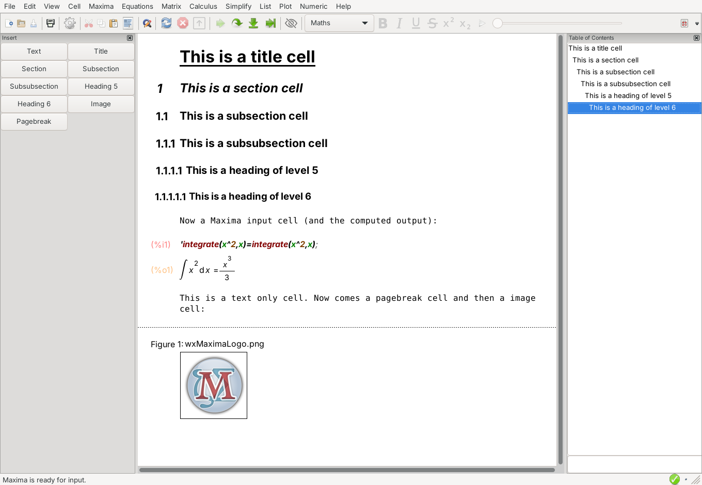
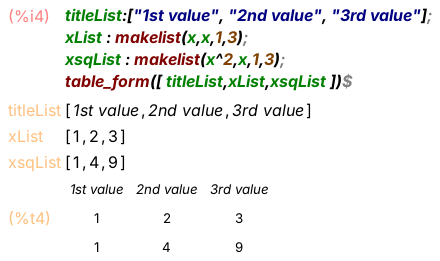

# El manual de usuario de wxMaxima

WxMaxima es un interfaz gráfico del usuario (IGU) para el sistema algebraico
de computación _Maxima_ (CAS). WxMaxima le permite a uno utilizar todas las
funciones de _Maxima_.  Además, proporciona asistentes convenientes para
acceder a las características más comúnmente utilizadas.  Este manual
describe alguna de las características que hacen de wxMaxima una de las IGU
más populares para _Maxima_.

{ id=img_wxMaximaLogo }

______________________________________________________________________

# Introducción a wxMaxima

## _Maxima_ y wxMaxima

En el dominio de código abierto, los sistemas grandes están divididos
normalmente en proyectos más pequeños que son más fáciles para manipular en
grupos pequeños de desarrolladores.  Por ejemplo un programa para el quemado
del DVD consistirá de una herramienta de línea de instrucciones que
actualmente quema el CD un interfaz gráfico de usuario que permite a los
usuarios implementarlo sin tener que aprenderse todas las opciones de línea
de instrucciones como complemento “enviar-a-CD” para una aplicación de
gestión de archivos, para la función N “quemar a CD” de un reproductor de
música y como el grabador de CD para una herramienta de respaldo DVD.  Otra
ventaja es que dividiendo una tarea grande en partes más pequeñas permite a
los desarrolladores proporcionar varios interfaces de usuarios para el mismo
programa.

Un sistema de computación algebraico (CAS) como _Maxima_ encaja dentro de
este marco referencial. Un CAS puede proporcionar la lógica detrás de la
aplicación de precisión de cálculo arbitrario o puede hacer transformaciones
automáticas de fórmulas en el segundo plano de un sistema más grande (p.e.,
[Sage] (https://www.sagemath.org/)).  Alternativamente, puede ser utilizado
directamente como un sistema independiente.  _Maxima_ pude ser accedido vía
una línea de instrucción.  A menudo, sin embargo, un interfaz como
_wxMaxima_ proporciona una manera más eficiente para acceder al software,
especialmente para los recién llegados.

### _Maxima_

_Maxima_ es un sistema algebraico computador completo (CAS) de
características. Un CAS es un programa que puede resolver problemas
matemáticos reconociendo fórmulas y encontrando una fórmula que resuelva el
problema como difícil a ajustar la salida del valor numérico del resultado.
En otras palabras, _Maxima_ pude servir como una calculadora que proporciona
representaciones numéricas de variables, y además puede proporcionar
soluciones analíticas.  Más aún, ofrece un rango de métodos numéricos para
ecuaciones o sistemas de ecuaciones que no pueden ser analíticamente
resueltos.

{
id=img_maxima_pantallazo }

Hay abundante documentación de _Maxima_  [disponible en internet](https://maxima.sourceforge.io/documentation.html). Parte de ella también está accesible desde el menú de ayuda de wxMaxima. Al pulsar la tecla de ayuda (en la mayoría de los sistemas, la tecla <kbd>F1</kbd>), la ayuda contextual de _wxMaxima_ salta automáticamente a la página del manual de _Maxima_ que describe la instrucción que está bajo el cursor.

### WxMaxima

_WxMaxima_ es un interfaz gráfico de usuario que proporciona la
funcionalidad y flexibilidad completa de _Maxima_. WxMaxima ofrece a los
usuarios una pantalla gráfica y varias características que hacen trabajar
más fácilmente con _Maxima_.  Por ejemplo _wxMaxima_ permite a uno exportar
cualquier contenido de celdas (o, si eso es necesario, cualquier parte de
una fórmula, también) como texto, como LaTeX o especificación MathML en una
sola pulsación secundaria.  Por cierto, puede exportarse un cuaderno
completo, ya sea como un archivo HTML o como un archivo LaTeX.  La
documentación para _wxMaxima_, incluyendo los cuadernos para ilustrar
aspectos de su uso, está por conexión al [sitio
web](https://wxMaxima-developers.github.io/wxmaxima/help.html) de
_wxMaxima_, así como a través del menú de ayuda.

{ id=img_wxMaximaWindow }

Los cálculos que son introducidos en _wxMaxima_ son realizados por la
herramienta de línea de instrucciones de _Maxima_ en el segundo plano.

## Conceptos básicos de la hoja de trabajo

Mucho de _wxMaxima_ son auto-explicativos, pero algunos detalles requieren
atención.  [Este
sitio](https://wxMaxima-developers.github.io/wxmaxima/help.html) contiene un
número de cuadernos que dirige varios aspectos de _wxMaxima_.  Trabaja a lo
largo de estos (particularmente el tutorial de «10 minutos _(wx)Maxima_»)
incrementará la familiaridad de uno con ambos del contenido de _Maxima_ y el
uso de _wxMAxima_ para interactuar con _Maxima_.  Este manual se concentra
en describir aspectos de _wxMaxima_ que no son como los evidentes y que tal
vez no está cubierto dentro del material en línea.

### El enfoque de la hoja de trabajo

Una de las muy pocas cosas que no están normalizadas en _wxMaxima_ es que se
organiza los datos para _Maxima_ dentro de celdas que son evaluadas (la cual
indica: envía a _Maxima_) solamente cuando solicita el usuario esto.  Cuando
una celda es evaluada, todas las instrucciones dentro de esa celda, y
solamente esa celda, son evaluadas como un guion. (El enunciado precedente
no es muy preciso: uno puede seleccionar un conjunto de celdas adyacentes y
evaluarlas a la vez. Además, uno puede instruir a _Maxima_ que evalúe todas
las celdas dentro de un cuaderno en una pasada). La aproximación de
_wxMaxima para enviar instrucciones para ejecutar tal vez se sienta poco
familiar en el primer momento. Sin embargo, drásticamente trabaja fácilmente
con documentos grandes (cuando el usuario no desea cada modificación para
disparar automáticamente una re-evaluación completa del todo el documento).
Además, esta aproximación es muy útil para depurar.

Si el texto está tecleado en _wxMaxima_ automáticamente crea una celda de
hoja de trabajo nueva.  El tipo de esta celda puede ser seleccionado en la
barra de herramientas.  Si se crea una celda de código, la celda puede ser
enviada a _Maxima_, la cual causa que el resultado del cálculo es desplegado
debajo del código.  Una pareja de dichas instrucciones se muestra debajo.

{ id=img_InputCell }

En la evaluación de los contenidos de celda de entrada la celda _Maxima_ de
entrada asigna una etiqueta a la entrada (por defecto muestra en rojo y
reconocible por el `%i`) por el cual puede ser referenciado posteriormente
dentro de la sesión _wxMaxima_.  La salida que genera _Maxima_ además
obtiene una etiqueta que comience con `%o` y por defecto está oculta,
excepto si el usuario asigna la salida un nombre.  En este caso por defecto
el etiquetado definido por el usuario está desplegado.  El estilo `%o` de
etiquetado _Maxima_ auto-genera además será accesible, sin embargo.

Al lado de las celdas de entradas _wxMaxima_ permite celdas de texto para
documentación, celdas de imagen, celdas de título, celdas de capítulo y
celdas de sección.  Cada celda tiene su propio tampón para deshacer por lo
que se depura a través de modificar los valores de varias celdas y después
gradualmente es más fácil revertir las modificaciones no necesarias.  Además
la misma hoja de trabajo tiene un tampón global para deshacer que puede
deshacer celdas editadas, agregar y borrar.

La figura inferior muestra tipos de celda diferentes (celdas título,
sección, subsección, texto, E/S e imagen).

{ id=img_cell-example }

### Celdas

La hoja de trabajo está organizada dentro de celdas.  wxmaxima conoce los
tipos de celdas siguientes:

- Celdas matemáticas, que contienen una o más líneas de entrada para
  _Maxima_.
- La salida de _Maxima_ o una pregunta que este plantea.
- Celdas de imagen.
- Celdas de texto, que pueden usarse, por ejemplo, para documentar.
- Un título, una sección o una subsección. Hay 6 niveles de encabezado
  distintos.
- Saltos de página.

El comportamiento predeterminado de _wxMaxima_ cuando el texto es teclado
para creación automática de una celda matemática.  Las celdas de otros tipos
puede ser creadas utilizando el menú Celda, utilizando las teclas resaltadas
mostradas dentro del menú o utilizando el listado de arrastrar-bajar dentro
de la barra de herramientas.  Una vez que la celda no matemática es creada,
lo que se teclee dentro del archivo es interpretado como texto.

Un [comentario de texto]
(C-style)(https://maxima.sourceforge.io/docs/manual/maxima_singlepage.html#Comments)
puede ser parte de una celda matemática como sigue: `/* Este comentario será
ignorado por Maxima */`

"`/*`" marca el inicio del comentario, "`*/`" el final.

### Cursores horizontal y vertical

Si el usuario intenta seccionar una oración completa, un procesador de
palabras intentará extender la selección para iniciar y finalizar
automáticamente con una palabra acotada.  Así mismo, si está seleccionada
más de una celda, _wxMaxima_ extenderá la selección a todas las celdas.

Que no es estándar es que _wxMaxima_ proporciona flexibilidad para
arrastrar-y-soltar definiendo dos tipos de cursores. _wxMaxima_ conmutará
entre ellos automáticamente cuando lo necesite:

- El cursor es dibujado horizontalmente si es trasladado dentro del espacio
  entre dos celdas o pulsando allí.
- Un cursor vertical que funciona dentro de una celda. Este cursor se activa
  al mover el cursor al interior de una celda con el puntero del ratón o con
  las teclas de cursor, y funciona de forma muy parecida al cursor de un
  editor de texto.

Al arrancar wxMaxima solo se ve el cursor horizontal parpadeando. En cuanto se empieza a escribir, se crea automáticamente una celda matemática y el cursor pasa a ser un cursor vertical normal (como «prompt» se ve una flecha hacia la derecha; una vez evaluada la celda matemática (<kbd>CTRL</kbd>+<kbd>ENTRAR</kbd>), aparecen las etiquetas, p. ej. `(%i1)`, `(%o1)`).

{ id=img_horizontal_cursor_only }

Quizá desea crear un tipo de celda diferente (utilizando el menú «Celda»),
puede ser una celda titular o de texto, la cual describe que será hecho,
cuando inicia crear su hoja de trabajo.

Si navegas entre las celdas diferentes, además verá el (parpadeo) cursor
horizontal, donde puede insertar una celda a su hoja de trabajo (bien una
celda matemática, por tan solo inicie tecleando su fórmula - o un tipo de
celda diferente utilizando el menú).

{
id=img_horizontal_cursor_between_cells }

### Enviar celdas a Maxima

La instrucción de una celda de código se ejecuta al pulsar <kbd>CTRL</kbd>+<kbd>ENTRAR</kbd>, <kbd>MAYÚS</kbd>+<kbd>ENTRAR</kbd> o la tecla <kbd>ENTRAR</kbd> del teclado numérico. De forma predeterminada, _wxMaxima_ envía las instrucciones al pulsar <kbd>CTRL</kbd>+<kbd>ENTRAR</kbd> o <kbd>MAYÚS</kbd>+<kbd>ENTRAR</kbd>, pero _wxMaxima_ puede configurarse para que las ejecute al pulsar <kbd>ENTRAR</kbd>.

### Autocompletado de instrucciones

_WxMaxima_ incluye una función de autocompletado que se activa desde el menú (Celda/Palabra completa) o, alternativamente, con la combinación de teclas <kbd>CTRL</kbd>+<kbd>ESPACIO</kbd>. El autocompletado tiene en cuenta el contexto. Por ejemplo, si se activa dentro de una especificación de unidades para ezUnits, ofrece una lista de las unidades aplicables.

{ id=img_ezUnits }

Además de completar un nombre de archivo, un nombre de unidad o el nombre de la instrucción o variable actual, el autocompletado puede mostrar una plantilla para la mayoría de las instrucciones que indica el tipo (y el significado) de los parámetros que esperan. Para activar esta función, pulse <kbd>MAYÚS</kbd>+<kbd>CTRL</kbd>+<kbd>ESPACIO</kbd> o elija la entrada de menú correspondiente (Celda/Mostrar plantilla).

#### Caracteres griegos

Equipos tradicionalmente almacenados en valores 8-bit.  Esto permite para un
máximo de 256 caracteres diferentes.  Todas las letras, números t y símbolos
de control (final de transmisión, final de cadena, líneas y bordes para
dibujar rectángulos para menús :etc_.) de cerca cualquier idioma puede caber
dentro de ese límite.

Para muchos países, la página de código de 256 caracteres que han sido
elegidos no incluyen cosas como letras griegas, por lo que, eso es utilizado
frecuentemente en matemáticas.  Para solucionar este tipo de limitación
[Unicode] (https://home.unicode.org/) ha sido inventado: una codificación
que hace que el texto inglés funcione como normal, pero para utilizar más
que los 256 caracteres.

_Maxima_ permite Unicode si fue compilado utilizando un compilador Lisp que
o bien admite Unicode o que no tomen en cuenta acerca de la codificación
tipográfica.  Al menos una de este par de condiciones debe ser
cierta. _wxMaxima_ proporciona un método de introducción de caracteres
griegos utilizando el teclado:

- Puede introducir una tecla griega pulsando la tecla <kbd>ESC</kbd> y
  después pulsando la tecla del nombre del carácter griego.
- También puede introducirse pulsando <kbd>ESC</kbd>, una letra (o dos, en
  el caso de la letra griega ómicron) y de nuevo <kbd>ESC</kbd>. En este
  caso se admiten las siguientes letras:

| tecla | Letra griega | tecla | Letra griega | tecla | Letra griega |
|:-----:|:------------:|:-----:|:------------:|:---- :|:------------:|
|   a   |     alfa     |   i   |    iota      |   r   |     rho      |
|   b   |      beta    |   k   |    kappa     |   s   |    sigma     |
|   g   |     gamma    |   l   |    lambda    |   t   |     tau      |
|   d   |     delta    |   m   |      mu      |   u   |   upsilon    |
|   e   |    épsilon   |   n   |      nu      |   f   |      phi     |
|   z   |     zeta     |   x   |      xi      |   c   |      chi     |
|   h   |      eta     |  om   |    ómicron   |   y   |      psi     |
|   q   |     teta     |   p   |      pi      |   o   |     omega    |
|   A   |     Alfa     |   I   |     Iota     |   R   |      Ro      |
|   B   |      Beta    |   K   |     Kappa    |   S   |     Sigma    |
|   G   |     Gamma    |   L   |     Lambda   |   T   |      Tau     |
|   D   |     Delta    |   M   |      Mu      |   U   |    Upsilon   |
|   E   |    Épsilon   |   N   |      Nu      |   P   |      Phi     |
|   Z   |      Zeta    |   X   |      Xi      |   C   |      Chi     |
|   H   |      Eta     |  Om   |    Ómicron   |   Y   |      Psi     |
|   T   |     Teta     |   P   |      Pi      |   O   |     Omega    |

Además puede utilizar la barra lateral de «Teclas griegas» para introducir
las letras griegas.

##### Atención: caracteres de aspecto idéntico

Varias letras latinas se parecen a letras griegas, p. ej. la letra latina
«A» y la letra griega «Alfa». Aunque parecen idénticas, son dos caracteres
Unicode distintos, representados por puntos de código Unicode (números)
diferentes.

Esto puede causar problemas si se asigna un valor a la variable A y más
tarde se usa la letra griega Alfa para hacer algo con esa variable, sobre
todo en documentos impresos.  Para la letra griega my (que también se usa
como prefijo para micro) existen asimismo dos puntos de código Unicode
distintos.

Por eso la barra lateral «Letras griegas» ofrece la opción de no mostrar los
caracteres de aspecto idéntico (se puede cambiar con el menú del botón
derecho).

El mismo mecanismo también permite introducir algunos símbolos matemáticos
adicionales:

| teclas a introd| símbolos matemáticos                                  |
|----------------|-------------------------------------------------------|
| barh           | constante de Planck: una h con una barra a hor. sobre |
| barH           | una H con una barra hor. por encima de ésta           |
| 2              | al cuadrado                                           |
| 3              | al cubo                                               |
| /2             | 1/2                                                   |
| parcial        | signo parcial (la d de dx/dt)                         |
| integral       | signo integral                                        |
| sq             | raíz cuadrada                                         |
| ii             | imaginario                                            |
| ee             | elemento                                              |
| in             | en, dentro de                                         |
| impl implies   | implica                                               |
| inf            | infinito                                              |
| empty          | vacío                                                 |
| TB             | triángulo derecho grande                              |
| tb             | triángulo derecho pequeño                             |
| and            | y                                                     |
| or             | o                                                     |
| xor            | ¬o                                                    |
| nand           | ¬y                                                    |
| nor            | ¬o                                                    |
| equiv          | equivalente                                           |
| not            | no                                                    |
| union          | unión                                                 |
| inter          | intersección                                          |
| subseteq       | subconjunto o igual                                   |
| subset         | subconjunto                                           |
| notsubseteq    | no subconjunto o igual                                |
| notsubset      | no subconjunto                                        |
| approx         | aproximadamente                                       |
| propto         | proporcional a                                        |
| neq != /= o #  | no igual a                                            |
| +/- o pm       | un signo suma/resta                                   |
| \<= o meq      | igual o menor que                                     |
| >= o Meq       | igual o Mayor que                                     |
| \<\< o ll      | mucho menor que                                       |
| >> o gg        | mucho mayor que                                       |
| equiv          | equivalente a                                         |
| qed            | final de prueba                                       |
| nabla          | un operador nabla                                     |
| sum            | signo suma                                            |
| prod           | signo producto                                        |
| exists         | existe signo                                          |
| nexists        | no existe signo                                       |
| parallel       | un signo paralelo                                     |
| perp           | un signo perpendicular                                |
| leadsto        | una cabecera de signo                                 |
| ->             | una flecha derecha                                    |
| -->            | una flecha derecha más grande                         |

Puede utilizar también los «Símbolos» de la barra lateral para introducir
estos símbolos matemáticos.

Si un símbolo especial no está en la lista, se puede introducir cualquier carácter Unicode pulsando <kbd>ESC</kbd> \[número del carácter (hexadecimal)\] <kbd>ESC</kbd>. Además, la barra lateral «Símbolos» tiene un menú contextual (botón derecho) que muestra una lista de todos los símbolos Unicode disponibles, que pueden añadirse a esta barra de herramientas o a la hoja de trabajo.

<kbd>ESC</kbd><kbd>6</kbd><kbd>1</kbd><kbd>ESC</kbd> therefore results in an `a`. While you type the number, the list of symbols shows the character it stands for and its Unicode name.

If the number also is the beginning of a symbol's name (`be` could be the start of `beta`, or the character ¾ with the number `be`), the name wins. A leading `0` or `u+` makes it a number: <kbd>ESC</kbd>`u+be`<kbd>ESC</kbd> and <kbd>ESC</kbd>`00be`<kbd>ESC</kbd> both result in a `¾`.

A letter with an accent that Unicode has no character of its own for, like a t with a bar on top of it, is a letter followed by a "combining" accent: <kbd>t</kbd><kbd>ESC</kbd><kbd>3</kbd><kbd>0</kbd><kbd>4</kbd><kbd>ESC</kbd> results in `t̄`, which _Maxima_ treats as a variable name like any other.

Symbols one needs often can be added to the "Symbols" sidebar in the "Options" tab of the configuration dialog (Edit -> Configure), where they can also be given a keyboard shortcut. A letter with accents counts as one symbol there and gets one button. The Greek letters and the symbols the sidebars show anyway can be given a keyboard shortcut there, too, or by right-clicking their button in the sidebar. A shortcut has to contain <kbd>Ctrl</kbd> or <kbd>Alt</kbd> or be a function key, and types its symbol while the worksheet has the keyboard focus. The configuration dialog warns if a menu entry already uses the same keys.

Note que muchos de estos símbolos (notablemente excepciones son los símbolos
lógicos) no tiene un significado especial dentro de _Maxima_ y por lo tanto
serán interpretados como caracteres ordinarios.  Si _Maxima_ está compilado
utilizando un Lisp que no admite caracteres Unicode quizá cause un mensaje
de error.

Puede ocurrir que, p. ej., los caracteres griegos o los símbolos matemáticos no estén incluidos en la tipografía seleccionada; en ese caso no se pueden mostrar.
Para resolverlo, elija otras tipografías (en: Editar -> Configurar -> Estilo).

### Sustitución de Unicode

wxMaxima will replace several Unicode characters with their respective Maxima expressions, e.g. `²` with `^2`, `³` with `^3`, `≠` with `#` or `≤` with `<=`.

Unicode characters that stand for a Maxima name are instead defined as
_Maxima_ aliases of that name when wxMaxima starts _Maxima_: `π` for `%pi`,
`ⅈ` for `%i`, `ⅇ` for `%e`, `∞` for `inf`, the (mathematical) Sigma sign
(which is not the same Unicode character as the corresponding Greek letter)
for `sum`, `∏` for `product`, `∫` for `integrate`, the square root sign for
`sqrt` and `⋀`, `⋁`, `⊻`, `⊼`, `⊽`, `⇒`, `⇔` and `¬` for `and`, `or`, `xor`,
`nand`, `nor`, `implies`, `equiv` and `not`. This means they work in files
loaded by `batch()` or `load()`, too, and `aliases` lists the names they
stand for. As _Maxima_ reads these characters as letters they need to be
separated from neighbouring names by spaces in such a file: `a⋀b` is a
variable name, `a ⋀ b` means `a and b`. In an input cell wxMaxima adds these
spaces automatically. It also puts parenthesis around a number or a variable
that directly follows the square root sign, so `√2` means `sqrt(2)`.

Unicode tiene varias fracciones «habituales» codificadas como un único punto
de código: `¼, ½, ¾, ⅐, ⅑, ⅒, ⅓, ⅔, ⅕, ⅖, ⅗, ⅘, ⅙, ⅚, ⅛, ⅜, ⅝, ⅞`

wxMaxima las sustituye por su representación en Maxima, p. ej. `(1/4)`,
antes de enviar la entrada a Maxima. También existen `⅟`, que se sustituye
por `1/`, y `↉` (usado en béisbol), que se sustituye por `(0/3)`.

Se recomienda usar **código de Maxima** (y no estos puntos de código
Unicode) en las celdas de entrada. Motivo: (a) es posible que la tipografía
usada para la entrada matemática no los contenga; (b) si guarda el documento
como archivo `wxm`, normalmente puede leerlo Maxima (en línea de órdenes),
donde estas sustituciones, por supuesto, no funcionan. Aun así, pueden
aparecer si copia y pega una fórmula de otro documento.

### Paneles laterales

Enlaces para las instrucciones de _Maxima_ más importantes, cosas como un
índice de contenido, ventanas con mensajes de depuración o un historial de
las últimas instrucciones emitidas pueden ser accedidas utilizando los
paneles laterales.  Puede ser habilitados utilizando el menú de "Vistas".
Todos ellos pueden ser trasladas a otras localización dentro o fuera de la
ventana de _wxMaxima.  Otro de los paneles útiles es el que permite
introducir letras griegas utilizando el ratón.

{
id=img_SidePanes }

En el panal lateral de "table de contenido", uno puede incrementar o
decrementar un encabezado tan solo pulsando sobre la cabecera con el botón
de ratón secundario y seleccionar el siguiente tipo de cabecera más alto o
bajo.

{ id=Sidepane-TOC-convert-headings
}

### Salida MathML

Varios procesadores de palabras y programas similares o bien reconocen
entradas de [MathML](https://www.w3.org/Math/) y lo insertan automáticamente
como una ecuación editable 2D - o bien (como LibreOffice 5.1) tiene un
editor de ecuación que ofrece una característica “importar MathML desde
portapapeles”.  Otros admiten matemáticas RTF.  _WxMaxima_ por lo tanto
ofrece varios apuntes dentro del menú a través de la pulsación secundaria
del menú.

### Pasting LaTeX or MathML formulas

**Edit → Paste LaTeX/MathML as Maxima Code** (also in the right-click menu) converts a formula from the clipboard into a _Maxima_ command, for example one copied from a paper, a web page or an equation editor. LaTeX may come with or without `$…$`, `\(…\)` or `\[…\]` around it, so `\int_0^1 \frac{\sin x}{x}\,dx` becomes `integrate(sin(x)/x,x,0,1)`. The command goes where the cursor is, or into a new code cell. MathML pasted into a code cell with the ordinary **Paste** is converted the same way, since nobody wants the XML in a code cell. If MathML copied with **Copy as MathML** is pasted back, the result is the original command: _wxMaxima_ adds it to the MathML as an annotation.

LaTeX and MathML describe what a formula looks like, not what it means, so
the conversion has to interpret it. Fractions, roots, powers, subscripts
(`x_1` becomes the name `x_1`, `a_{n+1}` the array element `a[n+1]`),
functions with or without parentheses (`\sin 2x`), `\frac{d}{dx}`, `f'(x)`,
integrals ending in `dx`, sums and products with limits, `\lim_{x\to 0}`,
`|x|` and matrices are understood. An `e` is Euler’s number, but an `i` is
only the imaginary unit when set upright (`\mathrm{i}`), as it more often is
an index. A product of a name and parentheses, like `x(y+1)`, is taken as a
product unless the name is `f`, `g`, `h` or longer than one letter. Anything
without a single meaning, like `\pm`, `\dots` or text, isn’t guessed at:
_wxMaxima_ says what it couldn’t convert instead. Check the command before
evaluating it.

### Soporte de Markdown

_WxMaxima_ ofrece un conjunto de convenciones de
[Markdown](https://es.wikipedia.org/wiki/Markdown) estándar que no colisione
con la notación matemática.  Una vez que estos elementos son listados de
puntos.

```text
Texto normal
 * Un elemento, nivel de sangría 1
 * Otro elemento en el nivel de sangría 1
   * Un elemento en un segundo nivel de sangría
   * Un segundo elemento en el segundo nivel de sangría
 * Un tercer elemento en el primer nivel de sangría
Texto normal
```

_WxMaxima_ reconoce el texto que empieza por caracteres `>` como cita en bloque:

```text
Texto normal
> cita cita cita cita
> cita cita cita cita
> cita cita cita cita
Texto normal
```

La salida TeX y HTML de _WxMaxima_ también reconoce `=>` y lo sustituye por el signo Unicode correspondiente:

```text
cogito => sum.
```

Otros símbolos que reconoce la exportación a HTML y TeX son `<=` y `>=` para comparaciones, una flecha doble con dos puntas (`<=>`), flechas simples (`<->`, `->` y `<-`) y `+/-` como el signo correspondiente. En la salida TeX se reconocen además `<<` y `>>`.

### Links in text cells

A web address in a text cell that starts with `http://`, `https://` or `mailto:` is shown as a link. Since clicking into a text cell places the cursor there, a link is followed by <kbd>CTRL</kbd>+clicking it (<kbd>CMD</kbd>+clicking on macOS), or by right-clicking it and choosing "Open Link"; hovering over it shows where it leads. The HTML export turns it into a link, the TeX export into a `\url{}`. Links are always recognized from the text itself, so nothing about them is stored in the file.

Links in a code cell's comments (`/* ... */`) work the same way. Elsewhere
in code, for example inside a string, an address is Maxima syntax and is not
a link.

The same goes for web addresses in _Maxima_'s output, for example in a string printed by `print("See https://wxmaxima-developers.github.io/wxmaxima/")`: <kbd>CTRL</kbd>+clicking the address or choosing "Open Link" from its context menu opens it, while a plain click still selects the output.

### Bold, italic, underlined and struck-through text

Text in a text cell, a title or a section heading can be made bold, italic,
underlined or struck through. Select the text and press the respective
button in the toolbar; pressing the button again removes that formatting
from the selection. With nothing selected the button switches the formatting
on or off for what is typed next. The buttons are hidden by right-clicking
the toolbar and unchecking "Text formatting buttons". Code cells cannot be
formatted: their colors already show the syntax of the code.

Superscript and subscript buttons work the same way: they make the text
smaller and raise it above or lower it below the line, as in E = mc² or
H₂O. A character cannot be both, so switching one of them on switches the
other off. A line that contains a superscript, a subscript or a character
that is taller than the font's usual ones, for example an emoji, gets as
much additional room as it needs.

The formatting is saved in `.wxmx` files. Older versions of _wxMaxima_ open
such a file without the formatting but keep all of the text. `.wxm` files,
the exports and the clipboard contain the text without its formatting.

### Atajos de teclado

Muchas teclas resaltadas pueden ser encontradas dentro del texto de los
respectivos menús.  Desde que son tomados actualmente desde el texto del
menú y por lo tanto puede ser adaptados por las traducciones de _wxMaxima_
para coincidir con las necesidades de los usuarios del teclado local, no lo
documentamos aquí.  Unas pocas teclas especiales o aliases, sin embargo , no
están documentadas dentro de los menús:

- <kbd>CTRL</kbd>+<kbd>MAYÚS</kbd>+<kbd>SUPR</kbd> borra una celda completa.
- <kbd>CTRL</kbd>+<kbd>TAB</kbd> o
  <kbd>CTRL</kbd>+<kbd>MAYÚS</kbd>+<kbd>TAB</kbd> activa el mecanismo de
  autocompletado.
- <kbd>MAYÚS</kbd>+<kbd>ESPACIO</kbd> introduce un espacio sin ruptura.

### Exploring output with the keyboard

A cell's output can be selected, and explored part by part, without a mouse:

- <kbd>DOWN</kbd> at the end of a cell's input selects the first result of
  its output. Further presses of <kbd>DOWN</kbd> and <kbd>UP</kbd> step
  through the results; past the last one the cursor leaves the cell. If you
  prefer <kbd>DOWN</kbd> to skip over the output, switch on "Up/Down keys
  skip over output" in the Worksheet tab of the configuration dialog.
- <kbd>ENTER</kbd> goes into the selected expression and selects its first
  part: the expression without its label, the numerator of a fraction, the
  name of a function, the first entry of a matrix, ... If the selection has
  no parts, <kbd>ENTER</kbd> opens a new input cell holding it, as it always
  did.
- <kbd>ESCAPE</kbd> selects what the selection is a part of. From a whole
  result it goes back into the cell's input.
- <kbd>LEFT</kbd> and <kbd>RIGHT</kbd> select the previous or next part at
  the same level. In a matrix all four arrow keys move from entry to entry.
- <kbd>SHIFT</kbd>+<kbd>LEFT</kbd> and <kbd>SHIFT</kbd>+<kbd>RIGHT</kbd>
  grow or shrink the selection over the neighbouring parts; in a matrix,
  <kbd>SHIFT</kbd> and any arrow key grow the selected entry into a block of
  entries.
- The context-menu key or <kbd>SHIFT</kbd>+<kbd>F10</kbd> opens the
  right-click menu for the selection, so it can be copied in any format.

### TeX sin procesar en la exportación a TeX

Si una celda de texto comienza con `TeX:` la exportación de TeX contiene el
texto literal que continua el marcador `TeX:`.  Utilizando esta
característica permite al apunte del marcado TeX sin el cuaderno _wxMaxima_.

## Formatos de archivo

El material desarrollado en una sesión _wxMaxima_ puede ser almacenado para
un posterior uso en cualquiera de estas tras maneras:

### .mac

Los archivos `.mac` son archivos de texto ordinarios que contienen
instrucciones de _Maxima_.  Pueden ser leídos utilizando la instrucción
`batch()` o `load()` de _Maxima_ o un apunte del menú de archivo del
«Archivo/Menú de archivo guion» de _wxMaxima_.

Un ejemplo se muestra debajo.  `Quadratic.mac` define una función y
posteriormente genera un tramado con `wxdraw2d()`.  Posteriormente el
contenido del archivo `Quadratic.mac` es representado y la función `f()`
nueva definida es evaluada.

{ id=img_BatchImage }

Atención: aunque el archivo `Quadratic.mac` tiene una extensión habitual de
_Maxima_ (`.mac`), solo puede leerlo _wxMaxima_, ya que la instrucción
`wxdraw2d()` es una extensión de wxMaxima para _Maxima_. Maxima (en línea de
órdenes) ignorará la instrucción desconocida `wxdraw2d()` y la volverá a
mostrar como salida.

Puede utilizar los archivos `.mac` para escribir su propia biblioteca de
macros.  Pero desde que no contengan suficiente información estructural no
pueden releer como una sesión _wxMaxima_.

### .wxm

Los archivos `.wxm` contienen la hoja de trabajo salvo la salida de _Maxima_. Con versiones de Maxima >5.38 se pueden leer con la función `load()` de _Maxima_, igual que los archivos .mac. Bueno, casi siempre. Las preguntas (como `asksign(x)`) son problemáticas, ya que la respuesta se escribe en el archivo `.wxm` (para poder sugerirla tras cargarlo), pero Maxima no puede evaluarla.
Se puede evitar que Maxima haga preguntas declarando con `assume()` las propiedades que Maxima quiere conocer.

Con este formato de texto plano, a veces es inevitable que las hojas de
trabajo que usan funciones nuevas no sean compatibles con versiones
anteriores de _wxMaxima_.

#### Formato de los archivos wxm

Esto es tan solo un archivo de texto simple (puede abrirlo con un editor de
texto), conteniendo el contenido de celda como algunos comentarios Maxima
especial.

Comienza con el siguiente comentario:

```maxima
/* [wxMaxima batch file version 1] [ DO NOT EDIT BY HAND! ]*/
/* [ Created with wxMaxima version 24.02.2_DevelopmentSnapshot ] */
```

Y entonces las celdas siguientes, codificados como comentarios Maxima,
p.ej., una celda de sección:

```maxima
/* [wxMaxima: section start ]
Title of the section
   [wxMaxima: section end   ] */
```

o (en una celda matemática la entrada es por supuesto *no* comentada afuera
(la salida no es guardada en un archivo `wxm`)):

```maxima
/* [wxMaxima: input   start ] */
f(x):=x^2+1$
f(2);
/* [wxMaxima: input   end   ] */
```

Imágenes están [codificadas en base64](https://es.wikipedia.org/wiki/Base64)
con el tipo de imagen como primera línea):

```maxima
/* [wxMaxima: image   start ]
jpg
[very chaotic looking character sequence]
   [wxMaxima: image   end   ] */
```

Un salto de página es tan solo una línea conteniendo:

```maxima
/* [wxMaxima: page break    ] */
```

Y las celdas encarpetadas marcadas por:

```maxima
/* [wxMaxima: fold    start ] */
...
/* [wxMaxima: fold    end   ] */
```

### .wxmx

Este archivo cuyo formato está basado en XML guarda la hoja de trabajo
completa incluyendo cosas como el factor de zoom y el listado de vigía.  Es
el formato de archivo preferido.

#### Formato de los archivos wxmx

Un archivo `wxmx` parece un formato binario, pero se puede manejar con
herramientas que incluye el sistema operativo. Es un archivo zip que se
puede descomprimir con `unzip` (quizá haya que renombrarlo antes para que el
programa de descompresión del sistema operativo lo reconozca).  No usamos la
función de compresión, sino solo la posibilidad de reunir varios archivos en
uno: las imágenes ya están comprimidas y el resto es texto simple
(probablemente mucho más pequeño que las imágenes grandes incluidas).

Contiene los siguientes archivos:

- `mimetype`: este archivo contiene el tipo MIME de los archivos de
  wxMaxima: `text/x-wxmathml`
- `format.txt`: una breve descripción de wxMaxima y del formato de archivo
  wxmx
- Imágenes (p. ej. png, jpeg): gráficos incrustados generados en la sesión
  de wxMaxima e imágenes incluidas.
- `content.xml`: un documento XML que contiene las distintas celdas del
  documento en formato XML.

Así que, si algo sale mal, se puede descomprimir un documento de wxMaxima
(quizá renombrándolo antes a archivo `zip`), hacer cambios en el archivo
`content.xml` con un editor de texto o sustituir una imagen dañada, volver a
comprimir los archivos y renombrar el `zip` a archivo `wxmx`, y se obtiene
un archivo `wxmx` modificado.

## Opciones de configuración

Para algunas configuraciones comunes de variables _wxMaxima_ ofrecen dos
maneras de configurarlas:

- La caja de diálogo de configuración de abajo le permite modificar sus
  valores predeterminados para las sesiones actuales y subsecuentes.
- Además, los valores de la mayoría de las variables de configuración pueden
  cambiarse solo para la sesión actual sobrescribiéndolos desde la hoja de
  trabajo, como se muestra a continuación.

{
id=img_wxMaxima_configuration_001 }

### Frecuencia de fotogramas predeterminada de las animaciones

La tasa del marco de animación que se utiliza para animaciones nuevas se
conserva dentro de la variable `wxanimate_framerate`.  El valor inicial de
esta variable contiene dentro una hoja de trabajo nueva que puede ser
modificada utilizando el diálogo de configuración.

### Tamaño predeterminado de los gráficos en nuevas sesiones de _maxima_

Tras el siguiente inicio, tramas empotradas a la hoja del trabajo será
creada con este tamaño si el valor de `wxplot_size` no es modificado por
_maxima_.

Con la intención de establecer el tamaño de trama de un grafo único
solamente utilice la notación siguiente puede ser utilizada que fija un
valor de variable solamente para una sola instrucción:

```maxima
wxdraw2d(
   explicit(
       x^2,
       x,-5,5
   )
), wxplot_size=[480,480]$
```

### Cerrar paréntesis automáticamente en los campos de texto

Esta opción habilita dos cosas:

- Si se introduce un paréntesis, un corchete o unas comillas de apertura,
  _wxMaxima_ inserta a continuación el de cierre.
- In a code cell a comment opened by `/*` is closed by an inserted
  `*/`. Typing `*/` in front of it moves the cursor past it instead.
- Si el texto está seleccionad si cualquiera de estas teclas es pulsada el
  texto seleccionado será puedes entre los signos coincidan.

### No guardar la hoja de trabajo automáticamente

Si esta opción está puesta, el archivo donde la hoja de trabajo será
sobrescrita solamente al solicitar el usuario.  En caso de un cuelgue/corte
de luz/... sin embargo, aún está disponible una copia de respaldo reciente
dentro del directorio temporal ‘temp’.

Si esta opción no está fijada _wxMaxima_ se comporta más como una app
telefónica moderna:

- Ficheros son guardados automáticamente al salir
- Y el archivo se guardará automáticamente cada 3 minutos.

### Arranging the toolbar

The toolbar is made of sections, like the "Open" and "Save" buttons, the
evaluation buttons or the drop-down list that sets the type of a cell. The
"Toolbar" tab of the configuration dialog lists them in the order the
toolbar shows them in: drag a section to another place, or select it and
press "Up" or "Down", to move it, and uncheck it to hide it. The flexible
space pushes every section after it to the right edge of the
window. "Default order" restores the original arrangement. Sections can also
be shown or hidden by right-clicking the toolbar.

### ¿Dónde se guarda la configuración?

En Unix/Linux, la configuración se guarda en el archivo `.wxMaxima` de su directorio personal (si usa wxWidgets \< 3.1.1) o en `.config/wxMaxima.conf` ((estándar XDG) si usa wxWidgets >= 3.1.1). Puede consultar la versión de wxWidgets con la instrucción `wxbuild_info();` o con la opción de menú Ayuda->Acerca de…. [wxWidgets](https://www.wxwidgets.org/) es la biblioteca de interfaz gráfica multiplataforma en la que se basa _wxMaxima_ (de ahí el `wx` del nombre).
(Como el nombre de archivo empieza por un punto, `.wxMaxima` o `.config` estarán ocultos).

Si está utilizando Windows, la configuración será almacenada dentro del
registro.  Encontrará los apuntes para _wxMaxima_ en la posición siguiente
dentro del registro:
`HKEY_CURRENT_USER\Software\wxMaxima`

______________________________________________________________________

# Extensiones de _Maxima_

_WxMaxima_ es primariamente un interfaz gráfico de usuario para _Maxima_.
Por lo tanto, su propósito principal es enviar órdenes a _Maxima_ y
comunicar los resultados de ejecutar esas órdenes.  En algunos casos, sin
embargo, _wxMaxima agrega funcionalidades a _Maxima_. La capacidad de
_wxMaxima_ para generar informes exportando un contenido del cuaderno a HTML
y LaTeX ha sido mencionado.  Esta sección considera algunas maneras que
_wxMaxima_ mejora la inclusión de gráficos dentro de una sesión.

## Variables con subíndice

<div id="wxsubscripts"></div>

Especificidades `wxsubscripts`, si (y como) _wxMaxima_ auto-suscribirá
nombres de variable:

Si es falso, la funcionalidad está apagada, wxMaxima no auto-suscribirá
parte de nombres de variable tras un subrayado.

Si está fijado a `all`, todo será escrito debajo tras un guion bajo (_).

Si está fijado a `true` (verdadero) los nombres de variables del formato
`x_y` están representados utilizando un subguion ‘if’

- `x` o `y` es una sola letra, o
- `y` es un número entero (puede tener más de un carácter).

{ id=img_wxsubscripts }

<div id="wxdeclare_subscripted"></div>

A variable the rules above don’t cover can still be declared as "to be
subscripted" using the command `wxdeclare_subscripted(variable_name);` or
`wxdeclare_subscripted([variable_name1,variable_name2,...]);` Declaring a
variable as subscripted can be reverted using the following command:
`wxdeclare_subscripted(variable_name,false);`, which also keeps a variable
the rules above do cover from being subscripted.

<div id="wxdeclare_subscript"></div>

`wxdeclare_subscript(text_snippet);` or
`wxdeclare_subscript([text_snippet1,text_snippet2,...]);` instead declares a
text snippet: every variable whose name ends in an underscore followed by
that snippet is subscripted, however long the two parts are.

Para establecer estos valores puede usar el menú «Vista->Autosuscribir».

## Información al usuario en la barra de estado

<div id="wxstatusbar"></div>

Las instrucciones de ejecución largas pueden proporcionar al usuario su
estado dentro de la barra de estado.  Esta comentario es sustituído por
cualquier comentario devuelto que es colocada allí (permitiendo utilizarlo
como un indicador de progreso) y es borrado tan pronto como la instrucción
actual enviada a _Maxima_ ha finalizado.  Es seguro de utilizar
`wxstatusbar()` incluso dentro de bibliotecas que tal vez sean utilizadas
con el simple _Maxima_ (como opuesto a _wxMaxima_): si _wxMaxima_ no está
presente la instrucción `wxstatusbar()` será tan solo dejada sin evaluar.

```maxima
for i:1 thru 10 do (
    /* Indicar al usuario hasta dónde hemos llegado */
    wxstatusbar(concat("Pass ",i)),
    /* (sleep n) es una función de Lisp que puede usarse */
    /* anteponiendo el carácter "?". Retrasa la */
    /* ejecución del programa (aquí: 3 segundos) */
    ?sleep(3)
)$
```

## Exportar la hoja de trabajo desde Maxima

<div id="wxworksheettohtml"></div>

La instrucción `wxworksheettohtml()` exporta la hoja de trabajo actual a un
archivo HTML desde una sesión de _Maxima_ en marcha, lo que resulta práctico
para exportar mediante guiones o por lotes. Al igual que `wxstatusbar()`,
puede usarse sin riesgo en código que quizá se ejecute también en _Maxima_
sin interfaz (de consola): si _wxMaxima_ no está presente, la instrucción
simplemente queda sin evaluar.

```maxima
wxworksheettohtml("report.html")$
wxworksheettohtml("report.html", flavor="svg", wxmx=true)$
```

Un nombre de archivo relativo se interpreta respecto al directorio de
trabajo de _Maxima_. Las opciones opcionales con palabra clave son:

| opción   | valores                                         | significado                                         |
| -------- | ----------------------------------------------- | --------------------------------------------------- |
| `flavor` | `mathml` (predeterminado), `mathjax`, `svg`, `bitmap` | cómo se representan las ecuaciones en la página exportada |
| `wxmx`   | `false` (predeterminado), `true`                | incrustar una copia descargable `.wxmx` de la sesión |

The images and the `.wxmx` copy are written into a folder named after the
HTML file, with `_htmlimg` appended. If "Embed images into the .html file"
is checked in the Export tab of the configuration dialog, they are embedded
into the HTML file instead, so it can be mailed as a single file.

Los valores de `flavor` corresponden a los formatos de ecuación que ofrece
el diálogo gráfico **Archivo → Exportar**: `mathml` genera una página
autónoma que no necesita conexión a internet, `mathjax` añade una
alternativa con MathJaX para los navegadores que aún no admiten MathML, y
`svg`/`bitmap` convierten cada ecuación en una imagen.

<div id="wxworksheettotex"></div>

La instrucción complementaria `wxworksheettotex()` exporta del mismo modo a
un archivo LaTeX (`.tex`):

```maxima
wxworksheettotex("report.tex")$
wxworksheettotex("report.tex", documentclass="report", documentclassoptions="12pt,a4paper")$
```

| opción                 | significado                                                          |
| ---------------------- | -------------------------------------------------------------------- |
| `documentclass`        | sustituye la `\documentclass` de LaTeX (p. ej. `"article"`, `"report"`) |
| `documentclassoptions` | sustituye sus opciones (p. ej. `"12pt,a4paper"`)                     |

Está previsto añadir `wxworksheettopdf()`.

## Gráficos

Tramar (teniendo fundamentalmente hacerlo con gráficas) es un lugar donde un
interfaz gráfico del usuario tendrá para proporcionar algunas extensiones
para el programa original.

### Incrustar un gráfico en la hoja de trabajo

<div id="wxplot2d"></div>
<div id="wxplot3d"></div>
<div id="wximplicit_plot"></div>
<div id="wxcontour_plot"></div>

_Maxima_ normalmente instrumenta el programa _Gnuplot_ externo para abrir
una ventana separada por cada diagrama que crea.  Debido a que muchas veces
es conveniente empotrar grafos a la hoja de trabajo en vez que _wxMaxima_
proporcione su propio conjunto de funciones de trama que no difieran desde
las funciones correspondientes a _maxima_ que guarda dentro de su nombre:
todo está prefijado por un “wx”.

Las siguientes funciones de tramado tienen contrapartes wx:

| Función tramado wxMaxima | Función de plot de Maxima                                                                       |
| ------------------------ | ----------------------------------------------------------------------------------------------- |
| `wxplot2d()`             | [plot2d](https://maxima.sourceforge.io/docs/manual/maxima_singlepage.html#plot2d)               |
| `wxplot3d()`             | [plot3d](https://maxima.sourceforge.io/docs/manual/maxima_singlepage.html#plot3d)               |
| `wxdraw2d()`             | [draw2d](https://maxima.sourceforge.io/docs/manual/maxima_singlepage.html#draw2d)               |
| `wxdraw3d()`             | [draw2d](https://maxima.sourceforge.io/docs/manual/maxima_singlepage.html#draw3d)               |
| `wxdraw()`               | [draw](https://maxima.sourceforge.io/docs/manual/maxima_singlepage.html#draw)                   |
| `wximplicit_plot()`      | [implicit_plot](https://maxima.sourceforge.io/docs/manual/maxima_singlepage.html#implicit_plot) |
| `wxhistogram()`          | [histogram](https://maxima.sourceforge.io/docs/manual/maxima_singlepage.html#histogram)         |
| `wxscatterplot()`        | [scatterplot](https://maxima.sourceforge.io/docs/manual/maxima_singlepage.html#scatterplot)     |
| `wxbarsplot()`           | [barsplot](https://maxima.sourceforge.io/docs/manual/maxima_singlepage.html#barsplot)           |
| `wxpiechart()`           | [piechart](https://maxima.sourceforge.io/docs/manual/maxima_singlepage.html#piechart)           |
| `wxboxplot()`            | [boxplot](https://maxima.sourceforge.io/docs/manual/maxima_singlepage.html#boxplot)             |

Si un archivo de `wxm` es leído por (consola) Maxima, estas funciones son
ignoradas (y escritas como salida, como otras funciones desconocidas en
Maxima).

Si tiene problemas con alguna de estas funciones, compruebe si el problema
también se da con la función de Maxima (p. ej., si obtiene un error con
`wxplot2d()`, pruebe el mismo gráfico con la instrucción de Maxima
`plot2d()`, que abre el gráfico en una ventana aparte). Si el problema no
desaparece, lo más probable es que sea un problema de Maxima y debería
comunicarse en el [gestor de errores de
Maxima](https://sourceforge.net/p/maxima/bugs/). O quizá sea un problema de
Gnuplot.

### Agrandar o reducir los gráficos incrustados

<div id="wxplot_size"></div>

Tal como notó arriba, el dialogo de configuración proporciona una manera de
modificar el tamaño de trama predeterminada lo cual fija el valor de inicio
de `wxplot_size`.  Las rutinas de tramado de _wxMaxima_ respeta esta
variable que especifica el tamaño de una trama en píxeles.  Siempre puede
ser solicitado o utilizado para fijar el tamaño de las tramas siguientes:

```maxima
wxplot_size:[1200,800]$
wxdraw2d(
    explicit(
        sin(x),
        x,1,10
    )
)$
```

Si el tamaño de solamente una trama va a ser modificada, _Maxima_
proporciona una manera canónica para modificar un atributo solamente para la
celda actual.  En este uso la especificación `wxplot_size = [valor1,
valor2]` es agregada a la instrucción `wxdraw2d( )`, y no es parte de la
instrucción `wxdraw2d`.

```maxima
wxdraw2d(
    explicit(
        sin(x),
        x,1,10
    )
),wxplot_size=[1600,800]$
```

Estableciendo el tamaño de trazas empotradas con `wxplot_size` funciona para
trazos empotrados utilizando p.e. instrucciones `wxplot`, `wxdraw`,
`wxcontour_plot` y `wximplicit_plot` y para animaciones empotradas con
instrucciones `with_slider_draw` y `wxanimate`.

<div id="wxplot_scale"></div>

`wxplot_size` tells _Gnuplot_ how many pixels to draw. If a plot is wider
than the window, _wxMaxima_ shrinks it until it fits. If one specific plot
is meant to be shown larger, even if that means it no longer fits on the
screen, or smaller than that, the variable `wxplot_scale` (default: `1`)
tells _wxMaxima_ to show it that many times as large as it would otherwise:

```maxima
wxdraw2d(
    explicit(
        sin(x),
        x,1,10
    )
),wxplot_scale=2$
```

Unlike a bigger `wxplot_size`, which makes the text and lines of a plot
smaller in relation to the plot, `wxplot_scale` makes everything larger, the
text included. The factor is stored in the worksheet with the plot, so it
survives saving and re-opening the file. It is respected by the same
commands as `wxplot_size`. If _wxMaxima_ shows plots as scalable vector
graphics (see "Create scalable plots" in the configuration dialog) they stay
sharp at any scale; a bitmap plot gets blurry if it is enlarged a lot.

A plot that should be wide but not high, for example a waveform, is better
made with `wxplot_size`: a wider `wxplot_size` gives more room for the data,
at the same height and with text of the same size. As such a plot would
normally be shrunk to fit into the window, which makes its text tiny again,
`wxplot_scale='native` tells _wxMaxima_ to show it at exactly the size
`wxplot_size` asks for, even if that is wider than the window:

```maxima
wxdraw2d(
    explicit(
        sin(10*x)*exp(-x/3),
        x,0,10
    )
),wxplot_size=[1600,300],wxplot_scale='native$
```

### Gráficos de mejor calidad

_Gnuplot_ parece no proporcionar una manera portable de determinar si admite
bitmap de salida de calidad alta que la biblioteca Cairo proporciona. En los
sistemas donde está compilado _Gnuplot_ para utilizar esta biblioteca la
opción pngCairo desde el menú de configuración (que puede ser sobrescrito
por la variable `wxplot_pngcairo`) habilita el mantenimiento para antialias
y estilos de línea adicional. Si `wxplot_pngCairo` está establecido sin
_Gnuplot_ admitiendo esto el resultado dará mensajes de error en vez de
gráficos.

### Abrir gráficos incrustados en ventanas interactivas de _Gnuplot_

Si fue generada una trama utilizando las instrucciones de tipo `wxdraw`
(`wxplot2d` y `wxplot3d` no son admitidas por esta característica) y el
tamaño del archivo del proyecto _Gnuplot_ subyacente no es una manera
demasiado buena que _wxMaxima_ ofrezca un menú de pulsación secundaria que
permita abrir el tramado dentro de una ventana interactiva de _Gnuplot_.

### Abrir la consola de órdenes de Gnuplot en ventanas `plot`

En MS Windows hay dos programas de Gnuplot, `gnuplot.exe` y `wgnuplot.exe`.
En el menú de configuración puede elegirse cuál usar. `wgnuplot.exe` ofrece
la posibilidad de abrir una ventana de consola en la que se pueden
introducir órdenes de _gnuplot_; `gnuplot.exe` no la ofrece. Por desgracia,
`wgnuplot.exe` hace que _Gnuplot_ «robe» el foco del teclado durante un
instante cada vez que se prepara un gráfico.

### Incrustar animaciones en la hoja de trabajo {#embedding-animations-into-the-spreadsheet}

Diagramas 3D tienden hacerlo difícil para lectura de datos
cuantitativos. Una alternativa viable sería asignar el 3er parámetro a la
rueda del ratón.  La instrucción `with_slider_draw` es una versión de
`wxdraw2d` que prepara múltiples tramados y permite conmutar entre ellos
moviendo el arrastre en la cima de la pantalla.  _wxMaxima_ permite exportar
esta animación como un gif animado.

Los primeros dos argumentos para `with_slider_draw` son el nombre de la
variable que está pasada entre las tramas y un listado de los valores de
estas variables.  Los argumentos que siguen son los argumentos ordinarios
para `wxdraw2d`:

```maxima
with_slider_draw(
    f,[1,2,3,4,5,6,7,10],
    title=concat("f=",f,"Hz"),
    explicit(
        sin(2*%pi*f*x),
        x,0,1
    ),grid=true
);
```

La misma funcionalidad para tramas de 3D es accesible como
‘with_slider:draw3d’, el cual permite rotación en tramas de 3D:

```maxima
wxanimate_autoplay:true;
wxanimate_framerate:20;
with_slider_draw3d(
    α,makelist(i,i,1,360,3),
    title=sconcat("α=",α),
    surface_hide=true,
    contour=both,
    view=[60,α],
    explicit(
        sin(x)*sin(y),
        x,-π,π,
        y,-π,π
    )
)$
```

Si el formato general de la trama es que pasa quizá sufra mover el tramado
tan solo un pequeño bit con el fin de crear su naturaleza 3D disponible a la
intuición:

```maxima
wxanimate_autoplay:true;
wxanimate_framerate:20;
with_slider_draw3d(
    t,makelist(i,i,0,2*π,.05*π),
    title=sconcat("α=",α),
    surface_hide=true,
    contour=both,
    view=[60,30+5*sin(t)],
    explicit(
        sin(x)*y^2,
        x,-2*π,2*π,
        y,-2*π,2*π
    )
)$
```

`with_slider_draw` and `with_slider_draw3d` make each frame out of a single
2D or 3D scene. `with_slider_draw_bare` instead hands the arguments that
follow the variable and its values to a plain `draw` command. Each frame can
therefore consist of several `gr2d` and `gr3d` scenes, and `draw`'s global
options like `columns` or `dimensions` can be used as well:

```maxima
with_slider_draw_bare(
    f,[1,2,3,4,5],
    columns=2,
    gr2d(
        title=concat("f=",f),
        explicit(sin(f*x),x,0,2*π)
    ),
    gr3d(
        explicit(sin(f*x)*cos(y),x,0,2*π,y,0,2*π)
    )
);
```

Like `with_slider_draw`, `with_slider_draw_bare` accepts `file_name="name"`,
which saves the animation as `name.gif` in Maxima's working directory. As
`draw` cannot turn a frame of several scenes into a single frame of a gif,
wxMaxima assembles that gif from the frames it shows, and the animation is
still shown in the worksheet. The gif file is only written when the command
is evaluated in wxMaxima.

<div id="with_slider"></div>
<div id="wxanimate"></div>

Para aquello más familiar con `trama` en vez de `dibujo`, hay un segundo
conjunto de funciones:

- `with_slider` y
- `wxanimate`.

<div id="wxanimate_framerate"></div>

Normalmente las animaciones son retro-reproducidas o exportadas con la parte
de marco elegida dentro de la configuración de _wxMaxima_.  Para establecer
la velocidad se reproduce una animación individual de vuelta a la variable
`wxanimate_framerate` puede utilizarse:

```maxima
wxanimate(a, 10,
    sin(a*x), [x,-5,5]), wxanimate_framerate=6$
```

Las funciones de animación utilizan las instrucciones `makelist` de _Maxima_
y por lo tanto comparte el escollo que el valor de variable del arrastre se
sustituye dentro de la expresión solamente si la variable es visible
directamente dentro de la expresión.  Por lo tanto el siguiente ejemplo
fallará:

```maxima
f:sin(a*x);
with_slider_draw(
    a,makelist(i/2,i,1,10),
    title=concat("a=",float(a)),
    grid=true,
    explicit(f,x,0,10)
)$
```

Si _Maxima_ solicita explícitamente sustituir el valor del tramado
deslizante funciona bien en su lugar:

```maxima
f:sin(a*x);
with_slider_draw(
    b,makelist(i/2,i,1,10),
    title=concat("a=",float(b)),
    grid=true,
    explicit(
        subst(a=b,f),
        x,0,10
    )
)$
```

### Abrir varios gráficos en ventanas simultáneas

Mientras no sean proporcionados por _wxMaxima_ esta característica de
_Maxima_ (sobre configuraciones que la admitan) algunas veces vienen
manualmente.  Los siguientes ejemplos vienen desde una carta desde Mario
Rodríguez al listado de correo de _Maxima_:

```maxima
load(draw);

/* Parábola en la ventana nº 1 */
draw2d(terminal=[wxt,1],explicit(x^2,x,-1,1));

/* Parábola en la ventana nº 2 */
draw2d(terminal=[wxt,2],explicit(x^2,x,-1,1));

/* Paraboloide en la ventana nº 3 */
draw3d(terminal=[wxt,3],explicit(x^2+y^2,x,-1,1,y,-1,1));
```

También es posible dibujar varios gráficos en la misma ventana (lo mismo se
puede hacer en Maxima de línea de órdenes con la instrucción estándar
`draw()`):

```maxima
wxdraw(
  gr2d(
    key="sin (x)",grid=[2,2],
    explicit(sin(x),x,0,2*%pi)),
  gr2d(
    key="cos (x)",grid=[2,2],
    explicit(cos(x),x,0,2*%pi))
);
```

### El panel lateral «Tramado utilizando Dibujo» (gráficos con draw)

La barra lateral «Tramado utilizando dibujo» oculta un generador de código
simple que permite generar escenas que hagan uso de alguna de la
flexibilidad del paquete _draw_ con el que _maxima_ viene.

#### 2D

Genera el esqueleto de una instrucción `draw()` que dibuja una escena 2D.
Esta escena posterior tiene que ser completada con instrucciones que generan
los contenidos de la escena, por ejemplo utilizando los botones dentro de
las filas debajo del botón "2D".

La característica de ayuda del botón 2D es que permite configurar la escena
como una animación en la cual una variable (por defecto es _t_) tiene un
valor diferente dentro de cada marco: a menudo un movimiento de trama 2D
permite una interpretación más fácil que el de datos dentro de uno sin
movimiento 3D.

#### 3D

Genera el esqueleto de una instrucción `draw()` que dibuja una escena 3D.
Si no está configurada ninguna escena 2D o 3D, todo de los otros botones
configuran una escena 2D que contenga la instrucción que el botón genera.

#### Expresión

Adjunta una trama común de una expresión como `sin(x)`, `x*sin(x)` o
`x^2+2*x-4` para la instrucción `draw()` el cursor actualmente está dentro.
Si no hay ninguna instrucción de dibujo en una escena 2D con la trama es
generada.  Cada escena puede ser completada con cualquier número de tramas.

#### Gráfico implícito

Intenta encontrar todos los puntos como una expresión `y=sin(x)`,
`y*sin(x)=3` o `x^2+y^2=4` es verdadero y trama de la curva resultante
dentro de la instrucción `draw()` el cursor actualmente está dentro.  Si no
hay instrucción de dibujo en escena de 2D con el trama es generado.

#### Tramado paramétrico

Para un paso de una variable desde un límite inferior a un límite superior y
utiliza dos expresiones como `t*sin(t)` y `t*cos(t)` para generar
coordenadas x, y (y en tramas 3D también z) de una curva que es puesta
dentro de la instrucción de actual del dibujo.

#### Puntos

Dibuja muchos puntos que pueden ser unidos opcionalmente.  Las coordenadas
de los puntos son tomados desde un listado de listas, una unimatriz 2D o un
listado o unimatriz por cada eje.

#### Título Diagramático

Dibuja un título sobre el final superior del diagrama,

#### Eje

Establece los ejes.

#### Contorno

(Solo para tramas 3D): agrega líneas de contorno similares a los que puedan
ser encontrados dentro de una asociación de una montaña a la trama de
instrucciones que continúe dentro de la instrucción ‘draw()’ actual y/o al
plano de tierra del diagrama.  Alternativamente, este asistente permite
descartar el dibujo de las curvas completamente.

#### Tramado nombrado

Agrega un apunte para leyenda mostrando el nombre del siguiente tramado de
la leyenda del diagrama. Un nombre vacío deshabilita generando apuntes de
leyenda para las tramas siguientes.

#### Color de línea

Establece el color de línea para las tramas seguidas que contiene la
instrucción de dibujo actual.

#### Color de relleno

Establece un color de relleno para tramas seguidas que contiene la
instrucción de dibujo actual.

#### Cuadrícula

Aparece un asistente que permite establecer las líneas de rejilla.

#### Precisión

Permite seleccionar un punto adecuado dentro de la velocidad versus
exactitud compensada que es parte de cualquier programa de trama.

### Cambiar la tipografía y su tamaño en los gráficos

Sobre todo con pantallas de alta resolución, el tamaño de letra
predeterminado puede resultar muy pequeño. En las instrucciones basadas en
`draw` se puede fijar la tipografía y su tamaño con opciones como `font=...`
y `font_size=...`, p. ej.:

~~~maxima
wxdraw2d(
     font="Helvetica",
     font_size=30,
     explicit(sin(x),x,1,10));
~~~

En las instrucciones `plot` (p. ej. `wxplot2d`, `wxplot3d`), la tipografía y
su tamaño se pueden fijar con la instrucción `gnuplot_preamble`, p. ej.:

~~~maxima
wxplot2d(sin(x),[x,1,10],
         [gnuplot_preamble, "set tics font \"Arial, 30\"; set xlabel font \",20\"; set ylabel font \",20\";"]);
~~~

Esto fija la tipografía de los números en Arial de tamaño 30, y el tamaño de
las etiquetas de los ejes x e y (xlabel e ylabel) en 20 (con la tipografía
predeterminada).

Para más información, consulte la documentación de Maxima y de Gnuplot.
Nota: Gnuplot parece tener problemas con tamaños de letra grandes; véase la
[incidencia 1966 de
wxMaxima](https://github.com/wxMaxima-developers/wxmaxima/issues/1966).

## Incrustar gráficos

Si el formato de archivo `.wxmx` está siendo utilizado empotrando archivos
dentro de un proyecto _wxMaxima_ puede ser hecho como fácilmente como por
arrastrar-y-soltar.  Pero algunas veces (por ejemplo si el contenido de la
imagen es modificado posteriormente sobre una sesión) es mejor decirle al
archivo que cargue la imagen al evaluar:

```maxima
show_image("man.png");
```

## Archivos de inicio

El diálogo de configuración de _wxMaxima_ ofrece editar dos archivos con
instrucciones que son ejecutadas al inicializar:

- Un fichero que contenga instrucciones que estén ejecutadas al iniciar
  _Maxima_: «maxima-init.mac»
- un archivo con instrucciones adicionales que se ejecutan cuando _wxMaxima_
  arranca _Maxima_: `wxmaxima-init.mac`

Por ejemplo, si Gnuplot está instalado en `/opt` (quizá en MacOS), puede
añadir `gnuplot_command:"/opt/local/bin/gnuplot"$` (o
`/opt/gnuplot/bin/gnuplot` o cualquier otra ruta) a estos archivos.

Estos archivos están en el directorio de usuario de Maxima (normalmente
`%USERPROFILE%/maxima` en Windows y `$HOME/.maxima` en otros sistemas). Su
ubicación puede averiguarse con la instrucción: `maxima_userdir;`

## Variables especiales wx...

<div id="wxfilename"></div>
<div id="wxdirname"></div>
<div id="wxplot_pngcairo"></div>
<div id="wxchangedir"></div>
<div id="wxanimate_autoplay"></div>
<div id="wxmaximaversion"></div>
<div id="wxwidgetsversion"></div>
<div id="wxdirs"></div>

- ‘wxsubscripts’ le dice a _Maxima_ si debería convertir los nombres de
  variables que contengan un guión bajo (‘R_150’ o lo similar) en variables
  sub-guion.  Vea ‘wxdeclare_subscript’ para detalles los cuales nombres de
  variables son convertidos automáticamente.
- `wxfilename`: esta variable contiene el nombre del fichero actualmente
  abierto en _wxMaxima_.
- `wxdirname`: esta variable contiene el nombre del directorio en el que
  está el archivo abierto actualmente en _wxMaxima_.
- `wxplot_pngcairo` indica si _wxMaxima_ intenta usar el terminal pngcairo
  de _Gnuplot_, que ofrece más estilos de línea y en general una mejor
  calidad gráfica.
- `wxplot_size` define la resolución de tramas empotradas.
- `wxchangedir`: en la mayoría de los sistemas _wxMaxima_ establece
  automáticamente el directorio de trabajo de _Maxima_ al directorio del
  fichero actual.  Esto permite la E/S del fichero (p.ej. a través de
  `read_matrix`) para trabajar sin especificar la ruta completa del fichero
  que tiene que ser leído o escrito.  En Windows algunas veces esta
  característica causa mensajes de error y por lo tanto puede ser puesta a
  `false` desde el dialogo de configuración.
- `wxanimate_framerate`: El número de marcos por segundo de las siguientes
  animaciones con las que tienen que ser representadas.
- `wxanimate_autoplay`: Reproduce automáticamente animaciones
  predeterminadamente?
- `wxmaximaversion`: devuelve el número de versión de _wxMaxima_.
- `wxwidgetsversion`: devuelve la versión de wxWidgets que usa _wxMaxima_.
- `wxdirs`: una estructura con las rutas que usa el propio _wxMaxima_, ya
  que estas varían según el empaquetador, la distribución y el sistema
  operativo:
  - `wxdirs@userconfdir`: el directorio en el que se guarda la configuración
    del usuario. Es el mismo directorio que `maxima_userdir` (véase más
    arriba): ambos apuntan al mismo lugar; `wxdirs@userconfdir` solo es útil
    si resulta más cómodo acceder a él desde un archivo `.mac` que a la
    variable del lado de Maxima.
  - `wxdirs@datadir`: el directorio en el que están instalados los datos
    propios de _wxMaxima_ (iconos, la lista integrada de autocompletado, …).
  - `wxdirs@helpdir`: el directorio en el que está instalada la copia local
    de este manual.
  - `wxdirs@localedir`: el directorio en el que están instalados los
    archivos de traducción de _wxMaxima_.
  - `wxdirs@maximalocation`: la ruta del ejecutable de _Maxima_ que
    _wxMaxima_ tiene configurado para arrancar.

## Presentación cuidada de salida 2D

<div id="table_form"></div>

La función `table_form()` representa un listado 2D dentro de un formulario
que es más legible que la salida desde la rutina de salida predeterminada de
_Maxima_. La entrada es un listado de uno o más listados. Como la
instrucción "print", esta instrucción representa la salida incluso cuando
finalizó con signo de dólar. Finalifilledzando la instrucción con un
resultado punto y coma devuelve el resultado en la misma tabla a lo largo
con un enunciado "done".

```maxima
table_form(
    [
        [1,2],
        [3,4]
    ]
)$
```

Como se muestra en el ejemplo siguiente, los listados que son ensamblados
por la instrucción ‘table_form’ pueden ser creados antes que la instrucción
sea ejecutada.

{
id=img_MatrixTableExample }

Además, porque una matriz es un listado de listados, las matrices pueden
convertirse a tablas de una aparición similar.

{
id=img_SecondTableExample }

<div id="wx_matrix"></div>

La función `wx_matrix()` es un envoltorio de la instrucción `matrix()` de
Maxima que permite dar a las matrices un formato más flexible en wxMaxima:

**`wx_matrix( <matrix>, [options] )`**

- **`lines=true`**: dibuja líneas de separación entre las celdas. Es
  necesario para separar visualmente los encabezados de los datos.
- **`rownames=true`**: indica a wxMaxima que la primera columna de la matriz
  contiene etiquetas.
- **`colnames=true`**: indica a wxMaxima que la primera fila de la matriz
  contiene etiquetas.
- **`parenstyle=<style>`**: establece el tipo de paréntesis o corchetes que
  se dibujan alrededor de la matriz. Los estilos admitidos son: `round`
  `()`, `square` `[]`, `angled` `<>`, `straight` `||` o `none`.
- **`oversized=<mode>`**: Decides how this one matrix is shown if it is too
  large for the window, whatever the option _Matrices too large for the
  window_ (see below) says: `full` draws it in full, `elide` leaves out its
  middle rows and columns, and `scroll` shows it in a box the size of the
  window, with scrollbars of its own.
- **`banding=<mode>`**: Decides whether every other row and column of this
  matrix is faintly shaded (see below): `true` always shades them, even if
  the matrix fits the window, `false` never does, not even in the window
  double-clicking opens, and `auto`, the default, shades them only if the
  matrix is too large for the window.

Ejemplo:

```maxima
wx_matrix(matrix(["Name", "Value"], ["X", 10], ["Y", 20]),
          lines=true, rownames=true, colnames=true, parenstyle=square);
```

`wx_matrix()` doesn't display anything itself: it returns the matrix with
the formatting attached, which is used whenever that value is displayed. So
it can be stored in a variable and displayed later, formatted, and a matrix
ended with `$` isn't displayed at all. A new matrix calculated from it, for
example by adding to it or transposing it, is displayed the normal way
again.

A matrix cannot be broken into lines the way a long sum can. So by default
wxMaxima leaves out the middle rows and columns of a matrix that is too
large for the window and marks the gap with `⋯`, `⋮` and `⋱`, the way a
large matrix is written by hand. The first and last rows and columns always
stay visible, and hovering the mouse over the matrix tells which rows and
columns are not shown. The option _Matrices too large for the window_ in the
_Worksheet_ tab of the configuration dialog can instead draw such a matrix
in full, which makes the whole worksheet scroll sideways, or show it in a
box the size of the window, with scrollbars of its own; there the mouse
wheel scrolls the worksheet, unless that matrix or something inside it is
selected, and such a matrix is printed with its middle rows and columns left
out. Whether it is elided or shown in a scrolling box, every other row and
column of such a matrix is faintly shaded, so that a row or a column is easy
to follow across it; a matrix that fits the window stays plain, unless
`wx_matrix()`'s `banding` option says otherwise. All of this affects only
what is shown on screen and printed: copying, saving and exporting the
matrix always include every entry. `wx_matrix()`'s `oversized` option
overrides that option for a single matrix; a matrix it asks to scroll is
still elided on paper, and exporting a matrix as an image still always shows
all of it. Double-clicking a matrix that is elided or shown in a scrolling
box opens a window of its own that shows all of it; the window can be
resized and scrolled, and _Escape_ closes it. _Ctrl+F_ in that window
searches the matrix: each match selects the entry it is in and scrolls it
into view, and searching again steps on to the next matching entry.

## Informar de errores

<div id="wxbuild_info"></div>
<div id="wxbug_report"></div>

_WxMaxima_ proporciona unas pocas funciones que obtenga información de
comunicados de fallos acerca del sistema actual:

- `wxbuild_info()` reúne información sobre la versión de _wxMaxima_ en
  ejecución
- `wxbug_report()` informa cómo y donde archivar los gazapos

## Resaltar en rojo partes de la salida

La instrucción `box()` de _Maxima_ causa que _wxMaxima_ escriba su argumento
con un fondo rojo, si el segundo argumento para la instrucción es el texto
`resaltado`.

## Representación de la salida.

Con `set_display()` se puede elegir cómo representa wxMaxima la salida.

`set_display('xml)` es el valor predeterminado. Con él, Maxima se comunica
con wxMaxima mediante un dialecto XML (legible por máquina), que puede verse
en la barra lateral «Monitor XML crudo», y las fórmulas resultantes se
muestran con una presentación cuidada: matrices, signos de raíz, fracciones,
etc.

<!--- Currently that does not work as it should, the line with the output label is shifted right (issue: #2006) -->
`set_display('ascii)` hace que wxMaxima muestre las fórmulas como Maxima en línea de órdenes, en arte ASCII.

`set_display('none)` produce resultados ASCII «de una línea», igual que la
instrucción `display2d:false;` en Maxima de línea de órdenes.

# Menú de ayuda

El menú de ayuda de wxMaxima proporciona acceso para el manual de Maxima y
wxMaxima, consejos, algunos ejemplos de hojas de trabajo y en la línea de
instrucción de Maxima incluyó demos (la instrucción `demo()`).

Infórmese, que las demos escriben:

~~~text
At the ’_’ prompt, type ’;’ and <enter> to proceed with the demonstration.
~~~

Esto vale para Maxima en línea de órdenes; en wxMaxima, en cambio, de forma predeterminada hay que continuar la demostración con: <kbd>CTRL</kbd>+<kbd>ENTRAR</kbd>

(Se puede configurar en el menú Configurar->Hoja de trabajo->«Teclas especiales para enviar instrucciones a ‘maxima’».)

______________________________________________________________________

# Solución de problemas

## The troubleshooting dialog

_Help > Troubleshooting_ checks the things that most often keep _wxMaxima_ from working: whether it finds _Maxima_, whether _Maxima_ starts, connects to _wxMaxima_, sends its first prompt and proves that it is the _Maxima_ _wxMaxima_ started, whether it accepts _wxMaxima_'s Lisp code and can load packages and `draw`, whether its temp directory is usable for plots, whether _gnuplot_ can draw `png` and `pngcairo` plots, whether _wxMaxima_ can stop _Maxima_ again, and whether the manuals, the help sidebar, a web browser, the translations, text in SVG images and the AI sidebar are available. For that it starts a _Maxima_ of its own, so the worksheet's _Maxima_ and anything it is calculating are left alone. The checks are grouped into pages (_Maxima_, packages and plots, help and manuals, user interface), each marked with the symbol of its most important result: a green check mark if everything works, a red cross if something doesn't. Selecting a line tells what was found and, for a problem, what can be done about it; _Copy report_ puts all of it on the clipboard, ready to be pasted into a bug report.

## No se puede conectar con _Maxima_

Desde _Maxima_ (el programa que hace las matemáticas actuales) y _wxMaxima_
(proporcionando el interfaz de usuario de uso-fácil) con programas separados
que se comunican por los medios de una conexión de red local.  Por lo tanto
la causa más probable es que esta conexión es algo que no funciona.  Por
ejemplo un cortafuegos pudo configurarse de una manera que no tan solo
impida conexiones no autorizadas desde Internet (y quizá intercepta algunas
conexiones de Internet, también), pero además bloquea la comunicación de
inter-procesos dentro del mismo equipo.  Nótese que desde _Maxima_ se está
ejecutando por un proceso Lisp la comunicación del proceso que está
bloqueado desde unos no necesariamente tiene que ser nombrado como
"maxima".  Los nombres comunes del programa que abre la conexión de red
sería sbcl, gcl, ccl, lisp.exe o nombres similares.

En las máquinas Un\*x otra razón posible sería que la red del bucle
invertido que proporciona conexiones de red entre dos programas dentro del
mismo equipo no está configurado apropiadamente.

## Cómo recuperar datos de un archivo .wxmx dañado

Internamente muchos formatos modernos basados en XML están normalmente en
archivos zip. _WxMaxima_ no activa la compresión, por lo que el contenido de
los archivos `.wxmx` pueden verse en cualquier editor de texto.

Si la firma zip en el final del archivo aún está intacta tras renombrar un
archivo `.wxmx` estropeado a `.zip` muchos sistemas operativos
proporcionarán una manera de extraer cualquier porción de información que
esté almacenada dentro de ésta.  Esto puede ser hecho cuando hay la
necesitad de recuperar los archivos de imagen original desde un documento de
procesamiento de texto.  Si la firma zip no está intacta que no necesita
estar el final del mundo: si _wxMaxima_ al guardar ha detectado que algo es
erróneo habrá un archivo `.wxmx~` cuyo contenido quizá ayude.

E incluso si no existe ese archivo: el archivo `.wxmx` es un formato contenedor y la parte XML se guarda sin comprimir. Se puede renombrar el archivo `.wxmx` a `.txt` y usar un editor de texto para recuperar la parte XML de su contenido (empieza por `<?xml version="1.0" encoding="UTF-8"?>` y termina en `</wxMaximaDocument>`. Antes y después de ese texto, el editor mostrará contenido binario ilegible).

Si un archivo de texto conteniendo solamente estos contenidos (p.ej. copiar
y pegar este texto a un archivo nuevo) es guardado como un archivo
terminando en `.xml`, _wxMaxima_ conocerá como recuperar el texto desde el
documento.

## Quiero ver información de depuración en pantalla antes de que termine mi instrucción

Normalmente _wxMaxima_ espera a la fórmula 2D completa para ser transferida
antes que comenzar a configurar el conjunto del tipo.  Esto guarda tiempo
para crear muchos intentos para tipos de teclas para solo ecuación
parcialmente completada.  Hay una instrucción `disp`, por lo que, eso
proporcionará salida de depuración inmediatamente y sin esperar a que la
instrucción de _Maxima_ finalice:

```maxima
for i:1 thru 10 do (
   disp(i),
   /* (sleep n) es una función de Lisp que puede usarse */
   /* anteponiendo el carácter "?". Retrasa la */
   /* ejecución del programa (aquí: 3 segundos) */
   ?sleep(3)
)$
```

Alternativamente uno puede buscar la instrucción `wxstatusbar()` arriba.

## Al dibujar solo aparece un sobre cerrado vacío con un mensaje de error

Esto significa que _wxMaxima_ no pudo leer el archivo _Maxima_ que fue
proporcionado a la instrucción _Gnuplot_ para crear.

Las posibles razones de este error son:

- La instrucción de tramado es parte de un paquete de tercera parte como
  ‘implicit_plot’ pero este paquete no fue cargado por la instrucción
  ‘load()’ de _Maxima_ porque está intentando puntear.
- _Maxima_ intentó hacer algo que la versión actualmente instalada de
  _gnuplot_ no es capaz de entender.  En este caso, un fichero terminando en
  `.gnuplot` localizado en el directorio, el cual la variable
  `maxima_userdir` está apuntando, contiene las instrucciones desde _Maxima_
  para _gnuplot_.  La mayoría del tiempo, estos contenidos del fichero
  contiene por lo tanto ayuda cuando se depura el problema.
- Gnuplot fue instruido para utilizar la biblioteca pngcairo que proporciona
  antialias y estilos de líneas adicionales, pero no fue compilado para
  admitir esta posibilidad.  Solución: Desmarque la casilla «Utilizar el
  terminal cairo para tramas» dentro del diálogo de configuración y no
  establezca `wxplot_pngcairo` a cierto desde _Maxima_.
- Gnuplot no saca un fichero «.png» válido.

## Dibujar una animación produce «error: undefined variable»

El valor de la variable desplazada por defecto únicamente es sustituido
dentro de la expresión que está para ser tramado si es visible ahí.
Utilizando una orden `subst` que sustituya la variable de arrastre dentro de
la ecuación para tramar soluciones que resuelvan este problema.  Al final de
la sección [Animaciones empotradas a la hoja de
cálculo](#embedding-animations-into-the-spreadsheet), puede consultar un
ejemplo.

## He perdido el contenido de una celda y deshacer no lo recuerda

Hay funciones de deshacer separadas para operaciones de celdas y para
modificaciones dentro de celdas tales que modifiquen son bajos que este a
veces ocurran.  Si no hay varios métodos para cubrir datos:

- _wxMaxima_ actualmente tiene dos características de deshacer: el búfer de
  deshacer global que está activo si ninguna celda está seleccionada y un
  deshacer por celda que está activo si el cursor está dentro de una celda.
  Es peor intentar utilizar ambas opciones con el fin de ver si un valor
  anterior aún puede ser accedido.
- Si todavía tiene una manera de encontrar cual etiqueta de _Maxima_ ha
  asignado a la celda tan solo teclee dentro de la etiqueta de la celda y
  sus contenidos aparecerán.
- Si no: no se asuste. En el menú “Vista” hay una manera de ver un panel
  histórico que muestra todas las instrucciones de _Maxima_ que han sido
  emitidas recientemente.
- Si nada más ayuda _Maxima_ contiene una característica de reproducción:

```maxima
playback();
```

## _WxMaxima_ arranca con el mensaje «Maxima process terminated.»

Una razón posible es que _Maxima_ no puede ser encontrada dentro de la
localización que está fijada dentro de la etiqueta “Maxima” del diálogo de
configuración de _wxMaxima_ y por lo tanto no ejecutará nada.  Estableciendo
la ruta a un _Maxima_ binario para el trabajo debería solucionar este
problema.

## Maxima calcula sin parar y no responde a la entrada

Es posible teóricamente que _wxMaxima_ no realiza que _Maxima_ ha finalizado
el cálculo y por lo tanto nunca está informado que puede enviar datos nuevos
a _Maxima_. Si esto es el caso “Disparar evaluación” tal vez re-sincronice
los dos programas.

## Mi _Maxima_ basado en SBCL se queda sin memoria

El compilador Lisp SBCL por defecto viene con un límite de memoria que lo
permite ejecutar incluso en equipos de bajo nivel.  Cuando compile un
paquete de software grande como Lapack u ocupándose con listados
extremadamente grandes de ecuaciones este límite tal vez sea demasiado
bajo.  Con el fin de extender los límites SBCL puede ser previsto con la
línea del parámetro de instrucción `--dynamic-space-size` que indica a SBCL
cuantos megabytes debería reservar.  Una ventana SBCL de 32-bit puede
reservar hasta 999 megabytes, una versión SBCL de 64-bit ejecutándose en
Windows pude ser instruido para utilizar más que la cantidad de 1280
megabytes compilando las necesidades Lapack.

Una manera de proporcionar a _Maxima_ (y por lo tanto SBCL) con parámetros
de línea de instrucción es el campo «Parámetros adicionales para Maxima» del
diálogo de configuración de _wxMaxima_.

{ id=img_sbclMemory }

## En Ubuntu la entrada a veces va lenta o ignora teclas

La instalación del paquete «ibus-gtk» debería resolver este problema.  Vea
[https://bugs.launchpad.net/ubuntu/+source/wxwidgets3.0/+bug/1421558](https://bugs.launchpad.net/ubuntu/+source/wxwidgets3.0/+bug/1421558))
para los detalles.

## _WxMaxima_ se detiene cuando _Maxima_ procesa caracteres griegos o diéresis

Si su _Maxima_ está basado en SBCL las siguientes líneas tienen que ser
agregadas a su `.sbclrc`:

```commonlisp
(setf sb-impl::*default-external-format* :utf-8)
```

La carpeta donde este archivo tiene que colocarse es específico del sistema
e instalación.  Pero cualquier _Maxima_ basada en SBCL que ya ha evaluado
una celda dentro de la sesión actual felizmente dirá donde puede ser
encontrada tras obtener la instrucción siguiente:

```maxima
:lisp (sb-impl::userinit-pathname)
```

## Nota sobre Wayland (distribuciones recientes de Linux/BSD)

Parecen ser emitidos con el Servidor de Pantalla Wayland y wxWidgets.
WxMaxima puede ser afectado, p.ej. esas barras laterales no son movibles.

Puede o bien desactivar Wayland y utilizar X11 en su lugar (globalmente) o
tan solo decir, que wxMaxima utilizaría el X Window System poniendo:
`GDK_BACKEND=x11`

P.ej. inicia wxMaxima con:

`GDK_BACKEND=x11 wxmaxima`

## La barra de menús desaparece en KDE Plasma

En algunas instalaciones de KDE Plasma, la barra de menús global desaparece
al hacer clic en ella.  Como se trata de un error del proxy del menú global,
la única forma de evitarlo es indicar a wxMaxima que use su propia barra de
menús en lugar de la global.  Para ello se establece: `UBUNTU_MENUPROXY=0`

A partir de la versión 26.05.0, wxMaxima intenta establecer esta variable
automáticamente si detecta un sistema afectado (KDE, Unity o Ubuntu con
versiones antiguas de wxWidgets).

Si la corrección automática falla, puede arrancar wxMaxima a mano con:

`UBUNTU_MENUPROXY=0 wxmaxima`

## ¿Por qué no se ofrece el navegador integrado del manual en mi PC con Windows?

O bien wxWidgets no fueron compilados con mantenimiento para webview2 o
webview2 de Microsoft no está instalado.

_Help/About_ lists which of the things the integrated browser needs this
wxMaxima has and which it is missing; the log window (_View/Toggle log
window_) shows the same list.

## ¿Por qué no funciona el navegador externo del manual en mi equipo Linux?

El explorador HTML quizá es una versión de «snap», «flatpack» o
«appimage». Todo de estos típicamente no puede acceder archivos que son
instalados en su sistema local. Otra razón quizá sea que «maxima» o
«wxMaxima» es instalado como un «snap», «flatpack» o algo más que no
proporciona el acceso al sistema hospedante para sus contenidos. Una tercera
razón sería que el manual HTML de maxima no está instalado y la conexión por
línea no puede ser accedida.

## ¿Puede _wxMaxima_ generar a la vez archivos de imagen y gráficos incrustados?

La hoja de trabajo empotra archivos .png. _wxMaxima_ permite al usuario
especificar donde serían generados:

```maxima
wxdraw2d(
    file_name="test",  /* la extensión .png se añade automáticamente */
    explicit(sin(x),x,1,10)
);
```

Si es un formato diferente para ser utilizado, es más fácil generar las
imágenes y después importarlas dentro de la hoja de trabajo de nuevo:

```maxima
load("draw");
pngdraw(name,[contents]):=
(
    draw(
        append(
            [
                terminal=pngcairo,
                dimensions=wxplot_size,
                file_name=name
            ],
            contents
        )
    ),
    show_image(printf(false,"~a.png",name))
);
pngdraw2d(name,[contents]):=
    pngdraw(name,gr2d(contents));

pngdraw2d("Test",
        explicit(sin(x),x,1,10)
);
```

## ¿Puedo fijar la relación de aspecto de un gráfico incrustado?

Use la variable `wxplot_size`:

```maxima
wxdraw2d(
    explicit(sin(x),x,1,10)
),wxplot_size=[1000,1000];
```

## Tras actualizar a MacOS 13.1, las instrucciones plot y/o draw muestran mensajes de error como

```text
1 HIToolbox 0x00007ff80cd91726 _ZN15MenuBarInstance22EnsureAutoShowObserverEv + 102
2 HIToolbox 0x00007ff80cd912b8 _ZN15MenuBarInstance14EnableAutoShowEv + 52
3 HIToolbox 0x00007ff80cd35908 SetMenuBarObscured + 408
...
```

Puede tratarse de un problema del sistema operativo. Desactivar la ocultación de la barra de menús (Ajustes del Sistema => Escritorio y Dock => Barra de menús) podría resolverlo. Para más información, véase la [incidencia #1746 de wxMaxima](https://github.com/wxMaxima-developers/wxmaxima/issues/1746).

## On MacOS `plot2d` or `draw` open no window, but print “Broken pipe”

A message like

```text
WARNING:
   Couldn't write to #<SB-SYS:FD-STREAM for "descriptor 9" {1002FC5EF3}>:
     Broken pipe
```

means that _Gnuplot_ stopped before _Maxima_ could send it the plot. On MacOS the usual reason is that MacOS blocks a _Gnuplot_ that was downloaded from the internet: since _Maxima_ starts _Gnuplot_ in the background, MacOS can't ask whether it may run. Starting _Gnuplot_ once from a Terminal, or allowing it in System Settings => Privacy & Security, tells MacOS that it may; `xattr -r -d com.apple.quarantine` followed by the path of _Gnuplot_ (for example `Gnuplot.app`) does the same. See [wxMaxima issue #1461](https://github.com/wxMaxima-developers/wxmaxima/issues/1461).

_XQuartz_ isn't needed for plots in separate windows: neither _wxMaxima_ nor
_Maxima_ chooses a _Gnuplot_ terminal for them, so _Gnuplot_ uses its own
default one. That is `qt` for a _Gnuplot_ from Homebrew and `aqua`
(AquaTerm) for one from MacPorts, both of which draw without _XQuartz_. Only
a _Gnuplot_ that offers nothing but its `x11` terminal, or `GNUTERM` set to
`x11`, needs _XQuartz_. Embedded plots (`wxplot2d`, `wxdraw` and friends)
never open a window and don't need any of this.

## Registro

Los mensajes de registro pueden ayudar a depurar problemas. WxMaxima puede registrar muchos sucesos. La mayoría de las entradas del registro son útiles para los desarrolladores, sobre todo en caso de problemas o errores. Si ejecuta una compilación «Release»,
la ventana de registro no se muestra de forma predeterminada; si ejecuta una versión de desarrollo, se muestra de forma predeterminada como segunda ventana. Esta ventana se puede activar y desactivar
con la entrada de menú «Vista->Toggle log window».

Los mensajes no se «pierden» si la ventana de registro no está visible: si
decide mostrarla más tarde, verá los mensajes anteriores (salvo que los haya
borrado).

Estos mensajes pueden ser útiles al redactar informes de errores (o al
intentar encontrar un error por su cuenta).

Los mensajes de registro pueden enviarse (además) a STDERR con la opción de
línea de órdenes «--logtostderr». En Windows se abre una consola de texto
aparte, ya que una aplicación gráfica de Windows no tiene conectada la E/S
estándar.

______________________________________________________________________

# Preguntas frecuentes

## ¿Hay alguna forma de que quepa más texto en una página LaTeX?

Sí.  Utilice el [paquete "geometry" de LaTeX](https://ctan.org/pkg/geometry)
para especificar el tamaño de los bordes.

Puede añadir la siguiente línea al preámbulo de LaTeX (por ejemplo, con el campo correspondiente del diálogo de configuración («Exportar»->«Líneas adicionales para el preámbulo de TeX»)) para fijar márgenes de 1 cm:

```latex
\usepackage[left=1cm,right=1cm,top=1cm,bottom=1cm]{geometry}
```

## ¿Existe un modo oscuro?

Si wxWidgets es suficientemente nuevo _wxMaxima_ automáticamente estará en
modo oscuro si el resto del sistema operativo también lo está.  La misma
hoja de trabajo por defecto está equipada con un fondo brillante.  Pero
puede ser configurado de otras maneras.  Alternativamente hay un apunte del
menú para ‘Ver/Invertir brillo de la hoja de trabajo’ para convertir
rápidamente la hoja de trabajo desde oscuro a claro y viceversa.

Most images are drawn for a white background, and black line art with a
transparent background would be invisible on a dark worksheet. So by
default, if the worksheet background is dark, the transparent parts of
images are filled with a backdrop color. Its color is the style _Backdrop of
transparent images_ in the _Style_ tab of the configuration dialog, and the
option _Behind transparent parts of images_ in its _Worksheet_ tab can
switch the backdrop off, or draw it on a bright worksheet, too.

## _WxMaxima_ a veces se bloquea unos segundos, una vez, durante el primer minuto

_WxMaxima_ delega algunas tareas grandes, como analizar el manual de más de 1000 páginas de _Maxima_, en tareas en segundo plano, lo que normalmente pasa totalmente desapercibido. Sin embargo, en el momento en que se necesita el resultado de una de esas tareas, puede que _wxMaxima_ tenga que esperar unos segundos antes de seguir trabajando.

## Sobre todo al probar nuevos ajustes de idioma, aparece un cuadro de mensaje «locale ’xx_YY’ can not be set»

{ id=img_locale_warning}

(El mismo problema puede suceder con otras aplicaciones también). Los
traslados parecen ok tras que pulse sobre ‘Aceptar’. Wxmaxima no solo
utiliza su propias transacciones sino también las transacciones del marco de
trabajo de wxWidgets.

Estos locales quizá no sean presente dentro del sistema. En sistemas
Ubuntu/Debian pueden ser generados utilizando: `dpkg-reconfigure locales`

## ¿Cómo puedo usar símbolos para los números reales, los naturales (ℝ, ℕ), etc.?

Puede encontrar estos símbolos en la barra lateral Unicode (busca
’doble-stuck capital’). Pero la tipografía seleccionada además debe mantener
estos símbolos. Si no representan apropiadamente, seleccione otra
tipografía.

## ¿Cómo puede un guion de Maxima saber si se ejecuta en wxMaxima o en Maxima de línea de órdenes?

Si se utiliza wxMaxima, la variable `maxima_frontend` de Maxima está fijada
a `wxmaxima`. La variable Maxima `maxima_frontend_version` contiene la
versión de wxMaxima en este caso.

Si no ningún frontend es utilizado (está utilizando Maxima en línea de
instrucción), estas variables son falsas.

### Is wxMaxima new enough for this worksheet?

<div id="wx_version_min"></div>

`wx_version_min("26.09.0")` returns `true` if the running _wxMaxima_ is at
least version 26.09.0, and `false` if it is older, or if the command runs in
command line _Maxima_. The parts of the version number are compared as
numbers, so 26.10.0 counts as newer than 26.9.0, and a part that is left out
counts as 0: `wx_version_min("26.9")` is the same as
`wx_version_min("26.09.0")`. A development version counts as the version it
will be released as.

_wxMaxima_ 26.08.0 and older don't know `wx_version_min()` yet. There, as
with any function _Maxima_ doesn't know, the call isn't an error: it just
returns itself, unevaluated, as `wx_version_min("26.09.0")`, which is
neither `true` nor `false`. So a plain `if wx_version_min("26.09.0") then
...` stays unevaluated on these versions, too. A worksheet that has to work
with them as well can compare the result with `true`, which gives `false`
there:

```maxima
if wx_version_min("26.09.0") = true then
    wx_matrix(M, oversized=scroll)
else
    M;
```

## ¡Socorro! ¡No puedo guardar mi documento!

Si guardar como archivo wxmx no funciona, intente guardar el documento como archivo wxm (y viceversa). También puede probar a quitar toda la salida (menú Celda->Quitar todas los resultados) y guardar el archivo; quizá alguna salida inesperada cause problemas al guardar.

______________________________________________________________________

# Argumentos de línea de órdenes

Usualmente puede iniciar programas con un interfaz gráfico de usuario tan
solo pulsando en un icono de escritorio o apunte de menú del
escritorio. wxMaxima -si inició desde la línea de instrucción- aún
proporciona algunos interruptores en línea de instrucción, sin embargo.

- ‘-v’ o ‘--version’: extrae la información de la versión
- ‘-h’ o ‘--help’: extrae un texto breve de ayuda
- `-o` u `--open=<cad>`: abre el nombre del archivo proporcionado como un
  argumento a este interruptor de línea de instrucción
- ‘-e’ o ‘--eval’: evalúa el archivo tras abrirlo.
- `-b` or `--batch`: If the command-line opens a file all cells in this file
  are evaluated and the file is saved afterward. This is for example useful
  if the session described in the file makes _Maxima_ generate output
  files. Batch-processing will be stopped if _wxMaxima_ detects that
  _Maxima_ has output an error and will exit if _Maxima_ asks a question no
  scripted answer exists for: Mathematics is somewhat interactive by nature
  so a completely interaction-free batch processing cannot always be
  guaranteed.
- `-d` or `--diff`: Compare 2 or 3 files side-by-side using the Diff viewer.
- `--single_process`: Open all worksheets from within the same process.
- `--single_thread`: Run all background tasks from within the main thread.
- `--logtostderr`:                 Log all "debug messages" sidebar messages to stderr, too.
- `--pipe`:                        Pipe messages from Maxima to stderr.
- `--debug`: Enable costly debug checks.
- `--exit-on-error`:               Close the program on any maxima error.
- `--language=<lang>`: Use this language for the user interface instead of the one configured in the settings, for example `de`, `pt_BR` or `zh_CN`. The setting is not saved. Useful for checking a translation, or for making screenshots for a translated manual.
- `-f` or `--ini=<str>`: Use the init file that was given as an argument to this command-line switch
- `-u`, `--use-version=<str>`:     Use maxima version `<str>`.
- `-l`, `--lisp=<str>`:              Use a Maxima compiled with Lisp compiler `<str>`.
- `-X`, `--extra-args=<str>`:        Allows to specify extra Maxima arguments
- `-m` or `--maxima=<str>`:    allows specifying the location of the _maxima_ binary
- `--enableipc`: Lets Maxima control wxMaxima via interprocess communications. Use this option with care.
- `--screenshot=<file>`: Evaluate the file that is opened, save a screenshot as `<file>` once _Maxima_ is idle and exit. What the screenshot shows is read from the `[Screenshot]` group of the configuration file given by `--ini`. Used for making the screenshots in this manual; see `info/screenshots/README.md` in wxMaxima's source code.
- `--wxmathml-lisp=<str>`:   Location of wxMathML.lisp (if not the built-in should be used, mainly for developers).

En vez de un menos, algunos sistemas operativos tal vez utilicen un guion
breve al frente de los conmutadores de línea de instrucciones.

On Linux and other Unix-like systems wxMaxima installs completions for bash, zsh and fish, so the <kbd>Tab</kbd> key completes these options and the names of the files wxMaxima can open.

A successful run exits with status 0. A batch run that had to stop before
finishing exits with one of the following statuses instead, so a script that
calls _wxMaxima_ can tell why it stopped without reading its log:

- `90`: _Maxima_ reported an error and `--exit-on-error` was given.
- `91`: _Maxima_ asked a question no scripted answer exists for.
- `92`: The file named on the command line could not be opened.
- `93`: Saving the worksheet failed.
- `94`: The data of an image in the worksheet could not be loaded.
- `95`: An image in the worksheet could not be decoded (only checked with
  `--debug`).

______________________________________________________________________

# Sobre el programa y cómo contribuir a wxMaxima

wxMaxima es principalmente desarrollado utilizando el lenguaje de
programación C++ utilizando el [marco de trabajo
wxWidgets](https://www.wxwidgets.org), como sistema de compilación
utilizamos [CMake](https://www.cmake.org), una parte pequeña escrita en
Lisp. Puede contribuir al proyecto wxMaxima en
<https://github.com/wxMaxima-developers/wxmaxima>, si tiene conocimiento de
estos lenguajes de programación y desea ayudar y contribuir al proyecto de
software libre de wxMaxima.

¡Pero no solamente los programadores son necesarios! Puede contribuir además
a wxMaxima, si ayuda para mejorar la documentación, encontrar e informar
defectos (y quizá repararlas), sugerir características nuevas, ayudar a
traducir wxMaxima o el manual a su idioma (lea el README.md en el
[subdirectorio de
idioma](https://github.com/wxMaxima-developers/wxmaxima/tree/main/locales)
como wxMaxima y el manual puede ser traducido).

O responda preguntas de otros usuarios en el foro de debate.

El código fuente de wxMaxima está documentado utilizando Doxygen
[aquí](https://wxmaxima-developers.github.io/wxmaxima/Doxygen-documentation/).

El programa es casi autónomo, por tanto excepto para bibliotecas del sistema
(y la biblioteca wxWidgets), ninguna dependencia externa (como archivos
gráficos o la parte Lisp (el archivo `wxmathML.lisp`) es necesario, se
incluyen estos archivos dentro del ejecutable.

Si es desarrollador y quiere probar un archivo `wxmathML.lisp` modificado sin recompilarlo todo, puede usar la opción de línea de órdenes `--wxmathml-lisp=<str>` para cargar otro archivo Lisp en lugar del incluido.
