# Manuel de l'utilisateur de wxMaxima

WxMaxima est une interface graphique (GUI) pour le système de calcul formel
(CAS) _Maxima_.  WxMaxima permet d’utiliser toutes les fonctions de
_Maxima_. De plus, il fournit des assistants pratiques pour accéder aux
fonctionnalités les plus couramment utilisées. Ce manuel décrit certaines
des caractéristiques qui font de wxMaxima l’une des interfaces graphiques
les plus populaires pour _Maxima_.

{ id=img_wxMaximaLogo }

______________________________________________________________________

# Présentation de wxMaxima

## _Maxima_ et wxMaxima

Dans le domaine open-source, les grands systèmes sont généralement divisés
en projets plus petits, plus faciles à gérer pour de petits groupes de
développeurs. Par exemple, un programme de gravure de CD peut se composer
d’un outil en ligne de commande qui effectue réellement la gravure du CD, et
d’une interface graphique permettant aux utilisateurs de l’utiliser sans
avoir à apprendre toutes les options de la ligne de commande, voire sans
jamais y recourir. Un avantage de cette méthode est que le travail de
développement réalisé dans le programme en ligne de commande peut être
partagé par de nombreuses applications : le même programme de gravure en
ligne de commande peut servir de module "Envoyer vers un CD",  pour un
gestionnaire de fichiers, de fonction "Graver sur CD" pour un lecteur
multimédia, ou encore de graveur de CD pour un outil de sauvegarde sur
DVD. Un autre avantage est que la division d’une tâche complexe en parties
plus réduites permet aux développeurs de proposer plusieurs interfaces
utilisateur pour un même programme.

Un système de calcul formel (CAS) comme _Maxima_ s'intègre dans ce cadre. Un
CAS peut fournir la logique derrière une application de type calculatrice à
précision arbitraire ou effectuer des transformations automatiques de
formules en arrière-plan d'un système plus large (par exemple,
[Sage](https://www.sagemath.org/)). Alternativement, il peut être utilisé
directement comme un logiciel autonome. _Maxima_ peut être accessible via
une ligne de commande. Cependant, une interface comme _wxMaxima_ s'avère
souvent un moyen plus efficace d'accéder au logiciel, surtout pour les
nouveaux utilisateurs.

### _Maxima_

_Maxima_ est un système complet de calcul formel (CAS). Un CAS est un
programme capable de résoudre des problèmes mathématiques en manipulant des
formules et en retournant des expressions algébriques qui résolvent le
problème, plutôt que de simplement fournir une valeur numérique du
résultat. Autrement dit, _Maxima_ peut fonctionner comme une calculatrice
qui donne  des valeurs numériques des variables, mais il peut aussi fournir
des solutions analytiques formelles. De plus, il propose une gamme de
méthodes numériques pour analyser des équations ou des systèmes d’équations
qui ne peuvent pas être résolus de manière formelle.

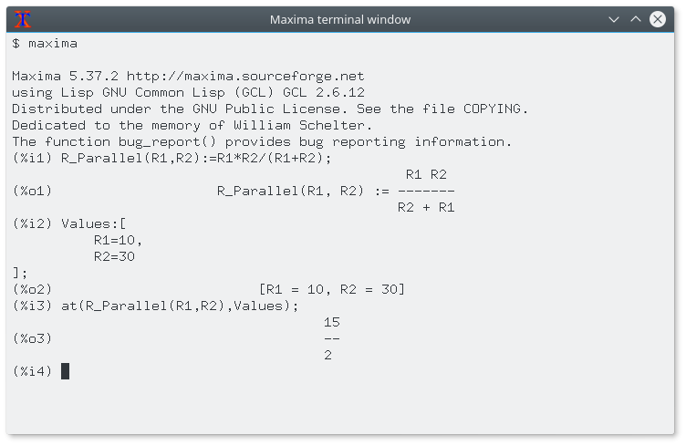{
id=img_maxima_screenshot }

Une documentation complète pour _Maxima_ est [disponible en ligne](https://maxima.sourceforge.io/documentation.html). Une partie de cette documentation est également accessible via le menu d’aide de wxMaxima. En appuyant sur la touche d’aide (généralement la touche <kbd>F1</kbd> sur la plupart des systèmes), la fonction d’aide contextuelle de _wxMaxima_ ouvre automatiquement la page du manuel de _Maxima_ correspondant à la commande située sous le curseur.

### WxMaxima

_WxMaxima_ est une interface graphique qui offre toutes les fonctionnalités
et la flexibilité de _Maxima_. WxMaxima propose aux utilisateurs un
affichage graphique ainsi que de nombreuses fonctionnalités qui facilitent
l’utilisation de _Maxima_. Par exemple, _wxMaxima_ permet d’exporter le
contenu de n’importe quelle cellule (ou, si nécessaire, une partie d’une
formule) sous forme de texte, de code LaTeX ou de codage MathML, simplement
en effectuant un clic droit. En outre, un notebook entier peut être exporté,
soit en tant que fichier HTML, soit en tant que fichier LaTeX. La
documentation de _wxMaxima_, incluant des notebooks d’exemples illustrant
ses différentes fonctionnalités, est disponible en ligne sur le [site d’aide
de wxMaxima](https://wxMaxima-developers.github.io/wxmaxima/help.html),
ainsi que via le menu d’aide.

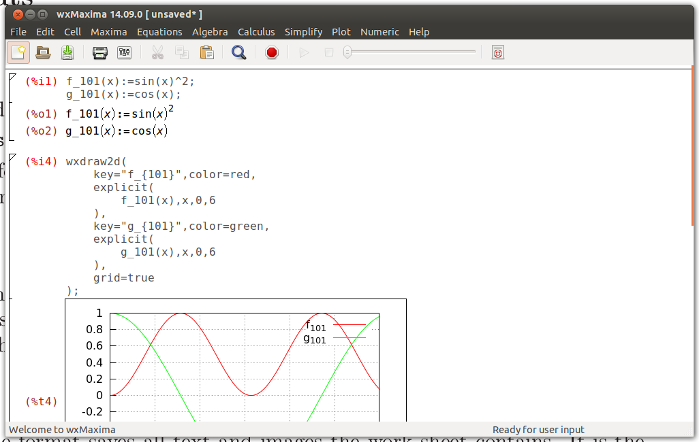{ id=img_wxMaximaWindow }

Les calculs saisis dans _wxMaxima_ sont exécutés en arrière-plan par l'outil
en ligne de commande _Maxima_.

## Notions de base d'un notebook

Une grande partie de wxMaxima est intuitive, mais certains détails
nécessitent une attention particulière. [Ce
site](https://wxMaxima-developers.github.io/wxmaxima/help.html) contient
plusieurs notebooks qui abordent divers aspects de _wxMaxima_. Parcourir
certains d’entre eux (notamment le « tutoriel de 10 minutes sur
(wx)Maxima ») permettra de mieux maîtriser à la fois le contenu de _Maxima_
et l’utilisation de _wxMaxima_ pour interagir avec _Maxima_. Ce manuel se
concentre sur la description des aspects de _wxMaxima_ qui ne sont pas
nécessairement évidents et qui pourraient ne pas être présentés dans les
ressources en ligne.

### Fondamentaux du notebook

L'une des très rares choses qui ne sont pas standard avec _wxMaxima_ est
qu'il organise les données pour _Maxima_ en cellules qui ne sont évaluées
(c'est-à-dire envoyées à _Maxima_) que lorsque l'utilisateur le
demande. Lorsqu'une cellule est évaluée, toutes les commandes de cette
cellule, et uniquement de cette cellule, sont évaluées en bloc. (La phrase
précédente n'est pas tout à fait exacte : on peut sélectionner un ensemble
de cellules adjacentes et les évaluer ensemble. On peut aussi demander à
_Maxima_ d'évaluer toutes les cellules d'un notebook  en une seule fois.)
L'approche de _wxMaxima_ pour exécuter les commandes peut sembler
inhabituelle au premier abord. Elle facilite cependant grandement le travail
avec de grands documents (où l'utilisateur ne souhaite pas que chaque
modification déclenche automatiquement une réévaluation complète de
l'ensemble du document). De plus, cette approche est très pratique pour le
débogage.

Si du texte est saisi dans _wxMaxima_, une nouvelle cellule est
automatiquement créée dans le notebook. Le type de cette cellule peut être
sélectionné dans la barre d'outils. Si une cellule de code est créée, elle
peut être envoyée à _Maxima_, ce qui affiche le résultat du calcul en
dessous du code. Une paire de ce type de commandes est présentée ci-dessous.

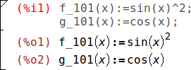{ id=img_InputCell }

Lors de l’évaluation du contenu d’une cellule d’entrée, _Maxima_ attribue un
identifiant à l’entrée (affiché par défaut en rouge et reconnaissable par le
`%i`), ce qui permet d’y faire référence plus tard dans la session
_wxMaxima_. La sortie générée par _Maxima_ reçoit également un identifiant
commençant par `%o`, masqué par défaut, sauf si l’utilisateur attribue un
nom à cette sortie. Dans ce cas, l’identifiant défini par l’utilisateur
s’affiche par défaut, mais l’identifiant automatique de type `%o` reste
accessible.

Outre les cellules d’entrée, _wxMaxima_ permet d’insérer des cellules de
texte pour la documentation, des cellules d’image, des cellules de titre, de
chapitre et de section. Chaque cellule dispose de son propre historique
d’annulation, ce qui facilite le débogage en modifiant les valeurs de
plusieurs cellules puis en annulant progressivement les changements
inutiles. De plus, le notebook en lui-même possède un historique
d’annulation global qui permet d’annuler les modifications, ajouts et
suppressions de cellules.

La figure ci-dessous montre différents types de cellules (cellules de titre,
cellules de section, cellules de sous-section, cellules de texte, cellules
d’entrée/sortie et cellules d’image).

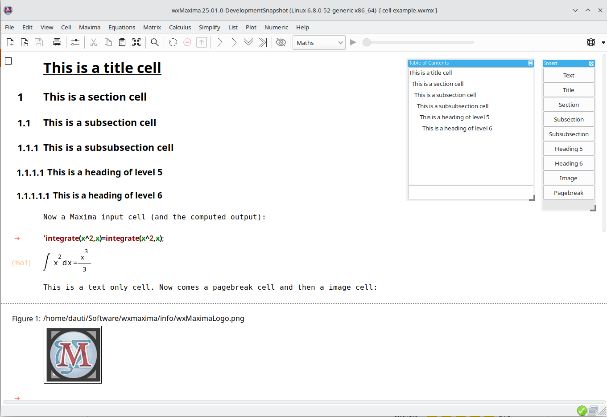{
id=img_cell-example }

### Cellules

Le notebook est organisé en cellules. WxMaxima distingue les types de
cellules suivants  :

- Cellules mathématiques, contenant une ou plusieurs lignes de saisie
  _Maxima_.
- Sortie de, ou une question de, _Maxima_.
- Cellules image.
- Cellules de texte, qui peuvent par exemple être utilisées pour la
  documentation.
- Un titre, une section ou une sous-section. 6 niveaux de titres différents
  sont possibles.
- Sauts de page.

Par défaut, _wxMaxima_ crée automatiquement une cellule de calcul lorsque du
texte est saisi. Pour créer des cellules d’un autre type, utilisez le menu
Cellule, les raccourcis clavier indiqués dans ce menu ou la liste déroulante
de la barre d’outils. Une fois qu’une cellule non mathématique est créée,
tout ce qui y est saisi est interprété comme du texte.

Un [commentaire (style
C)](https://maxima.sourceforge.io/docs/manual/maxima_singlepage.html#Comments)
peut être inséré dans une cellule de calcul comme suit : `/* Ce commentaire
sera ignoré par Maxima */`

"`/*`" indique le début du commentaire, "`*/`" la fin.

### Curseurs horizontaux et verticaux

Si l’utilisateur tente de sélectionner une phrase complète, un traitement de
texte étendra automatiquement la sélection pour qu’elle commence et se
termine aux limites d’un mot. De même, si plusieurs cellules sont
sélectionnées, _wxMaxima_ étendra la sélection aux cellules entières.

Ce qui est moins conventionnel, c’est que _wxMaxima_ offre une facilité de
glisser-déposer en définissant deux types de curseurs. _wxMaxima_ basculera
automatiquement entre eux selon le besoin :

- Le curseur est dessiné horizontalement s’il est déplacé dans l’espace
  entre deux cellules ou en cliquant à cet endroit.
- Un curseur vertical qui fonctionne à l’intérieur d’une cellule. Ce curseur
  est activé en déplaçant le curseur à l’intérieur d’une cellule à l’aide du
  pointeur de la souris ou des touches de direction, et fonctionne de
  manière similaire à celui d’un éditeur de texte.

Quand vous lancez wxMaxima, vous ne verrez que le curseur horizontal clignotant. Si vous commencez à taper, une cellule mathématique sera automatiquement créée et le curseur deviendra un curseur vertical classique (vous verrez une flèche vers la droite comme "invite", et après avoir évalué la cellule mathématique (<kbd>CTRL</kbd>+<kbd>ENTRÉE</kbd>), les étiquettes apparaîtront, par exemple `(%i1)`, `(%o1))`.

{ id=img_horizontal_cursor_only }

Vous pourrez peut-être vouloir créer un type de cellule différent (via le
menu "Cellule"), comme une cellule de titre ou une cellule de texte, pour
décrire ce que vous allez faire lorsque vous commencerez à créer votre
notebook.

Si vous naviguez entre les différentes cellules, vous verrez également le
curseur horizontal (clignotant), indiquant l'endroit où vous pouvez insérer
une nouvelle cellule dans votre notebook (soit une cellule mathématique, en
commençant simplement à saisir votre formule, soit un autre type de cellule
en utilisant le menu).

{
id=img_horizontal_cursor_between_cells }

### Envoyer des cellules à Maxima

La commande dans une cellule de code est exécutée en appuyant une fois sur <kbd>CTRL</kbd>+<kbd>ENTRÉE</kbd>, <kbd>MAJ</kbd>+<kbd>ENTRÉE</kbd> ou la touche <kbd>ENTRÉE</kbd> du pavé numérique. Par défaut, _wxMaxima_ exécute les commandes lorsque <kbd>CTRL</kbd>+<kbd>ENTRÉE</kbd> ou <kbd>MAJ</kbd>+<kbd>ENTRÉE</kbd> est pressé, mais il est possible de configurer _wxMaxima_ pour qu’il exécute les commandes en réponse à la touche <kbd>ENTRÉE</kbd>.

### Complétion automatique des commandes

_wxMaxima_ dispose d’une fonction de complétion automatique, accessible via le menu (Cellule/Compléter le mot) ou en appuyant sur la combinaison de touches <kbd>CTRL</kbd>+<kbd>ESPACE</kbd>. Cette complétion est sensible au contexte : par exemple, si elle est activée lors d'une spécification d’unité pour ezUnits, elle proposera une liste des unités applicables.

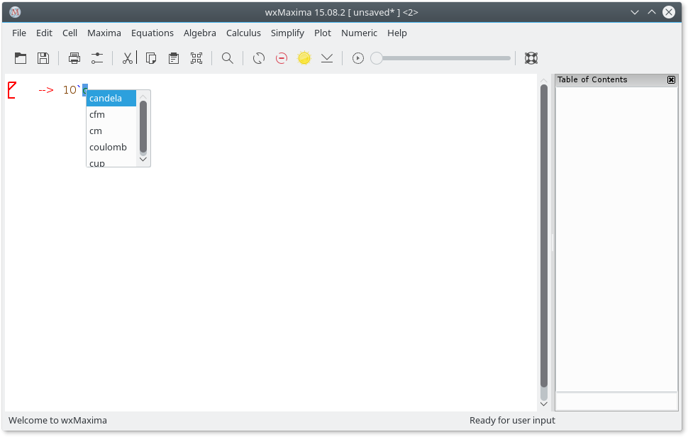{ id=img_ezUnits }

Outre la complétion des noms de fichiers, d’unités, de commandes ou de variables, la complétion automatique peut aussi afficher un modèle pour la plupart des commandes, indiquant le type (et la signification) des paramètres attendus par le programme. Pour activer cette fonctionnalité, appuyez sur <kbd>MAJ</kbd>+<kbd>CTRL</kbd>+<kbd>ESPACE</kbd> ou sélectionnez l’option correspondante dans le menu (Cellule/Afficher le modèle).

#### Caractères grecs

Traditionnellement, les ordinateurs stockaient les caractères sur 8 bits, ce
qui permet un maximum de 256 caractères différents. Toutes les lettres,
chiffres et symboles de contrôle (fin de transmission, fin de chaîne, lignes
et bordures pour dessiner des rectangles autour des menus, etc.) de presque
n'importe quelle langue pouvaient tenir avec cette limite.

Pour la plupart des pays, la page de codes de 256 caractères choisie
n'inclut cependant pas des éléments comme les lettres grecques, pourtant
fréquemment utilisées en mathématiques. Pour surmonter ce type de
limitation, [Unicode](https://home.unicode.org/) a été inventé : il s'agit
d'un encodage qui permet aux textes en anglais de s'afficher normalement,
tout en utilisant bien plus que 256 caractères.

_Maxima_ prend en charge Unicode s'il a été compilé avec un compilateur Lisp
qui supporte Unicode ou qui ne tient pas compte de l'encodage de la
police. Comme au moins une de ces deux conditions est probablement remplie,
_wxMaxima_ fournit une méthode pour saisir des caractères grecs à l'aide du
clavier :

- Une lettre grecque peut être saisie en appuyant sur la touche
  <kbd>ÉCHAP</kbd>, puis en commençant à taper le nom du caractère grec.
- - Une lettre grecque peut être saisie en appuyant sur la touche
  <kbd>ÉCHAP</kbd>, puis en commençant à taper le nom du caractère grec.
  - Elle peut aussi être saisie en appuyant sur <kbd>ÉCHAP</kbd>, une lettre
  (ou deux pour la lettre grecque omicron), puis à nouveau sur
  <kbd>ÉCHAP</kbd>. Dans ce cas, les lettres suivantes sont prises en charge
  :

| touche | Lettre grecque | touche | Lettre grecque | touche | Lettre grecque |
| :-: | :----------: | :-: | :----------: | :-: | :----------: |
|  a  |    alpha     |  i  |     iota     |  r  |     rho      |
|  b  |     beta     |  k  |    kappa     |  s  |    sigma     |
|  g  |    gamma     |  l  |    lambda    |  t  |     tau      |
|  d  |    delta     |  m  |      mu      |  u  |   upsilon    |
|  e  |   epsilon    |  n  |      nu      |  f  |     phi      |
|  z  |     zeta     |  x  |      xi      |  c  |     chi      |
|  h  |     eta      | om  |   omicron    |  y  |     psi      |
|  q  |    theta     |  p  |      pi      |  o  |    omega     |
|  A  |    Alpha     |  I  |     Iota     |  R  |     Rho      |
|  B  |     Beta     |  K  |    Kappa     |  S  |    Sigma     |
|  G  |    Gamma     |  L  |    Lambda    |  T  |     Tau      |
|  D  |    Delta     |  M  |      Mu      |  U  |   Upsilon    |
|  E  |   Epsilon    |  N  |      Nu      |  P  |     Phi      |
|  Z  |     Zeta     |  X  |      Xi      |  C  |     Chi      |
|  H  |     Eta      | Om  |   Omicron    |  Y  |     Psi      |
|  T  |    Theta     |  P  |      Pi      |  O  |    Omega     |

Vous pouvez également utiliser la barre latérale « Lettres grecques » pour
insérer les lettres grecques.

##### Attention aux caractères similaires

Plusieurs lettres latines ressemblent aux lettres grecques, par exemple la
lettre latine "A" et la lettre grecque "Alpha". Bien qu'elles aient la même
apparence, ce sont deux caractères Unicode distincts, représentés par des
codages Unicode (nombres) différents.

Cela peut poser problème si vous attribuez une valeur à la variable A et que
vous utilisez ensuite la lettre grecque Alpha pour faire quelque chose avec
cette variable, notamment sur les impressions. Pour la lettre grecque mu
(utilisée aussi comme préfixe pour micro), il existe également deux codages
Unicode différents.

La barre latérale « Lettres grecques » offre donc l’option de désactiver les
caractères similaires (ce paramètre peut être modifié via un menu accessible
par un clic droit).

Le même mécanisme permet également de saisir divers symboles mathématiques :

Touches à saisir | symbole mathématique                                            |
|---------------|-----------------------------------------------------------------|
| hbar           | Constante de Planck : un h avec une barre horizontale au-dessus |
| Hbar           | un H avec une barre horizontale au-dessus                       |
| 2              | au carré                                                        |
| 3              | à la puissance trois                                            |
| /2             | 1/2                                                             |
| partial        | symbole de dérivation partielle (le d de dx/dt)                 |
| integral       | symbole intégrale                                               |
| sq             | racine carrée                                                   |
| ii             | imaginaire                                                      |
| ee             | appartient à                                                    |
| in             | dans                                                            |
| impl implies   | implique                                                        |
| inf            | infini                                                          |
| empty          | ensemble vide                                                   |
| TB             | grand triangle vers la droite                                   |
| tb             | petit triangle vers la droite                                   |
| and            | et                                                              |
| or             | ou                                                              |
| xor            | ou exclusif                                                     |
| nand           | et non                                                          |
| nor            | ni                                                              |
| equiv          | équivalent à                                                    |
| not            | non                                                             |
| union          | union                                                           |
| inter          | intersection                                                    |
| subseteq       | sous-ensemble ou égal                                           |
| subset         | sous-ensemble                                                   |
| notsubseteq    | n'est pas un  sous-ensemble ou égal                             |
| notsubset      | n'est pas un sous-ensemble                                      |
| approx         | approximativement                                               |
| propto         | proportionnel à                                                 |
| neq != /= ou # | différent de                                                    |
| +/- ou pm      | signe plus/moins                                                |
| \<= ou leq     | inférieur ou égal à                                             |
| >= ou geq      | supérieur ou égal à                                             |
| \<\< ou ll     | beaucoup plus petit que                                         |
| >> ou gg       | beaucoup plus grand que                                         |
| qed            | fin de preuve                                                   |
| nabla          | opérateur nabla                                                 |
| sum            | symbole somme                                                   |
| prod           | symbole produit                                                 |
| exists         | il existe                                                       |
| nexists        | il n'existe pas                                                 |
| parallel       | symbole parallèle                                               |
| perp           | symbole perpendiculaire                                         |
| leadsto        | symbole mène à                                                  |
| ->             | flèche vers la droite                                           |
| -->            | longue flèche vers la droite                                    |

Vous pouvez aussi utiliser la barre latérale « Symboles » pour saisir ces
symboles mathématiques.

Si un symbole spécial ne figure pas dans la liste, il est possible de saisir des caractères Unicode arbitraires en appuyant sur <kbd>ÉCHAP</kbd> \[numéro du caractère (en hexadécimal)\] <kbd>ÉCHAP</kbd>. De plus, la barre latérale « Symboles » dispose d’un menu accessible par un clic droit, qui permet d’afficher une liste de tous les symboles Unicode disponibles que l’on peut ajouter à cette barre d’outils ou insérer dans le notebook.

<kbd>ESC</kbd><kbd>6</kbd><kbd>1</kbd><kbd>ESC</kbd>  est une séquence qui produit un `a`.

Veuillez noter que la plupart de ces symboles (à l'exception notable des
symboles logiques) n'ont pas de signification particulière dans _Maxima_ et
seront donc interprétés comme des caractères ordinaires. Si _Maxima_ est
compilé avec un Lisp qui ne supporte pas les caractères Unicode, ceux-ci
peuvent provoquer un message d'erreur.

Il est possible que, par exemple, les caractères grecs ou les symboles mathématiques ne soient pas inclus dans la police sélectionnée et ne puissent donc pas s'afficher. Pour résoudre ce problème, choisissez une autre police (via : Édition -> Configurer -> Style).

### Remplacement de caractères Unicode

wxMaxima will replace several Unicode characters with their respective Maxima expressions, e.g. `²` with `^2`, `³` with `^3`, `≠` with `#` or `≤` with `<=`.

Unicode characters that stand for a Maxima name are instead defined as
_Maxima_ aliases of that name when wxMaxima starts _Maxima_: `π` for `%pi`,
`ⅈ` for `%i`, `ⅇ` for `%e`, `∞` for `inf`, the (mathematical) Sigma sign
(which is not the same Unicode character as the corresponding Greek letter)
for `sum`, `∏` for `product`, `∫` for `integrate`, the square root sign for
`sqrt` and `⋀`, `⋁`, `⊻`, `⊼`, `⊽`, `⇒`, `⇔` and `¬` for `and`, `or`, `xor`,
`nand`, `nor`, `implies`, `equiv` and `not`. This means they work in files
loaded by `batch()` or `load()`, too, and `aliases` lists the names they
stand for. As _Maxima_ reads these characters as letters they need to be
separated from neighbouring names by spaces in such a file: `a⋀b` is a
variable name, `a ⋀ b` means `a and b`. In an input cell wxMaxima adds these
spaces automatically. It also puts parenthesis around a number or a variable
that directly follows the square root sign, so `√2` means `sqrt(2)`.

Unicode comprend plusieurs fractions « courantes » encodées sous la forme
d’un seul point de code : `¼, ½, ¾, ⅐, ⅑, ⅒, ⅓, ⅔, ⅕, ⅖, ⅗, ⅘, ⅙, ⅚, ⅛, ⅜,
⅝, ⅞`

wxMaxima les remplacera par leurs représentations dans Maxima, par exemple
`(1/4)` avant que l’entrée ne soit envoyée à Maxima. Il existe aussi `⅟`,
qui sera remplacé par `1/`, et `↉` (utilisé au baseball), qui sera remplacé
par `(0/3)`.

Il est recommandé d’utiliser le **code Maxima** (et non ces points de code
Unicode) dans les cellules de saisie. Raisons : (a) il se peut que la police
utilisée pour la saisie mathématique ne les contienne pas ;  (b) si vous
enregistrez le document au format `wxm`, celui-ci est généralement lisible
par Maxima en ligne de commande, mais ces substitutions ne fonctionneront
évidemment pas dans Maxima en ligne de commande. Toutefois, ces caractères
peuvent apparaître si vous copiez-collez une formule depuis un autre
document.

### Les panneaux latéraux

Les raccourcis vers les commandes les plus importantes de _Maxima_, comme
une table des matières, des fenêtres avec des messages de débogage ou un
historique des dernières commandes exécutées, peuvent être accessibles via
les panneaux latéraux. Ceux-ci peuvent être activés depuis le menu
« Affichage ». Ils peuvent tous être déplacés vers d’autres emplacements, à
l’intérieur ou à l’extérieur de la fenêtre de _wxMaxima_. Un autre volet
utile est celui qui permet de saisir des lettres grecques avec la souris.

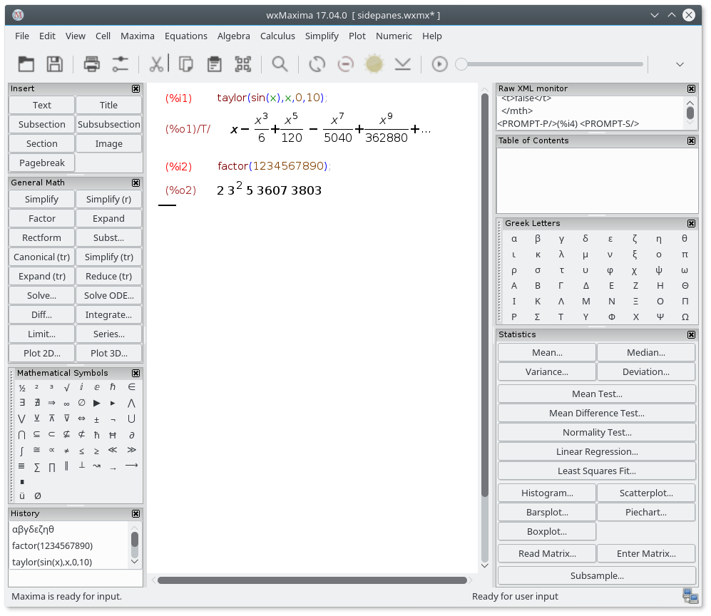{
id=img_SidePanes }

Dans le volet latéral « table des matières », vous pouvez augmenter ou
diminuer le niveau d’un titre en cliquant simplement dessus avec le bouton
droit de la souris et en sélectionnant le niveau de titre supérieur ou
inférieur.

{
id=Sidepane-TOC-convert-headings }

### Export MathML

Plusieurs logiciels de traitement de texte et programmes similaires
reconnaissent soit  une entrée  [MathML](https://www.w3.org/Math/)  et
l'insèrent automatiquement sous forme d'équation 2D modifiable, soit (comme
LibreOffice) disposent d'un éditeur d'équations proposant une fonction
« Importer du MathML depuis le presse-papiers ». D'autres prennent en charge
les équations en RTF. _WxMaxima_ offre donc plusieurs options dans le menu
contextuel (clic droit).

### Prise en charge de Markdown

_WxMaxima_ propose un ensemble de balises
[Markdown](https://en.wikipedia.org/wiki/Markdown) standard qui n’entrent
pas en conflit avec la notation mathématique. L’un de ces éléments est les
listes à puces.

```text
Texte ordinaire
* Un élément, niveau d'indentation 1
* Un autre élément au niveau d'indentation 1
  * Un élément au deuxième niveau d'indentation
  * Un deuxième élément au deuxième niveau d'indentation
* Un troisième élément au premier niveau d'indentation
Texte ordinaire

```

_WxMaxima_ reconnaîtra le texte commençant par le caractère `>` comme des blocs de citations  :

```text
Texte ordinaire
 > citation citation citation citation
 > citation citation citation citation
 > citation citation citation citation
 Texte ordinaire
```

_WxMaxima_ reconnaîtra `=>` dans ses sorties TeX et HTML et le remplacera par le symbole Unicode correspondant :

```text
cogito => sum.
```

D’autres symboles reconnus par les exports HTML et TeX sont `<=` et `>=` pour les comparaisons, une double flèche à double pointe (`<=>`), des flèches à une seule direction (`<->`, `->` et `<-`) ainsi que `+/-` pour le symbole correspondant. Pour la sortie TeX, les symboles `<<` et `>>` sont également reconnus.

### Links in text cells

A web address in a text cell that starts with `http://`, `https://` or `mailto:` is shown as a link. Since clicking into a text cell places the cursor there, a link is followed by <kbd>CTRL</kbd>+clicking it (<kbd>CMD</kbd>+clicking on macOS), or by right-clicking it and choosing "Open Link"; hovering over it shows where it leads. The HTML export turns it into a link, the TeX export into a `\url{}`. Links are always recognized from the text itself, so nothing about them is stored in the file.

Links in a code cell's comments (`/* ... */`) work the same way. Elsewhere
in code, for example inside a string, an address is Maxima syntax and is not
a link.

The same goes for web addresses in _Maxima_'s output, for example in a string printed by `print("See https://wxmaxima-developers.github.io/wxmaxima/")`: <kbd>CTRL</kbd>+clicking the address or choosing "Open Link" from its context menu opens it, while a plain click still selects the output.

### Bold, italic, underlined and struck-through text

Text in a text cell, a title or a section heading can be made bold, italic,
underlined or struck through. Select the text and press the respective
button in the toolbar; pressing the button again removes that formatting
from the selection. With nothing selected the button switches the formatting
on or off for what is typed next. The buttons are hidden by right-clicking
the toolbar and unchecking "Text formatting buttons". Code cells cannot be
formatted: their colors already show the syntax of the code.

Superscript and subscript buttons work the same way: they make the text
smaller and raise it above or lower it below the line, as in E = mc² or
H₂O. A character cannot be both, so switching one of them on switches the
other off. A line that contains a superscript, a subscript or a character
that is taller than the font's usual ones, for example an emoji, gets as
much additional room as it needs.

The formatting is saved in `.wxmx` files. Older versions of _wxMaxima_ open
such a file without the formatting but keep all of the text. `.wxm` files,
the exports and the clipboard contain the text without its formatting.

### Raccourcis clavier

La plupart des raccourcis clavier peuvent être trouvés dans le texte des
menus associés. Comme ils sont effectivement tirés du texte des menus, ils
peuvent ainsi être personnalisés par les traductions de _wxMaxima_ pour
correspondre aux besoins des utilisateurs des claviers locaux, nous ne les
documentons pas ici. Cependant, quelques raccourcis clavier ou alias de
raccourcis ne sont pas documentés dans les menus :

- <kbd>CTRL</kbd>+<kbd>SHIFT</kbd>+<kbd>DELETE</kbd> supprime complètement
  une cellule.
- <kbd>CTRL</kbd>+<kbd>TAB</kbd> or
  <kbd>CTRL</kbd>+<kbd>SHIFT</kbd>+<kbd>TAB</kbd> déclenche le mécanisme de
  saisie automatique.
- <kbd>SHIFT</kbd>+<kbd>SPACE</kbd> insère un espace insécable.

### Exploring output with the keyboard

A cell's output can be selected, and explored part by part, without a mouse:

- <kbd>DOWN</kbd> at the end of a cell's input selects the first result of
  its output. Further presses of <kbd>DOWN</kbd> and <kbd>UP</kbd> step
  through the results; past the last one the cursor leaves the cell. If you
  prefer <kbd>DOWN</kbd> to skip over the output, switch on "Up/Down keys
  skip over output" in the Worksheet tab of the configuration dialog.
- <kbd>ENTER</kbd> goes into the selected expression and selects its first
  part: the expression without its label, the numerator of a fraction, the
  name of a function, the first entry of a matrix, ... If the selection has
  no parts, <kbd>ENTER</kbd> opens a new input cell holding it, as it always
  did.
- <kbd>ESCAPE</kbd> selects what the selection is a part of. From a whole
  result it goes back into the cell's input.
- <kbd>LEFT</kbd> and <kbd>RIGHT</kbd> select the previous or next part at
  the same level. In a matrix all four arrow keys move from entry to entry.
- <kbd>SHIFT</kbd>+<kbd>LEFT</kbd> and <kbd>SHIFT</kbd>+<kbd>RIGHT</kbd>
  grow or shrink the selection over the neighbouring parts; in a matrix,
  <kbd>SHIFT</kbd> and any arrow key grow the selected entry into a block of
  entries.
- The context-menu key or <kbd>SHIFT</kbd>+<kbd>F10</kbd> opens the
  right-click menu for the selection, so it can be copied in any format.

### TeX brut dans l'export TeX

Si une cellule de texte commence par `TeX:`, l'export TeX inclut le texte
littéral qui suit le marqueur `TeX:`. Cette fonctionnalité permet d'insérer
du code TeX directement dans le classeur _wxMaxima_.

## Formats de fichiers

Le contenu développé lors d'une session _wxMaxima_ peut être enregistré pour
une utilisation ultérieure de trois manières différentes :

### .mac

Les fichiers `.mac` sont des fichiers texte ordinaires qui contiennent des
commandes _Maxima_. Ils peuvent être lus à l'aide de la commande `batch()`
ou `load()` de _Maxima_, ou via l'entrée de menu Fichier/Charger un
paquetage de _wxMaxima_.

Un exemple est présenté ci-dessous. `Quadratic.mac` définit une fonction,
puis génère un tracé avec `wxdraw2d()`. Ensuite, le contenu du fichier
`Quadratic.mac` est affiché et la fonction nouvellement définie `f()` est
évaluée.

{
id=img_BatchImage }

Attention : Bien que le fichier `Quadratic.mac` ait l'extension habituelle
de _Maxima_ (`.mac`), il ne peut être lu que par _wxMaxima_, car la commande
`wxdraw2d()` est une extension de wxMaxima à _Maxima_. _Maxima_ en ligne de
commande ignorera la commande inconnue `wxdraw2d()` et l'affichera à
l'identique en sortie.

Vous pouvez utiliser les fichiers `.mac` pour écrire votre propre
bibliothèque de macros. Cependant, comme ils ne contiennent pas assez
d’informations structurelles, ils ne peuvent pas être relus en tant que
session _wxMaxima_.

### .wxm

Les fichiers `.wxm` contiennent la feuille de travail, à l’exception de la sortie de _Maxima_.  Dans les versions de Maxima supérieures à 5.38, ils peuvent être lus à l’aide de la fonction `load()` de _Maxima_, tout comme les fichiers `.mac` — enfin, pour la plupart.  Les questions (comme `asksign(x)`) posent problème, car la réponse est écrite dans le fichier `.wxm` (afin qu’elle puisse être proposée après le chargement), mais Maxima ne peut pas l’évaluer.  Vous pouvez empêcher Maxima de poser des questions en utilisant `assume()` pour déclarer certaines propriétés que Maxima a besoin de connaître.

Avec ce format en texte brut, il est parfois inévitable que les feuilles de
calcul utilisant de nouvelles fonctionnalités ne soient pas rétrocompatibles
avec les anciennes versions de _wxMaxima_.

#### Format de fichier des fichiers wxm

Il s'agit simplement d'un fichier texte brut (vous pouvez l'ouvrir avec un
éditeur de texte), contenant le contenu des cellules sous forme de
commentaires spéciaux Maxima.

Cela commence par le commentaire suivant :

```maxima
/* [wxMaxima batch file version 1] [ DO NOT EDIT BY HAND! ]*/ 
/* [ Created with wxMaxima version 24.02.2_DevelopmentSnapshot ] */ 
```

Puis les cellules suivent, encodées sous forme de commentaires Maxima, par
exemple une cellule de section :

```maxima
/* [wxMaxima: section start ]
Titre de la section
   [wxMaxima: section end   ] */

```

ou (dans une cellule Math, l'entrée n'est bien sûr *pas* mise en commentaire
(la sortie n'est pas enregistrée dans un fichier `wxm`)) :

```maxima
/* [wxMaxima: input   start ] */
f(x):=x^2+1$
f(2);
/* [wxMaxima: input   end   ] */
```

Les images sont [encodées en Base64](https://en.wikipedia.org/wiki/Base64)
avec l'indication du type de l'image sur la première ligne):

```maxima
/* [wxMaxima: image   start ]
jpg
[séquence de caractères très chaotique à première vue]
   [wxMaxima: image   end   ] */

```

Un saut de page est simplement une ligne contenant :

```maxima
/* [wxMaxima: saut de page    ] */

```

Et les cellules repliées sont marquées par :

```maxima
/* [wxMaxima: fold    start ] */
...
/* [wxMaxima: fold    end   ] */

```

### .wxmx

Ce format de fichier basé sur le XML enregistre la feuille de travail
complète, y compris des éléments comme le facteur de zoom et la liste de
suivi du notebook. C'est le format de fichier recommandé.

#### Format de fichier des fichiers wxmx

Un fichier `wxmx` semble être un format binaire, mais on peut le gérer avec
des outils inclus dans votre système d'exploitation. Il s'agit d'un fichier
zip, que l'on peut décompresser avec `unzip` (peut-être faut-il le renommer
au préalable pour qu'il soit reconnu par le programme de décompression de
votre OS). Nous n'utilisons pas la fonction de compression, seulement la
possibilité de regrouper plusieurs fichiers en un seul — les images sont
déjà compressées et le reste est du texte simple (probablement bien plus
petit que les images volumineuses qu'il contient).

Il contient les fichiers suivants :

- `mimetype` : ce fichier contient le type MIME des fichiers wxMaxima :
  `text/x-wxmathml`
- `format.txt` : une brève description de wxMaxima et du format de fichier
  wxmx
- Images (par ex. png, jpeg) : graphiques intégrés produits lors de la
  session wxMaxima et images incluses.
- `content.xml` : un document XML contenant les différentes cellules de
  votre document au format XML.

Donc, si quelque chose ne va pas, vous pouvez décompresser un document
wxMaxima (peut-être en le renommant au préalable en `.zip`), éventuellement
modifier le fichier `content.xml` avec un éditeur de texte ou remplacer une
image corrompue, recompresser les fichiers, probablement renommer le `.zip`
en `.wxmx` — et vous obtiendrez un autre fichier `wxmx` modifié.

## Options pour la configuration

Pour certaines variables courantes liées à la configuration, _wxMaxima_
propose deux méthodes de configuration :

- La boîte de dialogue de configuration ci-dessous vous permet de modifier
  leurs valeurs par défaut pour la session en cours et les suivantes.
- De plus, les valeurs de la plupart des variables de configuration peuvent
  être modifiées uniquement pour la session en cours en remplaçant leurs
  valeurs depuis la feuille de calcul, comme illustré ci-dessous.

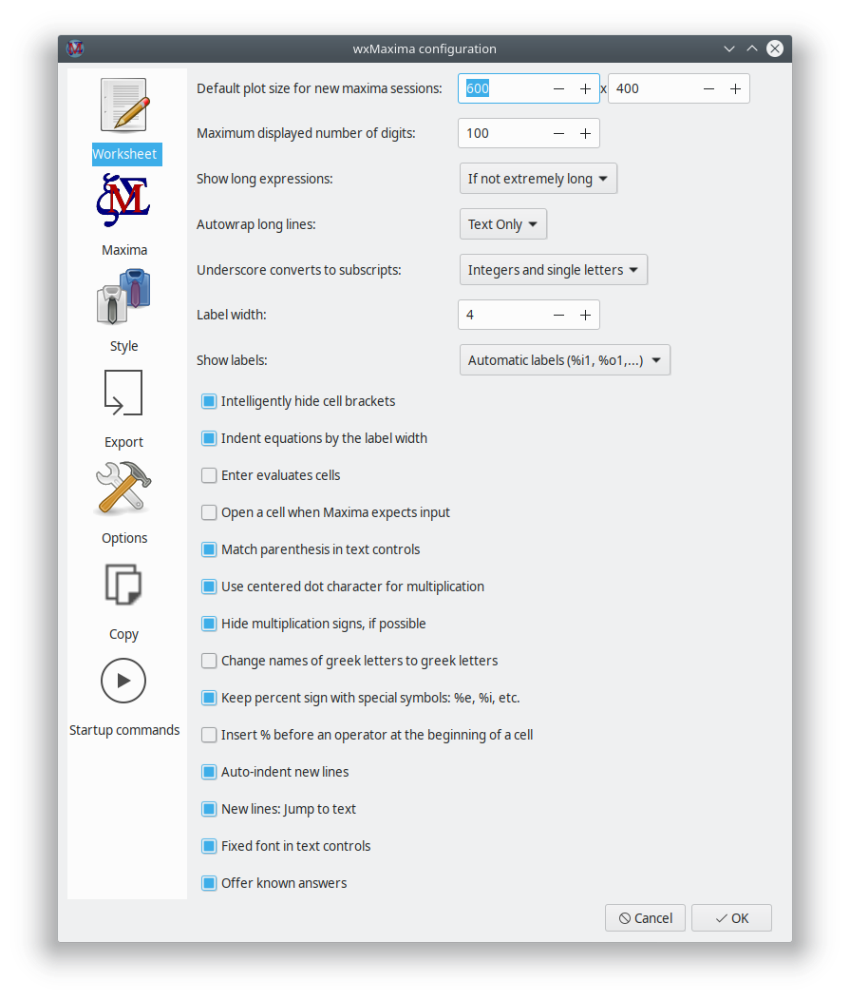{
id=img_wxMaxima_configuration_001 }

### Fréquence par défaut des images pour les animations

La fréquence des images utilisée pour les nouvelles animations est stockée
dans la variable `wxanimate_framerate`. La valeur initiale de cette variable
dans un nouveau notebook peut être modifiée via la boîte de dialogue de
configuration.

### Dimensions par défaut des graphiques pour les nouvelles sessions de _maxima_

Lors du prochain démarrage, les graphiques intégrés au notebook seront créés
avec ces dimensions, sauf si la valeur de `wxplot_size` est modifiée par
_Maxima_.

Afin de définir la taille d'un seul graphique, la notation suivante peut
être utilisée afin d'affecter une valeur à une variable pour une seule
commande :

```maxima
wxdraw2d(
   explicit(
       x^2,
       x,-5,5
   )
), wxplot_size=[480,480]$

```

### Correspondance des parenthèses dans les zones de texte

Cette option active deux fonctionnalités :

- Si une parenthèse ouvrante, un crochet ouvrant ou un guillemet double est
  saisi, _wxMaxima_ insère automatiquement le caractère de fermeture
  correspondant.
- Si du texte est sélectionné lorsque l’une de ces touches est enfoncée, le
  texte sélectionné est placé entre les signes correspondants appariés.

### Ne pas enregistrer automatiquement le notebook

Si cette option est activée, le fichier du notebook ne sera écrasé que sur
demande de l'utilisateur. En cas de plantage, de coupure de courant ou autre
incident, une copie de sauvegarde récente reste cependant disponible dans le
dossier temporaire.

Si cette option n'est pas activée, _wxMaxima_ se comporte davantage comme
une application moderne de smartphone :

- Les fichiers sont sauvegardés automatiquement lorsque l'on quitte le
  programme
- Et le fichier sera automatiquement sauvegardé toutes les 3 minutes.

### Arranging the toolbar

The toolbar is made of sections, like the "Open" and "Save" buttons, the
evaluation buttons or the drop-down list that sets the type of a cell. The
"Toolbar" tab of the configuration dialog lists them in the order the
toolbar shows them in: drag a section to another place, or select it and
press "Up" or "Down", to move it, and uncheck it to hide it. The flexible
space pushes every section after it to the right edge of the
window. "Default order" restores the original arrangement. Sections can also
be shown or hidden by right-clicking the toolbar.

### Où est enregistrée la configuration  ?

Si vous utilisez Unix/Linux, les informations de configuration sont enregistrées dans un fichier `.wxMaxima` de votre répertoire personnel (si vous utilisez wxWidgets < 3.1.1), ou dans `.config/wxMaxima.conf` (norme XDG, si wxWidgets >= 3.1.1 est utilisé). Vous pouvez connaître la version de wxWidgets avec la commande `wxbuild_info();` ou via le menu Aide → À propos. [wxWidgets](https://www.wxwidgets.org/) est la bibliothèque d'interface graphique multiplateforme sur laquelle repose _wxMaxima_ (d'où le `wx` dans le nom).
(Ces fichiers ou dossiers, commençant par un point, `.wxMaxima` ou `.config`, sont donc des fichiers cachés).

Si vous utilisez Windows, la configuration est stockée dans le
registre. Vous trouverez les entrées pour _wxMaxima_ à l'emplacement suivant
du registre : `HKEY_CURRENT_USER\Software\wxMaxima`

______________________________________________________________________

# Extensions pour _Maxima_

_WxMaxima_ est avant tout une interface graphique pour _Maxima_. Ainsi, son
rôle principal consiste à transmettre les commandes à _Maxima_ et à afficher
les résultats de leur exécution. Cependant, _WxMaxima_ ajoute également
certaines fonctionnalités à _Maxima_. La capacité de _WxMaxima_ à générer
des rapports en exportant le contenu d'un notebook vers des fichiers HTML et
LaTeX a déjà été évoquée. Cette section aborde certaines améliorations
apportées par _WxMaxima_ pour l'inclusion de graphiques dans une session.

## Variables en indice

<div id="wxsubscripts"></div>

`wxsubscripts` définit si (et comment) _wxMaxima_ appliquera automatiquement
des indices aux noms de variables :

Si sa valeur est `false`, cette fonctionnalité est désactivée : wxMaxima ne
transformera pas automatiquement en indices les parties des noms de
variables suivant un tiret bas.

Si elle est définie sur `'all`, tout ce qui suit un tiret bas sera converti
en indice.

Si elle est définie sur `true`, les noms de variables au format `x_y`
s'affichent avec un indice uniquement si

- Soit `x` soit `y` est une lettre unique ou
- `y` est un entier (peut inclure plus d'un caractère).

{ id=img_wxsubscripts }

<div id="wxdeclare_subscripted"></div>

A variable the rules above don’t cover can still be declared as "to be
subscripted" using the command `wxdeclare_subscripted(variable_name);` or
`wxdeclare_subscripted([variable_name1,variable_name2,...]);` Declaring a
variable as subscripted can be reverted using the following command:
`wxdeclare_subscripted(variable_name,false);`, which also keeps a variable
the rules above do cover from being subscripted.

<div id="wxdeclare_subscript"></div>

`wxdeclare_subscript(text_snippet);` or
`wxdeclare_subscript([text_snippet1,text_snippet2,...]);` instead declares a
text snippet: every variable whose name ends in an underscore followed by
that snippet is subscripted, however long the two parts are.

Vous pouvez utiliser le menu "Affichage->Mise en indice automatique" pour définir ces valeurs.

## Message utilisateur dans la barre d'état

<div id="wxstatusbar"></div>

Les commandes qui durent longtemps peuvent générer un message pour
l'utilisateur dans la barre d'état. Ce dernier est remplacé par tout nouveau
message qui apparait dans cette barre (ce qui permet de l'utiliser comme
indicateur de progression) et est supprimé dès que la commande actuelle
envoyée à _Maxima_ est terminée. Il n'y a pas de risque à utiliser
`wxstatusbar()` même avec des bibliothèques qui pourraient être utilisées
avec _Maxima_ standard (par opposition à _wxMaxima_) : si _wxMaxima_ n'est
pas présent, la commande `wxstatusbar()` restera simplement non évaluée.

```maxima
for i:1 thru 10 do (
    /* Informe l'utilisateur de l'avancement. */
    wxstatusbar(concat("Pass ",i)),
    /* (sleep n) est une fonction Lisp, qui peut être utilisée */
    /* avec le caractère "?" avant. Cela retarde */
    /* l'exécution du programme (dans ce cas : pour 3 secondes) */
    ?sleep(3)
)$
```

## Exporter la feuille de travail depuis Maxima

<div id="wxworksheettohtml"></div>

La commande `wxworksheettohtml()` exporte la feuille de travail actuelle
vers un fichier HTML depuis une session _Maxima_ en cours d’exécution, ce
qui est pratique pour un export par script ou par lot. Comme
`wxstatusbar()`, elle peut être utilisée en toute sécurité dans du code qui
pourrait également s’exécuter dans _Maxima_ (console) seul : si _wxMaxima_
n’est pas présent, la commande est simplement laissée non évaluée.

```maxima
wxworksheettohtml("report.html")$
wxworksheettohtml("report.html", flavor="svg", wxmx=true)$
```

Un nom de fichier relatif est interprété par rapport au répertoire de
travail de _Maxima_. Les options de mot-clé facultatives sont :

| option   | valeurs                                          | signification                                        |
| -------- | ----------------------------------------------- | --------------------------------------------------- |
| `flavor` | `mathml` (par défaut), `mathjax`, `svg`, `bitmap` | manière dont les équations sont rendues dans la page exportée |
| `wxmx`   | `false` (par défaut), `true`                     | intégrer une copie téléchargeable `.wxmx` de la session |

The images and the `.wxmx` copy are written into a folder named after the
HTML file, with `_htmlimg` appended. If "Embed images into the .html file"
is checked in the Export tab of the configuration dialog, they are embedded
into the HTML file instead, so it can be mailed as a single file.

Les valeurs de `flavor` correspondent aux formats d’équations proposés par
la boîte de dialogue graphique **Fichier → Exporter** : `mathml` produit une
page autonome qui ne nécessite aucune connexion Internet, `mathjax` ajoute
une solution de repli MathJax pour les navigateurs ne prenant toujours pas
en charge MathML, et `svg`/`bitmap` convertissent chaque équation en image.

<div id="wxworksheettotex"></div>

La commande complémentaire `wxworksheettotex()` exporte de la même manière
vers un fichier LaTeX (`.tex`) :

```maxima
wxworksheettotex("report.tex")$
wxworksheettotex("report.tex", documentclass="report", documentclassoptions="12pt,a4paper")$
```

| option                 | signification                                                        |
| ---------------------- | -------------------------------------------------------------------- |
| `documentclass`        | remplace la classe LaTeX `\documentclass` (par exemple `"article"`, `"report"`) |
| `documentclassoptions` | remplace ses options (par exemple `"12pt,a4paper"`)                  |

La prise en charge de `wxworksheettopdf()` est prévue.

## Graphiques

La création de courbes (qui repose fondamentalement sur des éléments
graphiques) est un domaine où une interface utilisateur graphique devra
apporter certaines extensions au programme d'origine.

### Intégrer un graphique dans le notebook

<div id="wxplot2d"></div>
<div id="wxplot3d"></div>
<div id="wximplicit_plot"></div>
<div id="wxcontour_plot"></div>

Normalement, _Maxima_ demande au programme externe _Gnuplot_ d'ouvrir une
fenêtre séparée pour chaque graphique qu'il génère. Comme il est souvent
plus pratique d'intégrer les graphiques directement dans le notebook,
_wxMaxima_ propose son propre ensemble de fonctions graphiques. Celles-ci ne
diffèrent des fonctions _Maxima_ correspondantes que par leur nom : elles
sont toutes préfixées par « wx ».

Les fonctions graphiques suivantes ont leurs équivalents préfixés par « wx »
:

| fonction graphique de wxMaxima |fonction graphique de Maxima                                                                          |
| ------------------------ | ----------------------------------------------------------------------------------------------- |
| `wxplot2d()`             | [plot2d](https://maxima.sourceforge.io/docs/manual/maxima_singlepage.html#plot2d)               |
| `wxplot3d()`             | [plot3d](https://maxima.sourceforge.io/docs/manual/maxima_singlepage.html#plot3d)               |
| `wxdraw2d()`             | [draw2d](https://maxima.sourceforge.io/docs/manual/maxima_singlepage.html#draw2d)               |
| `wxdraw3d()`             | [draw2d](https://maxima.sourceforge.io/docs/manual/maxima_singlepage.html#draw3d)               |
| `wxdraw()`               | [draw](https://maxima.sourceforge.io/docs/manual/maxima_singlepage.html#draw)                   |
| `wximplicit_plot()`      | [implicit_plot](https://maxima.sourceforge.io/docs/manual/maxima_singlepage.html#implicit_plot) |
| `wxhistogram()`          | [histogram](https://maxima.sourceforge.io/docs/manual/maxima_singlepage.html#histogram)         |
| `wxscatterplot()`        | [scatterplot](https://maxima.sourceforge.io/docs/manual/maxima_singlepage.html#scatterplot)     |
| `wxbarsplot()`           | [barsplot](https://maxima.sourceforge.io/docs/manual/maxima_singlepage.html#barsplot)           |
| `wxpiechart()`           | [piechart](https://maxima.sourceforge.io/docs/manual/maxima_singlepage.html#piechart)           |
| `wxboxplot()`            | [boxplot](https://maxima.sourceforge.io/docs/manual/maxima_singlepage.html#boxplot)             |

Si un fichier `.wxm` est lu par _Maxima_ (en mode console), ces fonctions
sont ignorées (et affichées à l'identique en sortie, comme toute autre
fonction inconnue dans _Maxima_).

Si vous rencontrez des problèmes avec l'une de ces fonctions, veuillez
vérifier si le problème existe également pour la fonction Maxima
correspondante (par exemple, si vous obtenez une erreur avec `wxplot2d()`,
testez le même graphique avec la commande Maxima `plot2d()` (qui ouvre le
graphique dans une fenêtre séparée)). Si le problème persiste, il s'agit
probablement d'un problème de Maxima qui devrait être signalé dans le [suivi
des bogues de Maxima](https://sourceforge.net/p/maxima/bugs/). Ou peut-être
un problème de Gnuplot.

### Agrandir ou diminuer les graphiques intégrés

<div id="wxplot_size"></div>

Comme indiqué précédemment, la boîte de dialogue de configuration permet de
modifier la taille par défaut des graphiques créés, en définissant la valeur
initiale de `wxplot_size`. Les routines graphiques de _wxMaxima_ tiennent
compte de cette variable, qui spécifie la taille d'un graphique en
pixels. Il est toujours possible d'interroger ou de définir cette variable
pour ajuster la taille des graphiques suivants :

```maxima
```maxima
wxplot_size:[1200,800]$
wxdraw2d(
    explicit(
        sin(x),
        x,1,10
    )
)$

```

Si la dimension d'un seul graphique doit être modifiée, _Maxima_ offre une
méthode standard pour changer l'attribut de taille uniquement pour la
cellule actuelle. Dans ce cas, la spécification `wxplot_size = [valeur1,
valeur2]` est ajoutée à la commande `wxdraw2d()`, sans faire partie
intégrante de cette commande.

```maxima
```maxima
wxdraw2d(
    explicit(
        sin(x),
        x,1,10
    )
),wxplot_size=[1600,800]$
```

Le réglage de la taille des graphiques intégrés avec `wxplot_size`
fonctionne pour les graphiques en ligne utilisant par exemple les commandes
`wxplot`, `wxdraw`, `wxcontour_plot` et `wximplicit_plot`, ainsi que pour
les animations intégrées avec les commandes `with_slider_draw` et
`wxanimate`.

### Des graphiques de meilleure qualité

Il semble que _Gnuplot_ ne propose pas de méthode portable pour déterminer
s'il prend en charge la sortie bitmap haute qualité fournie par la
bibliothèque Cairo. Sur les systèmes où _Gnuplot_ est compilé pour utiliser
cette bibliothèque, l'option pngCairo du menu de configuration (qui peut
être écrasée par la variable `wxplot_pngcairo`) active la prise en charge de
l'antialiasing et des styles de ligne supplémentaires. Si `wxplot_pngcairo`
est définie alors que _Gnuplot_ ne supporte pas cette fonctionnalité, le
résultat résultera en des messages d'erreur au lieu des graphiques.

### Ouvrir les graphiques intégrés dans les fenêtres interactives de _Gnuplot_

Si un graphique a été généré avec des commandes de type `wxdraw` (`wxplot2d`
et `wxplot3d` ne sont pas pris en charge par cette fonctionnalité) et que la
taille du fichier du projet _Gnuplot_ correspondant n'est pas trop élevée,
_wxMaxima_ propose un menu contextuel (clic droit) permettant d'ouvrir le
graphique dans une fenêtre interactive _Gnuplot_.

### Ouvrir la console de commandes de Gnuplot dans les fenêtres `plot`

Sous MS Windows, il existe deux programmes Gnuplot : `gnuplot.exe` et
`wgnuplot.exe`. Vous pouvez configurer lequel utiliser via le menu de
configuration. `wgnuplot.exe` permet d'ouvrir une fenêtre de console où les
commandes _Gnuplot_ peuvent être saisies, ce que `gnuplot.exe` ne propose
pas. Malheureusement, `wgnuplot.exe` provoque un bref "décrochage" du focus
clavier à chaque génération d'un graphique.

### Intégrer des animations dans le notebook

Les diagrammes en 3D impliquent souvent que la lecture des données
quantitatives soit difficile. Une alternative intéressante consiste à
associer le 3ᵉ paramètre à la molette de la souris. La commande
`with_slider_draw` est une version de `wxdraw2d` qui génère plusieurs
graphiques et permet de basculer entre eux à l'aide d'un curseur situé en
haut de l'écran. _WxMaxima_ permet d'exporter cette animation au format GIF
animé.

Les deux premiers arguments de `with_slider_draw` sont le nom du paramètre
qui varie entre les graphiques et une liste des valeurs prises par ce
paramètre. Les arguments suivants sont les arguments classiques de la
commande `wxdraw2d` :

```maxima
```maxima
with_slider_draw(
    f,[1,2,3,4,5,6,7,10],
    title=concat("f=",f,"Hz"),
    explicit(
        sin(2*%pi*f*x),
        x,0,1
    ),grid=true
);
```

La même fonctionnalité pour les graphiques 3D est accessible avec
`with_slider_draw3d`, qui permet de faire tourner les graphiques 3D :

```maxima
```maxima
wxanimate_autoplay:true;
wxanimate_framerate:20;
with_slider_draw3d(
    α,makelist(i,i,1,360,3),
    title=sconcat("α=",α),
    surface_hide=true,
    contour=both,
    view=[60,α],
    explicit(
        sin(x)*sin(y),
        x,-π,π,
        y,-π,π
    )
)$
```

Si c'est plutôt la forme générale du graphique qui importe, un léger
déplacement peut suffire pour rendre la visualisation 3D plus intuitive :

```maxima
wxanimate_autoplay:true;
wxanimate_framerate:20;
with_slider_draw3d(
    t,makelist(i,i,0,2*π,.05*π),
    title=sconcat("α=",α),
    surface_hide=true,
    contour=both,
    view=[60,30+5*sin(t)],
    explicit(
        sin(x)*y^2,
        x,-2*π,2*π,
        y,-2*π,2*π
    )
)$

```

`with_slider_draw` and `with_slider_draw3d` make each frame out of a single
2D or 3D scene. `with_slider_draw_bare` instead hands the arguments that
follow the variable and its values to a plain `draw` command. Each frame can
therefore consist of several `gr2d` and `gr3d` scenes, and `draw`'s global
options like `columns` or `dimensions` can be used as well:

```maxima
with_slider_draw_bare(
    f,[1,2,3,4,5],
    columns=2,
    gr2d(
        title=concat("f=",f),
        explicit(sin(f*x),x,0,2*π)
    ),
    gr3d(
        explicit(sin(f*x)*cos(y),x,0,2*π,y,0,2*π)
    )
);
```

Like `with_slider_draw`, `with_slider_draw_bare` accepts `file_name="name"`,
which saves the animation as `name.gif` in Maxima's working directory. As
`draw` cannot turn a frame of several scenes into a single frame of a gif,
wxMaxima assembles that gif from the frames it shows, and the animation is
still shown in the worksheet. The gif file is only written when the command
is evaluated in wxMaxima.

<div id="with_slider"></div>
<div id="wxanimate"></div>

Pour ceux qui maîtrisent mieux la commande `plot` que `draw`, il existe un
second ensemble de fonctions :

- - `with_slider` et
- `wxanimate`.

<div id="wxanimate_framerate"></div>

Normalement, les animations sont lues ou exportées avec le taux de
rafraîchissement défini dans la configuration de _wxMaxima_. Pour régler la
vitesse de lecture d'une animation donnée, on peut utiliser la variable
`wxanimate_framerate` :

```maxima
```maxima
wxanimate(a, 10,
    sin(a*x), [x,-5,5]), wxanimate_framerate=6$

```

Les fonctions d'animation utilisent la commande `makelist` de _Maxima_ et
partagent donc le même écueil : la valeur de la variable du curseur n'est
substituée dans l'expression que si cette variable y apparaît
explicitement. Par conséquent, l'exemple suivant échouera :

```maxima
f:sin(a*x);
with_slider_draw(
    a,makelist(i/2,i,1,10),
    title=concat("a=",float(a)),
    grid=true,
    explicit(f,x,0,10)
)$
```

Si _Maxima_ est explicitement invité à substituer la valeur du curseur, le
tracé fonctionne correctement :

```maxima
f:sin(a*x);
with_slider_draw(
    b,makelist(i/2,i,1,10),
    title=concat("a=",float(b)),
    grid=true,
    explicit(
        subst(a=b,f),
        x,0,10
    )
)$
```

### Ouvrir plusieurs graphiques dans des fenêtres de manière simultanée

Cette fonctionnalité de _Maxima_ (sur les configurations qui la supportent),
bien qu'elle ne soit pas disponible via  _wxMaxima_, s'avère parfois bien
pratique. L'exemple suivant provient d'un message de Mario Rodriguez sur la
_liste de diffusion de Maxima_ :

```maxima
load(draw);

/* Parabola in window #1 */
draw2d(terminal=[wxt,1],explicit(x^2,x,-1,1));

/* Parabola in window #2 */
draw2d(terminal=[wxt,2],explicit(x^2,x,-1,1));

/* Paraboloid in window #3 */
draw3d(terminal=[wxt,3],explicit(x^2+y^2,x,-1,1,y,-1,1));
```

Il est également possible de tracer plusieurs graphiques dans une même
fenêtre (la même chose est réalisable avec la commande standard `draw()` de
Maxima en ligne de commande) :

```maxima
wxdraw(
  gr2d(
    key="sin (x)",grid=[2,2],
    explicit(sin(x),x,0,2*%pi)),
  gr2d(
    key="cos (x)",grid=[2,2],
    explicit(cos(x),x,0,2*%pi))
);

```

### Le panneau latéral "Graphiques avec draw"

Le panneau latéral "Graphiques avec draw" cache un générateur simple de code
qui permet de créer des représentations graphiques exploitant une partie des
fonctionnalités du package _draw_ intégré à _Maxima_.

#### 2D

Génère le squelette d'une commande `draw()` pour dessiner une scène
2D. Cette scène doit ensuite être complétée avec des commandes qui génèrent
son contenu, par exemple en utilisant les boutons situés dans les lignes en
dessous du bouton "2D".

Une fonctionnalité utile du bouton 2D est qu'il permet de configurer la
scène comme une animation dans laquelle un paramètre (par défaut, _t_) prend
une valeur différente à chaque image : une courbe 2D animée facilite souvent
l'interprétation des données plus qu'une représentation 3D statique des
mêmes informations.

#### 3D

Génère le squelette d'une commande `draw()` pour tracer une scène 3D. Si
aucune scène 2D ou 3D n'est définie, tous les autres boutons configurent
automatiquement une scène 2D contenant la commande générée par le bouton.

#### Expression

Ajoute un tracé standard d'une expression comme `sin(x)`, `x*sin(x)` ou
`x^2+2*x-4` à la commande `draw()` où se trouve actuellement le curseur. Si
aucune commande `draw()` n'existe, une scène 2D avec ce tracé est
générée. Chaque scène peut contenir un nombre illimité de graphiques.

#### Courbe définie de manière implicite

Tente de trouver tous les points où une expression comme `y=sin(x)`,
`y*sin(x)=3` ou `x^2+y^2=4` est vérifiée et trace la courbe résultante dans
la commande `draw()` où se trouve le curseur. Si aucune commande `draw()`
n'existe, une scène 2D avec ce tracé est générée.

#### Courbe paramétrique

Fait varier une variable entre une borne inférieure et une borne supérieure,
puis utilise deux expressions comme `t*sin(t)` et `t*cos(t)` pour générer
les coordonnées x, y (et z dans le cas des tracés 3D) d'une courbe, qui est
ensuite insérée dans la commande `draw()` actuelle.

#### Points

Trace plusieurs points, éventuellement reliés entre eux. Les coordonnées des
points peuvent provenir d'une liste de listes, d'un tableau 2D, ou d'une
liste ou d'un tableau pour chaque axe.

#### Titre du graphique

Ajoute un titre en haut du graphique,

#### Axes

Configurer l'axe.

#### Lignes de niveau

(Uniquement pour les tracés 3D) : Ajoute des lignes de niveau similaires à
celles que l'on trouve sur une carte de montagne aux commandes du tracé qui
suivent dans la commande `draw()` actuelle et/ou au plan de base du
graphique. Alternativement, cet assistant permet de sauter entièrement le
tracé des courbes et d'afficher uniquement le tracé des lignes de niveau.

#### Légende du graphique

Ajoute une nouvelle entrée pour la légende affichant le nom du prochain
tracé à la légende actuelle du graphique. Un nom vide désactive la
génération d'entrées des légende pour les tracés suivants.

#### Couleur de la ligne du tracé

Définit la couleur de ligne pour les tracés suivants contenus dans la
commande `draw()` actuelle.

#### Couleur de remplissage

Définit la couleur de remplissage pour les tracés suivants contenus dans la
commande `draw()` actuelle.

#### Quadrillage

Ouvre un assistant permettant de configurer les lignes du quadrillage.

#### Précision

Permet de choisir un compromis adapté entre vitesse et précision, inhérent à
tout programme de tracé graphique.

### Modifier la police et la taille de police pour les graphiques

Surtout lorsque vous utilisez un affichage haute résolution, la taille de
police par défaut peut être très petite. Pour les commandes basées sur
`draw`, vous pouvez définir la police et la taille de police à l'aide
d'options comme `font=...`, `font_size=...`, par exemple :

~~~maxima
wxdraw2d(
     font="Helvetica",
     font_size=30,
     explicit(sin(x),x,1,10));
~~~

Pour les commandes de type `plot` (par exemple `wxplot2d`, `wxplot3d`), les
tailles et polices de caractères peuvent être définies à l'aide de la
commande `gnuplot_preamble`, par exemple :

~~~maxima
wxplot2d(sin(x),[x,1,10],
         [gnuplot_preamble, "set tics font \"Arial, 30\"; set xlabel font \",20\"; set ylabel font \",20\";"]);

~~~

Cela définit la police pour les nombres en Arial avec une taille de 30, et
la taille de la police des étiquettes xlabel et ylabel à 20 (avec la police
par défaut).

Consultez la documentation de Maxima et Gnuplot pour plus
d'informations. Remarque : Gnuplot semble rencontrer des problèmes avec les
polices de grande taille, voir [wxMaxima issue
1966](https://github.com/wxMaxima-developers/wxmaxima/issues/1966).

## Graphiques intégrés

Si le format de fichier `.wxmx` est utilisé, l’insertion de fichiers dans un
projet _wxMaxima_ peut se faire aussi simplement que par
glisser-déposer. Mais parfois (par exemple si le contenu d’une image est
susceptible de changer plus tard au cours de la session), il est préférable
d’indiquer au fichier de charger l’image lors de l’évaluation :

```maxima
show_image("man.png"); 
```

## Fichiers au démarrage

La boîte de dialogue de configuration de _wxMaxima_ permet de modifier deux
fichiers contenant des commandes exécutées au démarrage :

- Un fichier contenant des commandes exécutées au démarrage de _Maxima_ :
  `maxima-init.mac`
- un fichier d'instructions supplémentaires exécutées lorsque _wxMaxima_
  démarre _Maxima_ : `wxmaxima-init.mac`

Par exemple, si Gnuplot est installé dans `/opt` (peut-être sur macOS), vous
pouvez ajouter `gnuplot_command:"/opt/local/bin/gnuplot"$` (ou
`/opt/gnuplot/bin/gnuplot` ou tout autre chemin) à ces fichiers.

Ces fichiers se trouvent dans le répertoire utilisateur de Maxima
(généralement `%USERPROFILE%/maxima` sous Windows, ou `$HOME/.maxima`
sinon). Vous pouvez connaître leur emplacement avec la commande :
`maxima_userdir;`

## Variables spéciales wx...

<div id="wxfilename"></div>
<div id="wxdirname"></div>
<div id="wxplot_pngcairo"></div>
<div id="wxchangedir"></div>
<div id="wxanimate_autoplay"></div>
<div id="wxmaximaversion"></div>
<div id="wxwidgetsversion"></div>
<div id="wxdirs"></div>

- `wxsubscripts` indique à _Maxima_ s'il doit convertir les noms de
  variables contenant un tiret bas (`R_150` ou similaire) en variables avec
  indices en bas de ligne. Voir `wxdeclare_subscript` pour les détails sur
  les noms de variables automatiquement convertis.
- `wxfilename` : Cette variable contient le nom du fichier actuellement
  ouvert dans _wxMaxima_.
- `wxdirname` : Cette variable contient le nom du répertoire dans lequel se
  trouve le fichier actuellement ouvert dans _wxMaxima_.
- `wxplot_pngcairo` indique si _wxMaxima_ tente d’utiliser le terminal
  pngcairo de _Gnuplot_, qui offre davantage de styles de ligne et une
  meilleure qualité graphique générale.
- `wxplot_size` définit la résolution des graphiques intégrés.
- `wxchangedir` : sur la plupart des systèmes d’exploitation, _wxMaxima_
  définit automatiquement le répertoire de travail de _Maxima_ comme étant
  le répertoire du fichier courant. Cela permet aux opérations
  d’entrée/sortie sur fichiers (par exemple avec `read_matrix`) de
  fonctionner sans avoir à préciser le chemin complet du fichier à lire ou à
  écrire. Sous Windows, cette fonctionnalité provoque parfois des messages
  d’erreur et peut donc être désactivée en définissant `wxchangedir` à
  `false` dans la boîte de dialogue de configuration.
- `wxanimate_framerate` : Le nombre d'images par seconde pour la lecture des
  animations suivantes.
- `wxanimate_autoplay` : Jouer automatiquement les animations par défaut ?
- `wxmaximaversion` : Retourne le numéro de version de _wxMaxima_.
- `wxwidgetsversion` : Retourne la version de wxWidgets utilisée par
  _wxMaxima_.
- `wxdirs` : une structure contenant les chemins que _wxMaxima_ utilise
  lui-même, car ceux-ci diffèrent selon le mainteneur, la distribution et le
  système d’exploitation :
  - `wxdirs@userconfdir` : le répertoire où est stockée la configuration de
    l’utilisateur. C’est le même répertoire que `maxima_userdir` (voir
    ci-dessus) — les deux pointent vers le même emplacement ;
    `wxdirs@userconfdir` n’est utile que s’il est plus pratique d’y accéder
    depuis un fichier `.mac` que par la variable côté Maxima.
  - `wxdirs@datadir` : le répertoire où sont installées les données propres
    à _wxMaxima_ (icônes, liste d’autocomplétion intégrée, etc.).
  - `wxdirs@helpdir` : le répertoire où est installée la copie hors ligne de
    ce manuel.
  - `wxdirs@localedir` : le répertoire où sont installés les fichiers de
    traduction de _wxMaxima_.
  - `wxdirs@maximalocation` : le chemin de l’exécutable _Maxima_ que
    _wxMaxima_ utilise pour démarrer.

## Affichage formaté en 2D

<div id="table_form"></div>

La fonction `table_form()` affiche une liste en 2D sous une forme plus
lisible que la sortie produite par la routine de sortie par défaut de
_Maxima_. L’entrée est une liste contenant une ou plusieurs listes. Comme la
commande `print`, cette commande affiche une sortie même lorsqu’elle se
termine par un signe dollar. Si elle se termine par un point-virgule, le
même tableau est affiché, accompagné d’une instruction « done ».

```maxima
table_form(
    [
        [1,2],
        [3,4]
    ]
)$
```

Comme le montre l'exemple suivant, les listes utilisées par la commande
`table_form` peuvent être créées avant son exécution.

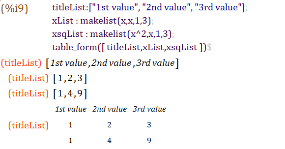{
id=img_MatrixTableExample }

De même, comme une matrice est une liste de listes, elle peut être convertie
en tableau de manière similaire.

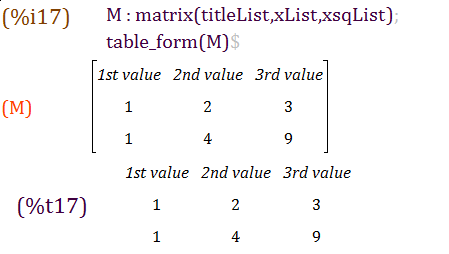{
id=img_SecondTableExample }

<div id="wx_matrix"></div>

La fonction `wx_matrix()` est une extension de la commande `matrix()` de
Maxima qui permet une mise en forme plus flexible des matrices dans wxMaxima
:

**`wx_matrix( <matrix>, [options] )`**

- **`lines=true`** : dessine des lignes de séparation internes entre les
  cellules. Cela est nécessaire pour distinguer visuellement les en-têtes
  des données.
- **`rownames=true`** : indique à wxMaxima que la première colonne de la
  matrice contient des étiquettes.
- **`colnames=true`** : indique à wxMaxima que la première ligne de la
  matrice contient des étiquettes.
- **`parenstyle=<style>`** : définit le type de parenthèses ou de crochets à
  dessiner autour de la matrice. Les styles pris en charge sont : `round`
  `()`, `square` `[]`, `angled` `<>`, `straight` `||` ou `none`.
- **`oversized=<mode>`**: Decides how this one matrix is shown if it is too
  large for the window, whatever the option _Matrices too large for the
  window_ (see below) says: `full` draws it in full, `elide` leaves out its
  middle rows and columns, and `scroll` shows it in a box the size of the
  window, with scrollbars of its own.
- **`banding=<mode>`**: Decides whether every other row and column of this
  matrix is faintly shaded (see below): `true` always shades them, even if
  the matrix fits the window, `false` never does, not even in the window
  double-clicking opens, and `auto`, the default, shades them only if the
  matrix is too large for the window.

Exemple :

```maxima
wx_matrix(matrix(["Name", "Value"], ["X", 10], ["Y", 20]),
          lines=true, rownames=true, colnames=true, parenstyle=square);
```

`wx_matrix()` doesn't display anything itself: it returns the matrix with
the formatting attached, which is used whenever that value is displayed. So
it can be stored in a variable and displayed later, formatted, and a matrix
ended with `$` isn't displayed at all. A new matrix calculated from it, for
example by adding to it or transposing it, is displayed the normal way
again.

A matrix cannot be broken into lines the way a long sum can. So by default
wxMaxima leaves out the middle rows and columns of a matrix that is too
large for the window and marks the gap with `⋯`, `⋮` and `⋱`, the way a
large matrix is written by hand. The first and last rows and columns always
stay visible, and hovering the mouse over the matrix tells which rows and
columns are not shown. The option _Matrices too large for the window_ in the
_Worksheet_ tab of the configuration dialog can instead draw such a matrix
in full, which makes the whole worksheet scroll sideways, or show it in a
box the size of the window, with scrollbars of its own; there the mouse
wheel scrolls the worksheet, unless that matrix or something inside it is
selected, and such a matrix is printed with its middle rows and columns left
out. Whether it is elided or shown in a scrolling box, every other row and
column of such a matrix is faintly shaded, so that a row or a column is easy
to follow across it; a matrix that fits the window stays plain, unless
`wx_matrix()`'s `banding` option says otherwise. All of this affects only
what is shown on screen and printed: copying, saving and exporting the
matrix always include every entry. `wx_matrix()`'s `oversized` option
overrides that option for a single matrix; a matrix it asks to scroll is
still elided on paper, and exporting a matrix as an image still always shows
all of it. Double-clicking a matrix that is elided or shown in a scrolling
box opens a window of its own that shows all of it; the window can be
resized and scrolled, and _Escape_ closes it. _Ctrl+F_ in that window
searches the matrix: each match selects the entry it is in and scrolls it
into view, and searching again steps on to the next matching entry.

## Signalement de bugs

<div id="wxbuild_info"></div>
<div id="wxbug_report"></div>

_WxMaxima_ propose quelques fonctions qui collectent des informations utiles
pour signaler un bug concernant le système actuel :

- - `wxbuild_info()` : Rassemble des informations sur la version en cours
  d'exécution  de _wxMaxima_
- `wxbug_report()` indique comment et où signaler les bogues

## Ecrire le résultat de la sortie en rouge

La commande `box()` de _Maxima_ fait que _wxMaxima_ affiche son argument
avec un texte en rouge, si le second argument de la commande est le texte
`highlight`.

## Rendu de la sortie.

Avec `set_display()`, on peut définir de quelle manière wxMaxima affichera
la sortie.

`set_display('xml)` est la valeur par défaut. Ici, Maxima communique avec
wxMaxima en utilisant un dialecte XML (lisible par machine) (visible dans la
barre latérale « XML brut ») et affiche les formules résultantes avec un
visuel mathématique, par exemple des matrices bien délimitées et
structurées, des signes de racine carrée, des fractions, etc.

<!--- Actuellement, cela ne fonctionne pas comme il se doit : la ligne portant l’étiquette de sortie est décalée vers la droite (problème : #2006) -->
`set_display('ascii)` fait que wxMaxima affiche les formules comme dans Maxima en ligne de commande, c’est-à-dire sous forme d’art ASCII.

`set_display('none)` produit des résultats ASCII « sur une seule ligne » —
comme le fait la commande de Maxima en ligne de commande `display2d:false;`.

# Menu d'aide

Le menu d’aide de _wxMaxima_ donne accès au manuel de Maxima et de wxMaxima,
à des astuces, à quelques feuilles de travail d’exemple ainsi qu’aux
démonstrations incluses dans Maxima en ligne de commande (la commande
`demo()`).

Veuillez noter que les exemples indiquent :

~~~text
À l’invite « _ », tapez « ; » puis appuyez sur <Entrée> pour poursuivre la démonstration.
~~~

Cela est valable pour Maxima en ligne de commande ; toutefois, dans wxMaxima, il est par défaut nécessaire de poursuivre la démonstration avec : <kbd>CTRL</kbd>+<kbd>ENTRÉE</kbd>

(Ce paramètre peut être configuré dans le menu Configurer → Feuille de travail → « Raccourcis clavier pour l’envoi de commandes à Maxima ».)

______________________________________________________________________

# Résolution des problèmes

## Impossible de se connecter à _Maxima_

Puisque _Maxima_ (le programme qui effectue réellement les calculs) et
_wxMaxima_ (qui fournit l’interface utilisateur facile à utiliser) sont des
programmes distincts qui communiquent au moyen d’une connexion réseau
locale, la cause la plus probable est que cette connexion ne fonctionne pas
correctement. Par exemple, un pare-feu peut être configuré de manière à ne
pas seulement empêcher les connexions non autorisées provenant d’Internet
(et éventuellement intercepter certaines connexions vers Internet), mais
aussi à bloquer la communication entre processus au sein d’un même
ordinateur. Notez que, puisque _Maxima_ est exécuté par un processeur Lisp,
le processus dont la communication est bloquée ne s’appelle pas
nécessairement « maxima ». Les noms courants du programme qui ouvre la
connexion réseau sont sbcl, gcl, ccl, lisp.exe ou des noms similaires.

Sur les ordinateurs Unix, une autre cause possible serait que le réseau de
bouclage (loopback), qui fournit les connexions réseau entre deux programmes
sur le même ordinateur, ne soit pas correctement configuré.

## Comment récupérer les données d’un fichier .wxmx corrompu

En interne, la plupart des formats modernes basés sur XML sont de simples
fichiers zip. _wxMaxima_ n’active pas la compression, de sorte que le
contenu des fichiers `.wxmx` peut être consulté dans n’importe quel éditeur
de texte.

Si la signature zip à la fin du fichier est toujours intacte après avoir
renommé un fichier `.wxmx` endommagé en `.zip`, la plupart des systèmes
d’exploitation offrent un moyen d’extraire une partie quelconque des
informations qui y sont stockées. Cela peut être utile lorsqu’il faut
récupérer les fichiers image d’origine à partir d’un document de traitement
de texte. Si la signature zip n’est pas intacte, ce n’est pas nécessairement
la fin du monde : si _wxMaxima_ a détecté lors de l’enregistrement que
quelque chose s’est mal passé, il existera un fichier `.wxmx~` dont le
contenu peut aider.

Et même s’il n’existe pas un tel fichier : le fichier `.wxmx` est un format conteneur et la partie XML y est stockée sans compression. Il est possible de renommer le fichier `.wxmx` en fichier `.txt` et d’utiliser un éditeur de texte pour récupérer la partie XML du contenu du fichier (elle commence par `<?xml version="1.0" encoding="UTF-8"?>` et se termine par `</wxMaximaDocument>`. Avant et après ce texte, vous verrez du contenu binaire illisible dans l’éditeur de texte).

Si vous enregistrez un fichier texte contenant uniquement ce contenu (par
exemple, en copiant et collant ce texte dans un nouveau fichier) avec une
extension `.xml`, _wxMaxima_ saura comment récupérer le texte du document.

## Je souhaite afficher des informations de débogage à l’écran avant que ma commande ne soit terminée

Normalement, _wxMaxima_ attend que la formule 2D soit transférée en totalité
avant de commencer la composition typographique. Cela permet d’économiser du
temps en évitant de tenter d'écrire une équation incomplète. Cependant, il
existe une commande `disp` qui affiche immédiatement des informations de
débogage, sans attendre la fin de l’exécution de la commande _Maxima_ en
cours :

```maxima
for i:1 thru 10 do (
   disp(i),
   /* (sleep n) is a Lisp function, which can be used */
   /* with the character "?" before. It delays the */
   /* program execution (here: for 3 seconds) */
   ?sleep(3)
)$
```

Sinon, on peut utiliser la commande `wxstatusbar()` mentionnée ci-dessus.

## La création du graphique n'affiche qu'un cadre vide encadrée avec un message d'erreur

Cela signifie que _wxMaxima_ n'a pas pu lire le fichier généré par _Maxima_,
qui était censé donner les instructions à _Gnuplot_ pour créer le graphique.

Les causes possibles de cette erreur sont :

- La commande de tracé fait partie d’un paquet tiers, tel que
  `implicit_plot`, mais ce paquet n’a pas été chargé par la commande
  `load()` de _Maxima_ avant de lancer la génération du graphique.
- _Maxima_ a tenté d’effectuer une opération que la version actuellement
  installée de _Gnuplot_ n’est pas en mesure de comprendre. Dans ce cas, un
  fichier se terminant par `.gnuplot`, situé dans le répertoire pointé par
  la variable `maxima_userdir` de _Maxima_, contient les instructions
  transmises par _Maxima_ à _Gnuplot_. La plupart du temps, le contenu de ce
  fichier est donc utile pour déboguer le problème.
- _Gnuplot_ a été configuré pour utiliser la bibliothèque pngCairo, qui
  fournit l’anticrénelage et des styles de ligne supplémentaires, mais il
  n’a pas été compilé pour prendre en charge cette possibilité. Solution :
  décochez la case « Utiliser le terminal Cairo pour le tracé » dans la
  boîte de dialogue de configuration et ne définissez pas `wxplot_pngcairo`
  à `true` depuis _Maxima_.
- Gnuplot n'a pas produit un fichier .png valide.

## Le tracé d’une animation génère l’erreur « error: undefined variable »

Par défaut, la valeur du paramètre pour le curseur n'est substituée dans
l'expression à tracer que si elle y est visible. L'utilisation d'une
commande `subst` qui substitue la variable du curseur dans l'équation à
tracer résout ce problème. À la fin de la section [Intégrer des animations
dans le notebook](#embedding-animations-into-the-spreadsheet), vous pouvez
voir un exemple.

## J’ai perdu le contenu d’une cellule et la fonction d’annulation ne s’en souvient pas

Il existe des fonctions Annuler distinctes pour les opérations sur les
cellules et pour les modifications à l’intérieur des cellules, donc il est
peu probable que cela arrive. Si cela se produit, plusieurs méthodes
permettent de récupérer les données :

- _WxMaxima_ dispose en fait de deux fonctions d’annulation : une mémoire
  d’annulation globale, active lorsqu’aucune cellule n’est sélectionnée, et
  une mémoire d’annulation par cellule, active lorsque le curseur se trouve
  à l’intérieur d’une cellule. Cela vaut la peine d’essayer les deux options
  d’annulation pour voir si une ancienne valeur peut encore être récupérée.
- Si vous avez encore un moyen de connaître l’étiquette que _Maxima_ a
  attribuée à la cellule, tapez simplement son étiquette et son contenu
  réapparaîtra.
- Si ce n’est pas le cas : pas de panique. Dans le menu « Affichage », il
  existe un moyen d’afficher un panneau d’historique qui montre toutes les
  commandes _Maxima_ qui ont été exécutées récemment.
- Si rien d’autre ne fonctionne, _Maxima_ contient une fonction de replay :

```maxima
playback();
```

## _WxMaxima_ démarre avec le message « Maxima process terminated. »

Une raison possible est que _Maxima_ ne peut pas être trouvé à l’emplacement
défini dans l’onglet « Maxima » de la boîte de dialogue de configuration de
_wxMaxima_ et ne peut donc pas s’exécuter du tout. Définir le chemin vers un
binaire _Maxima_ fonctionnel devrait résoudre ce problème.

## Maxima calcule indéfiniment et ne répond plus aux commandes entrées

Il est théoriquement possible que _wxMaxima_ ne se rende pas compte que
_Maxima_ a terminé son calcul et ne soit donc jamais informé qu’il peut lui
envoyer de nouvelles données. Si tel est le cas, « Déclencher l’évaluation »
peut resynchroniser les deux programmes.

## Mon _Maxima_ basé sur SBCL manque de mémoire

Le compilateur Lisp SBCL est configuré par défaut avec une limite de mémoire
qui lui permet de fonctionner même sur des ordinateurs peu
puissants. Cependant, lors de la compilation de gros packages logiciels
comme Lapack ou du traitement de listes d'équations extrêmement longues,
cette limite peut s'avérer insuffisante. Pour l'augmenter, vous pouvez
utiliser le paramètre en ligne de commande `--dynamic-space-size` lors du
lancement de SBCL, qui indique combien de mégaoctets doivent être
réservés. - Une version 32 bits de SBCL sous Windows peut réserver jusqu'à
999 Mo. - Une version 64 bits sous Windows peut aller au-delà des 1280 Mo
nécessaires pour compiler Lapack.

Une façon de fournir à _Maxima_ (et donc à SBCL) des paramètres pour sa
ligne de commande est le champ « Paramètres supplémentaires pour Maxima » de
la boîte de dialogue de configuration de _wxMaxima_.

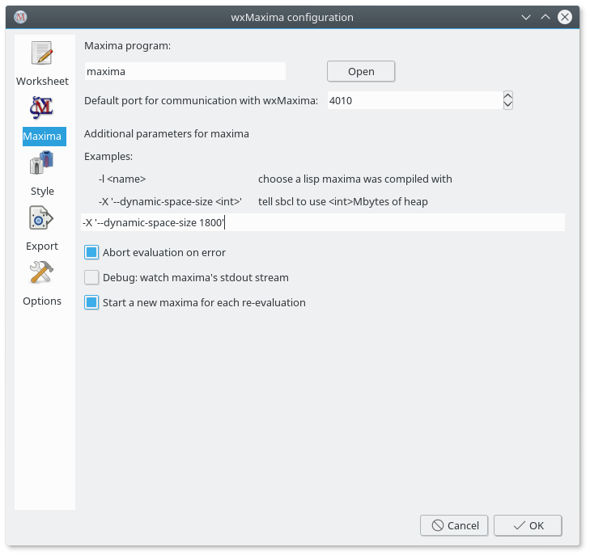{ id=img_sbclMemory }

## Sous Ubuntu, la saisie est parfois lente ou certaines touches sont ignorées

L'installation du paquet 'ibus-gtk' devrait résoudre ce problème. Pour plus
de détails, voir :
[https://bugs.launchpad.net/ubuntu/+source/wxwidgets3.0/+bug/1421558](https://bugs.launchpad.net/ubuntu/+source/wxwidgets3.0/+bug/1421558).

## _WxMaxima_ se fige lorsque _Maxima_ traite des caractères grecs ou des lettres accentuées (comme les umlauts)

Si votre _Maxima_ est basé sur SBCL, ajoutez les lignes suivantes à votre
fichier `.sbclrc` :

```commonlisp
(setf sb-impl::*default-external-format* :utf-8)
```

Le dossier où ce fichier doit être placé dépend du système et de
l’installation. Cependant, toute version de _Maxima_ basée sur SBCL, ayant
déjà évalué une cellule durant la session en cours, peut gentiment indiquer
son emplacement après exécution de la commande suivante :

```maxima
:lisp (sb-impl::userinit-pathname)
```

## Remarque concernant Wayland (distributions Linux/BSD récentes)

Il semble y avoir des problèmes de compatibilité entre le serveur
d'affichage Wayland et wxWidgets. WxMaxima peut en être affecté, par exemple
avec des barres latérales qui ne peuvent pas être déplacées.

Vous pouvez soit : - désactiver Wayland et utiliser X11 à la place (de
manière globale), - ou forcer WxMaxima à utiliser le système X Window en
définissant la variable d’environnement :  `GDK_BACKEND=x11`

Par exemple, lancez WxMaxima avec la commande :

`GDK_BACKEND=x11 wxmaxima`

## La barre de menus disparaît sous KDE Plasma

Sur certaines installations de KDE Plasma, la barre de menus globale
disparaît lorsqu’on clique dessus. Comme il s’agit d’un bogue du proxy de
menu global, le seul moyen de l’éviter est d’indiquer à wxMaxima qu’il doit
utiliser sa propre barre de menus au lieu de la barre globale. Cela se fait
en définissant : `UBUNTU_MENUPROXY=0`

À partir de la version 26.05.0, wxMaxima tente de définir automatiquement
cette variable s’il détecte un système concerné (KDE, Unity, ou Ubuntu avec
des versions plus anciennes de wxWidgets).

Si la correction automatique échoue, vous pouvez démarrer wxMaxima
manuellement avec :

`UBUNTU_MENUPROXY=0 wxmaxima`

## Pourquoi le navigateur pour le manuel intégré n’est-il pas disponible sur mon PC Windows ?

Soit wxWidgets n’a pas été compilé avec la prise en charge de WebView2 de
Microsoft, soit WebView2 de Microsoft n’est pas installé.

_Help/About_ lists which of the things the integrated browser needs this
wxMaxima has and which it is missing; the log window (_View/Toggle log
window_) shows the same list.

## Pourquoi le navigateur pour le manuel externe ne fonctionne-t-il pas sur ma machine Linux ?

Le navigateur HTML est peut-être une version Snap, Flatpak ou AppImage. Ces
formats ne peuvent généralement pas accéder aux fichiers installés sur votre
système local. Une autre raison possible est que Maxima ou wxMaxima est
installé sous forme de Snap, Flatpak ou autre format qui ne donne pas au
système hôte l’accès à son contenu. Une troisième raison possible est que le
manuel HTML de Maxima n’est pas installé et que la version en ligne n’est
pas accessible.

## Puis-je faire en sorte que _wxMaxima_ génère à la fois des fichiers image et des graphiques en ligne en même temps ?

Le notebook intègre les fichiers `.png`. _WxMaxima_ permet à l'utilisateur
de spécifier où ces fichiers doivent être générés :

```maxima
wxdraw2d(
    file_name="test",  /* extension .png automatically added */
    explicit(sin(x),x,1,10)
);
```

Si vous souhaitez utiliser un format différent, il est plus simple de
générer les images séparément, puis de les réimporter dans le notebook :

```maxima
load("draw");
pngdraw(name,[contents]):=
(
    draw(
        append(
            [
                terminal=pngcairo,
                dimensions=wxplot_size,
                file_name=name
            ],
            contents
        )
    ),
    show_image(printf(false,"~a.png",name))
);
pngdraw2d(name,[contents]):=
    pngdraw(name,gr2d(contents));

pngdraw2d("Test",
        explicit(sin(x),x,1,10)
);
```

## Puis-je définir le ratio pour l'aspect d’un graphique intégré ?

Utilisez la variable `wxplot_size` :

```maxima
wxdraw2d(
    explicit(sin(x),x,1,10)
),wxplot_size=[1000,1000];
```

## Après la mise à niveau vers macOS 13.1, les commandes plot et/ou draw affichent des messages d'erreur du type

```text
HIToolbox 0x00007ff80cd91726 _ZN15MenuBarInstance22EnsureAutoShowObserverEv + 102
2 HIToolbox 0x00007ff80cd912b8 _ZN15MenuBarInstance14EnableAutoShowEv + 52
3 HIToolbox 0x00007ff80cd35908 SetMenuBarObscured + 408
```

Ce problème pourrait être lié au système d'exploitation. Désactiver le masquage automatique de la barre de menus (via Réglages Système => Bureau et Dock => Barre des menus) pourrait résoudre le problème. Pour plus d'informations, voir [l'issue wxMaxima #1746](https://github.com/wxMaxima-developers/wxmaxima/issues/1746).

## Journalisation

Les messages du journal peuvent être utiles pour déboguer des problèmes. WxMaxima peut enregistrer de nombreux événements. La plupart des entrées du journal seront utiles aux développeurs, notamment en cas de problème ou de bogue. Si vous exécutez une version « Release », 
la fenêtre du journal n’est pas affichée par défaut ; si vous exécutez une version de développement, elle est affichée par défaut comme une seconde fenêtre. Vous pouvez activer ou désactiver
 cette fenêtre via le menu « Affichage -> Basculer la fenêtre du journal ».

Les messages ne sont pas « perdus » si la fenêtre du journal n’est pas
affichée. Si vous choisissez d’afficher la fenêtre du journal plus tard,
vous verrez les anciens messages du journal (à condition de ne pas les avoir
effacés).

Ces messages peuvent être utiles lorsque vous créez des rapports de bogues
(ou que vous essayez de résoudre un bogue par vous-même).

Les messages du journal peuvent également être envoyés vers STDERR en
utilisant l’option de ligne de commande « --logtostderr ». Sous Windows, une
console texte distincte sera ouverte, car une application graphique Windows
n’a pas de flux d’entrée/sortie standard connecté.

______________________________________________________________________

# FAQ

## Comment faire tenir plus de texte sur une page LaTeX ?

Oui. Utilisez le [package LaTeX "geometry"](https://ctan.org/pkg/geometry)
pour définir la taille des marges.

Vous pouvez ajouter la ligne suivante dans le préambule LaTeX (par exemple via le champ dédié dans la fenêtre de configuration : ("Export" → "Lignes supplémentaires pour le préambule TeX") pour régler les marges à 1 cm :

```latex
\usepackage[left=1cm,right=1cm,top=1cm,bottom=1cm]{geometry}
```

## Un mode sombre existe-t-il ?

Si wxWidgets est suffisamment récent, _wxMaxima_ passera automatiquement en
mode sombre si le système d'exploitation l'est également. Par défaut, la
feuille de travail a un fond clair, mais cela peut être personnalisé. Sinon,
il existe une option 'Affichage/Inverser la luminosité de la feuille' qui
permet de basculer rapidement entre un fond clair et un fond sombre.

Most images are drawn for a white background, and black line art with a
transparent background would be invisible on a dark worksheet. So by
default, if the worksheet background is dark, the transparent parts of
images are filled with a backdrop color. Its color is the style _Backdrop of
transparent images_ in the _Style_ tab of the configuration dialog, and the
option _Behind transparent parts of images_ in its _Worksheet_ tab can
switch the backdrop off, or draw it on a bright worksheet, too.

## _WxMaxima_ se fige parfois pendant plusieurs secondes lors de la première minute d'utilisation

_WxMaxima_ délègue certaines tâches importantes, comme l’analyse du manuel de _Maxima_ de plus de 1 000 pages, à des tâches en arrière-plan, ce qui passe normalement totalement inaperçu. Toutefois, au moment où le résultat d’une telle tâche est nécessaire, il est possible que _wxMaxima_ doive attendre quelques secondes avant de pouvoir poursuivre son travail.

## En particulier lors du test de nouveaux paramètres régionaux, une boîte de message « locale ’xx_YY’ can not be set » apparaît

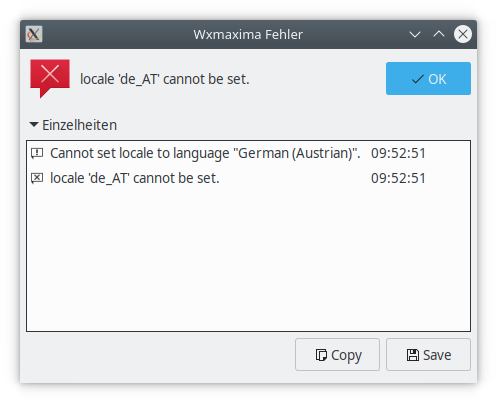{
id=img_locale_warning}

(Le même problème peut également se produire avec d’autres applications.)
Les traductions semblent correctes après avoir cliqué sur « OK ». WxMaxima
n’utilise pas seulement ses propres traductions, mais aussi celles du
framework wxWidgets.

Ces langues locales peuvent ne pas être présentes dans le système. Sur les
systèmes Ubuntu/Debian, elles peuvent être générées avec : `dpkg-reconfigure
locales`

## Comment puis-je utiliser les symboles des nombres réels, des nombres naturels (ℝ, ℕ), etc. ?

Vous pouvez trouver ces symboles dans la barre latérale Unicode (recherchez
« double-struck capital »). Mais la police sélectionnée doit également
prendre en charge ces symboles. S’ils ne s’affichent pas correctement,
choisissez une autre police.

## Comment un script Maxima peut-il déterminer s'il s'exécute sous wxMaxima ou en ligne de commande ?

Si wxMaxima est utilisé, la variable Maxima `maxima_frontend` est définie
sur `wxmaxima`. Dans ce cas, la variable Maxima `maxima_frontend_version`
contient la version de wxMaxima.

Si aucun programme pour le frontend n'est utilisé (si vous utilisez Maxima
en ligne de commande), ces variables valent `false`.

### Is wxMaxima new enough for this worksheet?

<div id="wx_version_min"></div>

`wx_version_min("26.09.0")` returns `true` if the running _wxMaxima_ is at
least version 26.09.0, and `false` if it is older, or if the command runs in
command line _Maxima_. The parts of the version number are compared as
numbers, so 26.10.0 counts as newer than 26.9.0, and a part that is left out
counts as 0: `wx_version_min("26.9")` is the same as
`wx_version_min("26.09.0")`. A development version counts as the version it
will be released as.

_wxMaxima_ 26.08.0 and older don't know `wx_version_min()` yet. There, as
with any function _Maxima_ doesn't know, the call isn't an error: it just
returns itself, unevaluated, as `wx_version_min("26.09.0")`, which is
neither `true` nor `false`. So a plain `if wx_version_min("26.09.0") then
...` stays unevaluated on these versions, too. A worksheet that has to work
with them as well can compare the result with `true`, which gives `false`
there:

```maxima
if wx_version_min("26.09.0") = true then
    wx_matrix(M, oversized=scroll)
else
    M;
```

## À l’aide ! Je ne peux pas enregistrer mon document !

Si l’enregistrement en fichier `.wxmx` ne fonctionne pas, essayez d’enregistrer le document en fichier `.wxm` (et inversement). Vous pouvez également essayer de supprimer toute la sortie (menu Cellule → Supprimer toute la sortie), puis enregistrer ce fichier ; il est possible qu’une sortie inattendue pose problème lors du processus d’enregistrement.

______________________________________________________________________

# Arguments en ligne de commande

Généralement, les programmes dotés d'une interface graphique se lancent
simplement en cliquant sur une icône ou une entrée de menu. WxMaxima,
lorsqu'il est démarré depuis la ligne de commande, accepte néanmoins
certains arguments.

- `-v` ou `--version` : affiche les informations de version
- `-h` ou `--help` : affiche un texte d'aide succinct
- `-o` ou `--open=<fichier>` : ouvre le fichier spécifié en argument de
  cette option de la ligne de commande
- `-e` ou `--eval` : évalue le fichier après l'avoir ouvert.
- `-b` or `--batch`: If the command-line opens a file all cells in this file
  are evaluated and the file is saved afterward. This is for example useful
  if the session described in the file makes _Maxima_ generate output
  files. Batch-processing will be stopped if _wxMaxima_ detects that
  _Maxima_ has output an error and will exit if _Maxima_ asks a question no
  scripted answer exists for: Mathematics is somewhat interactive by nature
  so a completely interaction-free batch processing cannot always be
  guaranteed.
- `--logtostderr` : redirige aussi les messages de débogage (barre latérale) vers stderr.
- `--pipe` : transmet les messages de Maxima vers stdout.
- `--exit-on-error` : ferme le programme en cas d’erreur Maxima.
- `-f` ou `--ini=<fichier>` : utilise le fichier d’initialisation spécifié en argument.
- `-u`, `--use-version=<version>` : utilise la version `<version>` de Maxima.
- `-l`, `--lisp=<compilateur>` : utilise une version de Maxima compilée avec le compilateur Lisp `<compilateur>`.
- `-X`, `--extra-args=<args>` : permet de passer des arguments supplémentaires à Maxima.
- `-m` ou `--maxima=<chemin>` : spécifie l’emplacement du binaire maxima.
- `--enableipc` : permet à Maxima de contrôler wxMaxima via une communication inter-processus (à utiliser avec prudence).
- `--wxmathml-lisp=<fichier>` : indique l’emplacement de `wxMathML.lisp` (pour remplacer la version intégrée, principalement pour les développeur·ses).

Certains systèmes d'exploitation peuvent utiliser un tiret long (—) au lieu
d'un tiret court (-) devant les options en ligne de commande.

A successful run exits with status 0. A batch run that had to stop before
finishing exits with one of the following statuses instead, so a script that
calls _wxMaxima_ can tell why it stopped without reading its log:

- `90`: _Maxima_ reported an error and `--exit-on-error` was given.
- `91`: _Maxima_ asked a question no scripted answer exists for.
- `92`: The file named on the command line could not be opened.
- `93`: Saving the worksheet failed.
- `94`: The data of an image in the worksheet could not be loaded.
- `95`: An image in the worksheet could not be decoded (only checked with
  `--debug`).

______________________________________________________________________

# À propos du logiciel et des contributions à wxMaxima

wxMaxima est principalement développé en C++ avec le framework
[wxWidgets](https://www.wxwidgets.org), et utilise
[CMake](https://www.cmake.org) comme système de build. Une petite partie est
écrite en Lisp. Si vous maîtrisez ces langages et souhaitez contribuer à ce
projet open source, vous pouvez rejoindre l’équipe sur
[GitHub](https://github.com/wxMaxima-developers/wxmaxima).

Mais les programmeurs ne sont pas les seul·es à pouvoir contribuer ! Vous
pouvez aussi aider à améliorer wxMaxima en améliorant la documentation, en
signalant (ou corrigeant) des bugs, en proposant de nouvelles
fonctionnalités, en traduisant l’interface ou le manuel dans votre langue
(consultez le fichier README.md dans le [dossier
locales](https://github.com/wxMaxima-developers/wxmaxima/tree/main/locales)
pour savoir comment procéder).

Ou répondre aux questions d'autres utilisateurs sur le forum de discussion.

Le code source de wxMaxima est documenté avec Doxygen, disponible
[ici](https://wxmaxima-developers.github.io/wxmaxima/Doxygen-documentation/).

Le programme est quasi complet : hormis les bibliothèques système (et la
bibliothèque wxWidgets), il ne nécessite aucune dépendance externe (comme
des fichiers graphiques ou le logiciel Lisp.   Les éléments comme le fichier
( `wxmathML.lisp`) sont intégrés directement dans l'exécutable.

Si vous êtes développeur et que vous souhaitez tester une version modifiée du fichier `wxmathML.lisp`  sans tout recompiler, vous pouvez utiliser l'option en ligne de commande : `--wxmathml-lisp=<chemin>` pour spécifier un autre fichier Lisp à la place de celui intégré à la version actuelle.
