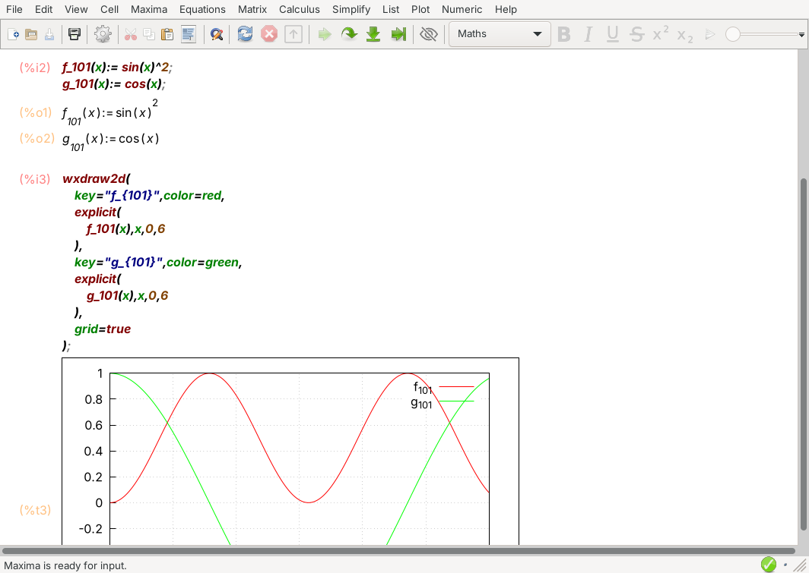
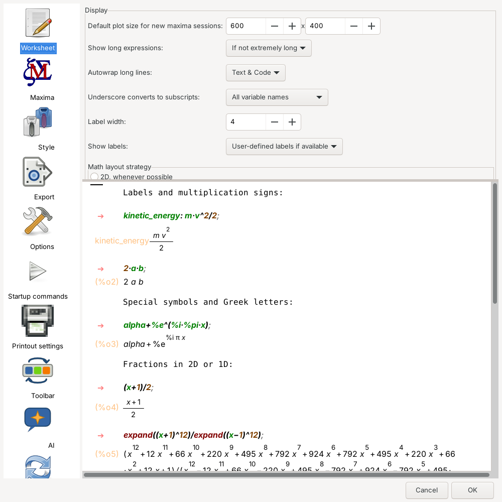
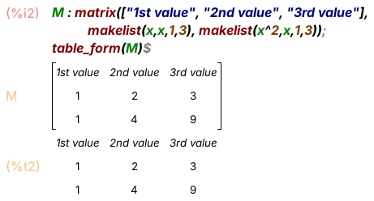

# Il manuale utente di wxMaxima

wxMaxima è un'interfaccia utente grafica (GUI) per il sistema di algebra
computazionale (CAS) _Maxima_. wxMaxima consente di utilizzare tutte le
funzioni di _Maxima_, inoltre, fornisce comode procedure guidate per
accedere alle funzionalità più comunemente utilizzate. Questo manuale
descrive alcune delle funzionalità che rendono wxMaxima una delle GUI più
popolari per _Maxima_.

{ id=img_wxMaximaLogo }

______________________________________________________________________

# Introduzione a wxMaxima

## _Maxima_ e wxMaxima

Nel dominio open source, i grandi sistemi sono normalmente suddivisi in
progetti più piccoli che sono più facili da gestire per piccoli gruppi di
sviluppatori. Ad esempio, un programma di masterizzazione di CD sarà
costituito da uno strumento a riga di comando che effettivamente masterizza
il CD e da un'interfaccia utente grafica che consente agli utenti di
utilizzarlo senza dover conoscere tutte le opzioni della riga di comando, e
di fatto senza utilizzare affatto la riga di comando. Un vantaggio di questo
approccio è che il lavoro di sviluppo che è stato investito nel programma a
riga di comando può essere condiviso da molti programmi: lo stesso programma
a riga di comando del masterizzatore CD può essere utilizzato come plug-in
"invia-al-CD" per un'applicazione di gestione file, per la funzione
"masterizza su CD" di un lettore musicale e come masterizzatore di CD per
uno strumento di backup su DVD. Un altro vantaggio è che suddividere una
grande attività in parti più piccole consente agli sviluppatori di fornire
diverse interfacce utente per lo stesso programma.

Un sistema di algebra computazionale (CAS) come _Maxima_ si inserisce in
questo quadro. Un CAS può fornire la logica dietro un'applicazione di
calcolatrice di precisione arbitraria o può fare trasformazioni automatiche
di formule sullo sfondo di un sistema più grande (ad esempio, [Sage]
(https://www.sagemath.org/)). In alternativa, può essere utilizzato
direttamente come sistema indipendente. _Maxima_ è utilizzabile tramite riga
di comando. Spesso, tuttavia, un'interfaccia come _wxMaxima_ si rivela un
modo più efficiente per accedere al software, in particolare per i nuovi
utenti.

### _Maxima_

_Maxima_ è un sistema di algebra computazionale (CAS) completo. Un CAS è un
programma in grado di risolvere problemi matematici riorganizzando le
formule e trovando una formula che risolve il problema invece di emettere
semplicemente il valore numerico del risultato. In altre parole, _Maxima_
può fungere da calcolatrice che fornisce rappresentazioni numeriche di
variabili e può anche fornire soluzioni analitiche. Inoltre, offre una gamma
di metodi numerici di analisi per equazioni o sistemi di equazioni che non
possono essere risolti analiticamente.

{
id=img_maxima_screenshot }

Un'ampia documentazione di _Maxima_ è  [disponibile su internet](https://maxima.sourceforge.io/documentation.html). Parte di essa è accessibile anche dal menu di aiuto di wxMaxima. Premendo il tasto di aiuto (sulla maggior parte dei sistemi il tasto <kbd>F1</kbd>), l'aiuto contestuale di _wxMaxima_ salta automaticamente alla pagina del manuale di _Maxima_ relativa al comando sotto il cursore.

### WxMaxima

_wxMaxima_ è un'interfaccia utente grafica che fornisce flessibilità e tutte
le funzionalità di _Maxima_. wxMaxima offre agli utenti una visualizzazione
grafica e molte caratteristiche che rendono più facile lavorare con
_Maxima_. Ad esempio _wxMaxima_ consente di esportare il contenuto di una
qualsiasi cella (o, se necessario, anche qualsiasi parte di una formula)
come testo, come LaTeX o come specifica MathML con un semplice clic
destro. In effetti, è possibile esportare un'intera cartella di lavoro, sia
come file HTML che come file LaTeX. La documentazione per _wxMaxima_,
comprese le cartelle di lavoro per illustrare gli aspetti del suo utilizzo,
è online su _wxMaxima_ [sito della
guida](https://wxMaxima-developers.github.io/wxmaxima/help.html), nonché
tramite il menu della guida.

{ id=img_wxMaximaWindow }

I calcoli immessi in _wxMaxima_ vengono eseguiti dallo strumento della riga
di comando _Maxima_ in background.

## Nozioni di base sul foglio di lavoro

Gran parte di _wxMaxima_ si spiega da sé, ma alcuni dettagli richiedono
attenzione. [Questo
sito](https://wxMaxima-developers.github.io/wxmaxima/help.html) contiene una
serie di cartelle di lavoro che affrontano vari aspetti di
_wxMaxima_. Lavorare attraverso alcuni di questi (in particolare il
"tutorial _(wx)Maxima_ di 10 minuti") può essere utile ad aumentare la
propria familiarità sia con il contenuto di _Maxima_ sia con l'uso di
_wxMaxima_ per interagire con _Maxima_. Questo manuale si concentra sulla
descrizione degli aspetti di _wxMaxima_ che probabilmente non sono evidenti
e che potrebbero non essere trattati nel materiale online.

### L'approccio del foglio di lavoro

Una delle pochissime cose che non sono standard in _wxMaxima_ è che
organizza i dati per _Maxima_ in celle che vengono elaborate (ovvero:
inviate a _Maxima_) solo quando l'utente lo richiede. Quando viene elaborata
una cella, tutti i comandi in quella cella, e solo quella cella, vengono
valutati in modalità 'batch'. (L'affermazione precedente non è del tutto
accurata: si può selezionare un insieme di celle adiacenti e valutarle tutte
assieme. Inoltre, si può istruire _Maxima_ a valutare tutte le celle in una
cartella di lavoro in un solo passaggio.) L'approccio di _wxMaxima_
all'invio di comandi per l'esecuzione potrebbe sembrare poco familiare a
prima vista. Tuttavia, facilita drasticamente il lavoro con documenti di
grandi dimensioni (dove l'utente potrebbe non desiderare che ogni modifica
attivi automaticamente una rivalutazione completa dell'intero
documento). Inoltre, questo approccio è molto utile per la ricerca difetti.

Se il testo viene digitato in _wxMaxima_, si crea automaticamente una nuova
cella del foglio di lavoro. Il tipo di questa cella può essere selezionato
nella barra degli strumenti. Se viene creata una cella di codice, la cella
può essere inviata a _Maxima_, il che fa sì che il risultato del calcolo
venga visualizzato sotto il codice. Di seguito viene mostrata una coppia di
tali comandi.

{ id=img_InputCell }

Sulla valutazione del contenuto di una cella di ingresso, la cella di
ingresso _Maxima_ assegna un'etichetta all'ingresso (per impostazione
predefinita mostrata in rosso e riconoscibile da `%i`) con la quale può
essere referenziata successivamente durante la sessione. L'uscita generata
da _Maxima_ ottiene anch'essa un'etichetta, la quale inizia con `%o` e, per
impostazione predefinita, è nascosta, tranne se l'utente assegna un nome
all'uscita. In questo caso, ancora per impostazione predefinita, viene
visualizzata un'etichetta definita dall'utente. Anche l'etichetta in stile
`%o`\ _Maxima_ e generata automaticamente, sarà accessibile.

Oltre alle celle di ingresso, _wxMaxima_ consente l'uso di celle di testo
per la documentazione, celle immagine, celle titolo, celle capitolo e celle
sezione. Ogni cella ha una propria memoria degli annullamenti, quindi
eseguire la correzione modificando i valori di più celle e quindi
ripristinare gradualmente le modifiche non necessarie, è piuttosto
semplice. Inoltre, il foglio di lavoro stesso ha una memoria degli
annullamenti globale che può annullare le modifiche, le aggiunte e le
eliminazioni delle celle.

La figura seguente mostra diversi tipi di celle (celle titolo, celle
sezione, celle sottosezione, celle testo, celle ingresso/uscita e celle
immagine).

{
id=img_cell-example }

### Celle

Il foglio di lavoro è organizzato in celle. wxMaxima riconosce i seguenti
tipi di celle:

- Celle matematiche, contenenti una o più righe di ingresso _Maxima_.
- Uscita di, o una domanda da parte di, _Maxima_.
- Celle immagine.
- Celle di testo, che per esempio possono essere usate per documentazione.
- Un titolo, sezione o sottosezione. Sono possibili 6 livelli diversi di
  intestazione.
- Interruzioni di pagina.

Il comportamento predefinito di _wxMaxima_ quando viene inserito del testo è
creare automaticamente una cella matematica. È possibile creare celle di
altro tipo utilizzando il menu Cella, utilizzando i tasti di scelta rapida
visualizzati nel menu o utilizzando l'elenco a discesa nella barra degli
strumenti. Una volta creata la cella non-matematica, tutto ciò che viene
digitato nel file viene interpretato come testo.

Un testo di commento (in stile linguaggio C) può fare parte di una cella
matematica come di seguito: `/* Questo commento verrà ignorato da Maxima */`

"`/*`" marca l'inizio del commento, mentre "`*/`" la sua fine.

### Cursore orizzontale e verticale

Se l'utente tenta di selezionare una frase completa, un elaboratore di testi
tenterà di estendere la selezione per iniziare e terminare automaticamente
con un limite di parola. Allo stesso modo _wxMaxima_ se viene selezionata
più di una cella estenderà la selezione alle celle intere.

Ciò che non è standard è che _wxMaxima_ fornisce flessibilità di
trascinamento della selezione definendo due tipi di cursori. _wxMaxima_
passerà da uno all'altro automaticamente alla bisogna:

- Il cursore viene disegnato orizzontalmente se viene spostato nello spazio
  tra due celle o facendo clic lì.
- Un cursore verticale che funziona all'interno di una cella. Questo cursore
  viene attivato spostando il cursore all'interno di una cella utilizzando
  il puntatore del mouse o i tasti cursore e funziona in modo molto simile
  al cursore in un editor di testo.

All'avvio di wxMaxima si vede solo il cursore orizzontale lampeggiante. Appena si inizia a scrivere, viene creata automaticamente una cella matematica e il cursore diventa un normale cursore verticale (come «prompt» si vede una freccia verso destra; dopo che la cella matematica è stata valutata (<kbd>CTRL</kbd>+<kbd>ENTER</kbd>) compaiono le etichette, ad es. `(%i1)`, `(%o1)`).

{ id=img_horizontal_cursor_only }

Si potrebbe voler creare un altro tipo di cella (usando il menu "Cella"),
magari una cella titolo o una cella di testo, che descriva cosa verrà fatto
quando si inizi a creare il foglio di lavoro.

Se si naviga tra le diverse celle, si vedrà anche il cursore orizzontale
(lampeggiante), col quale si può inserire una cella nel foglio di lavoro
(una cella matematica, semplicemente iniziando a digitare la formula, o un
altro tipo di cella utilizzando il menu).

{
id=img_horizontal_cursor_between_cells }

### Inviare le celle a Maxima

Il comando in una cella di codice viene eseguito premendo <kbd>CTRL</kbd>+<kbd>ENTER</kbd>, <kbd>SHIFT</kbd>+<kbd>ENTER</kbd> oppure il tasto <kbd>ENTER</kbd> del tastierino numerico. Per impostazione predefinita _wxMaxima_ invia i comandi con <kbd>CTRL</kbd>+<kbd>ENTER</kbd> o <kbd>SHIFT</kbd>+<kbd>ENTER</kbd>, ma _wxMaxima_ può essere configurato per eseguire i comandi alla pressione di <kbd>ENTER</kbd>.

### Completamento automatico dei comandi

_WxMaxima_ dispone di una funzione di completamento automatico che si attiva dal menu (Cella/Completa parola) oppure con la combinazione di tasti <kbd>CTRL</kbd>+<kbd>SPACE</kbd>. Il completamento tiene conto del contesto: ad esempio, se attivato all'interno di un'indicazione di unità per ezUnits, propone un elenco delle unità applicabili.

{ id=img_ezUnits }

Oltre a completare un nome di file, il nome di un'unità o il nome del comando o della variabile corrente, il completamento automatico può mostrare per la maggior parte dei comandi un modello che indica il tipo (e il significato) dei parametri attesi. Per usare questa funzione premere <kbd>SHIFT</kbd>+<kbd>CTRL</kbd>+<kbd>SPACE</kbd> oppure scegliere la voce di menu corrispondente (Cella/Mostra modello).

#### Lettere greche

I computer tradizionalmente memorizzavano i caratteri in valori a 8 bit. Ciò
consente un massimo di 256 caratteri diversi. Tutte le lettere, i numeri e i
simboli di controllo (fine trasmissione, fine stringa, linee e bordi per
disegnare rettangoli per i menu, _ecc._ .) di quasi tutte le lingue possono
essere compresi in tale limitazione.

Per la maggior parte dei paesi, la codifica di 256 caratteri che è stata
scelta non include per esempio le lettere greche, che sono usate
frequentemente in matematica. Per superare questo tipo di limitazione è
stato inventato [Unicode](https://home.unicode.org/): una codifica che fa
funzionare normalmente il testo inglese, ma può andare molto oltre il limite
dei 256 caratteri.

_Maxima_ consente Unicode, se è stato compilato utilizzando un compilatore
Lisp che supporta Unicode o che non si preoccupa della codifica dei
caratteri. Dato che è molto probabile che almeno una di questa coppia di
condizioni sia vera, _wxMaxima_ fornisce un metodo per inserire caratteri
greci usando la tastiera:

- È possibile inserire una lettera greca premendo il tasto <kbd>ESC</kbd> e
  quindi iniziare a digitare il nome del carattere greco.
- In alternativa può essere inserito premendo <kbd>ESC</kbd>, una lettera (o
  due per la lettera greca omicron) e <kbd>ESC</kbd> nuovamente. In questo
  caso sono supportate le seguenti lettere:

|tasto|Lettera greca |tasto|Lettera greca |Tasto|Lettera greca |
|:---:|:------------:|:---:|:------------:|:---:|:------------:|
|  a  |     alpha    |  i  |     iota     |  r  |      rho     |
|  b  |     beta     |  k  |     kappa    |  s  |     sigma    |
|  g  |     gamma    |  l  |    lambda    |  t  |      tau     |
|  d  |     delta    |  m  |      mu      |  u  |    upsilon   |
|  e  |    epsilon   |  n  |      nu      |  f  |      phi     |
|  z  |     zeta     |  x  |      xi      |  c  |      chi     |
|  h  |      eta     |  om |    omicron   |  y  |      psi     |
|  q  |     theta    |  p  |      pi      |  o  |     omega    |
|  A  |     Alpha    |  I  |     Iota     |  R  |      Rho     |
|  B  |     Beta     |  K  |     Kappa    |  S  |     Sigma    |
|  G  |     Gamma    |  L  |    Lambda    |  T  |      Tau     |
|  D  |     Delta    |  M  |      Mu      |  U  |    Upsilon   |
|  E  |    Epsilon   |  N  |      Nu      |  P  |      Phi     |
|  Z  |     Zeta     |  X  |      Xi      |  C  |      Chi     |
|  H  |      Eta     |  Om |    Omicron   |  Y  |      Psi     |
|  T  |     Theta    |  P  |      Pi      |  O  |     Omega    |

Le lettere greche si possono inserire anche tramite la barra laterale
«Lettere greche».

##### Attenzione: caratteri dall'aspetto identico

Diverse lettere latine somigliano a lettere greche, ad es. la lettera latina
«A» e la lettera greca «Alfa». Benché appaiano identiche, sono due caratteri
Unicode diversi, rappresentati da punti di codice Unicode (numeri) diversi.

Questo può creare problemi se si assegna un valore alla variabile A e poi si
usa la lettera greca Alfa per fare qualcosa con questa variabile,
soprattutto nelle stampe.  Anche per la lettera greca mi (usata pure come
prefisso per micro) esistono due punti di codice Unicode diversi.

La barra laterale «Lettere greche» offre perciò l'opzione di non rendere
disponibili i caratteri dall'aspetto identico (modificabile tramite il menu
del tasto destro).

Lo stesso meccanismo permette anche di inserire alcuni simboli matematici
vari:

| tasti da digitare | simbolo matematico                                 |
| -------------- | ----------------------------------------------------- |
| hbar           | costante di Planck: una h con una barra orizzontale sopra |
| Hbar           | una H con una barra orizzontale sopra                 |
| 2              | al quadrato                                           |
| 3              | alla terza                                            |
| /2             | 1/2                                                   |
| partial        | segno di derivata parziale (la d di dx/dt)            |
| integral       | segno di integrale                                    |
| sq             | radice quadrata                                       |
| ii             | immaginario                                           |
| ee             | elemento                                              |
| in             | appartiene a                                          |
| impl implies   | implica                                               |
| inf            | infinito                                              |
| empty          | insieme vuoto                                         |
| TB             | triangolo grande verso destra                         |
| tb             | triangolo piccolo verso destra                        |
| and            | e (and)                                               |
| or             | o (or)                                                |
| xor            | xor                                                   |
| nand           | nand                                                  |
| nor            | nor                                                   |
| equiv          | equivalente a                                         |
| not            | non (not)                                             |
| union          | unione                                                |
| inter          | intersezione                                          |
| subseteq       | sottoinsieme o uguale                                 |
| subset         | sottoinsieme                                          |
| notsubseteq    | non sottoinsieme né uguale                            |
| notsubset      | non sottoinsieme                                      |
| approx         | circa uguale                                          |
| propto         | proporzionale a                                       |
| neq != /= or # | diverso da                                            |
| +/- or pm      | un segno più/meno                                     |
| \<= or leq     | minore o uguale                                       |
| >= or geq      | maggiore o uguale                                     |
| \<\< or ll     | molto minore di                                       |
| >> or gg       | molto maggiore di                                     |
| qed            | fine della dimostrazione                              |
| nabla          | un operatore nabla                                    |
| sum            | segno di sommatoria                                   |
| prod           | segno di produttoria                                  |
| exists         | segno di «esiste»                                     |
| nexists        | segno di «non esiste»                                 |
| parallel       | un segno di parallelo                                 |
| perp           | un segno di perpendicolare                            |
| leadsto        | un segno di «porta a»                                 |
| ->             | una freccia verso destra                              |
| -->            | una freccia lunga verso destra                        |

Questi simboli matematici si possono inserire anche tramite la barra
laterale «Simboli».

Se un simbolo speciale non è nell'elenco, è possibile inserire qualsiasi carattere Unicode premendo <kbd>ESC</kbd> \[numero del carattere (esadecimale)\] <kbd>ESC</kbd>. Inoltre la barra laterale «Simboli» ha un menu del tasto destro che mostra un elenco di tutti i simboli Unicode disponibili, che si possono aggiungere a questa barra degli strumenti o al foglio di lavoro.

<kbd>ESC</kbd><kbd>6</kbd><kbd>1</kbd><kbd>ESC</kbd> therefore results in an `a`. While you type the number, the list of symbols shows the character it stands for and its Unicode name.

If the number also is the beginning of a symbol's name (`be` could be the start of `beta`, or the character ¾ with the number `be`), the name wins. A leading `0` or `u+` makes it a number: <kbd>ESC</kbd>`u+be`<kbd>ESC</kbd> and <kbd>ESC</kbd>`00be`<kbd>ESC</kbd> both result in a `¾`.

A letter with an accent that Unicode has no character of its own for, like a t with a bar on top of it, is a letter followed by a "combining" accent: <kbd>t</kbd><kbd>ESC</kbd><kbd>3</kbd><kbd>0</kbd><kbd>4</kbd><kbd>ESC</kbd> results in `t̄`, which _Maxima_ treats as a variable name like any other.

Symbols one needs often can be added to the "Symbols" sidebar in the "Options" tab of the configuration dialog (Edit -> Configure), where they can also be given a keyboard shortcut. A letter with accents counts as one symbol there and gets one button. The Greek letters and the symbols the sidebars show anyway can be given a keyboard shortcut there, too, or by right-clicking their button in the sidebar. A shortcut has to contain <kbd>Ctrl</kbd> or <kbd>Alt</kbd> or be a function key, and types its symbol while the worksheet has the keyboard focus. The configuration dialog warns if a menu entry already uses the same keys.

Si noti che la maggior parte di questi simboli (con l'importante eccezione
dei simboli logici) non ha un significato particolare in _Maxima_ e verrà
quindi interpretata come caratteri ordinari. Se _Maxima_ è compilato con un
Lisp che non supporta i caratteri Unicode, possono causare un messaggio di
errore.

Può capitare che, ad es., i caratteri greci o i simboli matematici non siano inclusi nel carattere tipografico scelto; in tal caso non possono essere visualizzati.
Per risolvere il problema, scegliere altri caratteri (tramite: Modifica -> Configura -> Stile).

### Sostituzione dei caratteri Unicode

wxMaxima will replace several Unicode characters with their respective Maxima expressions, e.g. `²` with `^2`, `³` with `^3`, `≠` with `#` or `≤` with `<=`.

Unicode characters that stand for a Maxima name are instead defined as
_Maxima_ aliases of that name when wxMaxima starts _Maxima_: `π` for `%pi`,
`ⅈ` for `%i`, `ⅇ` for `%e`, `∞` for `inf`, the (mathematical) Sigma sign
(which is not the same Unicode character as the corresponding Greek letter)
for `sum`, `∏` for `product`, `∫` for `integrate`, the square root sign for
`sqrt` and `⋀`, `⋁`, `⊻`, `⊼`, `⊽`, `⇒`, `⇔` and `¬` for `and`, `or`, `xor`,
`nand`, `nor`, `implies`, `equiv` and `not`. This means they work in files
loaded by `batch()` or `load()`, too, and `aliases` lists the names they
stand for. As _Maxima_ reads these characters as letters they need to be
separated from neighbouring names by spaces in such a file: `a⋀b` is a
variable name, `a ⋀ b` means `a and b`. In an input cell wxMaxima adds these
spaces automatically. It also puts parenthesis around a number or a variable
that directly follows the square root sign, so `√2` means `sqrt(2)`.

Unicode codifica diverse frazioni «comuni» come un unico punto di codice:
`¼, ½, ¾, ⅐, ⅑, ⅒, ⅓, ⅔, ⅕, ⅖, ⅗, ⅘, ⅙, ⅚, ⅛, ⅜, ⅝, ⅞`

wxMaxima le sostituisce con la loro rappresentazione in Maxima, ad
es. `(1/4)`, prima che l'input venga inviato a Maxima. Esistono anche `⅟`,
che viene sostituito da `1/`, e `↉` (usato nel baseball), che viene
sostituito da `(0/3)`.

Nelle celle di input si consiglia di usare **codice Maxima** (e non questi
punti di codice Unicode). Motivo: (a) può darsi che il carattere tipografico
usato per l'input matematico non li contenga; (b) se si salva il documento
come file `wxm`, di solito può essere letto da Maxima (a riga di comando),
dove naturalmente queste sostituzioni non funzionano. Possono però comparire
se si copia e incolla una formula da un altro documento.

### Pannelli laterali

È possibile accedere più velocemente ai comandi _Maxima_ più importanti o a
cose come il sommario, finestre con messaggi diagnostici o la cronologia
degli ultimi comandi emessi utilizzando i riquadri laterali. Questi possono
essere abilitati utilizzando il menu "Visualizza". Tutti possono essere
spostati in altre posizioni all'interno o all'esterno della finestra
_wxMaxima_. Altro riquadro utile è quello che permette di inserire le
lettere greche utilizzando il mouse.

{ id=img_SidePanes }

Nel riquadro laterale "sommario" è possibile elevare o abbassare di livello
un'intestazione; è sufficiente fare clic sull'intestazione con il tasto
destro del mouse e selezionare il tipo di intestazione successiva superiore
o inferiore.

{
id=Sidepane-TOC-convert-headings }

### Output MathML

Diversi elaboratori di testi e programmi simili riconoscono l'input
[MathML](https://www.w3.org/Math/) e lo inseriscono automaticamente come
equazione 2D modificabile, oppure (come LibreOffice) hanno un editor di
formule che offre la funzione «importa MathML dagli appunti». Altri
supportano la matematica in RTF. _WxMaxima_ offre perciò diverse voci nel
menu del tasto destro.

### Pasting LaTeX or MathML formulas

**Edit → Paste LaTeX/MathML as Maxima Code** (also in the right-click menu) converts a formula from the clipboard into a _Maxima_ command, for example one copied from a paper, a web page or an equation editor. LaTeX may come with or without `$…$`, `\(…\)` or `\[…\]` around it, so `\int_0^1 \frac{\sin x}{x}\,dx` becomes `integrate(sin(x)/x,x,0,1)`. The command goes where the cursor is, or into a new code cell. MathML pasted into a code cell with the ordinary **Paste** is converted the same way, since nobody wants the XML in a code cell. If MathML copied with **Copy as MathML** is pasted back, the result is the original command: _wxMaxima_ adds it to the MathML as an annotation.

LaTeX and MathML describe what a formula looks like, not what it means, so
the conversion has to interpret it. Fractions, roots, powers, subscripts
(`x_1` becomes the name `x_1`, `a_{n+1}` the array element `a[n+1]`),
functions with or without parentheses (`\sin 2x`), `\frac{d}{dx}`, `f'(x)`,
integrals ending in `dx`, sums and products with limits, `\lim_{x\to 0}`,
`|x|` and matrices are understood. An `e` is Euler’s number, but an `i` is
only the imaginary unit when set upright (`\mathrm{i}`), as it more often is
an index. A product of a name and parentheses, like `x(y+1)`, is taken as a
product unless the name is `f`, `g`, `h` or longer than one letter. Anything
without a single meaning, like `\pm`, `\dots` or text, isn’t guessed at:
_wxMaxima_ says what it couldn’t convert instead. Check the command before
evaluating it.

### Supporto per Markdown

_WxMaxima_ supporta un insieme di convenzioni standard di
[Markdown](https://en.wikipedia.org/wiki/Markdown) che non entrano in
conflitto con la notazione matematica. Uno di questi elementi sono gli
elenchi puntati.

```text
Testo normale
 * Una voce, livello di rientro 1
 * Un'altra voce al livello di rientro 1
   * Una voce a un secondo livello di rientro
   * Una seconda voce al secondo livello di rientro
 * Una terza voce al primo livello di rientro
Testo normale
```

_WxMaxima_ riconosce il testo che inizia con caratteri `>` come citazione:

```text
Testo normale
> citazione citazione citazione citazione
> citazione citazione citazione citazione
> citazione citazione citazione citazione
Testo normale
```

L'output TeX e HTML di _WxMaxima_ riconosce anche `=>` e lo sostituisce con il simbolo Unicode corrispondente:

```text
cogito => sum.
```

Altri simboli riconosciuti dall'esportazione in HTML e TeX sono `<=` e `>=` per i confronti, una doppia freccia a due punte (`<=>`), le frecce semplici (`<->`, `->` e `<-`) e `+/-` come il segno corrispondente. Nell'output TeX vengono riconosciuti anche `<<` e `>>`.

### Links in text cells

A web address in a text cell that starts with `http://`, `https://` or `mailto:` is shown as a link. Since clicking into a text cell places the cursor there, a link is followed by <kbd>CTRL</kbd>+clicking it (<kbd>CMD</kbd>+clicking on macOS), or by right-clicking it and choosing "Open Link"; hovering over it shows where it leads. The HTML export turns it into a link, the TeX export into a `\url{}`. Links are always recognized from the text itself, so nothing about them is stored in the file.

Links in a code cell's comments (`/* ... */`) work the same way. Elsewhere
in code, for example inside a string, an address is Maxima syntax and is not
a link.

The same goes for web addresses in _Maxima_'s output, for example in a string printed by `print("See https://wxmaxima-developers.github.io/wxmaxima/")`: <kbd>CTRL</kbd>+clicking the address or choosing "Open Link" from its context menu opens it, while a plain click still selects the output.

### Bold, italic, underlined and struck-through text

Text in a text cell, a title or a section heading can be made bold, italic,
underlined or struck through. Select the text and press the respective
button in the toolbar; pressing the button again removes that formatting
from the selection. With nothing selected the button switches the formatting
on or off for what is typed next. The buttons are hidden by right-clicking
the toolbar and unchecking "Text formatting buttons". Code cells cannot be
formatted: their colors already show the syntax of the code.

Superscript and subscript buttons work the same way: they make the text
smaller and raise it above or lower it below the line, as in E = mc² or
H₂O. A character cannot be both, so switching one of them on switches the
other off. A line that contains a superscript, a subscript or a character
that is taller than the font's usual ones, for example an emoji, gets as
much additional room as it needs.

The formatting is saved in `.wxmx` files. Older versions of _wxMaxima_ open
such a file without the formatting but keep all of the text. `.wxm` files,
the exports and the clipboard contain the text without its formatting.

### Tasti di scelta rapida

La maggior parte dei tasti di scelta rapida si trova nel testo dei
rispettivi menu. Dal momento che sono effettivamente presi dal testo del
menu e quindi possono essere personalizzati dalle traduzioni di _wxMaxima_
per soddisfare le esigenze degli utenti della tastiera locale, non vengono
documentati quì. Alcuni tasti di scelta rapida o alias di tasti di scelta
rapida, tuttavia, non sono documentati neanche nei menu:

- <kbd>CTRL</kbd>+<kbd>MAIUSC</kbd>+<kbd>CANC</kbd> elimina una cella
  intera.
- <kbd>CTRL</kbd>+<kbd>TAB</kbd> o
  <kbd>CTRL</kbd>+<kbd>SHIFT</kbd>+<kbd>TAB</kbd> attiva il completamento
  automatico.
- <kbd>MAIUSC</kbd>+<kbd>SPAZIO</kbd> inserisce uno spazio non divisibile.

### Exploring output with the keyboard

A cell's output can be selected, and explored part by part, without a mouse:

- <kbd>DOWN</kbd> at the end of a cell's input selects the first result of
  its output. Further presses of <kbd>DOWN</kbd> and <kbd>UP</kbd> step
  through the results; past the last one the cursor leaves the cell. If you
  prefer <kbd>DOWN</kbd> to skip over the output, switch on "Up/Down keys
  skip over output" in the Worksheet tab of the configuration dialog.
- <kbd>ENTER</kbd> goes into the selected expression and selects its first
  part: the expression without its label, the numerator of a fraction, the
  name of a function, the first entry of a matrix, ... If the selection has
  no parts, <kbd>ENTER</kbd> opens a new input cell holding it, as it always
  did.
- <kbd>ESCAPE</kbd> selects what the selection is a part of. From a whole
  result it goes back into the cell's input.
- <kbd>LEFT</kbd> and <kbd>RIGHT</kbd> select the previous or next part at
  the same level. In a matrix all four arrow keys move from entry to entry.
- <kbd>SHIFT</kbd>+<kbd>LEFT</kbd> and <kbd>SHIFT</kbd>+<kbd>RIGHT</kbd>
  grow or shrink the selection over the neighbouring parts; in a matrix,
  <kbd>SHIFT</kbd> and any arrow key grow the selected entry into a block of
  entries.
- The context-menu key or <kbd>SHIFT</kbd>+<kbd>F10</kbd> opens the
  right-click menu for the selection, so it can be copied in any format.

### TeX grezzo nell'esportazione TeX

Se una cella di testo inizia con `TeX:`, l'esportazione TeX contiene il
testo letterale che segue l'indicatore `TeX:`. L'utilizzo di questa funzione
consente l'inserimento del marcatore TeX all'interno della cartella di
lavoro _wxMaxima_.

## Formati di file

Il materiale sviluppato in una sessione _wxMaxima_ può essere archiviato per
un uso successivo in uno dei seguenti tre modi:

### .mac

I file `.mac` sono normali file di testo che contengono comandi
_Maxima_. Possono essere letti usando il comando `batch()` o `load()` di
_Maxima_ o la voce di menu File/File batch di _wxMaxima_.

Un esempio viene mostrato di seguito. `Quadratic.mac` definisce una funzione
e successivamente genera un grafico con `wxdraw2d()`. Successivamente viene
stampato il contenuto del file `Quadratic.mac` e viene valutata la nuova
funzione definita `f()`.

{ id=img_BatchImage }

Attenzione: anche se il file `Quadratic.mac` ha una normale estensione di
_Maxima_ (`.mac`), può essere letto solo da _wxMaxima_, perché il comando
`wxdraw2d()` è un'estensione di wxMaxima a _Maxima_. Maxima (a riga di
comando) ignorerà il comando sconosciuto `wxdraw2d()` e lo ristamperà come
output.

Si può usare i file `.mac` per scrivere la propria libreria di macro. Ma dal
momento che non contengono informazioni strutturali sufficienti, non possono
essere rilette come sessioni _wxMaxima_.

### .wxm

I file `.wxm` contengono il foglio di lavoro tranne l'output di _Maxima_. Con le versioni di Maxima >5.38 possono essere letti con la funzione `load()` di _Maxima_, proprio come i file .mac. Beh, quasi sempre. Le domande (come `asksign(x)`) sono problematiche, perché la risposta viene scritta nel file `.wxm` (così da poterla proporre dopo il caricamento), ma Maxima non può valutarla.
Si può evitare che Maxima faccia domande dichiarando con `assume()` le proprietà che Maxima vuole conoscere.

Con questo formato di testo semplice a volte è inevitabile che i fogli di
lavoro che usano funzionalità nuove non siano compatibili con le versioni
precedenti di _wxMaxima_.

#### Formato dei file wxm

È un semplice file di testo (lo si può aprire con un editor di testo) che
contiene il contenuto delle celle sotto forma di speciali commenti di
Maxima.

Inizia con il seguente commento:

```maxima
/* [wxMaxima batch file version 1] [ DO NOT EDIT BY HAND! ]*/
/* [ Created with wxMaxima version 24.02.2_DevelopmentSnapshot ] */
```

Seguono poi le celle, codificate come commenti di Maxima, ad es. una cella
di sezione:

```maxima
/* [wxMaxima: section start ]
Title of the section
   [wxMaxima: section end   ] */
```

oppure (in una cella matematica l'input naturalmente *non* è commentato;
l'output non viene salvato in un file `wxm`):

```maxima
/* [wxMaxima: input   start ] */
f(x):=x^2+1$
f(2);
/* [wxMaxima: input   end   ] */
```

Le immagini sono [codificate in
Base64](https://en.wikipedia.org/wiki/Base64), con il tipo di immagine nella
prima riga:

```maxima
/* [wxMaxima: image   start ]
jpg
[very chaotic looking character sequence]
   [wxMaxima: image   end   ] */
```

Un'interruzione di pagina è semplicemente una riga contenente:

```maxima
/* [wxMaxima: page break    ] */
```

E le celle compresse sono delimitate da:

```maxima
/* [wxMaxima: fold    start ] */
...
/* [wxMaxima: fold    end   ] */
```

### .wxmx

Questo formato di file basato su XML salva il foglio di lavoro completo,
inclusi elementi come il fattore di zoom e la watchlist. È il formato di
file preferito.

#### Formato dei file wxmx

Un file `wxmx` sembra un formato binario, ma lo si può gestire con strumenti
già inclusi nel sistema operativo. È un file zip che si può decomprimere con
`unzip` (eventualmente rinominandolo prima, affinché il programma di
decompressione del sistema operativo lo riconosca).  Non usiamo la funzione
di compressione, ma solo la possibilità di riunire più file in uno: le
immagini sono già compresse e il resto è semplice testo (probabilmente molto
più piccolo delle grandi immagini incluse).

Contiene i seguenti file:

- `mimetype`: questo file contiene il tipo MIME dei file di wxMaxima:
  `text/x-wxmathml`
- `format.txt`: una breve descrizione di wxMaxima e del formato di file wxmx
- Immagini (ad es. png, jpeg): grafici incorporati prodotti nella sessione
  di wxMaxima e immagini incluse.
- `content.xml`: un documento XML che contiene le varie celle del documento
  in formato XML.

Quindi, se qualcosa va storto, si può decomprimere un documento di wxMaxima
(eventualmente rinominandolo prima in file `zip`), modificare il file
`content.xml` con un editor di testo o sostituire un'immagine danneggiata,
ricomprimere i file e rinominare lo `zip` in file `wxmx`: si ottiene così un
file `wxmx` modificato.

## Opzioni di configurazione

Per alcune variabili di configurazione comuni _wxMaxima_ offre due modalità
di configurazione:

- La finestra di dialogo di configurazione sottostante consente di
  modificare i valori predefiniti per le sessioni correnti e successive.
- Inoltre, i valori per la maggior parte delle variabili di configurazione
  possono essere modificati per la sessione corrente solo sovrascrivendo i
  loro valori dal foglio di lavoro, come mostrato di seguito.

{
id=img_wxMaxima_configuration_001 }

### Frequenza dei fotogrammi predefinita delle animazioni

La frequenza di quadro dell'animazione usata per le nuove animazioni è
conservata nella variabile `wxanimate_framerate`. Il valore iniziale che
questa variabile conterrà in un nuovo foglio di lavoro può essere modificato
utilizzando la finestra di configurazione.

### Dimensione predefinita dei grafici nelle nuove sessioni di _maxima_

Al prossimo riavvio, i grafici incorporati nel foglio di lavoro verranno
creati con questa dimensione se il valore di `wxplot_size` non viene
modificato da _maxima_.

Per impostare la dimensione del grafico di un singolo grafico è possibile
utilizzare solo la seguente notazione che imposta il valore di una variabile
per un solo comando:

```maxima
wxdraw2d(
   explicit(
       x^2,
       x,-5,5
   )
), wxplot_size=[480,480]$
```

### Chiusura automatica delle parentesi nei campi di testo

Questa opzione abilita due cose:

- Se viene inserita una apertura parentesi tonda, quadra o virgolette doppie
  _wxMaxima_ ne inserirà una di chiusura dopo di essa.
- In a code cell a comment opened by `/*` is closed by an inserted
  `*/`. Typing `*/` in front of it moves the cursor past it instead.
- Se il testo è selezionato e viene premuto uno di questi tasti, questo
  verrà inserito in una coppia di segni corrispondenti.

### Non salvare automaticamente il foglio di lavoro

Se questa opzione è impostata, il file in cui si trova il foglio di lavoro
verrà sovrascritto solo su richiesta dell'utente. Tuttavia, in caso di
arresto anomalo/interruzione dell'alimentazione/... una copia di backup
recente sarà ancora disponibile nella directory temp.

Se questa opzione non è impostata, _wxMaxima_ si comporta più come una
moderna app per cellulari:

- I file vengono salvati automaticamente all'uscita
- E il file verrà automaticamente salvato ogni 3 minuti.

### Arranging the toolbar

The toolbar is made of sections, like the "Open" and "Save" buttons, the
evaluation buttons or the drop-down list that sets the type of a cell. The
"Toolbar" tab of the configuration dialog lists them in the order the
toolbar shows them in: drag a section to another place, or select it and
press "Up" or "Down", to move it, and uncheck it to hide it. The flexible
space pushes every section after it to the right edge of the
window. "Default order" restores the original arrangement. Sections can also
be shown or hidden by right-clicking the toolbar.

### Dove viene salvata la configurazione?

Su Unix/Linux la configurazione viene salvata nel file `.wxMaxima` nella cartella home (con wxWidgets \< 3.1.1) oppure in `.config/wxMaxima.conf` ((standard XDG) con wxWidgets >= 3.1.1). La versione di wxWidgets si può ricavare con il comando `wxbuild_info();` oppure dalla voce di menu Aiuto->Informazioni. [wxWidgets](https://www.wxwidgets.org/) è la libreria multipiattaforma per interfacce grafiche su cui si basa _wxMaxima_ (da cui il `wx` nel nome).
(Poiché il nome del file inizia con un punto, `.wxMaxima` o `.config` saranno nascosti.)

Se si sta usando Windows, la configurazione verrà memorizzata nel registro
di sistema. Le voci per _wxMaxima_ sono nella seguente posizione nel
registro: `HKEY_CURRENT_USER\Software\wxMaxima`

______________________________________________________________________

# Estensioni a _Maxima_

_wxMaxima_ è principalmente un'interfaccia utente grafica per _Maxima_. In
quanto tale, il suo scopo principale è passare i comandi a _Maxima_ e
riportare i risultati dell'esecuzione di tali comandi. In alcuni casi,
tuttavia, _wxMaxima_ aggiunge funzionalità a _Maxima_. È stata menzionata la
capacità di _wxMaxima_ di generare report esportando il contenuto di una
cartella di lavoro in file HTML e LaTeX. Questa sezione descrive alcuni modi
in cui _wxMaxima_ migliora l'inclusione della grafica in una sessione.

## Variabili con pedice

<div id="wxsubscripts"></div>

`wxsubscripts` stabilisce se (e come) _wxMaxima_ mette automaticamente a
pedice parti dei nomi delle variabili:

Se vale `false`, la funzione è disattivata: wxMaxima non mette
automaticamente a pedice le parti dei nomi delle variabili che seguono un
trattino basso.

Se vale `'all`, tutto ciò che segue un trattino basso viene messo a pedice.

se `wxsubscripts` è impostato su vera i nomi delle variabili nel formato
`x_y` vengono visualizzati utilizzando un pedice se

- `x` oppure `y` è una singola lettera, oppure
- `y` è un numero intero (può avere più di una cifra).

{ id=img_wxsubscripts }

<div id="wxdeclare_subscripted"></div>

A variable the rules above don’t cover can still be declared as "to be
subscripted" using the command `wxdeclare_subscripted(variable_name);` or
`wxdeclare_subscripted([variable_name1,variable_name2,...]);` Declaring a
variable as subscripted can be reverted using the following command:
`wxdeclare_subscripted(variable_name,false);`, which also keeps a variable
the rules above do cover from being subscripted.

<div id="wxdeclare_subscript"></div>

`wxdeclare_subscript(text_snippet);` or
`wxdeclare_subscript([text_snippet1,text_snippet2,...]);` instead declares a
text snippet: every variable whose name ends in an underscore followed by
that snippet is subscripted, however long the two parts are.

Questi valori si possono impostare anche con il menu «Vista->Autopedice».

## Messaggi per l'utente nella barra di stato

<div id="wxstatusbar"></div>

I comandi a esecuzione prolungata possono fornire feedback all'utente nella
barra di stato. Questo feedback all'utente viene sostituito da qualsiasi
nuovo feedback inserito lì (consentendo di utilizzarlo come indicatore di
avanzamento) e viene eliminato non appena il comando corrente inviato a
_Maxima_ viene terminato. È sicuro usare `wxstatusbar()` anche nelle
librerie che potrebbero essere usate semplicemente solo con _Maxima_ (invece
che con _wxMaxima_): Se _wxMaxima_ non è presente, il comando
`wxstatusbar()` non viene valutato.

```maxima
for i:1 thru 10 do (
    /* Comunica all'utente a che punto siamo */
    wxstatusbar(concat("Pass ",i)),
    /* (sleep n) è una funzione Lisp che si può usare */
    /* anteponendo il carattere "?". Ritarda */
    /* l'esecuzione del programma (qui: di 3 secondi) */
    ?sleep(3)
)$
```

## Esportare il foglio di lavoro dall'interno di Maxima

<div id="wxworksheettohtml"></div>

Il comando `wxworksheettohtml()` esporta il foglio di lavoro corrente in un
file HTML dall'interno di una sessione di _Maxima_ in esecuzione, il che è
comodo per esportazioni tramite script o in modalità batch. Come
`wxstatusbar()`, può essere usato senza rischi in codice che potrebbe girare
anche in _Maxima_ semplice (da console): se _wxMaxima_ non è presente, il
comando resta semplicemente non valutato.

```maxima
wxworksheettohtml("report.html")$
wxworksheettohtml("report.html", flavor="svg", wxmx=true)$
```

Un nome di file relativo è interpretato rispetto alla cartella di lavoro di
_Maxima_. Le opzioni facoltative con parola chiave sono:

| opzione  | valori                                          | significato                                         |
| -------- | ----------------------------------------------- | --------------------------------------------------- |
| `flavor` | `mathml` (predefinito), `mathjax`, `svg`, `bitmap` | come vengono rese le equazioni nella pagina esportata |
| `wxmx`   | `false` (predefinito), `true`                   | incorpora una copia `.wxmx` scaricabile della sessione |

The images and the `.wxmx` copy are written into a folder named after the
HTML file, with `_htmlimg` appended. If "Embed images into the .html file"
is checked in the Export tab of the configuration dialog, they are embedded
into the HTML file instead, so it can be mailed as a single file.

I valori di `flavor` corrispondono ai formati delle equazioni offerti dalla
finestra grafica **File → Esporta**: `mathml` produce una pagina autonoma
che non richiede una connessione a internet, `mathjax` aggiunge
un'alternativa MathJaX per i browser che non supportano ancora MathML, e
`svg`/`bitmap` trasformano ogni equazione in un'immagine.

<div id="wxworksheettotex"></div>

Il comando complementare `wxworksheettotex()` esporta allo stesso modo in un
file LaTeX (`.tex`):

```maxima
wxworksheettotex("report.tex")$
wxworksheettotex("report.tex", documentclass="report", documentclassoptions="12pt,a4paper")$
```

| opzione                | significato                                                          |
| ---------------------- | -------------------------------------------------------------------- |
| `documentclass`        | sostituisce la `\documentclass` di LaTeX (ad es. `"article"`, `"report"`) |
| `documentclassoptions` | sostituisce le sue opzioni (ad es. `"12pt,a4paper"`)                 |

Il supporto per `wxworksheettopdf()` è previsto.

## Grafici

Fare diagrammi (che ha fondamentalmente a che fare con la grafica) è un
luogo in cui un'interfaccia utente grafica dovrà fornire alcune estensioni
al programma originale.

### Incorporare un grafico nel foglio di lavoro

<div id="wxplot2d"></div>
<div id="wxplot3d"></div>
<div id="wximplicit_plot"></div>
<div id="wxcontour_plot"></div>

Normalmente _Maxima_ fa aprire al programma esterno _Gnuplot_ una finestra
separata per ogni diagramma che crea. Poiché spesso è comodo incorporare i
grafici nel foglio di lavoro, _wxMaxima_ fornisce un proprio insieme di
funzioni di disegno che differiscono dalle corrispondenti funzioni di
_maxima_ solo per il nome: hanno tutte il prefisso «wx».

Le seguenti funzioni di disegno hanno una controparte wx:

| funzione di disegno di wxMaxima | funzione di disegno di Maxima                                                          |
| ------------------------ | ----------------------------------------------------------------------------------------------- |
| `wxplot2d()`             | [plot2d](https://maxima.sourceforge.io/docs/manual/maxima_singlepage.html#plot2d)               |
| `wxplot3d()`             | [plot3d](https://maxima.sourceforge.io/docs/manual/maxima_singlepage.html#plot3d)               |
| `wxdraw2d()`             | [draw2d](https://maxima.sourceforge.io/docs/manual/maxima_singlepage.html#draw2d)               |
| `wxdraw3d()`             | [draw2d](https://maxima.sourceforge.io/docs/manual/maxima_singlepage.html#draw3d)               |
| `wxdraw()`               | [draw](https://maxima.sourceforge.io/docs/manual/maxima_singlepage.html#draw)                   |
| `wximplicit_plot()`      | [implicit_plot](https://maxima.sourceforge.io/docs/manual/maxima_singlepage.html#implicit_plot) |
| `wxhistogram()`          | [histogram](https://maxima.sourceforge.io/docs/manual/maxima_singlepage.html#histogram)         |
| `wxscatterplot()`        | [scatterplot](https://maxima.sourceforge.io/docs/manual/maxima_singlepage.html#scatterplot)     |
| `wxbarsplot()`           | [barsplot](https://maxima.sourceforge.io/docs/manual/maxima_singlepage.html#barsplot)           |
| `wxpiechart()`           | [piechart](https://maxima.sourceforge.io/docs/manual/maxima_singlepage.html#piechart)           |
| `wxboxplot()`            | [boxplot](https://maxima.sourceforge.io/docs/manual/maxima_singlepage.html#boxplot)             |

Se un file `wxm` viene letto da Maxima (da console), queste funzioni vengono
ignorate (e stampate come output, come altre funzioni sconosciute in
Maxima).

Se si hanno problemi con una di queste funzioni, verificare se il problema
si presenta anche con la funzione di Maxima (ad es. se si ottiene un errore
con `wxplot2d()`, provare lo stesso grafico con il comando di Maxima
`plot2d()`, che apre il grafico in una finestra separata). Se il problema
non scompare, molto probabilmente si tratta di un problema di Maxima e
andrebbe segnalato nel [bugtracker di
Maxima](https://sourceforge.net/p/maxima/bugs/). Oppure di Gnuplot.

### Ingrandire o rimpicciolire i grafici incorporati

<div id="wxplot_size"></div>

Come evidenziato sopra, la finestra di dialogo di configurazione fornisce un
modo per modificare le dimensioni predefinite dei grafici creati impostando
il valore iniziale di `wxplot_size`. Le routine di graficazione di
_wxMaxima_ rispettano questa variabile che specifica la dimensione di un
grafico in pixel. Può sempre essere interrogata o utilizzata per impostare
la dimensione dei seguenti grafici:

```maxima
wxplot_size:[1200,800]$
wxdraw2d(
    explicit(
        sin(x),
        x,1,10
    )
)$
```

Se è necessario modificare la dimensione di un solo grafico, _Maxima_
fornisce un modo canonico per modificare un attributo solo per la cella
corrente. Con questo metodo di utilizzo la specifica `wxplot_size = [value1,
value2]` viene aggiunta al comando `wxdraw2d()` e non fa parte del comando
`wxdraw2d`.

```maxima
wxdraw2d(
    explicit(
        sin(x),
        x,1,10
    )
),wxplot_size=[1600,800]$
```

L'impostazione della dimensione dei grafici incorporati con `wxplot_size`
funziona per i grafici incorporati prodotti ad es. con i comandi `wxplot`,
`wxdraw`, `wxcontour_plot` e `wximplicit_plot`, e per le animazioni
incorporate con i comandi `with_slider_draw` e `wxanimate`.

<div id="wxplot_scale"></div>

`wxplot_size` tells _Gnuplot_ how many pixels to draw. If a plot is wider
than the window, _wxMaxima_ shrinks it until it fits. If one specific plot
is meant to be shown larger, even if that means it no longer fits on the
screen, or smaller than that, the variable `wxplot_scale` (default: `1`)
tells _wxMaxima_ to show it that many times as large as it would otherwise:

```maxima
wxdraw2d(
    explicit(
        sin(x),
        x,1,10
    )
),wxplot_scale=2$
```

Unlike a bigger `wxplot_size`, which makes the text and lines of a plot
smaller in relation to the plot, `wxplot_scale` makes everything larger, the
text included. The factor is stored in the worksheet with the plot, so it
survives saving and re-opening the file. It is respected by the same
commands as `wxplot_size`. If _wxMaxima_ shows plots as scalable vector
graphics (see "Create scalable plots" in the configuration dialog) they stay
sharp at any scale; a bitmap plot gets blurry if it is enlarged a lot.

A plot that should be wide but not high, for example a waveform, is better
made with `wxplot_size`: a wider `wxplot_size` gives more room for the data,
at the same height and with text of the same size. As such a plot would
normally be shrunk to fit into the window, which makes its text tiny again,
`wxplot_scale='native` tells _wxMaxima_ to show it at exactly the size
`wxplot_size` asks for, even if that is wider than the window:

```maxima
wxdraw2d(
    explicit(
        sin(10*x)*exp(-x/3),
        x,0,10
    )
),wxplot_size=[1600,300],wxplot_scale='native$
```

### Grafici di qualità migliore

_Gnuplot_ non sembra offrire un modo portabile per stabilire se supporta
l'output bitmap di alta qualità fornito dalla libreria Cairo. Sui sistemi in
cui _Gnuplot_ è compilato con questa libreria, l'opzione pngCairo del menu
di configurazione (che può essere scavalcata con la variabile
`wxplot_pngcairo`) attiva l'antialiasing e stili di linea aggiuntivi. Se
`wxplot_pngCairo` è impostata senza che _Gnuplot_ lo supporti, al posto
della grafica si ottengono messaggi di errore.

### Aprire i grafici incorporati in finestre interattive di _Gnuplot_

Se un grafico è stato generato con i comandi di tipo `wxdraw` (`wxplot2d` e
`wxplot3d` non sono supportati da questa funzione) e la dimensione del
progetto _Gnuplot_ sottostante non è eccessiva, _wxMaxima_ offre un menu del
tasto destro che permette di aprire il grafico in una finestra interattiva
di _Gnuplot_.

### Aprire la console dei comandi di Gnuplot nelle finestre `plot`

Su MS Windows esistono due programmi Gnuplot, `gnuplot.exe` e
`wgnuplot.exe`.  Quale usare si può configurare nel menu di
configurazione. `wgnuplot.exe` offre la possibilità di aprire una finestra
di console in cui inserire comandi di _gnuplot_; `gnuplot.exe` non offre
questa possibilità. Purtroppo `wgnuplot.exe` fa sì che _Gnuplot_ «rubi» per
un attimo il focus della tastiera ogni volta che viene preparato un grafico.

### Incorporare animazioni nel foglio di lavoro {#embedding-animations-into-the-spreadsheet}

I diagrammi 3D tendono a rendere difficile la lettura dei dati
quantitativi. Una valida alternativa potrebbe essere quella di assegnare il
3° parametro alla rotellina del mouse. Il comando `with_slider_draw` è una
versione di `wxdraw2d` che prepara più grafici e consente di passare da uno
all'altro muovendo il cursore nella parte superiore dello
schermo. _wxMaxima_ consente di esportare questa animazione come gif
animata.

I primi due argomenti per `with_slider_draw` sono il nome della variabile
che si trova tra i grafici e un elenco dei valori di queste variabili. Gli
argomenti che seguono sono gli argomenti ordinari per `wxdraw2d`:

```maxima
with_slider_draw(
    f,[1,2,3,4,5,6,7,10],
    title=concat("f=",f,"Hz"),
    explicit(
        sin(2*%pi*f*x),
        x,0,1
    ),grid=true
);
```

La stessa funzionalità per i grafici 3D è accessibile come
`with_slider_draw3d`, che consente di ruotare i grafici 3D:

```maxima
wxanimate_autoplay:true;
wxanimate_framerate:20;
with_slider_draw3d(
    α,makelist(i,i,1,360,3),
    title=sconcat("α=",α),
    surface_hide=true,
    contour=both,
    view=[60,α],
    explicit(
        sin(x)*sin(y),
        x,-π,π,
        y,-π,π
    )
)$
```

Se ciò che conta è la forma generale del grafico, potrebbe bastare spostare
leggermente il grafico per rendere intuibile la sua natura 3D:

```maxima
wxanimate_autoplay:true;
wxanimate_framerate:20;
with_slider_draw3d(
    t,makelist(i,i,0,2*π,.05*π),
    title=sconcat("α=",α),
    surface_hide=true,
    contour=both,
    view=[60,30+5*sin(t)],
    explicit(
        sin(x)*y^2,
        x,-2*π,2*π,
        y,-2*π,2*π
    )
)$
```

`with_slider_draw` and `with_slider_draw3d` make each frame out of a single
2D or 3D scene. `with_slider_draw_bare` instead hands the arguments that
follow the variable and its values to a plain `draw` command. Each frame can
therefore consist of several `gr2d` and `gr3d` scenes, and `draw`'s global
options like `columns` or `dimensions` can be used as well:

```maxima
with_slider_draw_bare(
    f,[1,2,3,4,5],
    columns=2,
    gr2d(
        title=concat("f=",f),
        explicit(sin(f*x),x,0,2*π)
    ),
    gr3d(
        explicit(sin(f*x)*cos(y),x,0,2*π,y,0,2*π)
    )
);
```

Like `with_slider_draw`, `with_slider_draw_bare` accepts `file_name="name"`,
which saves the animation as `name.gif` in Maxima's working directory. As
`draw` cannot turn a frame of several scenes into a single frame of a gif,
wxMaxima assembles that gif from the frames it shows, and the animation is
still shown in the worksheet. The gif file is only written when the command
is evaluated in wxMaxima.

<div id="with_slider"></div>
<div id="wxanimate"></div>

Per coloro che hanno più familiarità con `plot` che con `draw` c'è un
secondo insieme di funzioni:

- `with_slider` e
- `wxanimate`.

<div id="wxanimate_framerate"></div>

Normalmente le animazioni vengono riprodotte o esportate con la frequenza di
quadro scelta nella configurazione di _wxMaxima_. Per impostare la velocità
di riproduzione di una singola animazione è possibile utilizzare la
variabile `wxanimate_framerate`:

```maxima
wxanimate(a, 10,
    sin(a*x), [x,-5,5]), wxanimate_framerate=6$
```

Le funzioni di animazione usano il comando `makelist` di _Maxima_ e quindi
condividono il problema che il valore della variabile slider viene
sostituito nell'espressione solo se la variabile è direttamente visibile
nell'espressione. Pertanto il seguente esempio fallirà:

```maxima
f:sin(a*x);
with_slider_draw(
    a,makelist(i/2,i,1,10),
    title=concat("a=",float(a)),
    grid=true,
    explicit(f,x,0,10)
)$
```

Se a _Maxima_ viene chiesto esplicitamente di sostituire il valore del
dispositivo di scorrimento, il tracciato funziona invece correttamente:

```maxima
f:sin(a*x);
with_slider_draw(
    b,makelist(i/2,i,1,10),
    title=concat("a=",float(b)),
    grid=true,
    explicit(
        subst(a=b,f),
        x,0,10
    )
)$
```

### Aprire più grafici in finestre contemporanee

Sebbene non sia fornita da _wxMaxima_, questa funzionalità di _Maxima_ (nei
setup che la supportano) a volte è utile. L'esempio seguente viene da un
post di Mario Rodriguez alla mailing list _Maxima_:

```maxima
load(draw);

/* Parabola nella finestra n. 1 */
draw2d(terminal=[wxt,1],explicit(x^2,x,-1,1));

/* Parabola nella finestra n. 2 */
draw2d(terminal=[wxt,2],explicit(x^2,x,-1,1));

/* Paraboloide nella finestra n. 3 */
draw3d(terminal=[wxt,3],explicit(x^2+y^2,x,-1,1,y,-1,1));
```

È possibile anche disegnare più grafici nella stessa finestra (lo stesso si
può fare in Maxima a riga di comando con il comando standard `draw()`):

```maxima
wxdraw(
  gr2d(
    key="sin (x)",grid=[2,2],
    explicit(sin(x),x,0,2*%pi)),
  gr2d(
    key="cos (x)",grid=[2,2],
    explicit(cos(x),x,0,2*%pi))
);
```

### Il pannello laterale «Grafico usando Draw»

La barra laterale «Grafico usando Draw» nasconde un semplice generatore di
codice che permette di creare scene sfruttando parte della flessibilità del
pacchetto _draw_ fornito con _maxima_.

#### 2D

Genera lo scheletro di un comando `draw()` che disegna una scena 2D. Questa
scena va poi riempita con comandi che ne generano il contenuto, ad esempio
usando i pulsanti nelle righe sotto il pulsante «2D».

Una caratteristica utile del pulsante «2D» è che permette di impostare la
scena come un'animazione in cui una variabile (per impostazione predefinita
_t_) assume un valore diverso in ogni fotogramma: spesso un grafico 2D in
movimento è più facile da interpretare degli stessi dati in un grafico 3D
fermo.

#### 3D

Genera lo scheletro di un comando `draw()` che disegna una scena 3D. Se non
è impostata né una scena 2D né una 3D, tutti gli altri pulsanti impostano
una scena 2D contenente il comando generato dal pulsante.

#### Espressione

Aggiunge un grafico standard di un'espressione come `sin(x)`, `x*sin(x)` o
`x^2+2*x-4` al comando `draw()` in cui si trova il cursore. Se non c'è alcun
comando draw, viene generata una scena 2D con il grafico. Ogni scena può
contenere un numero qualsiasi di grafici.

#### Grafico implicito

Cerca tutti i punti in cui un'espressione come `y=sin(x)`, `y*sin(x)=3` o
`x^2+y^2=4` è vera e disegna la curva risultante nel comando `draw()` in cui
si trova il cursore. Se non c'è alcun comando draw, viene generata una scena
2D con il grafico.

#### Grafico parametrico

Fa variare una variabile da un limite inferiore a uno superiore e usa due
espressioni come `t*sin(t)` e `t*cos(t)` per generare le coordinate x, y (e
nei grafici 3D anche z) di una curva che viene inserita nel comando draw
corrente.

#### Punti

Disegna molti punti, che possono facoltativamente essere uniti. Le
coordinate dei punti vengono prese da una lista di liste, da un array 2D
oppure da una lista o un array per ciascun asse.

#### Titolo diagramma

Disegna un titolo sul bordo superiore del diagramma,

#### Asse

Imposta gli assi.

#### Contorno

(Solo per grafici 3D): aggiunge curve di livello, simili a quelle delle
carte topografiche di montagna, ai comandi di disegno che seguono nel
comando `draw()` corrente e/o al piano di base del diagramma. In
alternativa, questa procedura guidata permette di non disegnare affatto le
curve e mostrare solo il grafico delle curve di livello.

#### Nome grafico

Aggiunge alla legenda del diagramma una voce con il nome del grafico
successivo. Un nome vuoto disattiva la generazione di voci di legenda per i
grafici seguenti.

#### Colore della linea

Imposta il colore della linea per i grafici seguenti contenuti nel comando
draw corrente.

#### Colore di riempimento

Imposta il colore di riempimento per i grafici seguenti contenuti nel
comando draw corrente.

#### Griglia

Apre una procedura guidata che permette di impostare le linee della griglia.

#### Accuratezza

Permette di scegliere un compromesso adeguato tra velocità e precisione,
presente in ogni programma di disegno di grafici.

### Modificare il carattere e la dimensione del carattere nei grafici

Soprattutto con schermi ad alta risoluzione, la dimensione predefinita del
carattere può risultare molto piccola. Nei comandi basati su `draw` si
possono impostare carattere e dimensione con opzioni come `font=...`,
`font_size=...`, ad es.:

~~~maxima
wxdraw2d(
     font="Helvetica",
     font_size=30,
     explicit(sin(x),x,1,10));
~~~

Nei comandi `plot` (ad es. `wxplot2d`, `wxplot3d`) carattere e dimensione si
possono impostare con il comando `gnuplot_preamble`, ad es.:

~~~maxima
wxplot2d(sin(x),[x,1,10],
         [gnuplot_preamble, "set tics font \"Arial, 30\"; set xlabel font \",20\"; set ylabel font \",20\";"]);
~~~

Questo imposta il carattere dei numeri su Arial di dimensione 30 e la
dimensione del carattere delle etichette degli assi x e y (xlabel e ylabel)
su 20 (con il carattere predefinito).

Per ulteriori informazioni leggere la documentazione di Maxima e di
Gnuplot.  Nota: Gnuplot sembra avere problemi con dimensioni di carattere
grandi, vedere la [segnalazione 1966 di
wxMaxima](https://github.com/wxMaxima-developers/wxmaxima/issues/1966).

## Incorporare immagini

Se si usa il formato di file `.wxmx`, incorporare file in un progetto di
_wxMaxima_ è semplice come un trascinamento. A volte però (ad esempio se il
contenuto di un'immagine può cambiare più avanti nella sessione) è meglio
far caricare l'immagine al momento della valutazione:

```maxima
show_image("man.png");
```

## File di avvio

La finestra di configurazione di _wxMaxima_ permette di modificare due file
con comandi che vengono eseguiti all'avvio:

- Un file con comandi che vengono eseguiti all'avvio di _Maxima_:
  `maxima-init.mac`
- un file con comandi aggiuntivi che vengono eseguiti quando _wxMaxima_
  avvia _Maxima_: `wxmaxima-init.mac`

Ad esempio, se Gnuplot è installato in `/opt` (magari su MacOS), si può
aggiungere `gnuplot_command:"/opt/local/bin/gnuplot"$` (oppure
`/opt/gnuplot/bin/gnuplot` o qualsiasi altro percorso) a questi file.

Questi file si trovano nella cartella utente di Maxima (di solito
`%USERPROFILE%/maxima` su Windows, altrimenti `$HOME/.maxima`). La posizione
si può ricavare con il comando: `maxima_userdir;`

## Variabili speciali wx...

<div id="wxfilename"></div>
<div id="wxdirname"></div>
<div id="wxplot_pngcairo"></div>
<div id="wxchangedir"></div>
<div id="wxanimate_autoplay"></div>
<div id="wxmaximaversion"></div>
<div id="wxwidgetsversion"></div>
<div id="wxdirs"></div>

- `wxsubscripts` indica a _Maxima_ se convertire in variabili con pedice i
  nomi di variabile che contengono un trattino basso (`R_150` e
  simili). Vedere `wxdeclare_subscript` per i dettagli su quali nomi di
  variabile vengono convertiti automaticamente.
- `wxfilename`: questa variabile contiene il nome del file attualmente
  aperto in _wxMaxima_.
- `wxdirname`: questa variabile contiene il nome della cartella in cui si
  trova il file attualmente aperto in _wxMaxima_.
- `wxplot_pngcairo` indica se _wxMaxima_ tenta di usare il terminale
  pngcairo di _Gnuplot_, che offre più stili di linea e una qualità grafica
  complessivamente migliore.
- `wxplot_size` definisce la risoluzione dei grafici incorporati.
- `wxchangedir`: sulla maggior parte dei sistemi operativi _wxMaxima_
  imposta automaticamente la cartella di lavoro di _Maxima_ sulla cartella
  del file corrente. Ciò permette all'I/O su file (ad es. con `read_matrix`)
  di funzionare senza specificare il percorso completo del file da leggere o
  scrivere. Su Windows questa funzione a volte provoca messaggi di errore e
  può quindi essere impostata a `false` dalla finestra di configurazione.
- `wxanimate_framerate`: il numero di fotogrammi al secondo con cui
  riprodurre le animazioni seguenti.
- `wxanimate_autoplay`: riprodurre automaticamente le animazioni per
  impostazione predefinita?
- `wxmaximaversion`: restituisce il numero di versione di _wxMaxima_.
- `wxwidgetsversion`: restituisce la versione di wxWidgets usata da
  _wxMaxima_.
- `wxdirs`: una struttura con i percorsi usati da _wxMaxima_ stesso, poiché
  questi variano a seconda del manutentore, della distribuzione e del
  sistema operativo:
  - `wxdirs@userconfdir`: la cartella in cui è salvata la configurazione
    dell'utente. È la stessa cartella di `maxima_userdir` (vedi sopra):
    entrambe puntano allo stesso posto; `wxdirs@userconfdir` è utile solo se
    da un file `.mac` è più comodo raggiungerla rispetto alla variabile lato
    Maxima.
  - `wxdirs@datadir`: la cartella in cui sono installati i dati propri di
    _wxMaxima_ (icone, l'elenco integrato per il completamento automatico,
    …).
  - `wxdirs@helpdir`: la cartella in cui è installata la copia locale di
    questo manuale.
  - `wxdirs@localedir`: la cartella in cui sono installati i file di
    traduzione di _wxMaxima_.
  - `wxdirs@maximalocation`: il percorso dell'eseguibile di _Maxima_ che
    _wxMaxima_ è configurato per avviare.

## Visualizzazione curata dell'output 2D

<div id="table_form"></div>

La funzione `table_form()` mostra una lista 2D in una forma più leggibile
dell'output della routine di output predefinita di _Maxima_. L'input è una
lista di una o più liste. Come il comando "print", questo comando mostra
l'output anche se terminato con il simbolo del dollaro. Terminando il
comando con un punto e virgola si ottiene la stessa tabella seguita da
"done".

```maxima
table_form(
    [
        [1,2],
        [3,4]
    ]
)$
```

Come mostra l'esempio seguente, le liste riunite dal comando `table_form`
possono essere create prima che il comando venga eseguito.

{
id=img_MatrixTableExample }

Inoltre, poiché una matrice è una lista di liste, anche le matrici possono
essere convertite in tabelle in modo analogo.

{
id=img_SecondTableExample }

<div id="wx_matrix"></div>

La funzione `wx_matrix()` è un involucro del comando `matrix()` di Maxima
che permette di formattare le matrici in wxMaxima in modo più flessibile:

**`wx_matrix( <matrix>, [options] )`**

- **`lines=true`**: disegna linee di separazione interne tra le celle. È
  necessario per separare visivamente le intestazioni dai dati.
- **`rownames=true`**: indica a wxMaxima che la prima colonna della matrice
  contiene etichette.
- **`colnames=true`**: indica a wxMaxima che la prima riga della matrice
  contiene etichette.
- **`parenstyle=<style>`**: imposta il tipo di parentesi da disegnare
  attorno alla matrice. Gli stili supportati sono: `round` `()`, `square`
  `[]`, `angled` `<>`, `straight` `||` oppure `none`.
- **`oversized=<mode>`**: Decides how this one matrix is shown if it is too
  large for the window, whatever the option _Matrices too large for the
  window_ (see below) says: `full` draws it in full, `elide` leaves out its
  middle rows and columns, and `scroll` shows it in a box the size of the
  window, with scrollbars of its own.
- **`banding=<mode>`**: Decides whether every other row and column of this
  matrix is faintly shaded (see below): `true` always shades them, even if
  the matrix fits the window, `false` never does, not even in the window
  double-clicking opens, and `auto`, the default, shades them only if the
  matrix is too large for the window.

Esempio:

```maxima
wx_matrix(matrix(["Name", "Value"], ["X", 10], ["Y", 20]),
          lines=true, rownames=true, colnames=true, parenstyle=square);
```

`wx_matrix()` doesn't display anything itself: it returns the matrix with
the formatting attached, which is used whenever that value is displayed. So
it can be stored in a variable and displayed later, formatted, and a matrix
ended with `$` isn't displayed at all. A new matrix calculated from it, for
example by adding to it or transposing it, is displayed the normal way
again.

A matrix cannot be broken into lines the way a long sum can. So by default
wxMaxima leaves out the middle rows and columns of a matrix that is too
large for the window and marks the gap with `⋯`, `⋮` and `⋱`, the way a
large matrix is written by hand. The first and last rows and columns always
stay visible, and hovering the mouse over the matrix tells which rows and
columns are not shown. The option _Matrices too large for the window_ in the
_Worksheet_ tab of the configuration dialog can instead draw such a matrix
in full, which makes the whole worksheet scroll sideways, or show it in a
box the size of the window, with scrollbars of its own; there the mouse
wheel scrolls the worksheet, unless that matrix or something inside it is
selected, and such a matrix is printed with its middle rows and columns left
out. Whether it is elided or shown in a scrolling box, every other row and
column of such a matrix is faintly shaded, so that a row or a column is easy
to follow across it; a matrix that fits the window stays plain, unless
`wx_matrix()`'s `banding` option says otherwise. All of this affects only
what is shown on screen and printed: copying, saving and exporting the
matrix always include every entry. `wx_matrix()`'s `oversized` option
overrides that option for a single matrix; a matrix it asks to scroll is
still elided on paper, and exporting a matrix as an image still always shows
all of it. Double-clicking a matrix that is elided or shown in a scrolling
box opens a window of its own that shows all of it; the window can be
resized and scrolled, and _Escape_ closes it. _Ctrl+F_ in that window
searches the matrix: each match selects the entry it is in and scrolls it
into view, and searching again steps on to the next matching entry.

## Segnalare errori

<div id="wxbuild_info"></div>
<div id="wxbug_report"></div>

_WxMaxima_ fornisce alcune funzioni che raccolgono informazioni sul sistema
corrente utili per le segnalazioni di errore:

- `wxbuild_info()` raccoglie informazioni sulla versione di _wxMaxima_ in
  esecuzione
- `wxbug_report()` spiega come e dove segnalare gli errori

## Evidenziare in rosso parti dell'output

Il comando `box()` di _Maxima_ fa sì che _wxMaxima_ stampi il suo argomento
in rosso, se il secondo argomento del comando è il testo `highlight`.

## Resa dell'output.

Con `set_display()` si può stabilire come wxMaxima rende l'output.

`set_display('xml)` è il valore predefinito. In questo caso Maxima comunica
con wxMaxima tramite un dialetto XML (leggibile da una macchina), visibile
nella barra laterale «Monitor XML grezzo», e le formule risultanti vengono
mostrate in modo curato, ad es. con matrici, segni di radice, frazioni
ecc. ben impaginati.

<!--- Currently that does not work as it should, the line with the output label is shifted right (issue: #2006) -->
`set_display('ascii)` fa sì che wxMaxima mostri le formule come Maxima a riga di comando, in ASCII-Art.

`set_display('none)` produce risultati ASCII «su una riga», come fa il
comando `display2d:false;` in Maxima a riga di comando.

# Menu Aiuto

Il menu di aiuto di wxMaxima dà accesso ai manuali di Maxima e di wxMaxima,
a suggerimenti, ad alcuni fogli di lavoro di esempio e alle dimostrazioni
incluse in Maxima a riga di comando (il comando `demo()`).

Si noti che le dimostrazioni scrivono:

~~~text
At the ’_’ prompt, type ’;’ and <enter> to proceed with the demonstration.
~~~

Questo vale per Maxima a riga di comando; in wxMaxima invece, per impostazione predefinita, la dimostrazione si prosegue con: <kbd>CTRL</kbd>+<kbd>ENTER</kbd>

(Si può configurare nel menu Configura->Foglio di lavoro->«Tasti acceleratori per inviare comandi a maxima».)

______________________________________________________________________

# Risoluzione dei problemi

## The troubleshooting dialog

_Help > Troubleshooting_ checks the things that most often keep _wxMaxima_ from working: whether it finds _Maxima_, whether _Maxima_ starts, connects to _wxMaxima_, sends its first prompt and proves that it is the _Maxima_ _wxMaxima_ started, whether it accepts _wxMaxima_'s Lisp code and can load packages and `draw`, whether its temp directory is usable for plots, whether _gnuplot_ can draw `png` and `pngcairo` plots, whether _wxMaxima_ can stop _Maxima_ again, and whether the manuals, the help sidebar, a web browser, the translations, text in SVG images and the AI sidebar are available. For that it starts a _Maxima_ of its own, so the worksheet's _Maxima_ and anything it is calculating are left alone. The checks are grouped into pages (_Maxima_, packages and plots, help and manuals, user interface), each marked with the symbol of its most important result: a green check mark if everything works, a red cross if something doesn't. Selecting a line tells what was found and, for a problem, what can be done about it; _Copy report_ puts all of it on the clipboard, ready to be pasted into a bug report.

## Impossibile connettersi a _Maxima_

_Maxima_ (il programma che svolge i calcoli matematici veri e propri) e
_wxMaxima_ (che fornisce l'interfaccia utente facile da usare) sono
programmi separati che comunicano tramite una connessione di rete locale. La
causa più probabile è quindi che questa connessione non funzioni per qualche
motivo. Ad esempio, un firewall potrebbe essere configurato in modo da non
limitarsi a impedire le connessioni non autorizzate da internet (ed
eventualmente intercettare alcune connessioni verso internet), ma da
bloccare anche la comunicazione tra processi all'interno dello stesso
computer. Poiché _Maxima_ viene eseguito da un interprete Lisp, il processo
la cui comunicazione è bloccata non si chiama necessariamente «maxima». Nomi
comuni del programma che apre la connessione di rete sono sbcl, gcl, ccl,
lisp.exe o simili.

Sui computer Unix un'altra possibile causa è che la rete di loopback, che
fornisce le connessioni di rete tra due programmi sullo stesso computer, non
sia configurata correttamente.

## Come recuperare i dati da un file .wxmx danneggiato

Internamente la maggior parte dei moderni formati basati su XML sono normali
file zip. _WxMaxima_ non attiva la compressione, quindi il contenuto dei
file `.wxmx` può essere visualizzato con qualsiasi editor di testo.

Se la firma zip alla fine del file è ancora intatta, dopo aver rinominato un
file `.wxmx` danneggiato in `.zip` la maggior parte dei sistemi operativi
offre un modo per estrarre qualsiasi parte delle informazioni contenute. Lo
stesso si può fare quando occorre recuperare i file immagine originali da un
documento di un elaboratore di testi. Se la firma zip non è intatta, non è
la fine del mondo: se durante il salvataggio _wxMaxima_ ha rilevato che
qualcosa è andato storto, ci sarà un file `.wxmx~` il cui contenuto potrebbe
essere d'aiuto.

E anche se tale file non esiste: il file `.wxmx` è un formato contenitore e la parte XML è memorizzata non compressa. È possibile rinominare il file `.wxmx` in `.txt` e usare un editor di testo per recuperare la parte XML del suo contenuto (inizia con `<?xml version="1.0" encoding="UTF-8"?>` e termina con `</wxMaximaDocument>`. Prima e dopo questo testo l'editor mostrerà dei dati binari illeggibili).

Se un file di testo contenente solo questo contenuto (ad es. copiando e
incollando questo testo in un nuovo file) viene salvato con estensione
`.xml`, _wxMaxima_ saprà recuperare il testo dal documento.

## Vorrei vedere informazioni di debug sullo schermo prima che il mio comando sia terminato

Normalmente _wxMaxima_ attende che l'intera formula 2D sia stata trasmessa
prima di iniziare a impaginarla. Ciò evita di perdere tempo in molti
tentativi di impaginare un'equazione solo parzialmente completa. Esiste però
un comando `disp` che fornisce subito un output di debug, senza attendere
che il comando di _Maxima_ corrente sia terminato:

```maxima
for i:1 thru 10 do (
   disp(i),
   /* (sleep n) è una funzione Lisp che si può usare */
   /* anteponendo il carattere "?". Ritarda */
   /* l'esecuzione del programma (qui: di 3 secondi) */
   ?sleep(3)
)$
```

In alternativa si può ricorrere al comando `wxstatusbar()` descritto sopra.

## Il grafico mostra solo una busta chiusa vuota con un messaggio di errore

Ciò significa che _wxMaxima_ non è riuscito a leggere il file che _Maxima_
avrebbe dovuto far creare a _Gnuplot_.

Possibili cause di questo errore sono:

- Il comando di disegno fa parte di un pacchetto esterno come
  `implicit_plot`, ma questo pacchetto non è stato caricato con il comando
  `load()` di _Maxima_ prima di provare a disegnare.
- _Maxima_ ha cercato di fare qualcosa che la versione di _Gnuplot_
  installata non è in grado di capire. In questo caso, un file con
  estensione `.gnuplot`, nella cartella a cui punta la variabile
  `maxima_userdir` di _Maxima_, contiene le istruzioni di _Maxima_ per
  _Gnuplot_. Il contenuto di questo file è quindi spesso utile per
  individuare il problema.
- A Gnuplot è stato chiesto di usare la libreria pngCairo, che offre
  antialiasing e stili di linea aggiuntivi, ma non è stato compilato con
  questo supporto. Soluzione: togliere la spunta alla casella «Use the Cairo
  terminal for the plot» nella finestra di configurazione e non impostare
  `wxplot_pngcairo` a true da _Maxima_.
- Gnuplot non ha prodotto un file `.png` valido.

## Disegnare un'animazione produce «error: undefined variable»

Per impostazione predefinita, il valore della variabile del cursore viene
sostituito nell'espressione da disegnare solo se vi compare in modo
visibile. Un comando `subst` che sostituisce la variabile del cursore
nell'equazione da disegnare risolve questo problema. Alla fine della sezione
[Incorporare animazioni nel foglio di
lavoro](#embedding-animations-into-the-spreadsheet) se ne trova un esempio.

## Ho perso il contenuto di una cella e l'annullamento non lo ricorda

Esistono funzioni di annullamento separate per le operazioni sulle celle e
per le modifiche all'interno delle celle, quindi è poco probabile che
succeda. Se succede, ci sono diversi metodi per recuperare i dati:

- _WxMaxima_ ha in realtà due funzioni di annullamento: il buffer di
  annullamento globale, attivo quando nessuna cella è selezionata, e un
  buffer di annullamento per cella, attivo quando il cursore si trova in una
  cella. Vale la pena provare entrambe le possibilità di annullamento per
  vedere se un valore precedente è ancora recuperabile.
- Se si ha ancora modo di sapere quale etichetta _Maxima_ ha assegnato alla
  cella, basta digitare l'etichetta della cella e il suo contenuto
  ricomparirà.
- Altrimenti: niente panico. Nel menu «Vista» si può mostrare un pannello
  della cronologia con tutti i comandi di _Maxima_ inviati di recente.
- Se nient'altro aiuta, _Maxima_ ha una funzione di riproduzione:

```maxima
playback();
```

## _WxMaxima_ si avvia con il messaggio «Maxima process terminated.»

Una possibile causa è che _Maxima_ non si trovi nella posizione impostata
nella scheda «Maxima» della finestra di configurazione di _wxMaxima_ e
quindi non parta affatto. Impostare il percorso di un eseguibile di _Maxima_
funzionante dovrebbe risolvere il problema.

## Maxima continua a calcolare all'infinito e non risponde all'input

In teoria è possibile che _wxMaxima_ non si accorga che _Maxima_ ha finito
di calcolare e quindi non venga mai informato di poter inviare nuovi dati a
_Maxima_. In questo caso «Trigger evaluation» potrebbe risincronizzare i due
programmi.

## Il mio _Maxima_ basato su SBCL esaurisce la memoria

Il compilatore Lisp SBCL ha per impostazione predefinita un limite di
memoria che gli permette di funzionare anche su computer poco
potenti. Quando si compila un grande pacchetto software come Lapack o si
lavora con liste di equazioni enormi, questo limite può essere troppo
basso. Per estenderlo si può passare a SBCL il parametro da riga di comando
`--dynamic-space-size`, che indica quanti megabyte riservare. Un SBCL a 32
bit per Windows può riservare fino a 999 megabyte. A una versione di SBCL a
64 bit su Windows si può chiedere di usare più dei circa 1280 megabyte
necessari per compilare Lapack.

Un modo per passare parametri da riga di comando a _Maxima_ (e quindi a
SBCL) è il campo «Parametri aggiuntivi per maxima» della finestra di
configurazione di _wxMaxima_.

{ id=img_sbclMemory }

## Su Ubuntu l'input a volte è lento o ignora dei tasti

Installare il pacchetto `ibus-gtk` dovrebbe risolvere il problema. Vedere
([https://bugs.launchpad.net/ubuntu/+source/wxwidgets3.0/+bug/1421558](https://bugs.launchpad.net/ubuntu/+source/wxwidgets3.0/+bug/1421558))
per i dettagli.

## _WxMaxima_ si blocca quando _Maxima_ elabora caratteri greci o dieresi

Se il proprio _Maxima_ è basato su SBCL, occorre aggiungere le seguenti
righe al file `.sbclrc`:

```commonlisp
(setf sb-impl::*default-external-format* :utf-8)
```

La cartella in cui va messo questo file dipende dal sistema e
dall'installazione. Ma qualsiasi _Maxima_ basato su SBCL che abbia già
valutato una cella nella sessione corrente indicherà volentieri dove
trovarlo dopo aver ricevuto il seguente comando:

```maxima
:lisp (sb-impl::userinit-pathname)
```

## Nota su Wayland (distribuzioni Linux/BSD recenti)

Sembrano esserci problemi tra il server grafico Wayland e wxWidgets.
WxMaxima può esserne interessato, ad es. le barre laterali potrebbero non
essere spostabili.

Si può disattivare Wayland e usare X11 (a livello di sistema) oppure
indicare solo a wxMaxima di usare l'X Window System impostando:
`GDK_BACKEND=x11`

Ad es. avviare wxMaxima con:

`GDK_BACKEND=x11 wxmaxima`

## La barra dei menu scompare su KDE Plasma

Su alcune installazioni di KDE Plasma la barra dei menu globale scompare
quando vi si fa clic.  Poiché si tratta di un errore del proxy del menu
globale, l'unico modo per evitarlo è indicare a wxMaxima di usare la propria
barra dei menu invece di quella globale.  Lo si fa impostando:
`UBUNTU_MENUPROXY=0`

A partire dalla versione 26.05.0, wxMaxima tenta di impostare
automaticamente questa variabile se rileva un sistema interessato (KDE,
Unity o Ubuntu con versioni meno recenti di wxWidgets).

Se la correzione automatica non funziona, si può avviare wxMaxima
manualmente con:

`UBUNTU_MENUPROXY=0 wxmaxima`

## Perché sul mio PC Windows non viene offerto il browser integrato per il manuale?

O wxWidgets non è stato compilato con il supporto per webview2 di Microsoft,
oppure webview2 di Microsoft non è installato.

_Help/About_ lists which of the things the integrated browser needs this
wxMaxima has and which it is missing; the log window (_View/Toggle log
window_) shows the same list.

## Perché il browser esterno per il manuale non funziona sul mio computer Linux?

Il browser HTML potrebbe essere una versione snap, flatpak o appimage. Tutte
queste di solito non possono accedere ai file installati sul sistema
locale. Un altro motivo può essere che maxima o wxMaxima siano installati
come snap, flatpak o in un'altra forma che non dà al sistema ospite accesso
al loro contenuto. Un terzo motivo può essere che il manuale HTML di maxima
non sia installato e quello online non sia raggiungibile.

## Si può fare in modo che _wxMaxima_ produca contemporaneamente file immagine e grafici incorporati?

Il foglio di lavoro incorpora file `.png`. _WxMaxima_ permette all'utente di
specificare dove generarli:

```maxima
wxdraw2d(
    file_name="test",  /* l'estensione .png viene aggiunta automaticamente */
    explicit(sin(x),x,1,10)
);
```

Se si vuole usare un formato diverso, è più semplice generare le immagini e
poi importarle di nuovo nel foglio di lavoro:

```maxima
load("draw");
pngdraw(name,[contents]):=
(
    draw(
        append(
            [
                terminal=pngcairo,
                dimensions=wxplot_size,
                file_name=name
            ],
            contents
        )
    ),
    show_image(printf(false,"~a.png",name))
);
pngdraw2d(name,[contents]):=
    pngdraw(name,gr2d(contents));

pngdraw2d("Test",
        explicit(sin(x),x,1,10)
);
```

## Si può impostare il rapporto d'aspetto di un grafico incorporato?

Usare la variabile `wxplot_size`:

```maxima
wxdraw2d(
    explicit(sin(x),x,1,10)
),wxplot_size=[1000,1000];
```

## Dopo l'aggiornamento a MacOS 13.1 i comandi plot e/o draw producono messaggi di errore come

```text
1 HIToolbox 0x00007ff80cd91726 _ZN15MenuBarInstance22EnsureAutoShowObserverEv + 102
2 HIToolbox 0x00007ff80cd912b8 _ZN15MenuBarInstance14EnableAutoShowEv + 52
3 HIToolbox 0x00007ff80cd35908 SetMenuBarObscured + 408
...
```

Potrebbe trattarsi di un problema del sistema operativo. Disattivare l'occultamento della barra dei menu (Impostazioni di Sistema => Scrivania e Dock => Barra dei menu) potrebbe risolverlo. Per maggiori informazioni vedere la [segnalazione #1746 di wxMaxima](https://github.com/wxMaxima-developers/wxmaxima/issues/1746).

## On MacOS `plot2d` or `draw` open no window, but print “Broken pipe”

A message like

```text
WARNING:
   Couldn't write to #<SB-SYS:FD-STREAM for "descriptor 9" {1002FC5EF3}>:
     Broken pipe
```

means that _Gnuplot_ stopped before _Maxima_ could send it the plot. On MacOS the usual reason is that MacOS blocks a _Gnuplot_ that was downloaded from the internet: since _Maxima_ starts _Gnuplot_ in the background, MacOS can't ask whether it may run. Starting _Gnuplot_ once from a Terminal, or allowing it in System Settings => Privacy & Security, tells MacOS that it may; `xattr -r -d com.apple.quarantine` followed by the path of _Gnuplot_ (for example `Gnuplot.app`) does the same. See [wxMaxima issue #1461](https://github.com/wxMaxima-developers/wxmaxima/issues/1461).

_XQuartz_ isn't needed for plots in separate windows: neither _wxMaxima_ nor
_Maxima_ chooses a _Gnuplot_ terminal for them, so _Gnuplot_ uses its own
default one. That is `qt` for a _Gnuplot_ from Homebrew and `aqua`
(AquaTerm) for one from MacPorts, both of which draw without _XQuartz_. Only
a _Gnuplot_ that offers nothing but its `x11` terminal, or `GNUTERM` set to
`x11`, needs _XQuartz_. Embedded plots (`wxplot2d`, `wxdraw` and friends)
never open a window and don't need any of this.

## Registro

I messaggi di registro possono aiutare a individuare i problemi. WxMaxima può registrare molti eventi. La maggior parte delle voci di registro è utile agli sviluppatori, soprattutto in caso di problemi o errori. In una build «Release»
la finestra del registro non viene mostrata per impostazione predefinita; in una versione di sviluppo viene mostrata per impostazione predefinita come seconda finestra. Si può attivare e disattivare
questa finestra con la voce di menu «Vista->Toggle log window».

I messaggi non vanno «persi» se la finestra del registro non è visibile: se
si sceglie di mostrarla in seguito, si vedranno i messaggi precedenti (a
meno che non siano stati cancellati).

Questi messaggi possono essere utili quando si scrivono segnalazioni di
errore (o si cerca un errore da soli).

I messaggi di registro possono essere stampati (anche) su STDERR usando
l'opzione da riga di comando «--logtostderr». Su Windows viene aperta una
console di testo separata, perché un'applicazione grafica di Windows non ha
l'I/O standard collegato.

______________________________________________________________________

# Domande frequenti

## È possibile far stare più testo in una pagina LaTeX?

Sì. Usare il [pacchetto LaTeX "geometry"](https://ctan.org/pkg/geometry) per
specificare la dimensione dei margini.

Per impostare margini di 1 cm si può aggiungere la riga seguente al preambolo LaTeX (ad esempio tramite il campo corrispondente nella finestra di configurazione («Esporta»->«Righe aggiuntive per il preambolo TeX»)):

```latex
\usepackage[left=1cm,right=1cm,top=1cm,bottom=1cm]{geometry}
```

## Esiste una modalità scura?

Se wxWidgets è abbastanza recente, _wxMaxima_ passa automaticamente alla
modalità scura quando lo fa il resto del sistema operativo. Il foglio di
lavoro ha per impostazione predefinita uno sfondo chiaro, ma lo si può
configurare diversamente. In alternativa c'è la voce di menu `View/Invert
worksheet brightness`, che permette di passare rapidamente il foglio di
lavoro da scuro a chiaro e viceversa.

Most images are drawn for a white background, and black line art with a
transparent background would be invisible on a dark worksheet. So by
default, if the worksheet background is dark, the transparent parts of
images are filled with a backdrop color. Its color is the style _Backdrop of
transparent images_ in the _Style_ tab of the configuration dialog, and the
option _Behind transparent parts of images_ in its _Worksheet_ tab can
switch the backdrop off, or draw it on a bright worksheet, too.

## _WxMaxima_ a volte si blocca per qualche secondo, una volta, nel primo minuto

_WxMaxima_ delega alcuni compiti pesanti, come l'analisi del manuale di _Maxima_ di oltre 1000 pagine, ad attività in background, il che normalmente passa del tutto inosservato. Nel momento in cui serve il risultato di una di queste attività, però, è possibile che _wxMaxima_ debba attendere qualche secondo prima di poter continuare.

## Soprattutto provando nuove impostazioni locali, compare una finestra di messaggio «locale ’xx_YY’ can not be set»

{ id=img_locale_warning}

(Lo stesso problema può verificarsi anche con altre applicazioni.) Dopo aver
fatto clic su «OK» le traduzioni sembrano a posto. WxMaxima non usa solo le
proprie traduzioni, ma anche quelle del framework wxWidgets.

Può darsi che queste impostazioni locali non siano presenti nel sistema. Sui
sistemi Ubuntu/Debian si possono generare con: `dpkg-reconfigure locales`

## Come si usano i simboli per i numeri reali, i numeri naturali (ℝ, ℕ) ecc.?

Questi simboli si trovano nella barra laterale Unicode (cercare
«double-struck capital»). Il carattere tipografico scelto deve però
supportarli. Se non vengono visualizzati correttamente, scegliere un altro
carattere.

## Come può uno script di Maxima stabilire se è in esecuzione in wxMaxima o in Maxima a riga di comando?

Se si usa wxMaxima, la variabile di Maxima `maxima_frontend` vale
`wxmaxima`. In tal caso la variabile di Maxima `maxima_frontend_version`
contiene la versione di wxMaxima.

Se non si usa alcuna interfaccia (si usa Maxima a riga di comando), queste
variabili valgono `false`.

### Is wxMaxima new enough for this worksheet?

<div id="wx_version_min"></div>

`wx_version_min("26.09.0")` returns `true` if the running _wxMaxima_ is at
least version 26.09.0, and `false` if it is older, or if the command runs in
command line _Maxima_. The parts of the version number are compared as
numbers, so 26.10.0 counts as newer than 26.9.0, and a part that is left out
counts as 0: `wx_version_min("26.9")` is the same as
`wx_version_min("26.09.0")`. A development version counts as the version it
will be released as.

_wxMaxima_ 26.08.0 and older don't know `wx_version_min()` yet. There, as
with any function _Maxima_ doesn't know, the call isn't an error: it just
returns itself, unevaluated, as `wx_version_min("26.09.0")`, which is
neither `true` nor `false`. So a plain `if wx_version_min("26.09.0") then
...` stays unevaluated on these versions, too. A worksheet that has to work
with them as well can compare the result with `true`, which gives `false`
there:

```maxima
if wx_version_min("26.09.0") = true then
    wx_matrix(M, oversized=scroll)
else
    M;
```

## Aiuto! Non riesco a salvare il mio documento!

Se il salvataggio come file wxmx non funziona, provare a salvare il documento come file wxm (e viceversa). Si può anche provare a eliminare tutti i risultati (menu Cella->Elimina tutti i risultati) e salvare il file: forse qualche output inatteso causa problemi durante il salvataggio.

______________________________________________________________________

# Argomenti da riga di comando

Di solito i programmi con interfaccia grafica si avviano semplicemente
facendo clic su un'icona o su una voce del menu del desktop. WxMaxima, se
avviato da riga di comando, offre comunque alcune opzioni da riga di
comando.

- `-v` o `--version`: mostra le informazioni sulla versione
- `-h` o `--help`: mostra un breve testo di aiuto
- `-o` o `--open=<str>`: apre il file il cui nome è passato come argomento a
  questa opzione
- `-e` o `--eval`: valuta il file dopo averlo aperto.
- `-b` or `--batch`: If the command-line opens a file all cells in this file
  are evaluated and the file is saved afterward. This is for example useful
  if the session described in the file makes _Maxima_ generate output
  files. Batch-processing will be stopped if _wxMaxima_ detects that
  _Maxima_ has output an error and will exit if _Maxima_ asks a question no
  scripted answer exists for: Mathematics is somewhat interactive by nature
  so a completely interaction-free batch processing cannot always be
  guaranteed.
- `-d` or `--diff`: Compare 2 or 3 files side-by-side using the Diff viewer.
- `--single_process`: Open all worksheets from within the same process.
- `--single_thread`: Run all background tasks from within the main thread.
- `--logtostderr`:                 Log all "debug messages" sidebar messages to stderr, too.
- `--pipe`:                        Pipe messages from Maxima to stderr.
- `--debug`: Enable costly debug checks.
- `--exit-on-error`:               Close the program on any maxima error.
- `--language=<lang>`: Use this language for the user interface instead of the one configured in the settings, for example `de`, `pt_BR` or `zh_CN`. The setting is not saved. Useful for checking a translation, or for making screenshots for a translated manual.
- `-f` or `--ini=<str>`: Use the init file that was given as an argument to this command-line switch
- `-u`, `--use-version=<str>`:     Use maxima version `<str>`.
- `-l`, `--lisp=<str>`:              Use a Maxima compiled with Lisp compiler `<str>`.
- `-X`, `--extra-args=<str>`:        Allows to specify extra Maxima arguments
- `-m` or `--maxima=<str>`:    allows specifying the location of the _maxima_ binary
- `--enableipc`: Lets Maxima control wxMaxima via interprocess communications. Use this option with care.
- `--screenshot=<file>`: Evaluate the file that is opened, save a screenshot as `<file>` once _Maxima_ is idle and exit. What the screenshot shows is read from the `[Screenshot]` group of the configuration file given by `--ini`. Used for making the screenshots in this manual; see `info/screenshots/README.md` in wxMaxima's source code.
- `--wxmathml-lisp=<str>`:   Location of wxMathML.lisp (if not the built-in should be used, mainly for developers).

Al posto del segno meno, alcuni sistemi operativi potrebbero usare un
trattino davanti alle opzioni da riga di comando.

On Linux and other Unix-like systems wxMaxima installs completions for bash, zsh and fish, so the <kbd>Tab</kbd> key completes these options and the names of the files wxMaxima can open.

A successful run exits with status 0. A batch run that had to stop before
finishing exits with one of the following statuses instead, so a script that
calls _wxMaxima_ can tell why it stopped without reading its log:

- `90`: _Maxima_ reported an error and `--exit-on-error` was given.
- `91`: _Maxima_ asked a question no scripted answer exists for.
- `92`: The file named on the command line could not be opened.
- `93`: Saving the worksheet failed.
- `94`: The data of an image in the worksheet could not be loaded.
- `95`: An image in the worksheet could not be decoded (only checked with
  `--debug`).

______________________________________________________________________

# Informazioni sul programma e come contribuire a wxMaxima

wxMaxima è sviluppato principalmente nel linguaggio di programmazione C++
con il [framework wxWidgets](https://www.wxwidgets.org); come sistema di
compilazione usiamo [CMake](https://www.cmake.org) e una piccola parte è
scritta in Lisp. Se conoscete questi linguaggi di programmazione e volete
aiutare e contribuire al progetto open source wxMaxima, potete partecipare
al progetto su <https://github.com/wxMaxima-developers/wxmaxima>.

Ma non servono solo programmatori! Si può contribuire a wxMaxima anche
aiutando a migliorare la documentazione, trovando e segnalando errori (ed
eventualmente le correzioni), proponendo nuove funzionalità, aiutando a
tradurre wxMaxima o il manuale nella propria lingua (il file README.md nella
[sottocartella
locale](https://github.com/wxMaxima-developers/wxmaxima/tree/main/locales)
spiega come si possono tradurre wxMaxima e il manuale).

Oppure rispondendo alle domande di altri utenti nel forum di discussione.

Il codice sorgente di wxMaxima è documentato con Doxygen
[qui](https://wxmaxima-developers.github.io/wxmaxima/Doxygen-documentation/).

Il programma è quasi autosufficiente: a parte le librerie di sistema (e la
libreria wxWidgets) non servono dipendenze esterne (come file grafici o la
parte in Lisp, il file `wxmathML.lisp`), perché questi file sono inclusi
nell'eseguibile.

Se si è sviluppatori e si vuole provare un file `wxmathML.lisp` modificato senza ricompilare tutto, si può usare l'opzione da riga di comando `--wxmathml-lisp=<str>` per usare un altro file Lisp al posto di quello incluso.
