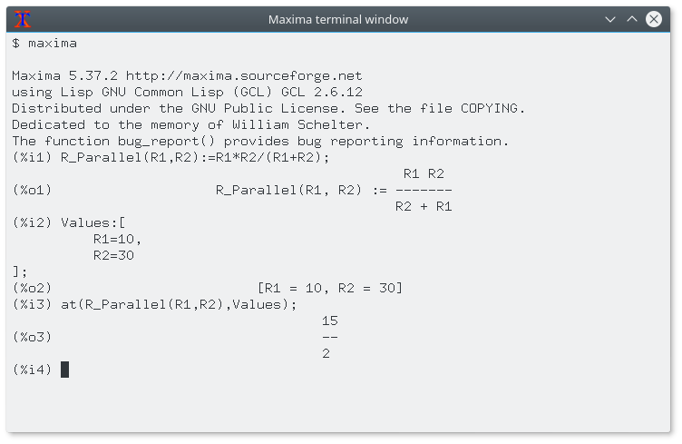
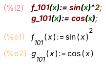

# Руководство пользователя wxMaxima

WxMaxima — графический интерфейс пользователя для системы компьютерной
алгебры (СКА) _Maxima_. WxMaxima позволяет использовать все функции
_Maxima_. А также предоставляет ряд удобных мастеров для работы с наиболее
часто используемыми функциями. Данное руководство описывает некоторые из тех
функций, которые делают wxMaxima одним из наиболее популярных графических
интерфейсов для _Maxima_.

{ id=img_wxMaximaLogo }

______________________________________________________________________

# Введение в wxMaxima

## _Maxima_ и wxMaxima

В области открытого программного обеспечения большие системы обычно делятся
на небольшие проекты, которые проще обслуживать небольшим группам
разработчиков. Например, программа записи компакт-дисков будет состоять из
средства командной строки, которое фактически выполняет запись CD, и
графического интерфейса пользователя, позволяющего выполнять запись без
необходимости изучения всех ключей командной строки, как и вообще без
необходимости использования консоли. Одним из преимуществ такого подхода
является возможность применить силы и средства, вложенные в разработку
консольной программы, в работе сразу нескольких программ: одна и та же
программа записи компакт-дисков может использоваться и в виде модуля
файлового менеджера «Отправить на CD», и в качестве функции музыкального
проигрывателя «Запись на CD», и в качестве программы записи CD в составе
системы резервного копирования DVD. Другим преимуществом такого подхода
является разделение одной большой задачи на меньшие части, позволяющее
разработчикам создавать несколько интерфейсов для одной и той же программы.

Система компьютерной алгебры (СКА) в исполнении _Maxima_ вполне вписывается
в эту парадигму. СКА может выполнять роль логики калькулятора произвольной
точности, либо осуществлять автоматические преобразования формул в составе
более крупной системы (например, [Sage](https://www.sagemath.org/)). И при
этом вполне может применяться и в качестве независимой системы. Работать с
_Maxima_ можно в командной строке. Однако часто интерфейс в стиле _wxMaxima_
обеспечивает более эффективную работу с ПО, особенно новичкам.

### _Maxima_

_Maxima_ является полноценной системой компьютерной алгебры (СКА). СКА
представляет собой программу, которая решает математические задачи путём
преобразования формул для нахождения формулы, способной решить заданную
задачу, в противоположность простому выводу численного значения
результата. Иными словами, _Maxima_ может служить в качестве калькулятора,
выводящего численные представления переменных, и вместе с тем может выдавать
и аналитические решения. Более того, она предлагает ряд численных методов
анализа для уравнений или систем уравнений, которые не могут быть решены
аналитически.

{
id=img_maxima_screenshot }

Обширная документация по _Maxima_  [доступна в интернете](https://maxima.sourceforge.io/documentation.html). Часть этой документации доступна и через меню «Справка» wxMaxima. При нажатии клавиши справки (в большинстве систем это клавиша <kbd>F1</kbd>) контекстная справка _wxMaxima_ автоматически переходит на страницу руководства _Maxima_, описывающую команду под курсором.

### WxMaxima

_WxMaxima_ — это графический интерфейс пользователя, полностью сохраняющий
функциональность и гибкость _Maxima_. WxMaxima предлагает пользователям
графическое отображение наряду с множеством функциональных возможностей,
позволяющих сделать работу с _Maxima_ более простой и приятной. Например,
_wxMaxima_ может экспортировать содержимое любого поля (а при необходимости
и любой части формулы) в виде текста в формате LaTeX или MathML по щелчку
правой клавиши мыши. Это позволяет экспортировать целую книгу либо в виде
HTML-файла, либо в виде файла LaTeX. Документация _wxMaxima_, включая
рабочие книги для иллюстрации аспектов использования программы, доступна
онлайн на [сайте
справки](https://wxMaxima-developers.github.io/wxmaxima/help.html)
_wxMaxima_, а также в меню справки программы.

{ id=img_wxMaximaWindow }

Введённые в _wxMaxima_ вычисления выполняются в фоновом режиме консольной
программой _Maxima_.

## Основы работы с рабочим листом

Большая часть интерфейса _wxMaxima_ интуитивно понятна, но некоторые детали
требуют особенного внимания. [Этот
сайт](https://wxMaxima-developers.github.io/wxmaxima/help.html) содержит
несколько рабочих книг, помогающих разобраться в различных аспектах работы с
_wxMaxima_. Проработка некоторых из них (особенно «_(wx)Maxima_ за 10
минут») позволит лучше ознакомиться как с содержимым _Maxima_, так и с
использованием _wxMaxima_ во взаимодействии с _Maxima_. Это руководство
концентрируется на описании таких аспектов _wxMaxima_, которые не будут
интуитивно понятны, и описание которых может отсутствовать в материалах,
доступных онлайн.

### Принцип рабочего листа

Одним из незначительного числа нестандартных подходов, нашедших применение в
_wxMaxima_, является организация данных для работы с _Maxima_ по полям,
которые вычисляются (имеется в виду «отправляются в _Maxima_») только по
требованию пользователя. При вычислении поля все команды в этом поле, и
только в этом поле, вычисляются путём пакетной обработки. (Предыдущее
высказывание не совсем точно: можно выбрать несколько смежных полей для
совместного вычисления. Также _Maxima_ может вычислять сразу все поля в
рабочей книге за один проход.) Принятый в _wxMaxima_ подход к отправке
команд для вычисления на первый взгляд может показаться необычным. Однако он
значительно упрощает работу с большими документами (где пользователю не
нужно, чтобы каждое изменение автоматически запускало полный пересчёт целого
документа). А также данный подход очень удобен для отладки.

При вводе текста _wxMaxima_ автоматически создаёт новое поле рабочего
листа. Тип этого поля можно выбрать на панели инструментов. Если создано
поле кода, то его можно отправить в _Maxima_, после чего под этим кодом
выводится результат вычисления. Пара таких команд показана ниже.

{ id=img_InputCell }

При вычислении содержимого, введённого в поле ввода, _Maxima_ назначает
вводу метку (по умолчанию отображается красным и распознаётся по `%i`),
позволяющую позднее сослаться на него в сеансе _wxMaxima_. Сгенерированный в
_Maxima_ вывод также получает метку, начинающуюся с `%o` и по умолчанию
скрытую, если только пользователь не назначит выводу имя. Тогда по умолчанию
будет показана заданная пользователем метка. Но и автоматически создаваемая
в _Maxima_ метка в виде `%o` также будет доступна.

Помимо полей ввода, _wxMaxima_ позволяет создавать текстовые поля для
документации, поля изображений, поля заголовков, поля глав и поля
разделов. Каждое поле имеет свой собственный буфер отмены действий, поэтому
можно легко выполнять отладку, изменяя значения нескольких полей и затем
постепенно отменяя ненужные изменения. Более того, сам рабочий лист имеет
глобальный буфер отмены действий, позволяющий отменять изменение, добавление
и удаление полей.

На рисунке ниже показаны различные типы полей (поля заголовков, поля
разделов, поля подразделов, текстовые поля, поля ввода/вывода и поля
изображений).

{ id=img_cell-example
}

### Поля

Рабочий лист состоит из полей. WxMaxima оперирует следующими их типами:

- Математические поля, содержащие одну или несколько строк ввода _Maxima_.
- Вывод программы _Maxima_ или вопрос от неё.
- Поля изображений.
- Текстовые поля, которые могут использоваться, например, для документации.
- Заголовок, раздел или подраздел. Поддерживаются шесть уровней разных
  заголовков.
- Разрывы страниц.

По умолчанию при вводе текста в _wxMaxima_ автоматически создаётся
математическое поле. Поля других типов можно создавать через меню «Поле», с
помощью указанных там сочетаний клавиш или раскрывающегося списка на панели
инструментов. При создании не-математического поля любой текст, введённый в
файл, интерпретируется как текст.

[Текст
комментария](https://maxima.sourceforge.io/docs/manual/maxima_singlepage.html#Comments)
(в стиле языка C) может использоваться в математических полях следующим
образом: `/* Этот комментарий будет игнорироваться Maxima */`

«`/*`» указывает начало комментария, «`*/`» указывает его конец.

### Горизонтальный и вертикальный курсоры

Если пользователь пытается выделить предложение полностью, текстовый
процессор будет автоматически пытаться расширить выделение, чтобы оно
начиналось и завершалось на границе слова. Подобным образом при выборе более
одного поля _wxMaxima_ расширяет выделение до целых полей.

Необычной возможностью _wxMaxima_ является гибкость при перетаскивании,
реализованная благодаря определению двух типов курсоров. При необходимости
_wxMaxima_ переключается между ними автоматически:

- Курсор отображается горизонтально при наведении или щелчке в пространстве
  между двумя полями.
- Вертикальный курсор отображается при работе внутри поля. Этот курсор
  активируется при помещении курсора внутрь поля указателем мыши или
  клавишами со стрелками и в работе очень напоминает курсор текстового
  редактора.

После запуска wxMaxima виден только мигающий горизонтальный курсор. Как только вы начнёте печатать, автоматически будет создано математическое поле, и курсор станет обычным вертикальным (в качестве приглашения отображается стрелка вправо, а после вычисления математического поля (<kbd>CTRL</kbd>+<kbd>ENTER</kbd>) появятся метки, например `(%i1)`, `(%o1)`).

{ id=img_horizontal_cursor_only }

Может понадобиться создать поле другого типа (с помощью меню «Поле»),
например, поле заголовка или текстовое поле с описанием того, что будет
сделано, при начале создания рабочего листа.

При переходе по различным полям также отображается (мигающий) горизонтальный
курсор в местах, где в рабочий лист можно вставить поле (математическое поле
— простым вводом формулы, поле другого типа — с помощью меню).

{
id=img_horizontal_cursor_between_cells }

### Отправка полей в Maxima

Команда в поле кода выполняется нажатием <kbd>CTRL</kbd>+<kbd>ENTER</kbd>, <kbd>SHIFT</kbd>+<kbd>ENTER</kbd> или клавиши <kbd>ENTER</kbd> на цифровой клавиатуре. По умолчанию _wxMaxima_ отправляет команды по нажатию <kbd>CTRL</kbd>+<kbd>ENTER</kbd> или <kbd>SHIFT</kbd>+<kbd>ENTER</kbd>, но _wxMaxima_ можно настроить так, чтобы команды выполнялись по нажатию <kbd>ENTER</kbd>.

### Автодополнение команд

В _WxMaxima_ есть функция автодополнения, которая вызывается через меню (Поле/Завершить слово) или комбинацией клавиш <kbd>CTRL</kbd>+<kbd>SPACE</kbd>. Автодополнение учитывает контекст. Например, внутри указания единиц измерения для ezUnits оно предложит список подходящих единиц.

{ id=img_ezUnits }

Помимо дополнения имени файла, названия единицы измерения или имени текущей команды или переменной, автодополнение умеет показывать для большинства команд шаблон, указывающий тип (и смысл) ожидаемых параметров. Чтобы воспользоваться этой функцией, нажмите <kbd>SHIFT</kbd>+<kbd>CTRL</kbd>+<kbd>SPACE</kbd> или выберите соответствующий пункт меню (Поле/Показать шаблон).

#### Греческие буквы

Компьютеры традиционно хранят символы в 8-разрядных значениях. Это позволяет
создать набор из 256 различных символов. В такой набор можно включить все
буквы, цифры и управляющие символы (конец передачи, конец строки, линии и
углы для рисования прямоугольников меню _и т.д._.) практически любого языка.

Для большинства стран в кодовую страницу из выбранных 256 символов не входят
греческие буквы, хотя они часто используются в математике. Для преодоления
данного ограничения был разработан [Юникод](https://home.unicode.org/):
кодировка, позволяющая использовать латиницу как обычно, но при этом
содержащая намного больше 256 символов.

_Maxima_ позволяет использовать Юникод, если её сборка выполнялась
компилятором Lisp, который либо поддерживает Юникод, либо не принимает во
внимание кодировку шрифта. Поскольку из пары представленных условий по
крайней мере одно может оказаться справедливым, _wxMaxima_ поддерживает ввод
греческих символов с помощью клавиатуры:

- Греческую букву можно ввести путём нажатия клавиши <kbd>ESC</kbd> с
  последующим вводом имени греческого символа.
- Также можно нажать <kbd>ESC</kbd>, ввести одну букву (или две для
  греческой буквы омикрон) и снова нажать <kbd>ESC</kbd>. Такой способ ввода
  поддерживается для следующих букв:

| кл. | греч. буква  | кл. | греч. буква  | кл. | греч. буква  |
| :-: | :----------: | :-: | :----------: | :-: | :----------: |
|  a  |    альфа     |  i  |     йота     |  r  |     ро       |
|  b  |     бета     |  k  |    каппа     |  s  |    сигма     |
|  g  |    гамма     |  l  |    лямбда    |  t  |     тау      |
|  d  |    дельта    |  m  |      мю      |  u  |   ипсилон    |
|  e  |   эпсилон    |  n  |      ню      |  f  |     фи       |
|  z  |     дзета    |  x  |      кси     |  c  |     хи     |
|  h  |     эта      | om  |   омикрон    |  y  |     пси      |
|  q  |    тэта      |  p  |      пи      |  o  |    омега     |
|  A  |    Альфа     |  I  |     Йота     |  R  |     Ро       |
|  B  |     Бета     |  K  |    Каппа     |  S  |    Сигма     |
|  G  |    Гамма     |  L  |    Лямбда    |  T  |     Тау      |
|  D  |    Дельта    |  M  |      Мю      |  U  |   Ипсилон    |
|  E  |   Эпсилон    |  N  |      Ню      |  P  |     Фи       |
|  Z  |     Дзета    |  X  |      Кси     |  C  |     Хи       |
|  H  |     Эта      | Om  |   Омикрон    |  Y  |     Пси      |
|  T  |    Тэта     |  P  |      Пи      |  O  |    Омега     |

Для ввода греческих букв также можно воспользоваться боковой панелью
«Греческие буквы».

##### Внимание: похожие символы

Несколько букв латиницы схожи с греческими буквами. Например, латинская «A»
и греческая буква «Альфа». Однако, несмотря на кажущееся сходство, это два
разных символа, представленных разными кодовыми точками (числами) в Юникоде.

Могут возникнуть проблемы, если задать значение переменной A, но
впоследствии пытаться использовать греческую букву Альфа для выполнения
каких-либо операций с этой переменной, особенно при печати. Для греческой
буквы Мю (которая может использоваться и в качестве приставки микро-) также
есть две разных кодовых точки Юникода.

Поэтому на боковой панели «Греческие буквы» имеется параметр, позволяющий
сделать схожие буквы недоступными (изменяется в контекстном меню).

Тот же механизм позволяет вводить различные математические символы:

| клавиши для ввода  | математический символ                                 |
| -------------- | ----------------------------------------------------- |
| hbar           | постоянная Планка: h с горизонтальной линией сверху |
| Hbar           | H с горизонтальной линией сверху                      |
| 2              | квадрат                                               |
| 3              | куб                                                   |
| /2             | 1/2                                                   |
| partial        | знак частной производной (d в dx/dt)                  |
| integral       | знак интеграла                                        |
| sq             | квадратный корень                                     |
| ii             | мнимая единица                                        |
| ee             | элемент                                               |
| in             | включается                                                  |
| impl implies   | импликация                                            |
| inf            | бесконечность                                         |
| empty          | пустое множество                                      |
| TB             | большой треугольник направо                           |
| tb             | малый треугольник направо                             |
| and            | и                                                     |
| or             | или                                                   |
| xor            | исключающее или                                       |
| nand           | не-и                                                  |
| nor            | не-или                                                |
| equiv          | эквивалентно                                          |
| not            | не                                                    |
| union          | объединение                                           |
| inter          | пересечение                                           |
| subseteq       | подмножество или равно                                |
| subset         | подмножество                                          |
| notsubseteq    | не подмножество или равно                             |
| notsubset      | не подмножество                                       |
| approx         | приблизительно                                        |
| propto         | пропорционально                                       |
| neq != /= or # | не равно                                              |
| +/- or pm      | знак плюс/минус                                       |
| \<= or leq    | меньше или равно                                    |
| >= or geq      | больше или равно                                      |
| \<\< or ll   | намного меньше                                        |
| >> or gg       | намного меньше                                        |
| qed            | конец доказательства                                  |
| nabla          | оператор Лапласа                                      |
| sum            | знак суммы                                            |
| prod           | знак умножения                                        |
| exists         | квантор существования                                 |
| nexists        | квантор несуществования                               |
| parallel       | знак параллельности                                   |
| perp           | знак перпендикулярности                               |
| leadsto        | знак «отсюда следует»                                 |
| ->             | стрелка направо                                       |
| -->            | длинная стрелка направо                               |

Для ввода математических символов также можно использовать боковую панель
«Математические символы».

Если нужного специального символа нет в списке, любой символ Юникода можно ввести, нажав <kbd>ESC</kbd> \[номер символа (шестнадцатеричный)\] <kbd>ESC</kbd>. Кроме того, у боковой панели «Символы» есть контекстное меню (правая кнопка мыши), которое показывает список всех доступных символов Юникода; их можно добавить на эту панель или в рабочий лист.

<kbd>ESC</kbd><kbd>6</kbd><kbd>1</kbd><kbd>ESC</kbd> therefore results in an `a`. While you type the number, the list of symbols shows the character it stands for and its Unicode name.

If the number also is the beginning of a symbol's name (`be` could be the start of `beta`, or the character ¾ with the number `be`), the name wins. A leading `0` or `u+` makes it a number: <kbd>ESC</kbd>`u+be`<kbd>ESC</kbd> and <kbd>ESC</kbd>`00be`<kbd>ESC</kbd> both result in a `¾`.

A letter with an accent that Unicode has no character of its own for, like a t with a bar on top of it, is a letter followed by a "combining" accent: <kbd>t</kbd><kbd>ESC</kbd><kbd>3</kbd><kbd>0</kbd><kbd>4</kbd><kbd>ESC</kbd> results in `t̄`, which _Maxima_ treats as a variable name like any other.

Symbols one needs often can be added to the "Symbols" sidebar in the "Options" tab of the configuration dialog (Edit -> Configure), where they can also be given a keyboard shortcut. A letter with accents counts as one symbol there and gets one button. The Greek letters and the symbols the sidebars show anyway can be given a keyboard shortcut there, too, or by right-clicking their button in the sidebar. A shortcut has to contain <kbd>Ctrl</kbd> or <kbd>Alt</kbd> or be a function key, and types its symbol while the worksheet has the keyboard focus. The configuration dialog warns if a menu entry already uses the same keys.

Обратите внимание, что большая часть этих символов (заметным исключением
являются логические символы) не имеют специального значения в _Maxima_ и
поэтому будут интерпретироваться как обычные символы. Если _Maxima_ собрана
в компиляторе Lisp, не имеющем поддержки символов Юникода, то при их
использовании может быть выведено сообщение об ошибке.

Может оказаться, что, например, греческих букв или математических символов нет в выбранном шрифте; тогда они не могут быть отображены.
Чтобы решить эту проблему, выберите другие шрифты (через: Правка -> Настройка -> Стиль).

### Замена символов Юникода

wxMaxima will replace several Unicode characters with their respective Maxima expressions, e.g. `²` with `^2`, `³` with `^3`, `≠` with `#` or `≤` with `<=`.

Unicode characters that stand for a Maxima name are instead defined as
_Maxima_ aliases of that name when wxMaxima starts _Maxima_: `π` for `%pi`,
`ⅈ` for `%i`, `ⅇ` for `%e`, `∞` for `inf`, the (mathematical) Sigma sign
(which is not the same Unicode character as the corresponding Greek letter)
for `sum`, `∏` for `product`, `∫` for `integrate`, the square root sign for
`sqrt` and `⋀`, `⋁`, `⊻`, `⊼`, `⊽`, `⇒`, `⇔` and `¬` for `and`, `or`, `xor`,
`nand`, `nor`, `implies`, `equiv` and `not`. This means they work in files
loaded by `batch()` or `load()`, too, and `aliases` lists the names they
stand for. As _Maxima_ reads these characters as letters they need to be
separated from neighbouring names by spaces in such a file: `a⋀b` is a
variable name, `a ⋀ b` means `a and b`. In an input cell wxMaxima adds these
spaces automatically. It also puts parenthesis around a number or a variable
that directly follows the square root sign, so `√2` means `sqrt(2)`.

В Юникоде есть несколько «правильных» дробей, представленных в виде одной
кодовой точки Юникода: `¼, ½, ¾, ⅐, ⅑, ⅒, ⅓, ⅔, ⅕, ⅖, ⅗, ⅘, ⅙, ⅚, ⅛, ⅜, ⅝,
⅞`

wxMaxima заменит их соответствующими представлениями Maxima (например,
`(1/4)`) перед отправкой ввода в Maxima. Кроме того, `⅟` заменяется на `1/`,
а `↉` (используется в бейсболе) — на `(0/3)`.

В полях ввода рекомендуется использовать **код Maxima** (а не эти кодовые
точки Юникода) (обоснование: (a) их может не быть в используемом для ввода
математических данных шрифте; (b) если сохранить документ как файл `wxm`, он
будет доступен для чтения (командной строкой) Maxima, но эти изменения не
будут работать в командной строке Maxima); но они могут появиться при
вырезании и вставке формулы из другого документа.

### Боковые панели

Наиболее важные команды _Maxima_, а также содержание, окна с отладочными
сообщениями и журнал последних отданных команд доступны на соответствующих
боковых панелях. Их можно активировать с помощью меню «Вид» и переместить в
любое место внутри или за пределами окна _wxMaxima_. Также можно открыть
панель, позволяющую вводить греческие буквы с помощью мыши.

{ id=img_SidePanes }

Боковая панель «Содержание» позволяет повышать или понижать уровень
заголовка путём щелчка по нему правой клавишей мыши с последующим выбором
ближайшего более высокого или низкого уровня.

{
id=Sidepane-TOC-convert-headings}

### Вывод в MathML

Несколько текстовых процессоров и подобных им программ либо способны
распознать ввод [MathML](https://www.w3.org/Math/) и автоматически вставить
его в виде редактируемого двухмерного уравнения, либо (как LibreOffice)
имеют редактор уравнений, позволяющий «импортировать MathML из буфера
обмена». Другие поддерживают RTF maths. Поэтому в контекстном меню
_wxMaxima_ доступно несколько пунктов.

### Pasting LaTeX or MathML formulas

**Edit → Paste LaTeX/MathML as Maxima Code** (also in the right-click menu) converts a formula from the clipboard into a _Maxima_ command, for example one copied from a paper, a web page or an equation editor. LaTeX may come with or without `$…$`, `\(…\)` or `\[…\]` around it, so `\int_0^1 \frac{\sin x}{x}\,dx` becomes `integrate(sin(x)/x,x,0,1)`. The command goes where the cursor is, or into a new code cell. MathML pasted into a code cell with the ordinary **Paste** is converted the same way, since nobody wants the XML in a code cell. If MathML copied with **Copy as MathML** is pasted back, the result is the original command: _wxMaxima_ adds it to the MathML as an annotation.

LaTeX and MathML describe what a formula looks like, not what it means, so
the conversion has to interpret it. Fractions, roots, powers, subscripts
(`x_1` becomes the name `x_1`, `a_{n+1}` the array element `a[n+1]`),
functions with or without parentheses (`\sin 2x`), `\frac{d}{dx}`, `f'(x)`,
integrals ending in `dx`, sums and products with limits, `\lim_{x\to 0}`,
`|x|` and matrices are understood. An `e` is Euler’s number, but an `i` is
only the imaginary unit when set upright (`\mathrm{i}`), as it more often is
an index. A product of a name and parentheses, like `x(y+1)`, is taken as a
product unless the name is `f`, `g`, `h` or longer than one letter. Anything
without a single meaning, like `\pm`, `\dots` or text, isn’t guessed at:
_wxMaxima_ says what it couldn’t convert instead. Check the command before
evaluating it.

### Поддержка Markdown

_WxMaxima_ поддерживает стандартные элементы форматирования
[Markdown](https://en.wikipedia.org/wiki/Markdown), которые не конфликтуют с
математической записью. Одним из таких элементов являются маркированные
списки.

```text
Обычный текст
 * Один пункт, уровень отступа 1
 * Ещё один пункт на уровне отступа 1
   * Пункт на втором уровне отступа
   * Второй пункт на втором уровне отступа
 * Третий пункт на первом уровне отступа
Обычный текст
```

_WxMaxima_ распознаёт текст, начинающийся с символов `>`, как цитату:

```text
Обычный текст
> цитата цитата цитата цитата
> цитата цитата цитата цитата
> цитата цитата цитата цитата
Обычный текст
```

Вывод _WxMaxima_ в TeX и HTML также распознаёт `=>` и заменяет его соответствующим символом Юникода:

```text
cogito => sum.
```

Другие символы, которые распознаёт экспорт в HTML и TeX: `<=` и `>=` для сравнений, двойная стрелка с двумя остриями (`<=>`), одинарные стрелки (`<->`, `->` и `<-`) и `+/-` как соответствующий знак. При выводе в TeX распознаются также `<<` и `>>`.

### Links in text cells

A web address in a text cell that starts with `http://`, `https://` or `mailto:` is shown as a link. Since clicking into a text cell places the cursor there, a link is followed by <kbd>CTRL</kbd>+clicking it (<kbd>CMD</kbd>+clicking on macOS), or by right-clicking it and choosing "Open Link"; hovering over it shows where it leads. The HTML export turns it into a link, the TeX export into a `\url{}`. Links are always recognized from the text itself, so nothing about them is stored in the file.

Links in a code cell's comments (`/* ... */`) work the same way. Elsewhere
in code, for example inside a string, an address is Maxima syntax and is not
a link.

The same goes for web addresses in _Maxima_'s output, for example in a string printed by `print("See https://wxmaxima-developers.github.io/wxmaxima/")`: <kbd>CTRL</kbd>+clicking the address or choosing "Open Link" from its context menu opens it, while a plain click still selects the output.

### Bold, italic, underlined and struck-through text

Text in a text cell, a title or a section heading can be made bold, italic,
underlined or struck through. Select the text and press the respective
button in the toolbar; pressing the button again removes that formatting
from the selection. With nothing selected the button switches the formatting
on or off for what is typed next. The buttons are hidden by right-clicking
the toolbar and unchecking "Text formatting buttons". Code cells cannot be
formatted: their colors already show the syntax of the code.

Superscript and subscript buttons work the same way: they make the text
smaller and raise it above or lower it below the line, as in E = mc² or
H₂O. A character cannot be both, so switching one of them on switches the
other off. A line that contains a superscript, a subscript or a character
that is taller than the font's usual ones, for example an emoji, gets as
much additional room as it needs.

The formatting is saved in `.wxmx` files. Older versions of _wxMaxima_ open
such a file without the formatting but keep all of the text. `.wxm` files,
the exports and the clipboard contain the text without its formatting.

### Комбинации клавиш

Большинство сочетаний клавиш можно найти в тексте соответствующих
меню. Поскольку они фактически берутся из текста меню и могут быть
локализованы при переводе _wxMaxima_ для использования клавиатур с
соответствующими локальными настройками, мы не будем приводить их
здесь. Хотя несколько сочетаний клавиш с их псевдонимами в меню отсутствуют:

- <kbd>CTRL</kbd>+<kbd>SHIFT</kbd>+<kbd>DELETE</kbd> полностью удаляет поле.
- <kbd>CTRL</kbd>+<kbd>TAB</kbd> или
  <kbd>CTRL</kbd>+<kbd>SHIFT</kbd>+<kbd>TAB</kbd> запускает механизм
  автодополнения.
- <kbd>SHIFT</kbd>+<kbd>ПРОБЕЛ</kbd> вставляет неразрывный пробел.

### Exploring output with the keyboard

A cell's output can be selected, and explored part by part, without a mouse:

- <kbd>DOWN</kbd> at the end of a cell's input selects the first result of
  its output. Further presses of <kbd>DOWN</kbd> and <kbd>UP</kbd> step
  through the results; past the last one the cursor leaves the cell. If you
  prefer <kbd>DOWN</kbd> to skip over the output, switch on "Up/Down keys
  skip over output" in the Worksheet tab of the configuration dialog.
- <kbd>ENTER</kbd> goes into the selected expression and selects its first
  part: the expression without its label, the numerator of a fraction, the
  name of a function, the first entry of a matrix, ... If the selection has
  no parts, <kbd>ENTER</kbd> opens a new input cell holding it, as it always
  did.
- <kbd>ESCAPE</kbd> selects what the selection is a part of. From a whole
  result it goes back into the cell's input.
- <kbd>LEFT</kbd> and <kbd>RIGHT</kbd> select the previous or next part at
  the same level. In a matrix all four arrow keys move from entry to entry.
- <kbd>SHIFT</kbd>+<kbd>LEFT</kbd> and <kbd>SHIFT</kbd>+<kbd>RIGHT</kbd>
  grow or shrink the selection over the neighbouring parts; in a matrix,
  <kbd>SHIFT</kbd> and any arrow key grow the selected entry into a block of
  entries.
- The context-menu key or <kbd>SHIFT</kbd>+<kbd>F10</kbd> opens the
  right-click menu for the selection, so it can be copied in any format.

### Необработанный TeX при экспорте в TeX

Если текстовое поле начинается с `TeX:` экспорт в TeX будет содержать
дословный текст, который который следует за меткой `TeX:`. Эта функция
позволяет вводить разметку TeX непосредственно в рабочую книгу _wxMaxima_.

## Форматы файлов

Разрабатываемые в сеансе _wxMaxima_ материалы можно сохранять для
дальнейшего использования одним из трёх способов:

### .mac

Файлы `.mac` представляют собой обычные текстовые файлы, содержащие команды
_Maxima_. Их можно считывать с помощью команд _Maxima_ `batch()` или
`load()`, либо с помощью пункта меню _wxMaxima_ «Файл/Пакетный файл».

Ниже приводится один пример. `Quadratic.mac` определяет функцию, после чего
генерирует график с помощью `wxdraw2d()`. Впоследствии выводится содержимое
файла `Quadratic.mac` и вычисляется вновь определённая функция `f()`.

{ id=img_BatchImage }

Внимание: несмотря на то, что файл `Quadratic.mac` имеет обычное расширение
_Maxima_ (`.mac`), прочитать его сможет только _wxMaxima_, поскольку команда
`wxdraw2d()` является расширением wxMaxima для _Maxima_. (Командная строка)
Maxima проигнорирует неизвестную команду `wxdraw2d()`, просто продублировав
её имя в выводе.

Файлы `.mac` можно использовать для создания собственной библиотеки
макросов. Но, поскольку они не содержат достаточно информации по структуре,
они не могут быть считаны как сеанс _wxMaxima_.

### .wxm

Файлы `.wxm` содержат рабочий лист без вывода _Maxima_. В версиях Maxima >5.38 их можно прочитать функцией _Maxima_ `load()`, так же как файлы .mac. Ну, в большинстве случаев. Вопросы (например, `asksign(x)`) создают проблемы, поскольку ответ записывается в файл `.wxm` (чтобы его можно было предложить после загрузки), а Maxima не может его вычислить.
Чтобы Maxima не задавала вопросов, можно объявить с помощью `assume()` свойства, которые Maxima хочет знать.

В этом текстовом формате иногда неизбежно, что рабочие листы, использующие
новые возможности, несовместимы со старыми версиями _wxMaxima_.

#### Формат файлов wxm

Это файл с обычным текстом (открывается в текстовом редакторе), в котором
содержимое полей хранится в виде специальных комментариев Maxima.

Файл начинается со следующего комментария:

```maxima
/* [wxMaxima batch file version 1] [ DO NOT EDIT BY HAND! ]*/
/* [ Created with wxMaxima version 24.02.2_DevelopmentSnapshot ] */
```

Затем следуют поля, записанные в виде комментариев Maxima. Например, поле
раздела:

```maxima
/* [wxMaxima: section start ]
Title of the section
   [wxMaxima: section end   ] */
```

или (разумеется, в математическом поле ввод будет *не* закомментирован
(вывод не сохраняется в файле `wxm`)):

```maxima
/* [wxMaxima: input   start ] */
f(x):=x^2+1$
f(2);
/* [wxMaxima: input   end   ] */
```

Изображения [закодированы в Base64](https://en.wikipedia.org/wiki/Base64). В
первой строке находится тип изображения:

```maxima
/* [wxMaxima: image   start ]
jpg
[very chaotic looking character sequence]
   [wxMaxima: image   end   ] */
```

Разрыв страницы представляет собой одну строку следующего содержания:

```maxima
/* [wxMaxima: page break    ] */
```

Свёрнутые поля обозначаются так:

```maxima
/* [wxMaxima: fold    start ] */
...
/* [wxMaxima: fold    end   ] */
```

### .wxmx

Этот файл на основе формата XML сохраняет рабочий лист целиком, включая
такие параметры, как масштаб отображения и список отслеживания. Это
рекомендуемый формат.

#### Формат файлов wxmx

Файл `wxmx` похож на двоичный формат, но работать с ним можно с помощью
базовых инструментов ОС. Это файл zip, который можно разархивировать с
помощью программы `unzip` (рекомендуется переименовать файл, чтобы программа
`unzip` могла распознать его в ОС). При создании файла используется не
функция сжатия, а возможность объединять несколько файлов в один —
изображения уже сжаты, а всё остальное представлено простым текстом
(занимает куда меньший объём, чем громадные включаемые изображения).

Содержит следующие файлы:

- `mimetype`: этот файл содержит тип MIME файлов wxMaxima:
  `text/x-wxmathml`.
- `format.txt`: краткое описание wxMaxima и формата файлов wxmx.
- Изображения (например, png, jpeg): встроенные графики, которые были
  созданы в сеансе wxMaxima, и включённые изображения.
- `content.xml`: документ XML, содержащий различные поля документа в формате
  XML.

Таким образом, в случае появления ошибок можно разархивировать документ
wxMaxima (рекомендуется сначала переименовать его в файл `zip`), внести
изменения в файл `content.xml` в текстовом редакторе или заменить
повреждённое изображение, снова добавить файлы в архив и заменить расширение
`zip` на `wxmx` — и получаем отредактированный файл `wxmx`.

## Параметры настройки

Для некоторых общих переменных конфигурации _wxMaxima_ обеспечивает два вида
настройки:

- Диалоговое окно параметров конфигурации, представленное ниже, позволяет
  изменять значения параметров по умолчанию для текущего и последующих
  сеансов.
- Кроме того, для текущего сеанса возможно изменение значений большинства
  переменных конфигурации путём перезаписи их значений из рабочего листа,
  как показано ниже.

{
id=img_wxMaxima_configuration_001 }

### Частота кадров анимации по умолчанию

Значение частоты кадров анимации, использующееся при создании новых
анимаций, хранится в переменной `wxanimate_framerate`. Начальное значение
этой переменной, которое будет содержаться в новом рабочем листе, можно
изменить в диалоговом окне настройки параметров конфигурации.

### Размер графиков по умолчанию для новых сеансов _maxima_

Начиная со следующего запуска, указанный размер будет использоваться для
создания графиков, встраиваемых в рабочий лист, если значение параметра
`wxplot_size` не изменялось _Maxima_.

Чтобы задать размер одного графика, используйте следующую запись при
установке значения переменной для одной команды:

```maxima
wxdraw2d(
   explicit(
       x^2,
       x,-5,5
   )
), wxplot_size=[480,480]$
```

### Автоматическое закрытие скобок в текстовых полях

Этот параметр активирует сразу две функции:

- При вводе открывающей круглой скобки, квадратной скобки или двойной
  кавычки _wxMaxima_ вставляет закрывающую после неё.
- In a code cell a comment opened by `/*` is closed by an inserted
  `*/`. Typing `*/` in front of it moves the cursor past it instead.
- При выделении текста, если нажать любую из этих клавиш, выделенный текст
  помещается между парой этих знаков.

### Не сохранять рабочий лист автоматически

При включении этого параметра файл с рабочим листом перезаписывается только
по требованию пользователя. В случае сбоя/отключении питания/... свежая
резервная копия остаётся доступной во временном каталоге.

Если этот параметр не включён, работа _wxMaxima_ больше напоминает
современное приложение сотового телефона:

- Файлы автоматически сохраняются при выходе.
- Также файл автоматически сохраняется каждые 3 минуты.

### Arranging the toolbar

The toolbar is made of sections, like the "Open" and "Save" buttons, the
evaluation buttons or the drop-down list that sets the type of a cell. The
"Toolbar" tab of the configuration dialog lists them in the order the
toolbar shows them in: drag a section to another place, or select it and
press "Up" or "Down", to move it, and uncheck it to hide it. The flexible
space pushes every section after it to the right edge of the
window. "Default order" restores the original arrangement. Sections can also
be shown or hidden by right-clicking the toolbar.

### Где хранятся настройки?

В Unix/Linux настройки сохраняются в файле `.wxMaxima` в домашнем каталоге (при wxWidgets \< 3.1.1) или в `.config/wxMaxima.conf` ((стандарт XDG) при wxWidgets >= 3.1.1). Версию wxWidgets можно узнать командой `wxbuild_info();` или через пункт меню Справка->О программе. [wxWidgets](https://www.wxwidgets.org/) — кроссплатформенная библиотека графического интерфейса, на которой основана _wxMaxima_ (отсюда `wx` в названии).
(Поскольку имя файла начинается с точки, `.wxMaxima` или `.config` будут скрыты.)

При использовании Windows параметры конфигурации будут храниться в
реестре. Расположение записей _wxMaxima_ в реестре:
`HKEY_CURRENT_USER\Software\wxMaxima`

______________________________________________________________________

# Расширения _Maxima_

_WxMaxima_ является прежде всего графическим интерфейсом пользователя для
_Maxima_. В этом качестве её главной целью является передача команд _Maxima_
и получение результатов выполнения этих команд. Однако в некоторых случаях
_wxMaxima_ позволяет дополнить функциональные возможности _Maxima_. Уже
упоминалась способность _wxMaxima_ генерировать отчёты путём экспорта
содержимого рабочей книги в файлы HTML и LaTeX. Этот раздел описывает
способы, которые _wxMaxima_ использует для усовершенствования использования
графики в сеансе.

## Переменные с нижними индексами

<div id="wxsubscripts"></div>

Параметр `wxsubscripts` указывает, будет ли (и как) _wxMaxima_ автоматически
переводить в нижний индекс имена переменных:

При значении `false` эта функциональная возможность отключена; wxMaxima не
будет автоматически переводить в нижний индекс часть имён переменных после
символа подчёркивания.

При значении `'all` весь текст после символа подчёркивания будет
переводиться в нижний индекс.

При значении `true` имена переменных в формате `x_y` отображаются как нижний
индекс, если:

- Либо `x` или `y` представлены одной буквой,
- либо `y` представлена целым числом (может включать более одного символа).

{ id=img_wxsubscripts }

<div id="wxdeclare_subscripted"></div>

A variable the rules above don’t cover can still be declared as "to be
subscripted" using the command `wxdeclare_subscripted(variable_name);` or
`wxdeclare_subscripted([variable_name1,variable_name2,...]);` Declaring a
variable as subscripted can be reverted using the following command:
`wxdeclare_subscripted(variable_name,false);`, which also keeps a variable
the rules above do cover from being subscripted.

<div id="wxdeclare_subscript"></div>

`wxdeclare_subscript(text_snippet);` or
`wxdeclare_subscript([text_snippet1,text_snippet2,...]);` instead declares a
text snippet: every variable whose name ends in an underscore followed by
that snippet is subscripted, however long the two parts are.

Задать эти значения можно также через меню «Вид->Автоперевод в нижний индекс».

## Сообщения пользователю в строке состояния

<div id="wxstatusbar"></div>

Работающие на протяжении длительного времени команды могут выводить
информацию в строку состояния. Новая информация последовательно заменяет
размещённую там старую (что позволяет использовать строку состояния в
качестве индикатора хода выполнения) и удаляется сразу по завершении
выполнения текущей отправленной в _Maxima_ команды. Можно использовать
`wxstatusbar()` даже в тех библиотеках, которые могут работать с обычной
_Maxima_ (а не _wxMaxima_): при отсутствии _wxMaxima_ команда
`wxstatusbar()` просто не будет обрабатываться.

```maxima
for i:1 thru 10 do (
    /* Сообщить пользователю, как далеко мы продвинулись */
    wxstatusbar(concat("Pass ",i)),
    /* (sleep n) — функция Lisp, которую можно вызвать, */
    /* поставив перед ней символ "?". Она приостанавливает */
    /* выполнение программы (здесь: на 3 секунды) */
    ?sleep(3)
)$
```

## Экспорт рабочего листа из Maxima

<div id="wxworksheettohtml"></div>

Команда `wxworksheettohtml()` экспортирует текущий рабочий лист в HTML-файл
прямо из работающего сеанса _Maxima_, что удобно для экспорта из скриптов
или в пакетном режиме. Как и `wxstatusbar()`, её можно без опаски
использовать в коде, который может выполняться и в обычной (консольной)
_Maxima_: если _wxMaxima_ нет, команда просто остаётся невычисленной.

```maxima
wxworksheettohtml("report.html")$
wxworksheettohtml("report.html", flavor="svg", wxmx=true)$
```

Относительное имя файла отсчитывается от рабочего каталога
_Maxima_. Необязательные именованные параметры:

| параметр | значения                                        | смысл                                               |
| -------- | ----------------------------------------------- | --------------------------------------------------- |
| `flavor` | `mathml` (по умолчанию), `mathjax`, `svg`, `bitmap` | как формулы отображаются на экспортированной странице |
| `wxmx`   | `false` (по умолчанию), `true`                  | встроить загружаемую копию сеанса в формате `.wxmx` |

The images and the `.wxmx` copy are written into a folder named after the
HTML file, with `_htmlimg` appended. If "Embed images into the .html file"
is checked in the Export tab of the configuration dialog, they are embedded
into the HTML file instead, so it can be mailed as a single file.

Значения `flavor` соответствуют форматам формул, которые предлагает
графический диалог **Файл → Экспорт**: `mathml` создаёт самодостаточную
страницу, не требующую подключения к интернету, `mathjax` добавляет запасной
вариант на MathJaX для браузеров, ещё не поддерживающих MathML, а
`svg`/`bitmap` превращают каждую формулу в изображение.

<div id="wxworksheettotex"></div>

Парная команда `wxworksheettotex()` точно так же экспортирует в файл LaTeX
(`.tex`):

```maxima
wxworksheettotex("report.tex")$
wxworksheettotex("report.tex", documentclass="report", documentclassoptions="12pt,a4paper")$
```

| параметр               | смысл                                                                |
| ---------------------- | -------------------------------------------------------------------- |
| `documentclass`        | заменяет `\documentclass` LaTeX (например, `"article"`, `"report"`)  |
| `documentclassoptions` | заменяет его параметры (например, `"12pt,a4paper"`)                  |

Поддержка `wxworksheettopdf()` запланирована.

## Графики

Построение графиков (в основном в связи с графической системой)
предполагает, что графический интерфейс пользователя предоставит ряд
расширений для исходной программы.

### Встраивание графика в рабочий лист

<div id="wxplot2d"></div>
<div id="wxplot3d"></div>
<div id="wximplicit_plot"></div>
<div id="wxcontour_plot"></div>

Обычно _Maxima_ использует внешнюю программу _Gnuplot_, которая открывает
отдельное окно для каждого создаваемого графика. Поскольку часто удобнее не
делать так, а встраивать графики в рабочий лист, _wxMaxima_ предоставляет
собственный набор графических функций, которые отличаются от соответствующих
функций _Maxima_ только именем: все они имеют префикс “wx”.

Следующие графические функции имеют wx-аналоги:

|Графическая функция wxMaxima| Графическая функция Maxima                                                                          |
| ------------------------ | ----------------------------------------------------------------------------------------------- |
| `wxplot2d()`             | [plot2d](https://maxima.sourceforge.io/docs/manual/maxima_singlepage.html#plot2d)               |
| `wxplot3d()`             | [plot3d](https://maxima.sourceforge.io/docs/manual/maxima_singlepage.html#plot3d)               |
| `wxdraw2d()`             | [draw2d](https://maxima.sourceforge.io/docs/manual/maxima_singlepage.html#draw2d)               |
| `wxdraw3d()`             | [draw2d](https://maxima.sourceforge.io/docs/manual/maxima_singlepage.html#draw3d)               |
| `wxdraw()`               | [draw](https://maxima.sourceforge.io/docs/manual/maxima_singlepage.html#draw)                   |
| `wximplicit_plot()`      | [implicit_plot](https://maxima.sourceforge.io/docs/manual/maxima_singlepage.html#implicit_plot) |
| `wxhistogram()`          | [histogram](https://maxima.sourceforge.io/docs/manual/maxima_singlepage.html#histogram)         |
| `wxscatterplot()`        | [scatterplot](https://maxima.sourceforge.io/docs/manual/maxima_singlepage.html#scatterplot)     |
| `wxbarsplot()`           | [barsplot](https://maxima.sourceforge.io/docs/manual/maxima_singlepage.html#barsplot)           |
| `wxpiechart()`           | [piechart](https://maxima.sourceforge.io/docs/manual/maxima_singlepage.html#piechart)           |
| `wxboxplot()`            | [boxplot](https://maxima.sourceforge.io/docs/manual/maxima_singlepage.html#boxplot)             |

Если Maxima прочитает файл `wxm` (в консоли), то эти функции игнорируются
(печатаются в выводе, как и другие неизвестные функции в Maxima).

При появлении проблем с работой одной из этих функций рекомендуется
проверить, существуют ли эти проблемы также и для функции Maxima (например,
если `wxplot2d()` возвращает ошибку, проверьте тот же график с помощью
команды Maxima `plot2d()` (она открывает график в отдельном окне)). Если
проблемы остались, вероятнее всего, что дело в ошибке Maxima; следует
сообщить о ней с помощью [системы отслеживания ошибок
Maxima](https://sourceforge.net/p/maxima/bugs/). Либо это может быть ошибкой
Gnuplot.

### Увеличение и уменьшение встроенных графиков

<div id="wxplot_size"></div>

Как указано выше, диалоговое окно настройки конфигурации позволяет изменять
размер по умолчанию для создаваемых графиков, устанавливая начальное
значение параметра `wxplot_size`. Графические процедуры _wxMaxima_
используют эту переменную для получения размера графика в пикселах. Её
значение всегда можно запросить или использовать для установки размера
последующих графиков:

```maxima
wxplot_size:[1200,800]$
wxdraw2d(
    explicit(
        sin(x),
        x,1,10
    )
)$
```

Если изменить размер необходимо только у одного графика, _Maxima_
обеспечивает канонический путь изменения атрибута только для текущего
поля. В этом случае строка установки параметра `wxplot_size = [value1,
value2]` добавляется к команде `wxdraw2d( )` и не является частью команды
`wxdraw2d`.

```maxima
wxdraw2d(
    explicit(
        sin(x),
        x,1,10
    )
),wxplot_size=[1600,800]$
```

Установка размера встроенного графика с помощью параметра `wxplot_size`
работает для встроенного графика при использовании команд `wxplot`,
`wxdraw`, `wxcontour_plot` и `wximplicit_plot`, а также для встроенных
анимаций при использовании команд `with_slider_draw` и `wxanimate`.

<div id="wxplot_scale"></div>

`wxplot_size` tells _Gnuplot_ how many pixels to draw. If a plot is wider
than the window, _wxMaxima_ shrinks it until it fits. If one specific plot
is meant to be shown larger, even if that means it no longer fits on the
screen, or smaller than that, the variable `wxplot_scale` (default: `1`)
tells _wxMaxima_ to show it that many times as large as it would otherwise:

```maxima
wxdraw2d(
    explicit(
        sin(x),
        x,1,10
    )
),wxplot_scale=2$
```

Unlike a bigger `wxplot_size`, which makes the text and lines of a plot
smaller in relation to the plot, `wxplot_scale` makes everything larger, the
text included. The factor is stored in the worksheet with the plot, so it
survives saving and re-opening the file. It is respected by the same
commands as `wxplot_size`. If _wxMaxima_ shows plots as scalable vector
graphics (see "Create scalable plots" in the configuration dialog) they stay
sharp at any scale; a bitmap plot gets blurry if it is enlarged a lot.

A plot that should be wide but not high, for example a waveform, is better
made with `wxplot_size`: a wider `wxplot_size` gives more room for the data,
at the same height and with text of the same size. As such a plot would
normally be shrunk to fit into the window, which makes its text tiny again,
`wxplot_scale='native` tells _wxMaxima_ to show it at exactly the size
`wxplot_size` asks for, even if that is wider than the window:

```maxima
wxdraw2d(
    explicit(
        sin(10*x)*exp(-x/3),
        x,0,10
    )
),wxplot_size=[1600,300],wxplot_scale='native$
```

### Графики лучшего качества

По всей видимости в _Gnuplot_ не реализован универсальный способ определения
наличия поддержки вывода растрового изображения в улучшенном качестве,
реализуемого библиотекой Cairo. В системах, где _Gnuplot_ скомпилирован с
поддержкой этой библиотеки, параметр pngCairo в меню настройки конфигурации
(может быть переопределён переменной `wxplot_pngcairo`) включает поддержку
сглаживания и дополнительные стили линий. Если включить параметр
`wxplot_pngCairo` в системах без поддержки этой библиотеки в _Gnuplot_, то
вместо графического изображения будут получены сообщения об ошибке.

### Открытие встроенных графиков в интерактивных окнах _Gnuplot_

Если график был создан с помощью команд типа `wxdraw` (`wxplot2d` и
`wxplot3d` в этой функции не поддерживаются) и размер файла основного
проекта _Gnuplot_ не слишком велик, то можно использовать контекстное меню
_wxMaxima_, которое позволяет открыть график в интерактивном окне _Gnuplot_.

### Открытие командной консоли Gnuplot в окнах `plot`

В MS Windows существует две программы Gnuplot: `gnuplot.exe` и
`wgnuplot.exe`. Выбрать ту из них, которая будет использоваться, можно в
меню настройки конфигурации. При этом `wgnuplot.exe` позволяет открыть окно
командной строки для ввода команд _gnuplot_, а `gnuplot.exe` такой
возможности не предоставляет. К сожалению, `wgnuplot.exe` позволяет
_Gnuplot_ на некоторое время «захватывать» фокус клавиатуры каждый раз при
подготовке графика.

### Встраивание анимаций в рабочий лист {#embedding-animations-into-the-spreadsheet}

Трёхмерные графики затрудняют чтение количественных данных. В качестве
возможной альтернативы можно назначить третий параметр колесу мыши. Команда
`with_slider_draw` является версией команды `wxdraw2d`, позволяющей
подготовить несколько графиков и переключаться между ними путём перемещения
ползунка в верхней части экрана. _WxMaxima_ позволяет экспортировать эту
анимацию в виде анимированного файла gif.

Первые два аргумента команды `with_slider_draw` представляют собой имя
переменной, значение которой пошагово изменяется в графиках, и список
значений этой переменной. За ними следуют обычные аргументы для `wxdraw2d`:

```maxima
with_slider_draw(
    f,[1,2,3,4,5,6,7,10],
    title=concat("f=",f,"Hz"),
    explicit(
        sin(2*%pi*f*x),
        x,0,1
    ),grid=true
);
```

Аналогичный функционал для трёхмерных графиков доступен при использовании
команды `with_slider_draw3d`, которая позволяет вращать трёхмерные графики:

```maxima
wxanimate_autoplay:true;
wxanimate_framerate:20;
with_slider_draw3d(
    α,makelist(i,i,1,360,3),
    title=sconcat("α=",α),
    surface_hide=true,
    contour=both,
    view=[60,α],
    explicit(
        sin(x)*sin(y),
        x,-π,π,
        y,-π,π
    )
)$
```

Если ключевым моментом является общая форма графика, то небольшого смещения
графика может быть достаточно, чтобы сделать его трёхмерную природу
интуитивно узнаваемой:

```maxima
wxanimate_autoplay:true;
wxanimate_framerate:20;
with_slider_draw3d(
    t,makelist(i,i,0,2*π,.05*π),
    title=sconcat("α=",α),
    surface_hide=true,
    contour=both,
    view=[60,30+5*sin(t)],
    explicit(
        sin(x)*y^2,
        x,-2*π,2*π,
        y,-2*π,2*π
    )
)$
```

`with_slider_draw` and `with_slider_draw3d` make each frame out of a single
2D or 3D scene. `with_slider_draw_bare` instead hands the arguments that
follow the variable and its values to a plain `draw` command. Each frame can
therefore consist of several `gr2d` and `gr3d` scenes, and `draw`'s global
options like `columns` or `dimensions` can be used as well:

```maxima
with_slider_draw_bare(
    f,[1,2,3,4,5],
    columns=2,
    gr2d(
        title=concat("f=",f),
        explicit(sin(f*x),x,0,2*π)
    ),
    gr3d(
        explicit(sin(f*x)*cos(y),x,0,2*π,y,0,2*π)
    )
);
```

Like `with_slider_draw`, `with_slider_draw_bare` accepts `file_name="name"`,
which saves the animation as `name.gif` in Maxima's working directory. As
`draw` cannot turn a frame of several scenes into a single frame of a gif,
wxMaxima assembles that gif from the frames it shows, and the animation is
still shown in the worksheet. The gif file is only written when the command
is evaluated in wxMaxima.

<div id="with_slider"></div>
<div id="wxanimate"></div>

Для тех, кто лучше знаком с `plot`, чем с `draw`, имеется другой набор
функций:

- `with_slider` и
- `wxanimate`.

<div id="wxanimate_framerate"></div>

Обычно анимации воспроизводятся или экспортируются с частотой кадров,
заданной в конфигурации _wxMaxima_. Для установки скорости воспроизведения
отдельной анимации можно воспользоваться параметром `wxanimate_framerate`:

```maxima
wxanimate(a, 10,
    sin(a*x), [x,-5,5]), wxanimate_framerate=6$
```

Функции анимации используют команду _Maxima_ `makelist` и подвержены тем же
недостаткам, в связи с которыми значение переменной ползунка подставляется в
выражение только тогда, когда эта переменная непосредственно видима в
выражении. Поэтому приведённый далее пример вызовет появление ошибки:

```maxima
f:sin(a*x);
with_slider_draw(
    a,makelist(i/2,i,1,10),
    title=concat("a=",float(a)),
    grid=true,
    explicit(f,x,0,10)
)$
```

Если же отправить _Maxima_ явный запрос на подстановку значения ползунка,
построение графиков работает прекрасно:

```maxima
f:sin(a*x);
with_slider_draw(
    b,makelist(i/2,i,1,10),
    title=concat("a=",float(b)),
    grid=true,
    explicit(
        subst(a=b,f),
        x,0,10
    )
)$
```

### Открытие нескольких графиков в одновременно открытых окнах

Эта функция _Maxima_ (в системах, которые её поддерживают) не реализована в
_wxMaxima_, но иногда может быть очень удобной. Следующий пример взят из
письма, которое Mario Rodriguez отправил в рассылку _Maxima_:

```maxima
load(draw);

/* Парабола в окне №1 */
draw2d(terminal=[wxt,1],explicit(x^2,x,-1,1));

/* Парабола в окне №2 */
draw2d(terminal=[wxt,2],explicit(x^2,x,-1,1));

/* Параболоид в окне №3 */
draw3d(terminal=[wxt,3],explicit(x^2+y^2,x,-1,1,y,-1,1));
```

Также возможно создание нескольких графиков в одном окне (то же самое
возможно в командной строке Maxima при использовании стандартной команды
`draw()`):

```maxima
wxdraw(
  gr2d(
    key="sin (x)",grid=[2,2],
    explicit(sin(x),x,0,2*%pi)),
  gr2d(
    key="cos (x)",grid=[2,2],
    explicit(cos(x),x,0,2*%pi))
);
```

### Боковая панель «График с помощью Draw»

Боковая панель «График с помощью Draw» работает как простой генератор кода,
который позволяет создавать сцены, использующие гибкие возможности пакета
_draw_, поставляемого с _Maxima_.

#### 2D

Генерирует основную конструкцию команды `draw()`, которая рисует двухмерную
сцену. Эту сцену далее необходимо заполнить командами, формирующими её
наполнение, например, с помощью кнопок в строках под кнопкой «2D».

Одной из полезных функций кнопки «2D» является возможность задать сцену в
виде анимации, где переменная (по умолчанию используется _t_) имеет разное
значение в каждом кадре: часто бывает проще понять анимированный двухмерный
график, чем те же самые данные в неподвижной трёхмерной сцене.

#### 3D

Генерирует основную конструкцию команды `draw()`, которая рисует трёхмерную
сцену. Если ни двухмерная, ни трёхмерная сцена не заданы, при нажатии всех
остальных кнопок создаётся двухмерная сцена, содержащая генерируемую кнопкой
команду.

#### Выражение

Добавляет стандартный график выражения, подобного `sin(x)`, `x*sin(x)` или
`x^2+2*x-4`, в команду `draw()`, в которой в данный момент находится
курсор. Если команда draw отсутствует, то будет создана двухмерная
сцена. Каждая сцена может быть заполнена любым количеством графиков.

#### Неявный график

Пытается найти все точки, для которых истинны выражения, подобные
`y=sin(x)`, `y*sin(x)=3` или `x^2+y^2=4`, и помещает итоговую кривую в
команду `draw()`, в которой в данный момент находится курсор. Если команда
draw отсутствует, то будет создана двухмерная сцена.

#### Параметрический график

Проводит переменную по шагам от нижнего до верхнего предела с использованием
двух выражений, подобных `t*sin(t)` и `t*cos(t)`, для генерации координат x,
y (а в трёхмерных графиках ещё и z) для кривой, заданной в текущей команде
draw.

#### Точки

Рисует несколько точек, которые при необходимости можно
соединить. Координаты точек берутся из списка списков, двухмерного массива,
либо из одного списка или массива для каждой оси.

#### Заголовок диаграммы

Рисует заголовок в верхней части диаграммы.

#### Ось

Задаёт ось.

#### Контур

(Только для трёхмерных графиков): добавляет отображение контурных линий,
подобных изображаемым на картах гор, в команды создания графиков, которые
следуют за текущей командой `draw()`, и/или на нижнюю плоскость
графика. Данный мастер также позволяет полностью исключить начертание
кривых, оставляя на графике только контуры.

#### Название графика

Добавляет запись с отображением имени следующего графика к легенде
диаграммы. Пустое имя отключает формирование записей легенды для последующих
графиков.

#### Цвет линии

Задаёт цвет линии для последующих графиков, содержащихся в составе текущей
команды draw.

#### Цвет заливки

Задаёт цвет заливки для последующих графиков, передаваемых в составе команды
draw.

#### Сетка

Выводит мастер, позволяющий задать линии сетки.

#### Точность

Позволяет выбрать приемлемое значение компромисса между скоростью и
точностью, являющегося неотъемлемой частью любой программы формирования
графиков.

### Изменение шрифта и его размера на графиках

Размер шрифта по умолчанию может оказаться слишком маленьким, особенно при
использовании мониторов с высоким разрешением. Для команд на основе `draw`
установка шрифта / размера шрифта выполняется с помощью таких параметров,
как `font=...`, `font_size=...`, например:

~~~maxima
wxdraw2d(
     font="Helvetica",
     font_size=30,
     explicit(sin(x),x,1,10));
~~~

Для команд построения диаграмм (например, `wxplot2d`, `wxplot3d`) размеры
шрифтов и шрифты можно задавать с помощью команды `gnuplot_preamble`,
например:

~~~maxima
wxplot2d(sin(x),[x,1,10],
         [gnuplot_preamble, "set tics font \"Arial, 30\"; set xlabel font \",20\"; set ylabel font \",20\";"]);
~~~

Это позволяет установить Arial с размером 30 в качестве шрифта для
чисел. Размер шрифта для xlabel и ylabel будет равен 20 (со шрифтом по
умолчанию).

Изучите документацию Maxima и Gnuplot для получения более подробной
информации. Примечание: известно о наличии у Gnuplot проблем с шрифтами
большого размера, смотрите [ошибку wxMaxima
#1966](https://github.com/wxMaxima-developers/wxmaxima/issues/1966).

## Встраивание изображений

При использовании формата файла `.wxmx` встраивание графики в проект
_wxMaxima_ выполняется простым перетаскиванием. Но иногда (например, если
содержимое изображения может измениться позднее во время сеанса) лучше
задать загрузку файла изображения после проведения вычислений:

```maxima
show_image("man.png");
```

## Файлы автозапуска

В диалоге настройки _wxMaxima_ можно внести изменения в два файла с
командами, которые выполняются при запуске:

- Файл с командами, которые выполняются при запуске _Maxima_:
  `maxima-init.mac`.
- Один файл с дополнительными командами, которые выполняются, когда
  _wxMaxima_ запускает _Maxima_: `wxmaxima-init.mac`.

Например, если Gnuplot установлен в `/opt` (может быть в MacOS), в эти файлы
можно добавить`gnuplot_command:"/opt/local/bin/gnuplot"$` (либо
`/opt/gnuplot/bin/gnuplot` или любой другой путь).

Эти файлы находятся в каталоге пользователя Maxima (в Windows это обычно
`%USERPROFILE%/maxima`, в других ОС — `$HOME/.maxima`). Местоположение можно
выяснить с помощью команды: `maxima_userdir;`

## Специальные переменные wx...

<div id="wxfilename"></div>
<div id="wxdirname"></div>
<div id="wxplot_pngcairo"></div>
<div id="wxchangedir"></div>
<div id="wxanimate_autoplay"></div>
<div id="wxmaximaversion"></div>
<div id="wxwidgetsversion"></div>
<div id="wxdirs"></div>

- `wxsubscripts` указывает _Maxima_, следует ли преобразовать имена
  переменных, которые содержат символ подчёркивания (`R_150` или аналог), в
  переменные в нижнем индексе. Подробные сведения о том, какие имена
  переменных преобразуются автоматически, доступны в описании команды
  `wxdeclare_subscript`.
- `wxfilename`: эта переменная содержит имя файла, который в настоящее время
  открыт в _wxMaxima_.
- `wxdirname`: эта переменная содержит имя каталога, в котором находится
  текущий открытый в _wxMaxima_ файл.
- `wxplot_pngcairo` определяет, будет ли _wxMaxima_ пытаться использовать
  терминал pngcairo _Gnuplot_, который предоставляет дополнительные стили
  линий и обеспечивает лучшее качество графики в целом.
- `wxplot_size` определяет разрешение встроенных графиков.
- `wxchangedir`: в большинстве операционных систем _wxMaxima_ автоматически
  устанавливает в качестве рабочего каталога _Maxima_ тот каталог, где
  располагается текущий файл. Это позволяет файловому вводу/выводу
  (например, по `read_matrix`) работать без указания полного пути к файлу,
  который следует прочитать или записать. В Windows эта возможность иногда
  приводит к появлению сообщений об ошибках; её можно установить в значение
  `false` в диалоге настройки.
- `wxanimate_framerate`: количество кадров в секунду, с которым следует
  воспроизводить следующие анимации.
- `wxanimate_autoplay`: следует ли автоматически воспроизводить анимации по
  умолчанию.
- `wxmaximaversion`: возвращает номер версии _wxMaxima_.
- `wxwidgetsversion`: возвращает версию wxWidgets, которую использует
  _wxMaxima_.
- `wxdirs`: структура с путями, которые использует сама _wxMaxima_,
  поскольку они различаются в зависимости от сопровождающего, дистрибутива и
  операционной системы:
  - `wxdirs@userconfdir`: каталог, в котором хранятся настройки
    пользователя. Это тот же каталог, что и `maxima_userdir` (см. выше) —
    оба указывают на одно и то же место; `wxdirs@userconfdir` полезна лишь
    тогда, когда из файла `.mac` к ней удобнее обратиться, чем к переменной
    на стороне Maxima.
  - `wxdirs@datadir`: каталог, в который установлены собственные данные
    _wxMaxima_ (значки, встроенный список автодополнения, …).
  - `wxdirs@helpdir`: каталог, в который установлена локальная копия этого
    руководства.
  - `wxdirs@localedir`: каталог, в который установлены файлы переводов
    _wxMaxima_.
  - `wxdirs@maximalocation`: путь к исполняемому файлу _Maxima_, который
    _wxMaxima_ настроена запускать.

## Наглядный вывод в 2D

<div id="table_form"></div>

Функция `table_form()` отображает двухмерный список в более удобочитаемой
форме, нежели при стандартном выводе процедуры _Maxima_. Ввод осуществляется
в виде списка, содержащего один или нескольких списков. Как и команда
«print», данная команда отображает вывод, даже когда завершается символом
доллара. Завершение команды символом точки с запятой приводит к выводу такой
же таблицы вместе с сообщением «done».

```maxima
table_form(
    [
        [1,2],
        [3,4]
    ]
)$
```

Согласно примеру, представленному ниже, списки, которые собираются командой
`table_form`, могут создаваться до выполнения команды.

{
id=img_MatrixTableExample }

Также, поскольку матрица является списком списков, матрицы могут схожим
образом преобразовываться в таблицы.

{
id=img_SecondTableExample }

<div id="wx_matrix"></div>

Функция `wx_matrix()` — обёртка над командой Maxima `matrix()`, позволяющая
гибче оформлять матрицы в wxMaxima:

**`wx_matrix( <matrix>, [options] )`**

- **`lines=true`**: рисует разделительные линии между ячейками матрицы. Это
  нужно, чтобы визуально отделить заголовки от данных.
- **`rownames=true`**: сообщает wxMaxima, что первый столбец матрицы
  содержит подписи.
- **`colnames=true`**: сообщает wxMaxima, что первая строка матрицы содержит
  подписи.
- **`parenstyle=<style>`**: задаёт вид скобок вокруг матрицы. Поддерживаемые
  стили: `round` `()`, `square` `[]`, `angled` `<>`, `straight` `||` или
  `none`.
- **`oversized=<mode>`**: Decides how this one matrix is shown if it is too
  large for the window, whatever the option _Matrices too large for the
  window_ (see below) says: `full` draws it in full, `elide` leaves out its
  middle rows and columns, and `scroll` shows it in a box the size of the
  window, with scrollbars of its own.
- **`banding=<mode>`**: Decides whether every other row and column of this
  matrix is faintly shaded (see below): `true` always shades them, even if
  the matrix fits the window, `false` never does, not even in the window
  double-clicking opens, and `auto`, the default, shades them only if the
  matrix is too large for the window.

Пример:

```maxima
wx_matrix(matrix(["Name", "Value"], ["X", 10], ["Y", 20]),
          lines=true, rownames=true, colnames=true, parenstyle=square);
```

`wx_matrix()` doesn't display anything itself: it returns the matrix with
the formatting attached, which is used whenever that value is displayed. So
it can be stored in a variable and displayed later, formatted, and a matrix
ended with `$` isn't displayed at all. A new matrix calculated from it, for
example by adding to it or transposing it, is displayed the normal way
again.

A matrix cannot be broken into lines the way a long sum can. So by default
wxMaxima leaves out the middle rows and columns of a matrix that is too
large for the window and marks the gap with `⋯`, `⋮` and `⋱`, the way a
large matrix is written by hand. The first and last rows and columns always
stay visible, and hovering the mouse over the matrix tells which rows and
columns are not shown. The option _Matrices too large for the window_ in the
_Worksheet_ tab of the configuration dialog can instead draw such a matrix
in full, which makes the whole worksheet scroll sideways, or show it in a
box the size of the window, with scrollbars of its own; there the mouse
wheel scrolls the worksheet, unless that matrix or something inside it is
selected, and such a matrix is printed with its middle rows and columns left
out. Whether it is elided or shown in a scrolling box, every other row and
column of such a matrix is faintly shaded, so that a row or a column is easy
to follow across it; a matrix that fits the window stays plain, unless
`wx_matrix()`'s `banding` option says otherwise. All of this affects only
what is shown on screen and printed: copying, saving and exporting the
matrix always include every entry. `wx_matrix()`'s `oversized` option
overrides that option for a single matrix; a matrix it asks to scroll is
still elided on paper, and exporting a matrix as an image still always shows
all of it. Double-clicking a matrix that is elided or shown in a scrolling
box opens a window of its own that shows all of it; the window can be
resized and scrolled, and _Escape_ closes it. _Ctrl+F_ in that window
searches the matrix: each match selects the entry it is in and scrolls it
into view, and searching again steps on to the next matching entry.

## Сообщения об ошибках

<div id="wxbuild_info"></div>
<div id="wxbug_report"></div>

_WxMaxima_ предоставляет несколько функций, которые собирают информацию о
текущей системе для формирования отчёта об ошибках:

- `wxbuild_info()` собирает информацию о версии запущенной программы
  _wxMaxima_.
- `wxbug_report()` определяет, как и куда отправлять отчёты об ошибках.

## Выделение вывода красным цветом

Команда _Maxima_ `box()` вызывает вывод аргументов _wxMaxima_ с выделением
красным цветом, если второй аргумент команды представляет собой текст
`highlight`.

## Отображение вывода.

`set_display()` позволяет указать, как wxMaxima следует визуализировать
вывод.

`set_display('xml)` — значение по умолчанию. Здесь Maxima обращается к
wxMaxima с помощью (машиночитаемого) XML-диалекта (доступен для просмотра на
боковой панели «Отслеживание необработанных XML-данных») и выводит
получившиеся формулы в удобном для восприятия пользователем виде; например,
матрицы, знаки квадратного корня, дроби и так далее.

<!--- Currently that does not work as it should, the line with the output label is shifted right (issue: #2006) -->
`set_display('ascii)` заставляет wxMaxima выводить формулы так же, как Maxima в командной строке, — в виде ASCII-графики.

`set_display('none)` — «однострочные» выходные данные ASCII — эта команда
делает то же самое, что и команда `display2d:false;` командной строки
Maxima.

# Меню «Справка»

Меню справки wxMaxima предоставляет доступ к руководству, подсказкам и
некоторым примерам рабочих листов Maxima и wxMaxima, а также к
демонстрационным примерам в командной строке Maxima (команда `demo()`).

Обратите внимание на вывод демонстрационных примеров:

~~~text
At the ’_’ prompt, type ’;’ and <enter> to proceed with the demonstration.
~~~

Это верно для Maxima в командной строке; в wxMaxima же по умолчанию продолжать демонстрацию нужно с помощью <kbd>CTRL</kbd>+<kbd>ENTER</kbd>

(Это настраивается в меню Настройка->Лист->«Комбинации клавиш для отправки команд в Maxima».)

______________________________________________________________________

# Устранение неполадок

## The troubleshooting dialog

_Help > Troubleshooting_ checks the things that most often keep _wxMaxima_ from working: whether it finds _Maxima_, whether _Maxima_ starts, connects to _wxMaxima_, sends its first prompt and proves that it is the _Maxima_ _wxMaxima_ started, whether it accepts _wxMaxima_'s Lisp code and can load packages and `draw`, whether its temp directory is usable for plots, whether _gnuplot_ can draw `png` and `pngcairo` plots, whether _wxMaxima_ can stop _Maxima_ again, and whether the manuals, the help sidebar, a web browser, the translations, text in SVG images and the AI sidebar are available. For that it starts a _Maxima_ of its own, so the worksheet's _Maxima_ and anything it is calculating are left alone. The checks are grouped into pages (_Maxima_, packages and plots, help and manuals, user interface), each marked with the symbol of its most important result: a green check mark if everything works, a red cross if something doesn't. Selecting a line tells what was found and, for a problem, what can be done about it; _Copy report_ puts all of it on the clipboard, ready to be pasted into a bug report.

## Не удаётся подключиться к _Maxima_

_Maxima_ (программа, которая фактически выполняет математические расчёты) и
_wxMaxima_ (предоставляет удобный интерфейс пользователя) — отдельные
программы, которые обмениваются данными по локальной сети. Поэтому наиболее
вероятной причиной проблемы могут быть сбои в работе соединения. Например,
межсетевой экран может быть настроен таким образом, что не только
предотвращает несанкционированные соединения, поступающие из сети Интернет
(а возможно, и некоторые соединения в обратном направлении), но также
блокирует взаимодействие между процессами на одном и том же
компьютере. Поскольку _Maxima_ работает на процессоре Lisp, блокируемые
процессы не обязательно будут носить имя «maxima». Сетевые соединения обычно
открывают программы sbcl, gcl, ccl, lisp.exe или подобные им.

На компьютерах с Unix другой возможной причиной может быть неправильная
конфигурация закольцованной сети, обеспечивающей сетевое соединение между
двумя программами на одном компьютере.

## Как спасти данные из повреждённого файла .wxmx

Большинство современных форматов на основе XML представляют собой обычные
zip-файлы. _WxMaxima_ не использует функцию сжатия, поэтому содержимое
файлов `.wxmx` можно просматривать в текстовом редакторе.

Если zip-сигнатура в конце файла осталась нетронутой после переименования
повреждённого файла `.wxmx` в `.zip`, то большинство операционных систем
смогут обеспечить извлечение любой части находящихся в нём данных. Это может
быть сделано при необходимости восстановления исходных файлов изображений из
текстового документа. И даже повреждение zip-сигнатуры не означает, что всё
потеряно: если во время сохранения _wxMaxima_ удалось определить, что что-то
пошло не так, появится файл `.wxmx~`, содержимое которого может оказаться
полезным.

И даже если такого файла нет: файл `.wxmx` — это контейнерный формат, а его XML-часть хранится без сжатия. Можно переименовать файл `.wxmx` в `.txt` и с помощью текстового редактора восстановить XML-часть его содержимого (она начинается с `<?xml version="1.0" encoding="UTF-8"?>` и заканчивается `</wxMaximaDocument>`. До и после этого текста редактор покажет нечитаемые двоичные данные).

Если извлечь это содержимое (например, скопировать и вставить этот текст в
новый файл) и сохранить полученный текстовый файл с расширением `.xml`, то
_wxMaxima_ сможет восстановить текст из этого документа.

## Я хочу видеть отладочную информацию на экране ещё до завершения моей команды

Обычно _wxMaxima_ начинает вёрстку только после полной передачи двухмерной
формулы. Это сделано, чтобы не тратить время на выполнение нескольких
попыток вёрстки частично завершённого уравнения. Тем не менее, существует
команда `disp`, которая обеспечивает незамедлительный вывод отладочной
информации без ожидания завершения выполнения текущей команды _Maxima_:

```maxima
for i:1 thru 10 do (
   disp(i),
   /* (sleep n) — функция Lisp, которую можно вызвать, */
   /* поставив перед ней символ "?". Она приостанавливает */
   /* выполнение программы (здесь: на 3 секунды) */
   ?sleep(3)
)$
```

Альтернативный вариант —  воспользоваться командой `wxstatusbar()` (её
описание приводилось выше).

## Вместо графика отображается только закрытый пустой конверт с сообщением об ошибке

Это означает, что _wxMaxima_ не удалось прочитать файл, который должен был
быть создан _Gnuplot_ по инструкции от _Maxima_.

Возможные причины ошибки:

- Команда построения входит в состав стороннего пакета наподобие
  `implicit_plot`, но этот пакет не был загружен с помощью команды `load()`
  _Maxima_ перед попыткой построить график.
- Текущей установленной версии _Gnuplot_ не удалось распознать действие,
  которое пыталась выполнить _Maxima_. Файл с заканчивающимся на `.gnuplot`
  именем, который расположен в каталоге, указанном переменной
  `maxima_userdir` _Maxima_, содержит инструкции от _Maxima_ для
  _Gnuplot_. Чаще всего содержимое этого файла помогает при отладке.
- Для Gnuplot было задано использование библиотеки pngCairo, которая
  предоставляет сглаживание и дополнительные стили линий, но компиляция была
  выполнена без поддержки такой возможности. Решение: снимите флажок
  «Использовать Cairo для улучшения качества графиков» в диалоговом окне
  параметров конфигурации и не устанавливайте `wxplot_pngcairo` в значение
  «true» в _Maxima_.
- Вывод Gnuplot — некорректный файл `.png`.

## Построение анимации приводит к ошибке «error: undefined variable»

По умолчанию значение переменной ползунка подставляется в выражение только
тогда, когда эта переменная непосредственно видима в выражении. Проблему
решает использование команды `subst`, которая подставляет переменную
ползунка в уравнение для формирования графика. В конце раздела [Встраивание
анимаций в электронную таблицу](#embedding-animations-into-the-spreadsheet)
есть соответствующий пример.

## Я потерял содержимое поля, а отмена его не помнит

Операции с полями и действия по изменению их содержимого имеют свои
отдельные функции отмены. Поэтому возникновение такой ситуации крайне
маловероятно. Если же это случилось, то имеется несколько способов
восстановления данных:

- В _wxMaxima_ есть две функции отмены: глобальный буфер отмены (активен,
  когда не выбрано ни одного поля) и буфер отмены для поля (активен, когда
  курсор находится внутри поля). Стоит попробовать воспользоваться обеими
  функциями, чтобы увидеть, можно ли ещё получить доступ к старому значению.
- Если ещё можно узнать, какую метку _Maxima_ присвоила полю, просто введите
  эту метку, чтобы содержимое поля появилось вновь.
- Если нельзя, не переживайте. В меню «Вид» доступна панель журнала, где
  показаны все недавно отданные команды _Maxima_.
- Если больше ничего не помогло, в _Maxima_ есть функция повторного
  воспроизведения:

```maxima
playback();
```

## _WxMaxima_ при запуске выдаёт сообщение «Maxima process terminated.»

Одна из возможных причин — _Maxima_ не удалось найти в расположении, которое
задано на вкладке «Maxima» диалогового окна параметров конфигурации
_wxMaxima_, и поэтому программа не может запуститься в принципе. Проблема
решается указанием пути к рабочему исполняемому файлу _Maxima_.

## Maxima бесконечно считает и не реагирует на ввод

Теоретически возможно, что _wxMaxima_ не распознаёт, что _Maxima_ уже
завершила вычисление, и поэтому не получает уведомление о том, что пора
отправлять новые данные для _Maxima_. Если дело в этом, то “Trigger
evaluation” может помочь повторно синхронизировать эти две программы.

## Моей _Maxima_ на основе SBCL не хватает памяти

Компилятор Lisp SBCL по умолчанию поставляется с ограничением памяти,
которое позволяет ему работать даже на очень слабых компьютерах. В процессе
компиляции такого большого программного пакета, как Lapack, или при работе с
огромными списками уравнений этот лимит может оказаться слишком низким. Для
увеличения лимита SBCL можно запустить с параметром командной строки
`--dynamic-space-size`, который указывает SBCL сколько мегабайт нужно
зарезервировать. SBCL для 32-разрядной версии Windows может зарезервировать
до 999 мегабайт. 64-разрядная версия SBCL для Windows позволяет
зарезервировать более 1280 мегабайт, необходимых для компилирования Lapack.

Один из способов указать параметры командной строки для _Maxima_ (а значит,
и для SBCL) — использовать поле «Дополнительные параметры команды Maxima» в
диалоговом окне настройки параметров конфигурации _wxMaxima_.

{ id=img_sbclMemory }

## В Ubuntu ввод иногда тормозит или пропускает нажатия клавиш

Установка пакета `ibus-gtk` должна решить этот вопрос. Более подробную
информацию смотрите по адресу
([https://bugs.launchpad.net/ubuntu/+source/wxwidgets3.0/+bug/1421558](https://bugs.launchpad.net/ubuntu/+source/wxwidgets3.0/+bug/1421558)).

## _WxMaxima_ зависает, когда _Maxima_ обрабатывает греческие буквы или умлауты

Если используемая версия _Maxima_ основана на SBCL, то в `.sbclrc`
необходимо добавить следующие строки:

```commonlisp
(setf sb-impl::*default-external-format* :utf-8)
```

Папка, в которой размещается этот файл, зависит от конкретной системы и
установки. Но любая версия _Maxima_ на основе SBCL, в которой в текущем
сеансе уже производилось вычисление поля, всегда укажет его местонахождение
после получения следующей команды:

```maxima
:lisp (sb-impl::userinit-pathname)
```

## Замечание о Wayland (современные дистрибутивы Linux/BSD)

Возможны проблемы с работой протокола графического сервера Wayland и
wxWidgets. Это может затронуть wxMaxima (например, будет невозможно
перемещать боковые панели).

Можно либо отключить Wayland и использовать вместо этой подсистемы X11
(глобально), либо просто указать, что wxMaxima должна использовать X Window
System, установкой параметра: `GDK_BACKEND=x11`

Например, запустить wxMaxima с параметром:

`GDK_BACKEND=x11 wxmaxima`

## В KDE Plasma пропадает строка меню

В некоторых установках KDE Plasma глобальная строка меню исчезает при щелчке
по ней.  Поскольку это ошибка прокси глобального меню, избежать её можно,
только указав wxMaxima использовать собственную строку меню вместо
глобальной.  Для этого задайте: `UBUNTU_MENUPROXY=0`

Начиная с версии 26.05.0, wxMaxima пытается задать эту переменную
автоматически, если обнаруживает затронутую систему (KDE, Unity или Ubuntu
со старыми версиями wxWidgets).

Если автоматическое исправление не сработало, wxMaxima можно запустить
вручную так:

`UBUNTU_MENUPROXY=0 wxmaxima`

## Почему на моём ПК с Windows не предлагается встроенный браузер руководства?

Либо компиляция wxWidgets была выполнена без поддержки webview2 от
Microsoft, либо компонент webview2 от Microsoft не был установлен.

_Help/About_ lists which of the things the integrated browser needs this
wxMaxima has and which it is missing; the log window (_View/Toggle log
window_) shows the same list.

## Почему внешний браузер руководства не работает на моём компьютере с Linux?

Браузер HTML может быть реализован в виде версии пакета snap, flatpack или
appimage. Все они обычно не имеют доступа к файлам, установленным локально в
системе. Другая причина может заключаться в том, что Maxima или wxMaxima
установлена в виде версии пакета snap, flatpack или ещё чего-то, что не
предоставляет доступа к содержимому операционной системы. Третьей причиной
может быть то, что HTML-руководство maxima не установлено локально, а
получить доступ к онлайн-руководству не получается.

## Может ли _wxMaxima_ одновременно выводить файлы изображений и встроенные графики?

В рабочий лист встраиваются .png-файлы. _WxMaxima_ позволяет пользователю
указать, где они должны генерироваться:

```maxima
wxdraw2d(
    file_name="test",  /* расширение .png добавляется автоматически */
    explicit(sin(x),x,1,10)
);
```

Если необходимо использовать другой формат, то проще сначала сгенерировать
изображения, а затем снова импортировать их в рабочий лист:

```maxima
load("draw");
pngdraw(name,[contents]):=
(
    draw(
        append(
            [
                terminal=pngcairo,
                dimensions=wxplot_size,
                file_name=name
            ],
            contents
        )
    ),
    show_image(printf(false,"~a.png",name))
);
pngdraw2d(name,[contents]):=
    pngdraw(name,gr2d(contents));

pngdraw2d("Test",
        explicit(sin(x),x,1,10)
);
```

## Можно ли задать соотношение сторон встроенного графика?

С помощью переменной `wxplot_size`:

```maxima
wxdraw2d(
    explicit(sin(x),x,1,10)
),wxplot_size=[1000,1000];
```

## После обновления до MacOS 13.1 команды plot и/или draw выдают сообщения об ошибках вроде

```text
1 HIToolbox 0x00007ff80cd91726 _ZN15MenuBarInstance22EnsureAutoShowObserverEv + 102
2 HIToolbox 0x00007ff80cd912b8 _ZN15MenuBarInstance14EnableAutoShowEv + 52
3 HIToolbox 0x00007ff80cd35908 SetMenuBarObscured + 408
...
```

Возможно, это проблема операционной системы. Отключение скрытия строки меню (Системные настройки => Рабочий стол и Dock => Строка меню) может её решить. Подробнее см. [задачу wxMaxima #1746](https://github.com/wxMaxima-developers/wxmaxima/issues/1746).

## On MacOS `plot2d` or `draw` open no window, but print “Broken pipe”

A message like

```text
WARNING:
   Couldn't write to #<SB-SYS:FD-STREAM for "descriptor 9" {1002FC5EF3}>:
     Broken pipe
```

means that _Gnuplot_ stopped before _Maxima_ could send it the plot. On MacOS the usual reason is that MacOS blocks a _Gnuplot_ that was downloaded from the internet: since _Maxima_ starts _Gnuplot_ in the background, MacOS can't ask whether it may run. Starting _Gnuplot_ once from a Terminal, or allowing it in System Settings => Privacy & Security, tells MacOS that it may; `xattr -r -d com.apple.quarantine` followed by the path of _Gnuplot_ (for example `Gnuplot.app`) does the same. See [wxMaxima issue #1461](https://github.com/wxMaxima-developers/wxmaxima/issues/1461).

_XQuartz_ isn't needed for plots in separate windows: neither _wxMaxima_ nor
_Maxima_ chooses a _Gnuplot_ terminal for them, so _Gnuplot_ uses its own
default one. That is `qt` for a _Gnuplot_ from Homebrew and `aqua`
(AquaTerm) for one from MacPorts, both of which draw without _XQuartz_. Only
a _Gnuplot_ that offers nothing but its `x11` terminal, or `GNUTERM` set to
`x11`, needs _XQuartz_. Embedded plots (`wxplot2d`, `wxdraw` and friends)
never open a window and don't need any of this.

## Журналирование

Сообщения журнала могут помочь при отладке. WxMaxima умеет записывать в журнал множество событий. Большинство записей полезны разработчикам, особенно при проблемах или ошибках. В «Release»-сборке
окно журнала по умолчанию не показывается, а в разрабатываемой версии оно по умолчанию открывается вторым окном. Включить и выключить
это окно можно пунктом меню «Вид->Toggle log window».

Сообщения не «теряются»; если окно журнала не показано, то при последующем
включении его отображения будут доступны для просмотра также и прошлые
сообщения журнала (если они не были очищены пользователем).

Такие сообщения могут быть полезны при создании отчётов об ошибках (или при
самостоятельном поиске ошибок).

Сообщения журнала можно (дополнительно) выводить в STDERR с помощью
параметра командной строки «--logtostderr». В Windows будет открыта
отдельная текстовая консоль, так как у приложения Windows с графическим
интерфейсом пользователя не подключён стандартный ввод/вывод.

______________________________________________________________________

# Часто задаваемые вопросы

## Можно ли уместить больше текста на странице LaTeX?

Да. Можно использовать [пакет LaTeX
«geometry»](https://ctan.org/pkg/geometry), который позволяет указать
размеры границ.

Чтобы задать поля шириной 1 см, можно добавить в преамбулу LaTeX следующую строку (например, через соответствующее поле в диалоге настроек («Экспорт»->«Дополнительные строки для преамбулы TeX»)):

```latex
\usepackage[left=1cm,right=1cm,top=1cm,bottom=1cm]{geometry}
```

## Есть ли тёмная тема?

Если версия wxWidgets достаточно свежая, то _wxMaxima_ автоматически
использует тёмную тему, когда вся остальная операционная система настроена
на работу в ней. Сам по себе рабочий лист по умолчанию оснащён светлым
фоном, но можно установить тёмный. Кроме того, имеется пункт меню
«Вид/Инвертировать яркость рабочего листа», позволяющий быстро
преобразовывать рабочий лист из тёмного в светлый и обратно.

Most images are drawn for a white background, and black line art with a
transparent background would be invisible on a dark worksheet. So by
default, if the worksheet background is dark, the transparent parts of
images are filled with a backdrop color. Its color is the style _Backdrop of
transparent images_ in the _Style_ tab of the configuration dialog, and the
option _Behind transparent parts of images_ in its _Worksheet_ tab can
switch the backdrop off, or draw it on a bright worksheet, too.

## _WxMaxima_ иногда один раз зависает на несколько секунд в течение первой минуты

_WxMaxima_ поручает некоторые крупные задачи, например разбор руководства _Maxima_ объёмом более 1000 страниц, фоновым потокам, что обычно совершенно незаметно. Однако если результат такой задачи нужен именно сейчас, _wxMaxima_ может понадобиться несколько секунд подождать, прежде чем продолжить работу.

## Особенно при проверке новых языковых настроек появляется окно с сообщением «locale ’xx_YY’ can not be set»

{ id=img_locale_warning}

(Та же ошибка может возникать и с другими приложениями). После нажатия
кнопки «ОК» никаких проблем с переводом не обнаруживается. WxMaxima
использует не только свои собственные переводы, но и переводы платформы
wxWidgets.

Указанные локали могут отсутствовать в системе. В системах Ubuntu/Debian их
можно сгенерировать с помощью команды `dpkg-reconfigure locales`

## Как использовать символы для действительных, натуральных чисел (ℝ, ℕ) и т. п.?

Эти символы доступны на боковой панели «Юникод» (выполните поиск по
’double-struck capital’). Но такие символы должен поддерживать и выбранный
шрифт. Выберите другой шрифт, если символы отображаются неправильно.

## Как скрипт Maxima может определить, работает ли он под wxMaxima или в Maxima командной строки?

Если используется wxMaxima, то переменная Maxima `maxima_frontend`
установлена в значение `wxmaxima`. Переменная Maxima
`maxima_frontend_version` в этом случае содержит версию wxMaxima.

Если графический интерфейс не используется (работа выполняется в командной
строке Maxima), то эти переменные имеют значение `false`.

### Is wxMaxima new enough for this worksheet?

<div id="wx_version_min"></div>

`wx_version_min("26.09.0")` returns `true` if the running _wxMaxima_ is at
least version 26.09.0, and `false` if it is older, or if the command runs in
command line _Maxima_. The parts of the version number are compared as
numbers, so 26.10.0 counts as newer than 26.9.0, and a part that is left out
counts as 0: `wx_version_min("26.9")` is the same as
`wx_version_min("26.09.0")`. A development version counts as the version it
will be released as.

_wxMaxima_ 26.08.0 and older don't know `wx_version_min()` yet. There, as
with any function _Maxima_ doesn't know, the call isn't an error: it just
returns itself, unevaluated, as `wx_version_min("26.09.0")`, which is
neither `true` nor `false`. So a plain `if wx_version_min("26.09.0") then
...` stays unevaluated on these versions, too. A worksheet that has to work
with them as well can compare the result with `true`, which gives `false`
there:

```maxima
if wx_version_min("26.09.0") = true then
    wx_matrix(M, oversized=scroll)
else
    M;
```

## Помогите! Не могу сохранить документ!

Если сохранение в формате wxmx не работает, попробуйте сохранить документ как файл wxm (и наоборот). Можно также удалить весь вывод (меню Поле->Удалить весь вывод) и сохранить файл — возможно, проблемы при сохранении вызывает какой-то неожиданный вывод.

______________________________________________________________________

# Аргументы командной строки

Обычно программы с графическим интерфейсом пользователя можно запускать
простым щелчком по значку на рабочем столе или пункту меню рабочего
стола. Тем не менее, wxMaxima — при запуске из командной строки — позволяет
использовать некоторые аргументы командной строки.

- `-v` или `--version`: вывести информацию о версии.
- `-h` или `--help`: вывести краткую справочную информацию.
- `-o` или `--open=<str>`: открыть файл, заданный в виде аргумента к этому
  ключу командной строки.
- `-e` или `--eval`: выполнить вычисление файла после его открытия.
- `-b` or `--batch`: If the command-line opens a file all cells in this file
  are evaluated and the file is saved afterward. This is for example useful
  if the session described in the file makes _Maxima_ generate output
  files. Batch-processing will be stopped if _wxMaxima_ detects that
  _Maxima_ has output an error and will exit if _Maxima_ asks a question no
  scripted answer exists for: Mathematics is somewhat interactive by nature
  so a completely interaction-free batch processing cannot always be
  guaranteed.
- `-d` or `--diff`: Compare 2 or 3 files side-by-side using the Diff viewer.
- `--single_process`: Open all worksheets from within the same process.
- `--single_thread`: Run all background tasks from within the main thread.
- `--logtostderr`:                 Log all "debug messages" sidebar messages to stderr, too.
- `--pipe`:                        Pipe messages from Maxima to stderr.
- `--debug`: Enable costly debug checks.
- `--exit-on-error`:               Close the program on any maxima error.
- `--language=<lang>`: Use this language for the user interface instead of the one configured in the settings, for example `de`, `pt_BR` or `zh_CN`. The setting is not saved. Useful for checking a translation, or for making screenshots for a translated manual.
- `-f` or `--ini=<str>`: Use the init file that was given as an argument to this command-line switch
- `-u`, `--use-version=<str>`:     Use maxima version `<str>`.
- `-l`, `--lisp=<str>`:              Use a Maxima compiled with Lisp compiler `<str>`.
- `-X`, `--extra-args=<str>`:        Allows to specify extra Maxima arguments
- `-m` or `--maxima=<str>`:    allows specifying the location of the _maxima_ binary
- `--enableipc`: Lets Maxima control wxMaxima via interprocess communications. Use this option with care.
- `--screenshot=<file>`: Evaluate the file that is opened, save a screenshot as `<file>` once _Maxima_ is idle and exit. What the screenshot shows is read from the `[Screenshot]` group of the configuration file given by `--ini`. Used for making the screenshots in this manual; see `info/screenshots/README.md` in wxMaxima's source code.
- `--wxmathml-lisp=<str>`:   Location of wxMathML.lisp (if not the built-in should be used, mainly for developers).

Вместо минуса в некоторых операционных системах перед ключами командной
строки может использоваться тире.

On Linux and other Unix-like systems wxMaxima installs completions for bash, zsh and fish, so the <kbd>Tab</kbd> key completes these options and the names of the files wxMaxima can open.

A successful run exits with status 0. A batch run that had to stop before
finishing exits with one of the following statuses instead, so a script that
calls _wxMaxima_ can tell why it stopped without reading its log:

- `90`: _Maxima_ reported an error and `--exit-on-error` was given.
- `91`: _Maxima_ asked a question no scripted answer exists for.
- `92`: The file named on the command line could not be opened.
- `93`: Saving the worksheet failed.
- `94`: The data of an image in the worksheet could not be loaded.
- `95`: An image in the worksheet could not be decoded (only checked with
  `--debug`).

______________________________________________________________________

# О программе, участие в разработке wxMaxima

wxMaxima написана большей частью на языке программирования C++ с
использованием [платформы wxWidgets](https://www.wxwidgets.org), в качестве
системы сборки используется [CMake](https://www.cmake.org), небольшая часть
написана на Lisp. Можно принять участие в разработке wxMaxima. Для этого
необходимо присоединиться к проекту wxMaxima на
<https://github.com/wxMaxima-developers/wxmaxima> при наличии навыков
программирования на этих языках и желании внести вклад в разработку проекта
wxMaxima с открытым исходным кодом.

Но требуются не только программисты! Внести вклад в разработку wxMaxima
можно также путём улучшения документации, поиска ошибок и отправки
соответствующих отчётов (а также, возможно, исправлений), предложения новых
функциональных возможностей, помощи с переводом интерфейса или документации
wxMaxima на другие языки (для получения информации о порядке перевода
интерфейса и документации wxMaxima изучите файл README.md в [подкаталоге
локализации](https://github.com/wxMaxima-developers/wxmaxima/tree/main/locales)).

Также можно отвечать на вопросы других пользователей на дискуссионном
форуме.

Исходный код wxMaxima документирован с помощью Doxygen
[здесь](https://wxmaxima-developers.github.io/wxmaxima/Doxygen-documentation/).

Программа практически полностью автономна, поэтому — за исключением
системных библиотек (и библиотеки wxWidgets) — для её работы не требуется
внешних зависимостей (например, графических файлов или части на языке Lisp
(файл `wxmathML.lisp`); эти файлы включены в исполняемый файл).

Если вы разработчик и хотите опробовать изменённый файл `wxmathML.lisp` без полной перекомпиляции, можно с помощью параметра командной строки `--wxmathml-lisp=<str>` использовать другой файл Lisp вместо встроенного.
