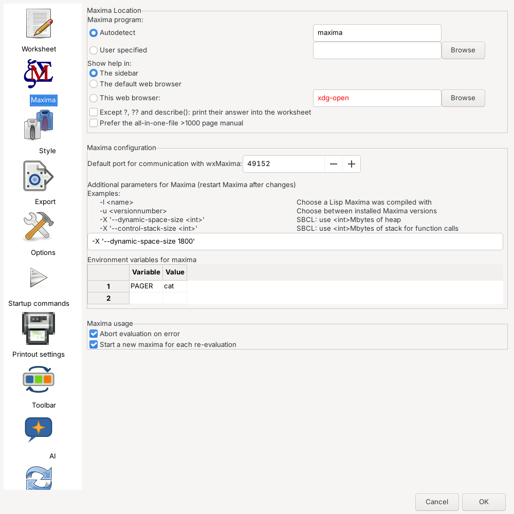

# wxMaxima kullanım kılavuzu

WxMaxima, _Maxima_ bilgisayar cebiri sistemi (CAS) için bir grafik kullanıcı
arayüzüdür (GUI). WxMaxima ile _Maxima_'nın tüm işlevleri
kullanılabilir. Ayrıca en sık kullanılan özelliklere erişmek için kullanışlı
sihirbazlar sunar. Bu kılavuz, wxMaxima'yı _Maxima_ için en popüler
arayüzlerden biri yapan özelliklerden bazılarını anlatır.

{ id=img_wxMaximaLogo }

______________________________________________________________________

# wxMaxima'ya giriş

## _Maxima_ ve wxMaxima

Açık kaynak dünyasında büyük sistemler genellikle küçük geliştirici
gruplarının daha kolay yönetebileceği daha küçük projelere bölünür. Örneğin
bir CD yazma programı, CD'yi asıl yazan bir komut satırı aracından ve
kullanıcıların tüm komut satırı seçeneklerini öğrenmek zorunda kalmadan,
hatta komut satırını hiç kullanmadan bu aracı kullanmasını sağlayan bir
grafik kullanıcı arayüzünden oluşur. Bu yaklaşımın bir avantajı, komut
satırı programına harcanan geliştirme emeğinin birçok program tarafından
paylaşılabilmesidir: Aynı CD yazma komut satırı programı bir dosya
yöneticisinde “CD'ye gönder” eklentisi olarak, bir müzik çalarda “CD'ye yaz”
işlevi için ve bir DVD yedekleme aracında CD yazıcı olarak
kullanılabilir. Bir başka avantaj da büyük bir işi küçük parçalara bölmenin
geliştiricilerin aynı program için birden fazla kullanıcı arayüzü sunmasına
olanak tanımasıdır.

_Maxima_ gibi bir bilgisayar cebiri sistemi (CAS) bu yapıya uyar. Bir CAS,
keyfi duyarlıklı bir hesap makinesi uygulamasının arkasındaki mantığı
sağlayabilir ya da daha büyük bir sistemin arka planında formüllerin
otomatik dönüşümlerini yapabilir
(örn. [Sage](https://www.sagemath.org/)). Alternatif olarak doğrudan
bağımsız bir sistem olarak da kullanılabilir. _Maxima_'ya bir komut satırı
üzerinden erişilebilir. Ancak çoğu zaman, özellikle yeni başlayanlar için,
_wxMaxima_ gibi bir arayüz yazılıma erişmenin daha verimli bir yolu olur.

### _Maxima_

_Maxima_ tam özellikli bir 'Sembolik' olarak ta çalışabilen bir bilgisayar
cebir sistemidir (BCS). Bir BCS, formülleri yeniden düzenleyerek ve sadece
sonucun sayısal değerini çıkarmanın aksine problemi çözen bir formül bularak
(sembolik ifadeler ile) matematiksel problemleri çözebilen bir
programdır. Başka bir deyişle, _Maxima_ değişkenlerin sayısal değerlerini
veren bir hesap makinesi olarak kullanılabilir ve analitik çözümler de
sağlayabilir. Ayrıca, analitik olarak çözülemeyen denklemler veya denklem
sistemleri için bir dizi sayısal analiz yöntemi sunar.

{
id=img_maxima_screenshot }

_Maxima_ için kapsamlı belgeler [internette mevcuttur](https://maxima.sourceforge.io/documentation.html). Bu belgelerin bir kısmına wxMaxima'nın Yardım menüsünden de ulaşılabilir. Yardım tuşuna (çoğu sistemde <kbd>F1</kbd> tuşu) basıldığında _wxMaxima_'nın bağlama duyarlı yardım özelliği, imlecin bulunduğu komutun _Maxima_ kılavuzundaki sayfasına otomatik olarak atlar.

### WxMaxima

_WxMaxima_, _Maxima_'nın tüm işlevselliğini ve esnekliğini sunan bir grafik
kullanıcı arayüzüdür. WxMaxima kullanıcılara grafik bir görüntü ve _Maxima_
ile çalışmayı kolaylaştıran birçok özellik sunar. Örneğin _wxMaxima_,
herhangi bir hücrenin içeriğini (ya da gerekirse bir formülün herhangi bir
parçasını) basit bir sağ tıklamayla metin, LaTeX ya da MathML olarak dışa
aktarmaya izin verir. Hatta bütün bir çalışma sayfası HTML ya da LaTeX
dosyası olarak dışa aktarılabilir. _wxMaxima_'nın belgeleri, kullanımının
çeşitli yönlerini gösteren çalışma sayfalarıyla birlikte, _wxMaxima_ [yardım
sitesinde](https://wxMaxima-developers.github.io/wxmaxima/help.html) ve
Yardım menüsünde bulunur.

{ id=img_wxMaximaWindow }

_WxMaxima_ içine girilen hesaplamalar, arka planda _Maxima_ komut satırı
aracı tarafından gerçekleştirilir.

## Çalışma sayfasının temelleri

_wxMaxima_'nın çoğu kendini açıklar, ancak bazı ayrıntılar dikkat
gerektirir. [Bu
site](https://wxMaxima-developers.github.io/wxmaxima/help.html),
_wxMaxima_'nın çeşitli yönlerini ele alan bir dizi çalışma sayfası
içerir. Bunlardan bazılarını (özellikle "10 dakikada _(wx)Maxima_"
eğitimini) baştan sona çalışmak, hem _Maxima_'nın içeriğine hem de _Maxima_
ile etkileşim için _wxMaxima_ kullanımına aşinalığı artıracaktır. Bu
kılavuz, _wxMaxima_'nın kendiliğinden anlaşılması pek beklenmeyen ve
çevrimiçi materyalde ele alınmamış olabilecek yönlerini anlatmaya odaklanır.

### Çalışma sayfası yaklaşımı

_wxMaxima_'da standart olmayan çok az şeyden biri, _Maxima_ için verileri
yalnızca kullanıcı istediğinde değerlendirilen (yani _Maxima_'ya gönderilen)
hücreler halinde düzenlemesidir. Bir hücre değerlendirildiğinde, o hücredeki
ve yalnızca o hücredeki tüm komutlar toplu olarak değerlendirilir. (Bu ifade
tam olarak doğru değil: Bitişik birkaç hücre seçilip birlikte
değerlendirilebilir. Ayrıca _Maxima_'ya bir çalışma sayfasındaki tüm
hücreleri tek seferde değerlendirmesi söylenebilir.) _WxMaxima_'nın
komutları çalıştırmak üzere gönderme yaklaşımı ilk bakışta alışılmadık
gelebilir. Ancak büyük belgelerle çalışmayı (kullanıcının her değişikliğin
belgenin tamamının yeniden değerlendirilmesini otomatik olarak tetiklemesini
istemediği durumlarda) büyük ölçüde kolaylaştırır. Ayrıca bu yaklaşım hata
ayıklama için çok kullanışlıdır.

_wxMaxima_'ya metin yazıldığında otomatik olarak yeni bir çalışma sayfası
hücresi oluşturulur. Bu hücrenin türü araç çubuğundan seçilebilir. Bir kod
hücresi oluşturulduysa hücre _Maxima_'ya gönderilebilir; bu durumda
hesaplamanın sonucu kodun altında görüntülenir. Aşağıda böyle bir komut
çifti gösterilmektedir.

{ id=img_InputCell }

Bir giriş hücresinin içeriği değerlendirildiğinde _Maxima_ girişe bir etiket
atar (varsayılan olarak kırmızı gösterilir ve `%i` ile tanınır); bu etiketle
girişe _wxMaxima_ oturumunda daha sonra başvurulabilir. _Maxima_'nın
ürettiği çıktı da `%o` ile başlayan bir etiket alır; bu etiket, kullanıcı
çıktıya bir ad atamadıkça varsayılan olarak gizlidir. Ad atanmışsa
varsayılan olarak kullanıcının tanımladığı etiket gösterilir. Yine de
_Maxima_'nın otomatik ürettiği `%o` biçimindeki etikete de erişilebilir.

_wxMaxima_, giriş hücrelerinin yanı sıra belgeleme için metin hücrelerine,
görüntü hücrelerine, başlık hücrelerine, bölüm hücrelerine ve kısım
hücrelerine de izin verir. Her hücrenin kendi geri alma arabelleği vardır;
bu yüzden birkaç hücrenin değerlerini değiştirip ardından gereksiz
değişiklikleri yavaş yavaş geri alarak hata ayıklamak oldukça
kolaydır. Ayrıca çalışma sayfasının kendisinin de hücre düzenlemelerini,
eklemelerini ve silmelerini geri alabilen genel bir geri alma arabelleği
vardır.

Aşağıdaki şekil farklı hücre türlerini (başlık hücreleri, bölüm hücreleri,
alt bölüm hücreleri, metin hücreleri, giriş/çıkış hücreleri ve görüntü
hücreleri) göstermektedir.

{
id=img_cell-example }

### Hücreler

Çalışma sayfası hücreler halinde düzenlenmiştir. WxMaxima aşağıdaki hücre
türlerini tanır:

- Bir ya da daha fazla satır _Maxima_ girişi içeren matematik hücreleri.
- _Maxima_'nın çıktısı ya da _Maxima_'dan gelen bir soru.
- Görüntü hücreleri.
- Örneğin belgeleme için kullanılabilen metin hücreleri.
- Bir başlık, bölüm ya da alt bölüm. 6 farklı başlık düzeyi mümkündür.
- Sayfa sonları.

Metin girildiğinde _wxMaxima_'nın varsayılan davranışı otomatik olarak bir
matematik hücresi oluşturmaktır. Diğer türlerdeki hücreler Hücre menüsüyle,
menüde gösterilen kısayol tuşlarıyla ya da araç çubuğundaki açılır listeyle
oluşturulabilir. Matematik dışı bir hücre oluşturulduktan sonra içine
yazılan her şey metin olarak yorumlanır.

Bir matematik hücresi, (C tarzı) bir [yorum
metni](https://maxima.sourceforge.io/docs/manual/maxima_singlepage.html#Comments)
de içerebilir: `/* This comment will be ignored by Maxima */`

"`/*`" yorumun başlangıcını, "`*/`" ise sonunu işaretler.

### Yatay ve dikey imleçler

Kullanıcı tam bir cümle seçmeye çalışırsa, bir kelime işlemci seçimi
otomatik olarak bir kelime sınırında başlayıp bitecek şekilde genişletmeye
çalışır. Benzer şekilde, birden fazla hücre seçilirse _wxMaxima_ da seçimi
hücrelerin tamamına genişletir.

Standart olmayan şey, _wxMaxima_'nın iki tür imleç tanımlayarak
sürükle-bırak esnekliği sağlamasıdır. _WxMaxima_ gerektiğinde bunlar
arasında otomatik olarak geçiş yapar:

- İmleç iki hücre arasındaki boşlukta hareket ettirilirse ya da oraya
  tıklanırsa yatay çizilir.
- Bir hücrenin içinde çalışan dikey bir imleç. Bu imleç, fare işaretçisiyle
  ya da imleç tuşlarıyla imleci bir hücrenin içine taşıyarak etkinleştirilir
  ve bir metin düzenleyicideki imleç gibi çalışır.

wxMaxima'yı başlattığınızda yalnızca yanıp sönen yatay imleci görürsünüz. Yazmaya başlarsanız otomatik olarak bir matematik hücresi oluşturulur ve imleç normal, dikey bir imlece dönüşür (istem olarak bir sağ ok görürsünüz; matematik hücresi değerlendirildikten sonra (<kbd>CTRL</kbd>+<kbd>ENTER</kbd>) `(%i1)`, `(%o1)` gibi etiketleri görürsünüz).

{ id=img_horizontal_cursor_only }

Çalışma sayfanızı oluşturmaya başlarken, ne yapılacağını açıklayan farklı
bir hücre türü (örneğin bir başlık hücresi ya da metin hücresi) oluşturmak
isteyebilirsiniz ("Hücre" menüsünü kullanarak).

Farklı hücreler arasında gezinirken de, çalışma sayfanıza bir hücre
ekleyebileceğiniz yerde (yanıp sönen) yatay imleci görürsünüz (ya
formülünüzü yazmaya başlayarak bir matematik hücresi ya da menüyü kullanarak
farklı türde bir hücre).

{
id=img_horizontal_cursor_between_cells }

### Hücreleri Maxima'ya gönderme

Bir kod hücresindeki komut, <kbd>CTRL</kbd>+<kbd>ENTER</kbd>, <kbd>SHIFT</kbd>+<kbd>ENTER</kbd> ya da sayısal tuş takımındaki <kbd>ENTER</kbd> tuşuna basılarak bir kez çalıştırılır. _wxMaxima_ varsayılan olarak komutları <kbd>CTRL</kbd>+<kbd>ENTER</kbd> ya da <kbd>SHIFT</kbd>+<kbd>ENTER</kbd> girildiğinde gönderir, ancak _wxMaxima_ komutları <kbd>ENTER</kbd> tuşuna yanıt olarak çalıştıracak şekilde yapılandırılabilir.

### Komutların otomatik tamamlanması

_WxMaxima_, menüden (Hücre/Kelimeyi tamamla) ya da <kbd>CTRL</kbd>+<kbd>SPACE</kbd> tuş bileşimine basılarak tetiklenen bir otomatik tamamlama özelliği içerir. Otomatik tamamlama bağlama duyarlıdır. Örneğin ezUnits için bir birim belirtiminin içinde etkinleştirilirse uygun birimlerin bir listesini sunar.

{ id=img_ezUnits }

Otomatik tamamlama, bir dosya adını, bir birim adını ya da geçerli komutun veya değişkenin adını tamamlamanın yanı sıra, komutların çoğu için programın beklediği parametrelerin türünü (ve anlamını) gösteren bir şablon da gösterebilir. Bu özelliği etkinleştirmek için <kbd>SHIFT</kbd>+<kbd>CTRL</kbd>+<kbd>SPACE</kbd> tuşlarına basın ya da ilgili menü öğesini (Hücre/Şablonu göster) seçin.

#### Yunan harfleri

Bilgisayarlar geleneksel olarak karakterleri 8 bitlik değerlerde saklar. Bu,
en fazla 256 farklı karaktere izin verir. Hemen her dilin tüm harfleri,
rakamları ve denetim simgeleri (iletimin sonu, dizenin sonu, menüler için
dikdörtgen çizmeye yarayan çizgiler ve kenarlar _vb._) bu sınırın içine
sığabilir.

Ancak çoğu ülke için seçilmiş olan 256 karakterlik kod sayfası, matematikte
sık kullanılan Yunan harfleri gibi şeyleri içermez. Bu tür sınırlamaların
üstesinden gelmek için [Unicode](https://home.unicode.org/) icat edilmiştir:
İngilizce metnin her zamanki gibi çalışmasını sağlayan, ama 256'dan çok daha
fazla karakter kullanmaya olanak tanıyan bir kodlama.

_Maxima_, Unicode'u destekleyen ya da yazı tipi kodlamasıyla ilgilenmeyen
bir Lisp derleyicisiyle derlenmişse Unicode'a izin verir. Bu iki koşuldan en
az birinin doğru olması muhtemeldir. _WxMaxima_ Yunan harflerini klavyeyle
girmek için bir yöntem sunar:

- Bir Yunan harfi, <kbd>ESC</kbd> tuşuna basıp ardından Yunan harfinin adını
  yazmaya başlayarak girilebilir.
- Alternatif olarak <kbd>ESC</kbd>, bir harf (omikron için iki harf) ve
  yeniden <kbd>ESC</kbd> tuşlarına basılarak da girilebilir. Bu durumda şu
  harfler desteklenir:

| tuş | Yunan harfi | tuş | Yunan harfi | tuş | Yunan harfi |
| :-: | :----------: | :-: | :----------: | :-: | :----------: |
|  a  |    alpha     |  i  |     iota     |  r  |     rho      |
|  b  |     beta     |  k  |    kappa     |  s  |    sigma     |
|  g  |    gamma     |  l  |    lambda    |  t  |     tau      |
|  d  |    delta     |  m  |      mu      |  u  |   upsilon    |
|  e  |   epsilon    |  n  |      nu      |  f  |     phi      |
|  z  |     zeta     |  x  |      xi      |  c  |     chi      |
|  h  |     eta      | om  |   omicron    |  y  |     psi      |
|  q  |    theta     |  p  |      pi      |  o  |    omega     |
|  A  |    Alpha     |  I  |     Iota     |  R  |     Rho      |
|  B  |     Beta     |  K  |    Kappa     |  S  |    Sigma     |
|  G  |    Gamma     |  L  |    Lambda    |  T  |     Tau      |
|  D  |    Delta     |  M  |      Mu      |  U  |   Upsilon    |
|  E  |   Epsilon    |  N  |      Nu      |  P  |     Phi      |
|  Z  |     Zeta     |  X  |      Xi      |  C  |     Chi      |
|  H  |     Eta      | Om  |   Omicron    |  Y  |     Psi      |
|  T  |    Theta     |  P  |      Pi      |  O  |    Omega     |

Yunan harflerini girmek için "Yunanca harfler" kenar çubuğunu da
kullanabilirsiniz.

##### Dikkat: Birbirine benzeyen karakterler

Bazı Latin harfleri Yunan harflerine benzer; örneğin Latin "A" harfi ile
Yunan "Alfa" harfi. Aynı görünseler de bunlar, farklı Unicode kod
noktalarıyla (sayılarla) temsil edilen iki ayrı Unicode karakteridir.

Bu, A değişkenine bir değer atayıp daha sonra bu değişkenle bir şey yapmak
için Yunan Alfa harfini kullanırsanız, özellikle de çıktılarda, sorun
yaratabilir. Yunan mü harfi için de (mikro öneki olarak da kullanılır) iki
farklı Unicode kod noktası vardır.

Bu yüzden "Yunanca harfler" kenar çubuğunda birbirine benzeyen karakterlerin
sunulmaması seçeneği vardır (bu, sağ tıklama menüsüyle değiştirilebilir).

Aynı mekanizma ayrıca çeşitli matematiksel sembollerin girilmesine izin
verir:

| girilecek tuşlar | matematik simgesi                                     |
| -------------- | ----------------------------------------------------- |
| hbar           | Planck sabiti: üzerinde yatay çizgi olan bir h        |
| Hbar           | üzerinde yatay çizgi olan bir H                       |
| 2              | kare                                                  |
| 3              | küp                                                   |
| /2             | 1/2                                                   |
| partial        | kısmi türev işareti (dx/dt'deki d)                    |
| integral       | integral işareti                                      |
| sq             | karekök                                               |
| ii             | sanal                                                 |
| ee             | eleman                                                |
| in             | içinde                                                |
| impl implies   | gerektirir                                            |
| inf            | sonsuz                                                |
| empty          | boş                                                   |
| TB             | sağa bakan büyük üçgen                                |
| tb             | sağa bakan küçük üçgen                                |
| and            | ve                                                    |
| or             | veya                                                  |
| xor            | özel veya (xor)                                       |
| nand           | nand                                                  |
| nor            | nor                                                   |
| equiv          | denktir                                               |
| not            | değil                                                 |
| union          | birleşim                                              |
| inter          | kesişim                                               |
| subseteq       | alt küme ya da eşit                                   |
| subset         | alt küme                                              |
| notsubseteq    | alt küme ya da eşit değil                             |
| notsubset      | alt küme değil                                        |
| approx         | yaklaşık olarak                                       |
| propto         | orantılı                                              |
| neq != /= or # | eşit değil                                            |
| +/- or pm      | artı/eksi işareti                                     |
| \<= or leq     | küçük ya da eşit                                      |
| >= or geq      | büyük ya da eşit                                      |
| \<\< or ll     | çok küçük                                             |
| >> or gg       | çok büyük                                             |
| qed            | ispatın sonu                                          |
| nabla          | nabla operatörü                                       |
| sum            | toplam işareti                                        |
| prod           | çarpım işareti                                        |
| exists         | vardır işareti                                        |
| nexists        | yoktur işareti                                        |
| parallel       | paralel işareti                                       |
| perp           | dik işareti                                           |
| leadsto        | "götürür" işareti                                     |
| ->             | sağ ok                                                |
| -->            | uzun sağ ok                                           |

Bu matematik simgelerini girmek için "Semboller" kenar çubuğunu da
kullanabilirsiniz.

Özel bir simge listede yoksa, <kbd>ESC</kbd> \[karakterin (onaltılık) numarası\] <kbd>ESC</kbd> tuşlarına basarak istenen herhangi bir Unicode karakteri girmek mümkündür. Ayrıca "Semboller" kenar çubuğunun sağ tıklama menüsü, bu araç çubuğuna ya da çalışma sayfasına eklenebilecek tüm Unicode simgelerinin bir listesini gösterebilir.

<kbd>ESC</kbd><kbd>6</kbd><kbd>1</kbd><kbd>ESC</kbd> therefore results in an `a`. While you type the number, the list of symbols shows the character it stands for and its Unicode name.

If the number also is the beginning of a symbol's name (`be` could be the start of `beta`, or the character ¾ with the number `be`), the name wins. A leading `0` or `u+` makes it a number: <kbd>ESC</kbd>`u+be`<kbd>ESC</kbd> and <kbd>ESC</kbd>`00be`<kbd>ESC</kbd> both result in a `¾`.

A letter with an accent that Unicode has no character of its own for, like a t with a bar on top of it, is a letter followed by a "combining" accent: <kbd>t</kbd><kbd>ESC</kbd><kbd>3</kbd><kbd>0</kbd><kbd>4</kbd><kbd>ESC</kbd> results in `t̄`, which _Maxima_ treats as a variable name like any other.

Symbols one needs often can be added to the "Symbols" sidebar in the "Options" tab of the configuration dialog (Edit -> Configure), where they can also be given a keyboard shortcut. A letter with accents counts as one symbol there and gets one button. The Greek letters and the symbols the sidebars show anyway can be given a keyboard shortcut there, too, or by right-clicking their button in the sidebar. A shortcut has to contain <kbd>Ctrl</kbd> or <kbd>Alt</kbd> or be a function key, and types its symbol while the worksheet has the keyboard focus. The configuration dialog warns if a menu entry already uses the same keys.

Lütfen bu simgelerin çoğunun (mantık simgeleri önemli istisnalardır)
_Maxima_'da özel bir anlamı olmadığını ve bu yüzden sıradan karakterler
olarak yorumlanacağını unutmayın. _Maxima_, Unicode karakterleri
desteklemeyen bir Lisp ile derlenmişse bu simgeler hata mesajına yol
açabilir.

Örneğin Yunan harfleri ya da matematik simgeleri seçili yazı tipinde bulunmuyor olabilir; bu durumda görüntülenemezler.
Bu sorunu çözmek için başka yazı tipleri seçin (Düzen -> Yapılandır -> Stil ile).

### Unicode değiştirme

wxMaxima will replace several Unicode characters with their respective Maxima expressions, e.g. `²` with `^2`, `³` with `^3`, `≠` with `#` or `≤` with `<=`.

Unicode characters that stand for a Maxima name are instead defined as
_Maxima_ aliases of that name when wxMaxima starts _Maxima_: `π` for `%pi`,
`ⅈ` for `%i`, `ⅇ` for `%e`, `∞` for `inf`, the (mathematical) Sigma sign
(which is not the same Unicode character as the corresponding Greek letter)
for `sum`, `∏` for `product`, `∫` for `integrate`, the square root sign for
`sqrt` and `⋀`, `⋁`, `⊻`, `⊼`, `⊽`, `⇒`, `⇔` and `¬` for `and`, `or`, `xor`,
`nand`, `nor`, `implies`, `equiv` and `not`. This means they work in files
loaded by `batch()` or `load()`, too, and `aliases` lists the names they
stand for. As _Maxima_ reads these characters as letters they need to be
separated from neighbouring names by spaces in such a file: `a⋀b` is a
variable name, `a ⋀ b` means `a and b`. In an input cell wxMaxima adds these
spaces automatically. It also puts parenthesis around a number or a variable
that directly follows the square root sign, so `√2` means `sqrt(2)`.

Unicode'da birkaç "yaygın" kesir tek bir Unicode kod noktası olarak
kodlanmıştır: `¼, ½, ¾, ⅐, ⅑, ⅒, ⅓, ⅔, ⅕, ⅖, ⅗, ⅘, ⅙, ⅚, ⅛, ⅜, ⅝, ⅞`

wxMaxima, giriş Maxima'ya gönderilmeden önce bunları Maxima gösterimleriyle
değiştirir, örneğin `(1/4)`. Ayrıca `1/` ile değiştirilen `⅟` ve `(0/3)` ile
değiştirilen `↉` (beyzbolda kullanılır) vardır.

Giriş hücrelerinde (bu Unicode kod noktalarını değil) **Maxima kodunu**
kullanmanız önerilir (gerekçe: (a) matematik girişi için kullanılan yazı
tipi bunları içermiyor olabilir; (b) belgeyi `wxm` dosyası olarak
kaydederseniz genellikle (komut satırı) Maxima tarafından okunabilir, ancak
bu değiştirmeler komut satırı Maxima'sında elbette çalışmaz); yine de başka
bir belgeden bir formülü kesip yapıştırdığınızda bu karakterler ortaya
çıkabilir.

### Kenar panelleri

En önemli _Maxima_ komutlarına kısayollara, içindekiler tablosu gibi
şeylere, hata ayıklama mesajlarını gösteren pencerelere ya da son verilen
komutların geçmişine kenar panelleriyle erişilebilir. Bunlar "Görünüm"
menüsünden etkinleştirilebilir. Hepsi _wxMaxima_ penceresinin içinde ya da
dışında başka konumlara taşınabilir. Yararlı panellerden biri de Yunan
harflerini fareyle girmeye olanak tanıyandır.

{ id=img_SidePanes }

"İçerik Tablosu" kenar panelinde bir başlığın düzeyi, başlığa farenin sağ
tuşuyla tıklayıp bir üst ya da bir alt başlık türünü seçerek kolayca
artırılabilir ya da azaltılabilir.

{
id=Sidepane-TOC-convert-headings }

### MathML çıktısı

Birçok kelime işlemci ve benzeri program ya
[MathML](https://www.w3.org/Math/) girişini tanıyıp otomatik olarak
düzenlenebilir iki boyutlu bir denklem olarak ekler ya da (LibreOffice gibi)
“panodan MathML içe aktar” özelliği sunan bir denklem düzenleyicisine
sahiptir. Diğerleri RTF matematiğini destekler. Bu yüzden _WxMaxima_ sağ
tıklama menüsünde birkaç öğe sunar.

### Pasting LaTeX or MathML formulas

**Edit → Paste LaTeX/MathML as Maxima Code** (also in the right-click menu) converts a formula from the clipboard into a _Maxima_ command, for example one copied from a paper, a web page or an equation editor. LaTeX may come with or without `$…$`, `\(…\)` or `\[…\]` around it, so `\int_0^1 \frac{\sin x}{x}\,dx` becomes `integrate(sin(x)/x,x,0,1)`. The command goes where the cursor is, or into a new code cell. MathML pasted into a code cell with the ordinary **Paste** is converted the same way, since nobody wants the XML in a code cell. If MathML copied with **Copy as MathML** is pasted back, the result is the original command: _wxMaxima_ adds it to the MathML as an annotation.

LaTeX and MathML describe what a formula looks like, not what it means, so
the conversion has to interpret it. Fractions, roots, powers, subscripts
(`x_1` becomes the name `x_1`, `a_{n+1}` the array element `a[n+1]`),
functions with or without parentheses (`\sin 2x`), `\frac{d}{dx}`, `f'(x)`,
integrals ending in `dx`, sums and products with limits, `\lim_{x\to 0}`,
`|x|` and matrices are understood. An `e` is Euler’s number, but an `i` is
only the imaginary unit when set upright (`\mathrm{i}`), as it more often is
an index. A product of a name and parentheses, like `x(y+1)`, is taken as a
product unless the name is `f`, `g`, `h` or longer than one letter. Anything
without a single meaning, like `\pm`, `\dots` or text, isn’t guessed at:
_wxMaxima_ says what it couldn’t convert instead. Check the command before
evaluating it.

### Markdown desteği

_WxMaxima_, matematiksel gösterimle çakışmayan bir dizi standart
[Markdown](https://en.wikipedia.org/wiki/Markdown) kuralını destekler. Bu
öğelerden biri madde işaretli listelerdir.

```text
Sıradan metin
 * Bir öğe, girinti düzeyi 1
 * Girinti düzeyi 1'de başka bir öğe
   * İkinci girinti düzeyinde bir öğe
   * İkinci girinti düzeyinde ikinci bir öğe
 * Birinci girinti düzeyinde üçüncü bir öğe
Sıradan metin
```

_WxMaxima_, `>` karakterleriyle başlayan metni blok alıntı olarak tanır:

```text
Sıradan metin
> alıntı alıntı alıntı alıntı
> alıntı alıntı alıntı alıntı
> alıntı alıntı alıntı alıntı
Sıradan metin
```

_WxMaxima_'nın TeX ve HTML çıktısı `=>` dizisini de tanır ve karşılık gelen Unicode işaretiyle değiştirir:

```text
cogito => sum.
```

HTML ve TeX dışa aktarımının tanıdığı diğer simgeler, karşılaştırmalar için `<=` ve `>=`, iki uçlu çift ok (`<=>`), tek başlı oklar (`<->`, `->` ve `<-`) ve ilgili işaret olarak `+/-` dizisidir. TeX çıktısı için `<<` ve `>>` de tanınır.

### Links in text cells

A web address in a text cell that starts with `http://`, `https://` or `mailto:` is shown as a link. Since clicking into a text cell places the cursor there, a link is followed by <kbd>CTRL</kbd>+clicking it (<kbd>CMD</kbd>+clicking on macOS), or by right-clicking it and choosing "Open Link"; hovering over it shows where it leads. The HTML export turns it into a link, the TeX export into a `\url{}`. Links are always recognized from the text itself, so nothing about them is stored in the file.

Links in a code cell's comments (`/* ... */`) work the same way. Elsewhere
in code, for example inside a string, an address is Maxima syntax and is not
a link.

The same goes for web addresses in _Maxima_'s output, for example in a string printed by `print("See https://wxmaxima-developers.github.io/wxmaxima/")`: <kbd>CTRL</kbd>+clicking the address or choosing "Open Link" from its context menu opens it, while a plain click still selects the output.

### Bold, italic, underlined and struck-through text

Text in a text cell, a title or a section heading can be made bold, italic,
underlined or struck through. Select the text and press the respective
button in the toolbar; pressing the button again removes that formatting
from the selection. With nothing selected the button switches the formatting
on or off for what is typed next. The buttons are hidden by right-clicking
the toolbar and unchecking "Text formatting buttons". Code cells cannot be
formatted: their colors already show the syntax of the code.

Superscript and subscript buttons work the same way: they make the text
smaller and raise it above or lower it below the line, as in E = mc² or
H₂O. A character cannot be both, so switching one of them on switches the
other off. A line that contains a superscript, a subscript or a character
that is taller than the font's usual ones, for example an emoji, gets as
much additional room as it needs.

The formatting is saved in `.wxmx` files. Older versions of _wxMaxima_ open
such a file without the formatting but keep all of the text. `.wxm` files,
the exports and the clipboard contain the text without its formatting.

### Kısayol tuşları

Çoğu kısayol tuşu ilgili menülerin metninde bulunabilir. Aslında menü
metninden alındıklarından ve _wxMaxima_ çevirileriyle yerel klavyenin
kullanıcılarının ihtiyaçlarına göre özelleştirilebildiğinden, bunları burada
belgelemiyoruz. Bununla birlikte, bazı kısayol tuşları veya kısayol takma
adları menülerde belgelenmemiştir:

- <kbd> CTRL </kbd> + <kbd> ÜST KARAKTER </kbd> + <kbd> SİL </kbd> tam bir
  hücreyi siler.
- <kbd>CTRL</kbd>+<kbd>TAB</kbd> ya da
  <kbd>CTRL</kbd>+<kbd>SHIFT</kbd>+<kbd>TAB</kbd> otomatik tamamlama
  mekanizmasını tetikler.
- <kbd> SHIFT </kbd> + <kbd> SPACE </kbd>, boşluk bırakmayan bir boşluk
  ekler.

### Exploring output with the keyboard

A cell's output can be selected, and explored part by part, without a mouse:

- <kbd>DOWN</kbd> at the end of a cell's input selects the first result of
  its output. Further presses of <kbd>DOWN</kbd> and <kbd>UP</kbd> step
  through the results; past the last one the cursor leaves the cell. If you
  prefer <kbd>DOWN</kbd> to skip over the output, switch on "Up/Down keys
  skip over output" in the Worksheet tab of the configuration dialog.
- <kbd>ENTER</kbd> goes into the selected expression and selects its first
  part: the expression without its label, the numerator of a fraction, the
  name of a function, the first entry of a matrix, ... If the selection has
  no parts, <kbd>ENTER</kbd> opens a new input cell holding it, as it always
  did.
- <kbd>ESCAPE</kbd> selects what the selection is a part of. From a whole
  result it goes back into the cell's input.
- <kbd>LEFT</kbd> and <kbd>RIGHT</kbd> select the previous or next part at
  the same level. In a matrix all four arrow keys move from entry to entry.
- <kbd>SHIFT</kbd>+<kbd>LEFT</kbd> and <kbd>SHIFT</kbd>+<kbd>RIGHT</kbd>
  grow or shrink the selection over the neighbouring parts; in a matrix,
  <kbd>SHIFT</kbd> and any arrow key grow the selected entry into a block of
  entries.
- The context-menu key or <kbd>SHIFT</kbd>+<kbd>F10</kbd> opens the
  right-click menu for the selection, so it can be copied in any format.

### TeX dışa aktarımında ham TeX

Bir metin hücresi `TeX:` ile başlıyorsa, TeX dışa aktarımı `TeX:` işaretini
izleyen değişmez metni içerir. Bu özelliği kullanmak _wxMaxima_ çalışma
kitabına TeX işaretlemesinin girilmesini sağlar.

## Dosya biçimleri

_WxMaxima_ oturumunda geliştirilen materyal, daha sonra kullanılmak üzere üç
yoldan biriyle saklanabilir:

### .mac

`.mac` dosyaları _Maxima_ komutları içeren sıradan metin
dosyalarıdır. _Maxima_'nın `batch()` ya da `load()` komutuyla veya
_wxMaxima_'nın Dosya/Kütük Dosyası menü öğesiyle okunabilirler.

Aşağıda bir örnek gösterilmektedir. `Quadratic.mac` bir fonksiyon tanımlar
ve ardından `wxdraw2d()` ile bir grafik oluşturur. Sonra `Quadratic.mac`
dosyasının içeriği yazdırılır ve yeni tanımlanan `f()` fonksiyonu
değerlendirilir.

{ id=img_BatchImage }

Dikkat: `Quadratic.mac` dosyası olağan bir _Maxima_ uzantısına (`.mac`)
sahip olsa da yalnızca _wxMaxima_ tarafından okunabilir, çünkü `wxdraw2d()`
komutu wxMaxima'nın _Maxima_'ya eklediği bir uzantıdır. (Komut satırı)
Maxima bilinmeyen `wxdraw2d()` komutunu yok sayar ve onu yeniden çıktı
olarak yazdırır.

`.mac` dosyalarını kendi makro kitaplığınızı yazmak için
kullanabilirsiniz. Ancak yeterli yapısal bilgi içermedikleri için bir
_wxMaxima_ oturumu olarak geri okunamazlar.

### .wxm

`.wxm` dosyaları, _Maxima_'nın çıktısı dışında çalışma sayfasını içerir. 5.38'den yeni Maxima sürümlerinde .mac dosyaları gibi _Maxima_'nın `load()` fonksiyonuyla okunabilirler. Şey, çoğunlukla. Sorular (`asksign(x)` gibi) sorunludur, çünkü yanıt `.wxm` dosyasına yazılır (böylece yüklendikten sonra önerilebilir), ama Maxima bunu değerlendiremez.
Maxima'nın bilmek istediği bazı özellikleri `assume()` ile bildirerek Maxima'nın soru sormasını önleyebilirsiniz.

Bu düz metin biçiminde, yeni özellikler kullanan çalışma sayfalarının
_wxMaxima_'nın eski sürümleriyle geriye dönük uyumlu olmaması bazen
kaçınılmazdır.

#### wxm dosyalarının dosya biçimi

Bu yalnızca düz bir metin dosyasıdır (bir metin düzenleyiciyle
açabilirsiniz) ve hücre içeriklerini özel Maxima yorumları olarak içerir.

Dosya aşağıdaki yorumla başlar:

```maxima
/* [wxMaxima batch file version 1] [ DO NOT EDIT BY HAND! ]*/
/* [ Created with wxMaxima version 24.02.2_DevelopmentSnapshot ] */
```

Ardından Maxima yorumları olarak kodlanmış hücreler gelir, örneğin bir bölüm
hücresi:

```maxima
/* [wxMaxima: section start ]
Title of the section
   [wxMaxima: section end   ] */
```

ya da (bir matematik hücresinde giriş elbette yorum içine *alınmaz* (çıktı
`wxm` dosyasına kaydedilmez)):

```maxima
/* [wxMaxima: input   start ] */
f(x):=x^2+1$
f(2);
/* [wxMaxima: input   end   ] */
```

Görüntüler, ilk satırda görüntü türü olacak şekilde [Base64 ile
kodlanır](https://en.wikipedia.org/wiki/Base64):

```maxima
/* [wxMaxima: image   start ]
jpg
[very chaotic looking character sequence]
   [wxMaxima: image   end   ] */
```

Sayfa sonu yalnızca şunu içeren tek bir satırdır:

```maxima
/* [wxMaxima: page break    ] */
```

Katlanmış hücreler ise şöyle işaretlenir:

```maxima
/* [wxMaxima: fold    start ] */
...
/* [wxMaxima: fold    end   ] */
```

### .wxmx

XML tabanlı bu dosya biçimi, yakınlaştırma oranı ve izleme listesi gibi
şeyler dahil çalışma sayfasının tamamını kaydeder. Tercih edilen dosya
biçimidir.

#### wxmx dosyalarının dosya biçimi

Bir `wxmx` dosyası ikili bir biçim gibi görünür, ancak işletim sisteminizde
bulunan araçlarla işlenebilir. Bu bir zip dosyasıdır ve `unzip` ile
açılabilir (işletim sisteminizin zip programının tanıması için önce yeniden
adlandırmanız gerekebilir). Sıkıştırma işlevini kullanmıyoruz, yalnızca
birkaç dosyayı tek bir dosyada birleştirme olanağını kullanıyoruz:
Görüntüler zaten sıkıştırılmıştır, geri kalanı ise basit metindir
(muhtemelen içerilen büyük görüntülerden çok daha küçüktür).

Şu dosyaları içerir:

- `mimetype`: Bu dosya wxMaxima dosyalarının MIME türünü içerir:
  `text/x-wxmathml`
- `format.txt`: wxMaxima ve wxmx dosya biçimi hakkında kısa bir açıklama
- Görüntüler (örn. png, jpeg): wxMaxima oturumunda üretilen satır içi
  grafikler ve eklenmiş görüntüler.
- `content.xml`: Belgenizin çeşitli hücrelerini XML biçiminde içeren bir XML
  belgesi.

Yani bir şeyler ters giderse bir wxMaxima belgesini açabilir (belki önce
`zip` dosyası olarak yeniden adlandırarak), `content.xml` dosyasında bir
metin düzenleyiciyle değişiklik yapabilir ya da bozuk bir görüntüyü
değiştirebilir, dosyaları yeniden sıkıştırabilir, `zip` dosyasını yeniden
`wxmx` dosyası olarak adlandırabilirsiniz; böylece değiştirilmiş yeni bir
`wxmx` dosyası elde edersiniz.

## Yapılandırma seçenekleri

Bazı yaygın yapılandırma değişkenleri için _wxMaxima_ iki yapılandırma
yöntemi sunar:

- Aşağıdaki yapılandırma iletişim kutusu, geçerli ve sonraki oturumlar için
  varsayılan değerlerini değiştirmenizi sağlar.
- Ayrıca çoğu yapılandırma değişkeninin değeri, aşağıda gösterildiği gibi
  çalışma sayfasından üzerine yazılarak yalnızca geçerli oturum için
  değiştirilebilir.

{
id=img_wxMaxima_configuration_001 }

### Varsayılan animasyon kare hızı

Yeni animasyonlar için kullanılan animasyon karesi `wxanimate_framerate
'değişkeninde tutulur. Bu değişkenin yeni bir çalışma sayfasında içereceği
ilk değer, yapılandırma iletişim kutusu kullanılarak değiştirilebilir.

### Yeni _maxima_ oturumları için varsayılan grafik boyutu

Bir sonraki başlatmadan sonra, `wxplot_size` değeri _maxima_ tarafından
değiştirilmedikçe çalışma sayfasına gömülen grafikler bu boyutta
oluşturulur.

Yalnızca tek bir grafiğin boyutunu ayarlamak için, bir değişkenin değerini
yalnızca tek bir komut için ayarlayan şu gösterim kullanılabilir:

```maxima
wxdraw2d(
   explicit(
       x^2,
       x,-5,5
   )
), wxplot_size=[480,480]$
```

### Metin denetimlerinde parantezleri eşleştir

Bu seçenek iki şeyi etkinleştirir:

- Açılan bir parantez, köşeli parantez ya da çift tırnak girilirse
  _wxMaxima_ arkasına kapanan bir tane ekler.
- In a code cell a comment opened by `/*` is closed by an inserted
  `*/`. Typing `*/` in front of it moves the cursor past it instead.
- Bu tuşlardan herhangi birine basıldığında metin seçilirse, seçilen metin
  eşleşen işaretlerin arasına yerleştirilir.

### Çalışma sayfasını otomatik olarak kaydetme

Bu seçenek ayarlanmışsa, çalışma sayfasının bulunduğu dosyanın üzerine
yalnızca kullanıcı istediğinde yazılır. Yine de çökme, elektrik kesintisi
vb. durumlar için geçici dizinde yakın tarihli bir yedek kopya bulunur.

Bu seçenek ayarlanmamışsa _wxMaxima_ daha çok modern bir cep telefonu
uygulaması gibi davranır:

- Dosyalar çıkışta otomatik olarak kaydedilir
- Ayrıca dosya her 3 dakikada bir otomatik olarak kaydedilir.

### Arranging the toolbar

The toolbar is made of sections, like the "Open" and "Save" buttons, the
evaluation buttons or the drop-down list that sets the type of a cell. The
"Toolbar" tab of the configuration dialog lists them in the order the
toolbar shows them in: drag a section to another place, or select it and
press "Up" or "Down", to move it, and uncheck it to hide it. The flexible
space pushes every section after it to the right edge of the
window. "Default order" restores the original arrangement. Sections can also
be shown or hidden by right-clicking the toolbar.

### Yapılandırma nereye kaydedilir?

Unix/Linux kullanıyorsanız yapılandırma bilgileri ana dizininizdeki `.wxMaxima` dosyasına (wxWidgets \< 3.1.1 kullanıyorsanız) ya da `.config/wxMaxima.conf` dosyasına (wxWidgets >= 3.1.1 kullanılıyorsa, XDG standardı) kaydedilir. wxWidgets sürümünü `wxbuild_info();` komutuyla ya da Yardım->'wxMaxima' hakkında menü seçeneğiyle öğrenebilirsiniz. [wxWidgets](https://www.wxwidgets.org/), _wxMaxima_'nın temelini oluşturan platformlar arası GUI kitaplığıdır (addaki `wx` buradan gelir).
(Dosya adı bir noktayla başladığı için `.wxMaxima` ya da `.config` gizlidir.)

Windows kullanıyorsanız yapılandırma kayıt defterinde saklanır. _wxMaxima_
girdilerini kayıt defterinde şu konumda bulabilirsiniz:
`HKEY_CURRENT_USER\Software\wxMaxima`

______________________________________________________________________

# _Maxima_ uzantıları

_WxMaxima_ öncelikle _Maxima_ için bir grafik kullanıcı arayüzüdür. Bu
nedenle asıl amacı komutları _Maxima_'ya iletmek ve bu komutların
çalıştırılmasının sonuçlarını bildirmektir. Ancak bazı durumlarda
_wxMaxima_, _Maxima_'ya işlevsellik ekler. _WxMaxima_'nın bir çalışma
sayfasının içeriğini HTML ve LaTeX dosyalarına aktararak rapor oluşturma
yeteneğinden daha önce söz edilmişti. Bu bölüm, _wxMaxima_'nın bir oturuma
grafik eklemeyi kolaylaştırdığı bazı yolları ele alır.

## Alt simgeli değişkenler

<div id="wxsubscripts"></div>

`wxsubscripts`, _wxMaxima_'nın değişken adlarını otomatik olarak alt simgeli
gösterip göstermeyeceğini (ve nasıl göstereceğini) belirtir:

`false` ise işlev kapalıdır; wxMaxima değişken adlarında alt çizgiden
sonraki kısmı otomatik olarak alt simge yapmaz.

`'all` olarak ayarlanırsa alt çizgiden sonraki her şey alt simge olur.

`true` olarak ayarlanırsa `x_y` biçimindeki değişken adları şu durumlarda
alt simgeyle gösterilir:

- `x` ya da `y` tek bir harfse ya da
- `y` bir tamsayıysa (birden fazla karakterden oluşabilir).

{ id=img_wxsubscripts }

<div id="wxdeclare_subscripted"></div>

A variable the rules above don’t cover can still be declared as "to be
subscripted" using the command `wxdeclare_subscripted(variable_name);` or
`wxdeclare_subscripted([variable_name1,variable_name2,...]);` Declaring a
variable as subscripted can be reverted using the following command:
`wxdeclare_subscripted(variable_name,false);`, which also keeps a variable
the rules above do cover from being subscripted.

<div id="wxdeclare_subscript"></div>

`wxdeclare_subscript(text_snippet);` or
`wxdeclare_subscript([text_snippet1,text_snippet2,...]);` instead declares a
text snippet: every variable whose name ends in an underscore followed by
that snippet is subscripted, however long the two parts are.

Bu değerleri ayarlamak için "Görünüm->Otomatik alt karakter" menüsünü kullanabilirsiniz.

## Durum çubuğunda kullanıcıya geri bildirim

<div id="wxstatusbar"></div>

Uzun süren komutlar durum çubuğunda kullanıcıya geri bildirim verebilir. Bu
geri bildirim, oraya yerleştirilen her yeni geri bildirimle değiştirilir
(böylece ilerleme göstergesi olarak kullanılabilir) ve _Maxima_'ya
gönderilen geçerli komut biter bitmez silinir. `wxstatusbar()` komutunu, düz
_Maxima_ (_wxMaxima_'nın aksine) ile de kullanılabilecek kitaplıklarda bile
güvenle kullanabilirsiniz: _wxMaxima_ yoksa `wxstatusbar()` komutu
değerlendirilmeden bırakılır.

```maxima
for i:1 thru 10 do (
    /* Kullanıcıya ne kadar ilerlediğimizi söyle */
    wxstatusbar(concat("Pass ",i)),
    /* (sleep n) bir Lisp fonksiyonudur; önüne */
    /* "?" karakteri konarak kullanılabilir. */
    /* Programı geciktirir (burada: 3 saniye) */
    ?sleep(3)
)$
```

## Çalışma sayfasını Maxima'nın içinden dışa aktarma

<div id="wxworksheettohtml"></div>

`wxworksheettohtml()` komutu, geçerli çalışma sayfasını çalışan bir _Maxima_
oturumunun içinden bir HTML dosyasına aktarır; bu, betiklerle ya da toplu
işlemle dışa aktarma için kullanışlıdır. `wxstatusbar()` gibi bu komut da
düz (konsol) _Maxima_'da çalışabilecek kodlarda güvenle kullanılabilir:
_wxMaxima_ yoksa komut değerlendirilmeden bırakılır.

```maxima
wxworksheettohtml("report.html")$
wxworksheettohtml("report.html", flavor="svg", wxmx=true)$
```

Göreli bir dosya adı _Maxima_'nın çalışma dizinine göre yorumlanır. İsteğe
bağlı anahtar sözcük seçenekleri şunlardır:

| seçenek  | değerler                                        | anlamı                                              |
| -------- | ----------------------------------------------- | --------------------------------------------------- |
| `flavor` | `mathml` (varsayılan), `mathjax`, `svg`, `bitmap` | dışa aktarılan sayfada denklemlerin nasıl işleneceği |
| `wxmx`   | `false` (varsayılan), `true`                    | oturumun indirilebilir bir `.wxmx` kopyasını göm    |

The images and the `.wxmx` copy are written into a folder named after the
HTML file, with `_htmlimg` appended. If "Embed images into the .html file"
is checked in the Export tab of the configuration dialog, they are embedded
into the HTML file instead, so it can be mailed as a single file.

`flavor` değerleri, grafik **Dosya → Çıkart** iletişim kutusunun sunduğu
denklem biçimlerine karşılık gelir: `mathml` internet bağlantısı
gerektirmeyen, kendi kendine yeten bir sayfa üretir, `mathjax` hâlâ MathML
desteği olmayan tarayıcılar için bir MathJaX yedeği ekler, `svg`/`bitmap`
ise her denklemi bir görüntüye dönüştürür.

<div id="wxworksheettotex"></div>

Eşlik eden `wxworksheettotex()` komutu aynı şekilde bir LaTeX (`.tex`)
dosyasına aktarır:

```maxima
wxworksheettotex("report.tex")$
wxworksheettotex("report.tex", documentclass="report", documentclassoptions="12pt,a4paper")$
```

| seçenek                | anlamı                                                               |
| ---------------------- | -------------------------------------------------------------------- |
| `documentclass`        | LaTeX `\documentclass` değerini geçersiz kılar (örn. `"article"`, `"report"`) |
| `documentclassoptions` | bunun seçeneklerini geçersiz kılar (örn. `"12pt,a4paper"`)           |

`wxworksheettopdf()` desteği planlanmaktadır.

## Grafik çizme

Çizim (temel olarak grafiklerle ilgili çalışmak), grafik kullanıcı
arayüzünün orijinal programa bazı uzantılar sağlamak zorunda kalacağı bir
yerdir.

### Bir grafiği çalışma sayfasına gömme

<div id="wxplot2d"></div>
<div id="wxplot3d"></div>
<div id="wximplicit_plot"></div>
<div id="wxcontour_plot"></div>

_Maxima_ normalde harici _Gnuplot_ programına oluşturduğu her diyagram için
ayrı bir pencere açmasını söyler. Grafikleri çalışma sayfasına gömmek çoğu
zaman daha kullanışlı olduğu için _wxMaxima_, karşılık gelen _maxima_
fonksiyonlarından adları dışında farkı olmayan kendi grafik fonksiyonlarını
sunar: Hepsinin önünde “wx” öneki vardır.

Aşağıdaki grafik fonksiyonlarının wx karşılıkları vardır:

| wxMaxima'nın grafik fonksiyonu | Maxima'nın grafik fonksiyonu                                                          |
| ------------------------ | ----------------------------------------------------------------------------------------------- |
| `wxplot2d()`             | [plot2d](https://maxima.sourceforge.io/docs/manual/maxima_singlepage.html#plot2d)               |
| `wxplot3d()`             | [plot3d](https://maxima.sourceforge.io/docs/manual/maxima_singlepage.html#plot3d)               |
| `wxdraw2d()`             | [draw2d](https://maxima.sourceforge.io/docs/manual/maxima_singlepage.html#draw2d)               |
| `wxdraw3d()`             | [draw2d](https://maxima.sourceforge.io/docs/manual/maxima_singlepage.html#draw3d)               |
| `wxdraw()`               | [draw](https://maxima.sourceforge.io/docs/manual/maxima_singlepage.html#draw)                   |
| `wximplicit_plot()`      | [implicit_plot](https://maxima.sourceforge.io/docs/manual/maxima_singlepage.html#implicit_plot) |
| `wxhistogram()`          | [histogram](https://maxima.sourceforge.io/docs/manual/maxima_singlepage.html#histogram)         |
| `wxscatterplot()`        | [scatterplot](https://maxima.sourceforge.io/docs/manual/maxima_singlepage.html#scatterplot)     |
| `wxbarsplot()`           | [barsplot](https://maxima.sourceforge.io/docs/manual/maxima_singlepage.html#barsplot)           |
| `wxpiechart()`           | [piechart](https://maxima.sourceforge.io/docs/manual/maxima_singlepage.html#piechart)           |
| `wxboxplot()`            | [boxplot](https://maxima.sourceforge.io/docs/manual/maxima_singlepage.html#boxplot)             |

Bir `wxm` dosyası (konsol) Maxima tarafından okunursa bu fonksiyonlar yok
sayılır (ve Maxima'daki diğer bilinmeyen fonksiyonlar gibi çıktı olarak
yazdırılır).

Bu fonksiyonlardan biriyle sorun yaşarsanız, sorunun Maxima fonksiyonunda da
olup olmadığını kontrol edin (örneğin `wxplot2d()` ile bir hata aldıysanız
aynı grafiği Maxima'nın `plot2d()` komutuyla deneyin; bu komut grafiği ayrı
bir pencerede açar). Sorun ortadan kalkmazsa büyük olasılıkla bir Maxima
sorunudur ve [Maxima hata
izleyicisine](https://sourceforge.net/p/maxima/bugs/) bildirilmelidir. Ya da
bir Gnuplot sorunu olabilir.

### Gömülü grafikleri büyütme ya da küçültme

<div id="wxplot_size"></div>

Yukarıda belirtildiği gibi, yapılandırma iletişim kutusu oluşturulan
grafiklerin varsayılan boyutunu değiştirmenin bir yolunu sunar; bu,
`wxplot_size` değişkeninin başlangıç değerini ayarlar. _wxMaxima_'nın grafik
rutinleri, bir grafiğin boyutunu piksel cinsinden belirten bu değişkene
uyar. Bu değişken her zaman sorgulanabilir ya da sonraki grafiklerin
boyutunu ayarlamak için kullanılabilir:

```maxima
wxplot_size:[1200,800]$
wxdraw2d(
    explicit(
        sin(x),
        x,1,10
    )
)$
```

Yalnızca tek bir grafiğin boyutu değiştirilecekse, _Maxima_ bir özelliği
yalnızca geçerli hücre için değiştirmenin standart bir yolunu sunar. Bu
kullanımda `wxplot_size = [value1, value2]` belirtimi `wxdraw2d( )`
komutunun arkasına eklenir ve `wxdraw2d` komutunun bir parçası değildir.

```maxima
wxdraw2d(
    explicit(
        sin(x),
        x,1,10
    )
),wxplot_size=[1600,800]$
```

Gömülü grafiğin boyutunu `wxplot_size` ile ayarlamak, örneğin `wxplot`,
`wxdraw`, `wxcontour_plot` ve `wximplicit_plot` komutlarıyla oluşturulan
gömülü grafiklerde ve `with_slider_draw` ve `wxanimate` komutlarıyla
oluşturulan gömülü animasyonlarda çalışır.

<div id="wxplot_scale"></div>

`wxplot_size` tells _Gnuplot_ how many pixels to draw. If a plot is wider
than the window, _wxMaxima_ shrinks it until it fits. If one specific plot
is meant to be shown larger, even if that means it no longer fits on the
screen, or smaller than that, the variable `wxplot_scale` (default: `1`)
tells _wxMaxima_ to show it that many times as large as it would otherwise:

```maxima
wxdraw2d(
    explicit(
        sin(x),
        x,1,10
    )
),wxplot_scale=2$
```

Unlike a bigger `wxplot_size`, which makes the text and lines of a plot
smaller in relation to the plot, `wxplot_scale` makes everything larger, the
text included. The factor is stored in the worksheet with the plot, so it
survives saving and re-opening the file. It is respected by the same
commands as `wxplot_size`. If _wxMaxima_ shows plots as scalable vector
graphics (see "Create scalable plots" in the configuration dialog) they stay
sharp at any scale; a bitmap plot gets blurry if it is enlarged a lot.

A plot that should be wide but not high, for example a waveform, is better
made with `wxplot_size`: a wider `wxplot_size` gives more room for the data,
at the same height and with text of the same size. As such a plot would
normally be shrunk to fit into the window, which makes its text tiny again,
`wxplot_scale='native` tells _wxMaxima_ to show it at exactly the size
`wxplot_size` asks for, even if that is wider than the window:

```maxima
wxdraw2d(
    explicit(
        sin(10*x)*exp(-x/3),
        x,0,10
    )
),wxplot_size=[1600,300],wxplot_scale='native$
```

### Daha kaliteli grafikler

_Gnuplot_, Cairo kitaplığının sağladığı yüksek kaliteli bit eşlem çıktısını
destekleyip desteklemediğini belirlemenin taşınabilir bir yolunu sunmuyor
gibi görünür. _Gnuplot_'un bu kitaplığı kullanacak şekilde derlendiği
sistemlerde, yapılandırma menüsündeki pngCairo seçeneği (`wxplot_pngcairo`
değişkeniyle geçersiz kılınabilir) kenar yumuşatma ve ek çizgi stilleri
desteğini etkinleştirir. `wxplot_pngCairo`, _Gnuplot_ bunu desteklemediği
halde ayarlanırsa sonuç grafik yerine hata mesajları olur.

### Gömülü grafikleri etkileşimli _Gnuplot_ pencerelerinde açma

Bir grafik `wxdraw` türü komutlarla oluşturulduysa (`wxplot2d` ve `wxplot3d`
bu özellik tarafından desteklenmez) ve altta yatan _Gnuplot_ projesinin
dosya boyutu çok büyük değilse, _wxMaxima_ grafiği etkileşimli bir _Gnuplot_
penceresinde açmaya olanak tanıyan bir sağ tıklama menüsü sunar.

### `plot` pencerelerinde Gnuplot'un komut konsolunu açma

MS Windows'ta iki Gnuplot programı vardır: `gnuplot.exe` ve
`wgnuplot.exe`. Hangi komutun kullanılacağını yapılandırma menüsünden
ayarlayabilirsiniz. `wgnuplot.exe`, _gnuplot_ komutlarının girilebileceği
bir konsol penceresi açma olanağı sunar; `gnuplot.exe` bu olanağı sunmaz. Ne
yazık ki `wgnuplot.exe`, her grafik hazırlandığında _Gnuplot_'un klavye
odağını kısa bir süreliğine "çalmasına" yol açar.

### Animasyonları çalışma sayfasına gömme {#embedding-animations-into-the-spreadsheet}

Üç boyutlu diyagramlarda nicel verileri okumak genellikle
zordur. Uygulanabilir bir alternatif, 3. parametreyi fare tekerleğine atamak
olabilir. `with_slider_draw` komutu, birden fazla grafik hazırlayan ve
ekranın üstündeki kaydırıcıyı hareket ettirerek bunlar arasında geçiş
yapmaya olanak tanıyan bir `wxdraw2d` sürümüdür. _WxMaxima_ bu animasyonu
animasyonlu GIF olarak dışa aktarabilir.

`With_slider_draw` için ilk iki argüman, grafikler arasında basamaklanan
değişkenin adı ve bu değişkenin değerlerinin bir listesidir. Aşağıdaki
argümanlar "wxdraw2d" için sıradan argümanlardır:

```maxima
with_slider_draw(
    f,[1,2,3,4,5,6,7,10],
    title=concat("f=",f,"Hz"),
    explicit(
        sin(2*%pi*f*x),
        x,0,1
    ),grid=true
);
```

3D grafikler için aynı işleve, 3d grafikleri döndürmeye izin veren ``
with_slider_draw3d` ile erişilebilir:

```maxima
wxanimate_autoplay:true;
wxanimate_framerate:20;
with_slider_draw3d(
    α,makelist(i,i,1,360,3),
    title=sconcat("α=",α),
    surface_hide=true,
    contour=both,
    view=[60,α],
    explicit(
        sin(x)*sin(y),
        x,-π,π,
        y,-π,π
    )
)$
```

Önemli olan grafiğin genel şekliyse, üç boyutlu yapısını sezgiyle
kavranabilir kılmak için grafiği biraz hareket ettirmek yeterli olabilir:

```maxima
wxanimate_autoplay:true;
wxanimate_framerate:20;
with_slider_draw3d(
    t,makelist(i,i,0,2*π,.05*π),
    title=sconcat("α=",α),
    surface_hide=true,
    contour=both,
    view=[60,30+5*sin(t)],
    explicit(
        sin(x)*y^2,
        x,-2*π,2*π,
        y,-2*π,2*π
    )
)$
```

`with_slider_draw` and `with_slider_draw3d` make each frame out of a single
2D or 3D scene. `with_slider_draw_bare` instead hands the arguments that
follow the variable and its values to a plain `draw` command. Each frame can
therefore consist of several `gr2d` and `gr3d` scenes, and `draw`'s global
options like `columns` or `dimensions` can be used as well:

```maxima
with_slider_draw_bare(
    f,[1,2,3,4,5],
    columns=2,
    gr2d(
        title=concat("f=",f),
        explicit(sin(f*x),x,0,2*π)
    ),
    gr3d(
        explicit(sin(f*x)*cos(y),x,0,2*π,y,0,2*π)
    )
);
```

Like `with_slider_draw`, `with_slider_draw_bare` accepts `file_name="name"`,
which saves the animation as `name.gif` in Maxima's working directory. As
`draw` cannot turn a frame of several scenes into a single frame of a gif,
wxMaxima assembles that gif from the frames it shows, and the animation is
still shown in the worksheet. The gif file is only written when the command
is evaluated in wxMaxima.

<div id="with_slider"></div>
<div id="wxanimate"></div>

`draw` yerine `plot` ile daha tanışık olanlar için ikinci bir fonksiyon
grubu vardır:

- `with_slider` ve
- `wxanimate`.

<div id="wxanimate_framerate"></div>

Animasyonlar normalde _wxMaxima_ yapılandırmasında seçilen kare hızıyla
oynatılır ya da dışa aktarılır. Tek bir animasyonun oynatılma hızını
ayarlamak için `wxanimate_framerate` değişkeni kullanılabilir:

```maxima
wxanimate(a, 10,
    sin(a*x), [x,-5,5]), wxanimate_framerate=6$
```

Animasyon fonksiyonları _Maxima_'nın `makelist` komutunu kullanır ve bu
yüzden aynı tuzağı paylaşır: Kaydırıcı değişkeninin değeri ifadeye yalnızca
değişken ifadede doğrudan görünüyorsa yerleştirilir. Bu nedenle aşağıdaki
örnek başarısız olur:

```maxima
f:sin(a*x);
with_slider_draw(
    a,makelist(i/2,i,1,10),
    title=concat("a=",float(a)),
    grid=true,
    explicit(f,x,0,10)
)$
```

_Maxima_'dan kaydırıcının değerini yerleştirmesi açıkça istenirse grafik
sorunsuz çizilir:

```maxima
f:sin(a*x);
with_slider_draw(
    b,makelist(i/2,i,1,10),
    title=concat("a=",float(b)),
    grid=true,
    explicit(
        subst(a=b,f),
        x,0,10
    )
)$
```

### Birden fazla grafiği aynı anda ayrı pencerelerde açma

_wxMaxima_ tarafından sağlanmasa da _Maxima_'nın bu özelliği (destekleyen
kurulumlarda) bazen işe yarar. Aşağıdaki örnek, Mario Rodriguez'in _Maxima_
e-posta listesine gönderdiği bir iletiden alınmıştır:

```maxima
load(draw);

/* 1 numaralı pencerede parabol */
draw2d(terminal=[wxt,1],explicit(x^2,x,-1,1));

/* 2 numaralı pencerede parabol */
draw2d(terminal=[wxt,2],explicit(x^2,x,-1,1));

/* 3 numaralı pencerede paraboloit */
draw3d(terminal=[wxt,3],explicit(x^2+y^2,x,-1,1,y,-1,1));
```

Aynı pencerede birden fazla grafik çizmek de mümkündür (komut satırı
Maxima'da standart `draw()` komutuyla da aynısı yapılabilir):

```maxima
wxdraw(
  gr2d(
    key="sin (x)",grid=[2,2],
    explicit(sin(x),x,0,2*%pi)),
  gr2d(
    key="cos (x)",grid=[2,2],
    explicit(cos(x),x,0,2*%pi))
);
```

### "Draw kullanarak grafik çiz" kenar paneli

"Draw kullanarak grafik çiz" kenar çubuğunda, _maxima_ ile birlikte gelen
_draw_ paketinin esnekliğinin bir kısmından yararlanan sahneler oluşturmaya
olanak tanıyan basit bir kod üreteci bulunur.

#### 2B

İki boyutlu bir sahne çizen bir `draw()` komutunun iskeletini oluşturur. Bu
sahnenin daha sonra içeriğini oluşturan komutlarla doldurulması gerekir;
örneğin "2D" düğmesinin altındaki satırlarda bulunan düğmeler kullanılarak.

2D düğmesinin yararlı bir özelliği, sahneyi bir değişkenin (varsayılan
olarak _t_) her karede farklı bir değer aldığı bir animasyon olarak kurmaya
olanak tanımasıdır: Hareketli iki boyutlu bir grafik, aynı verilerin
hareketsiz üç boyutlu bir grafiğinden çoğu zaman daha kolay yorumlanır.

#### 3B

Üç boyutlu bir sahne çizen bir `draw()` komutunun iskeletini oluşturur. Ne
iki boyutlu ne de üç boyutlu bir sahne kurulmamışsa, diğer tüm düğmeler,
düğmenin ürettiği komutu içeren iki boyutlu bir sahne kurar.

#### İfade

İmlecin içinde bulunduğu `draw ()` komutuna `sin (x)`, `x * sin (x)` veya `x
^ 2 + 2 * x-4` gibi bir ifadenin standart grafiğini ekler. çizim ile bir 2D
sahne oluşturulur çizme komutu yoktur. Her sahne herhangi bir sayıda çizim
ile doldurulabilir.

#### Örtük grafik

`Y = sin (x)`, `y * sin (x) = 3` veya` x ^ 2 + y ^ 2 = 4` gibi bir ifadenin
tüm noktalarını bulmaya çalışır ve sonuçtaki eğriyi `` imlecin içinde
bulunduğu draw () `komutu. Draw komutu yoksa çizim içeren bir 2D sahne
oluşturulur.

#### Parametrik Çizim

Bir değişkeni alt sınırdan üst sınıra çevirir ve a'nın x, y (ve 3B
grafiklerde de z) koordinatlarını oluşturmak için `t * sin (t)` ve `t * cos
(t)` gibi iki ifade kullanır geçerli çizim komutuna konan eğri.

#### Noktalar

İsteğe bağlı olarak birleştirilebilen birçok nokta çizer. Noktaların
koordinatları bir liste listesinden, bir 2D diziden veya her eksen için bir
listeden veya diziden alınır.

#### Diyagram başlığı

Diyagramın üst ucuna bir başlık çizer,

#### Eksenler

Ekseni ayarlar.

#### Eşyükselti eğrisi

(Yalnızca üç boyutlu grafikler için): Geçerli `draw()` komutundaki sonraki
grafik komutlarına ve/veya diyagramın taban düzlemine, bir dağın haritasında
görülebilecek olanlara benzer eşyükselti eğrileri ekler. Alternatif olarak
bu sihirbaz, eğrilerin çizimini tamamen atlayıp yalnızca eşyükselti
grafiğini göstermeye de olanak tanır.

#### Çizimin adı

Diyagramın açıklamasına (lejant) sonraki grafiğin adını gösteren bir öğe
ekler. Boş bir ad, sonraki grafikler için açıklama öğeleri oluşturulmasını
kapatır.

#### Çizgi rengi

Geçerli draw komutunun içerdiği sonraki grafikler için çizgi rengini
ayarlar.

#### Dolgu rengi

Geçerli draw komutunun içerdiği sonraki grafikler için dolgu rengini
ayarlar.

#### Izgara

Izgara çizgilerini ayarlamaya izin veren bir sihirbaz açar.

#### Doğruluk

Herhangi bir çizim programının parçası olan hız ve doğruluk dengesinde
yeterli bir noktanın seçilmesini sağlar.

### Grafiklerin yazı tipini ve yazı boyutunu değiştirme

Özellikle yüksek çözünürlüklü bir ekran kullanıyorsanız varsayılan yazı
boyutu çok küçük olabilir. `draw` tabanlı komutlar için yazı tipini ve
boyutunu `font=...`, `font_size=...` gibi seçeneklerle ayarlayabilirsiniz,
örneğin:

~~~maxima
wxdraw2d(
     font="Helvetica",
     font_size=30,
     explicit(sin(x),x,1,10));
~~~

`plot` komutları (örn. `wxplot2d`, `wxplot3d`) için yazı boyutları ve yazı
tipleri `gnuplot_preamble` komutuyla ayarlanabilir, örneğin:

~~~maxima
wxplot2d(sin(x),[x,1,10],
         [gnuplot_preamble, "set tics font \"Arial, 30\"; set xlabel font \",20\"; set ylabel font \",20\";"]);
~~~

Bu, sayıların yazı tipini 30 boyutunda Arial olarak, xlabel ve ylabel
yazılarının boyutunu ise (varsayılan yazı tipiyle) 20 olarak ayarlar.

Daha fazla bilgi için Maxima ve Gnuplot belgelerini okuyun. Not: Gnuplot'un
büyük yazı boyutlarıyla sorunları var gibi görünüyor, bkz. [wxMaxima issue
1966](https://github.com/wxMaxima-developers/wxmaxima/issues/1966).

## Görüntü gömme

`.wxmx` dosya biçimi kullanılıyorsa dosyaları bir _wxMaxima_ projesine
gömmek sürükle-bırak kadar kolaydır. Ancak bazen (örneğin bir görüntünün
içeriği oturumun ilerleyen bir aşamasında değişebilecekse) dosyaya görüntüyü
değerlendirme sırasında yüklemesini söylemek daha iyidir:

```maxima
show_image("man.png");
```

## Başlangıç dosyaları

_WxMaxima_'ın yapılandırma iletişim kutusu, başlangıçta yürütülen komutlarla
iki dosyayı düzenlemeyi önerir:

- _Maxima_ başlatılırken çalıştırılan komutları içeren bir dosya:
  `maxima-init.mac`
- _wxMaxima_, _Maxima_'yı başlatırken çalıştırılan ek komutları içeren bir
  dosya: `wxmaxima-init.mac`

Örneğin Gnuplot `/opt` içine kuruluysa (MacOS'ta olabilir), bu dosyalara
`gnuplot_command:"/opt/local/bin/gnuplot"$` (ya da
`/opt/gnuplot/bin/gnuplot` veya başka herhangi bir yol) ekleyebilirsiniz.

Bu dosyalar Maxima kullanıcı dizinindedir (Windows'ta genellikle
`%USERPROFILE%/maxima`, diğer sistemlerde `$HOME/.maxima`). Konumu şu
komutla öğrenebilirsiniz: `maxima_userdir;`

## Özel değişkenler wx...

<div id="wxfilename"></div>
<div id="wxdirname"></div>
<div id="wxplot_pngcairo"></div>
<div id="wxchangedir"></div>
<div id="wxanimate_autoplay"></div>
<div id="wxmaximaversion"></div>
<div id="wxwidgetsversion"></div>
<div id="wxdirs"></div>

- `wxsubscripts`, _Maxima_ öğesine alt çizgi (` R_150` veya benzeri) içeren
  değişken adlarını abone değişkenlere dönüştürüp dönüştürmeyeceğini
  bildirir. Hangi değişken adlarının otomatik olarak dönüştürüldüğünü
  öğrenmek için `wxdeclare_subscript'e bakınız.
- `wxfilename`: Bu değişken, şu anda _wxMaxima_ içinde açılmış olan dosyanın
  adını içerir.
- `wxdirname`: Bu değişken, _wxMaxima_'da şu anda açık olan dosyanın
  bulunduğu dizinin adını içerir.
- `wxplot_pngcairo`, _wxMaxima_'nın _Gnuplot_'un daha fazla çizgi stili ve
  genel olarak daha iyi grafik kalitesi sunan pngcairo uçbirimini kullanmayı
  deneyip denemediğini belirtir.
- "wxplot_size`, katıştırılmış grafiklerin çözünürlüğünü tanımlar.
- `wxchangedir`: Çoğu işletim sisteminde _wxMaxima_, _Maxima_'nın çalışma
  dizinini otomatik olarak geçerli dosyanın dizinine ayarlar. Bu, dosya
  giriş/çıkışının (örneğin `read_matrix` ile) okunacak ya da yazılacak
  dosyanın tam yolunu belirtmeden çalışmasını sağlar. Windows'ta bu özellik
  bazen hata mesajlarına yol açar; bu yüzden yapılandırma iletişim
  kutusundan `false` olarak ayarlanabilir.
- "wxanimate_framerate": Aşağıdaki animasyonların oynatılması gereken saniye
  başına kare sayısı.
- "wxanimate_autoplay`: Animasyonlar varsayılan olarak otomatik olarak
  oynatılsın mı?
- `wxmaximaversion`: _wxMaxima_'nın sürüm numarasını döndürür.
- `wxwidgetsversion`: _wxMaxima_'nın kullandığı wxWidgets sürümünü döndürür.
- `wxdirs`: _wxMaxima_'nın kendi kullandığı yolları tutan bir yapı; bu
  yollar paketleyiciye, dağıtıma ve işletim sistemine göre farklılık
  gösterir:
  - `wxdirs@userconfdir`: Kullanıcının yapılandırmasının saklandığı
    dizin. `maxima_userdir` (yukarıya bakın) ile aynı dizindir; ikisi de
    aynı yeri gösterir. `wxdirs@userconfdir` yalnızca bir `.mac` dosyasından
    erişmek Maxima tarafındaki değişkenden daha kolaysa işe yarar.
  - `wxdirs@datadir`: _wxMaxima_'nın kendi verilerinin (simgeler, yerleşik
    otomatik tamamlama listesi vb.) kurulu olduğu dizin.
  - `wxdirs@helpdir`: Bu kılavuzun çevrimdışı kopyasının kurulu olduğu
    dizin.
  - `wxdirs@localedir`: _wxMaxima_'nın çeviri dosyalarının kurulu olduğu
    dizin.
  - `wxdirs@maximalocation`: _wxMaxima_'nın başlatmak üzere yapılandırıldığı
    _Maxima_ çalıştırılabilir dosyasının yolu.

## İki boyutlu çıktıyı güzel yazdırma

<div id="table_form"></div>

`table_form()` fonksiyonu iki boyutlu bir listeyi _Maxima_'nın varsayılan
çıktı rutininden daha okunaklı bir biçimde gösterir. Giriş, bir ya da daha
fazla liste içeren bir listedir. "print" komutu gibi bu komut da dolar
işaretiyle bitirildiğinde bile çıktı gösterir. Komutu noktalı virgülle
bitirmek aynı tabloyu bir "done" ifadesiyle birlikte verir.

```maxima
table_form(
    [
        [1,2],
        [3,4]
    ]
)$
```

Bir sonraki örnekte gösterildiği gibi, `table_form` komutu ile birleştirilen
listeler komut yürütülmeden önce oluşturulabilir.

{
id=img_MatrisTabloÖrneği }

Ayrıca, bir matris bir liste listesi olduğundan, matrisler benzer şekilde
tablolara dönüştürülebilir.

{
id=img_İkinciTabloÖrneği }

<div id="wx_matrix"></div>

`wx_matrix()` fonksiyonu, Maxima'nın `matrix()` komutunu saran ve
wxMaxima'da matrislerin daha esnek biçimlendirilmesine olanak tanıyan bir
fonksiyondur:

**`wx_matrix( <matrix>, [options] )`**

- **`lines=true`**: Hücreler arasına iç ayırıcı çizgiler çizer. Başlıkları
  verilerden görsel olarak ayırmak için gereklidir.
- **`rownames=true`**: wxMaxima'ya matrisin ilk sütununun etiketler
  içerdiğini söyler.
- **`colnames=true`**: wxMaxima'ya matrisin ilk satırının etiketler
  içerdiğini söyler.
- **`parenstyle=<style>`**: Matrisin çevresine çizilecek parantez türünü
  ayarlar. Desteklenen stiller şunlardır: `round` `()`, `square` `[]`,
  `angled` `<>`, `straight` `||` ya da `none`.
- **`oversized=<mode>`**: Decides how this one matrix is shown if it is too
  large for the window, whatever the option _Matrices too large for the
  window_ (see below) says: `full` draws it in full, `elide` leaves out its
  middle rows and columns, and `scroll` shows it in a box the size of the
  window, with scrollbars of its own.
- **`banding=<mode>`**: Decides whether every other row and column of this
  matrix is faintly shaded (see below): `true` always shades them, even if
  the matrix fits the window, `false` never does, not even in the window
  double-clicking opens, and `auto`, the default, shades them only if the
  matrix is too large for the window.

Örnek:

```maxima
wx_matrix(matrix(["Name", "Value"], ["X", 10], ["Y", 20]),
          lines=true, rownames=true, colnames=true, parenstyle=square);
```

`wx_matrix()` doesn't display anything itself: it returns the matrix with
the formatting attached, which is used whenever that value is displayed. So
it can be stored in a variable and displayed later, formatted, and a matrix
ended with `$` isn't displayed at all. A new matrix calculated from it, for
example by adding to it or transposing it, is displayed the normal way
again.

A matrix cannot be broken into lines the way a long sum can. So by default
wxMaxima leaves out the middle rows and columns of a matrix that is too
large for the window and marks the gap with `⋯`, `⋮` and `⋱`, the way a
large matrix is written by hand. The first and last rows and columns always
stay visible, and hovering the mouse over the matrix tells which rows and
columns are not shown. The option _Matrices too large for the window_ in the
_Worksheet_ tab of the configuration dialog can instead draw such a matrix
in full, which makes the whole worksheet scroll sideways, or show it in a
box the size of the window, with scrollbars of its own; there the mouse
wheel scrolls the worksheet, unless that matrix or something inside it is
selected, and such a matrix is printed with its middle rows and columns left
out. Whether it is elided or shown in a scrolling box, every other row and
column of such a matrix is faintly shaded, so that a row or a column is easy
to follow across it; a matrix that fits the window stays plain, unless
`wx_matrix()`'s `banding` option says otherwise. All of this affects only
what is shown on screen and printed: copying, saving and exporting the
matrix always include every entry. `wx_matrix()`'s `oversized` option
overrides that option for a single matrix; a matrix it asks to scroll is
still elided on paper, and exporting a matrix as an image still always shows
all of it. Double-clicking a matrix that is elided or shown in a scrolling
box opens a window of its own that shows all of it; the window can be
resized and scrolled, and _Escape_ closes it. _Ctrl+F_ in that window
searches the matrix: each match selects the entry it is in and scrolls it
into view, and searching again steps on to the next matching entry.

## Hata bildirme

<div id="wxbuild_info"></div>
<div id="wxbug_report"></div>

_WxMaxima_, geçerli sistem hakkında hata bildirimi için bilgi toplayan
birkaç fonksiyon sunar:

- `wxbuild_info()`, şu anda çalışan _wxMaxima_ sürümü hakkında bilgi toplar
- `wxbug_report ()`, hataların nasıl ve nerede dosyalanacağını söyler

## Çıktıyı kırmızıyla işaretleme

_Maxima_'nın `box()` komutunun ikinci argümanı `highlight` metniyse,
_wxMaxima_ komutun argümanını kırmızı ön plan rengiyle yazdırır.

## Çıktının işlenmesi.

`set_display()` ile wxMaxima'nın çıktıyı nasıl işleyeceği ayarlanabilir.

`set_display('xml)` varsayılan değerdir. Bu durumda Maxima, wxMaxima ile
(makine tarafından okunabilir) bir XML lehçesiyle konuşur ("Raw XML monitor"
kenar çubuğunda görülebilir) ve ortaya çıkan formülleri güzelce işlenmiş
olarak çıkarır; örneğin şık matrisler, karekök işaretleri, kesirler vb.

<!--- Currently that does not work as it should, the line with the output label is shifted right (issue: #2006) -->
`set_display('ascii)`, wxMaxima'nın formülleri komut satırı Maxima'daki gibi ASCII sanatı olarak çıkarmasını sağlar.

`set_display('none)` "tek satırlık" ASCII sonuçları verir; komut satırı
Maxima'daki `display2d:false;` komutuyla aynı etkiye sahiptir.

# Yardım menüsü

WxMaxima'nın Yardım menüsü Maxima ve wxMaxima kılavuzlarına, ipuçlarına,
bazı örnek çalışma sayfalarına ve komut satırı Maxima'da bulunan tanıtımlara
(`demo()` komutu) erişim sağlar.

Lütfen tanıtımların şunu yazdığına dikkat edin:

~~~text
At the ’_’ prompt, type ’;’ and <enter> to proceed with the demonstration.
~~~

Bu komut satırı Maxima için geçerlidir; ancak wxMaxima'da varsayılan olarak tanıtıma şu tuşlarla devam etmek gerekir: <kbd>CTRL</kbd>+<kbd>ENTER</kbd>

(Bu, Yapılandır->Çalışma Yaprağı->"Hotkeys for sending commands to Maxima" menüsünde ayarlanabilir.)

______________________________________________________________________

# Sorun giderme

## The troubleshooting dialog

_Help > Troubleshooting_ checks the things that most often keep _wxMaxima_ from working: whether it finds _Maxima_, whether _Maxima_ starts, connects to _wxMaxima_, sends its first prompt and proves that it is the _Maxima_ _wxMaxima_ started, whether it accepts _wxMaxima_'s Lisp code and can load packages and `draw`, whether its temp directory is usable for plots, whether _gnuplot_ can draw `png` and `pngcairo` plots, whether _wxMaxima_ can stop _Maxima_ again, and whether the manuals, the help sidebar, a web browser, the translations, text in SVG images and the AI sidebar are available. For that it starts a _Maxima_ of its own, so the worksheet's _Maxima_ and anything it is calculating are left alone. The checks are grouped into pages (_Maxima_, packages and plots, help and manuals, user interface), each marked with the symbol of its most important result: a green check mark if everything works, a red cross if something doesn't. Selecting a line tells what was found and, for a problem, what can be done about it; _Copy report_ puts all of it on the clipboard, ready to be pasted into a bug report.

## _Maxima_'ya bağlanılamıyor

_Maxima_ (asıl matematiği yapan program) ve _wxMaxima_ (kullanımı kolay
kullanıcı arayüzünü sağlayan) yerel bir ağ bağlantısı aracılığıyla iletişim
kuran ayrı programlardır. Bu yüzden en olası neden bu bağlantının bir
şekilde çalışmamasıdır. Örneğin bir güvenlik duvarı, yalnızca internetten
gelen yetkisiz bağlantıları engellemekle (ve belki internete giden bazı
bağlantıları da kesmekle) kalmayıp aynı bilgisayardaki süreçler arası
iletişimi de engelleyecek şekilde ayarlanmış olabilir. _Maxima_ bir Lisp
işlemcisi tarafından çalıştırıldığı için engellenen süreç iletişiminin
"maxima" adını taşıması gerekmediğini unutmayın. Ağ bağlantısını açan
programın yaygın adları sbcl, gcl, ccl, lisp.exe ya da benzerleridir.

Unix bilgisayarlarda bir başka olası neden, aynı bilgisayardaki iki program
arasında ağ bağlantısı sağlayan geri döngü (loopback) ağının doğru
yapılandırılmamış olmasıdır.

## Bozuk bir .wxmx dosyasındaki veriler nasıl kurtarılır

Dahili olarak, modern XML tabanlı biçimlerin çoğu sıradan zip
dosyalarıdır. _WxMaxima_ sıkıştırmayı açmaz; bu yüzden `.wxmx` dosyalarının
içeriği herhangi bir metin düzenleyiciyle görüntülenebilir.

Bozuk bir `.wxmx` dosyası `.zip` olarak yeniden adlandırıldıktan sonra
dosyanın sonundaki zip imzası hâlâ sağlamsa, çoğu işletim sistemi içinde
saklanan bilgilerin herhangi bir bölümünü çıkarmanın bir yolunu sunar. Bu,
bir kelime işlemci belgesinden özgün görüntü dosyalarını kurtarmak
gerektiğinde de yapılabilir. Zip imzası sağlam değilse bu da dünyanın sonu
değildir: _wxMaxima_ kaydetme sırasında bir şeylerin ters gittiğini fark
ettiyse, içeriği yardımcı olabilecek bir `.wxmx~` dosyası bulunur.

Böyle bir dosya olmasa bile: `.wxmx` dosyası bir kapsayıcı biçimdir ve XML kısmı sıkıştırılmadan saklanır. `.wxmx` dosyasını `.txt` dosyası olarak yeniden adlandırıp dosya içeriğinin XML kısmını bir metin düzenleyiciyle kurtarmak mümkündür (bu kısım `<?xml version="1.0" encoding="UTF-8"?>` ile başlar ve `</wxMaximaDocument>` ile biter. Bu metnin öncesinde ve sonrasında metin düzenleyicide okunamayan bazı ikili içerikler görürsünüz).

Yalnızca bu içeriği barındıran bir metin dosyası (örneğin bu metni yeni bir
dosyaya kopyalayıp yapıştırarak) `.xml` ile biten bir dosya olarak
kaydedilirse, _wxMaxima_ belgedeki metni nasıl kurtaracağını bilir.

## Komutum bitmeden ekranda bazı hata ayıklama bilgilerinin görüntülenmesini istiyorum

Normalde _wxMaxima_, 2B formülün tamamının dizilmeye başlamadan önce
aktarılmasını bekler. Bu, sadece kısmen tamamlanmış bir denklemi dizmek için
birçok girişimde bulunmak için zaman kazandırır. Bununla birlikte, geçerli
_Maxima_ komutunun bitmesini beklemeden hemen hata ayıklama çıktısı
sağlayacak bir 'disp` komutu vardır:

```maxima
for i:1 thru 10 do (
   disp(i),
   /* (sleep n) bir Lisp fonksiyonudur; önüne */
   /* "?" karakteri konarak kullanılabilir. */
   /* Programı geciktirir (burada: 3 saniye) */
   ?sleep(3)
)$
```

Alternatif olarak yukarıda anlatılan `wxstatusbar()` komutuna bakılabilir.

## Grafik çizimi yalnızca hata mesajlı kapalı, boş bir zarf gösteriyor

Bu, _wxMaxima_'nın, _Maxima_'nın _Gnuplot_'a oluşturmasını söylemesi gereken
dosyayı okuyamadığı anlamına gelir.

Bu hatanın olası nedenleri:

- Grafik komutu `implicit_plot` gibi üçüncü taraf bir paketin parçasıdır,
  ancak bu paket grafik çizilmeye çalışılmadan önce _Maxima_'nın `load()`
  komutuyla yüklenmemiştir.
- _Maxima_, şu anda kurulu _Gnuplot_ sürümünün anlayamadığı bir şey yapmaya
  çalışmıştır. Bu durumda _Maxima_'nın `maxima_userdir` değişkeninin
  gösterdiği dizindeki `.gnuplot` ile biten bir dosya, _Maxima_'dan
  _Gnuplot_'a giden talimatları içerir. Bu yüzden sorunu ayıklarken bu
  dosyanın içeriği çoğu zaman yardımcı olur.
- Gnuplot'a kenar yumuşatma ve ek çizgi stilleri sunan pngCairo kitaplığını
  kullanması söylenmiştir, ancak bu olanağı destekleyecek şekilde
  derlenmemiştir. Çözüm: Yapılandırma iletişim kutusundaki "Use the Cairo
  terminal for the plot" onay kutusunun işaretini kaldırın ve _Maxima_'dan
  `wxplot_pngcairo` değişkenini true yapmayın.
- Gnuplot geçerli bir `.png` dosyası üretmemiştir.

## Bir animasyon çizmek “error: undefined variable” hatasıyla sonuçlanıyor

Kaydırıcı değişkeninin değeri varsayılan olarak çizilecek ifadeye yalnızca
orada görünüyorsa yerleştirilir. Kaydırıcı değişkenini çizilecek denkleme
yerleştiren bir `subst` komutu kullanmak bu sorunu çözer. [Animasyonları
çalışma sayfasına gömme](#embedding-animations-into-the-spreadsheet)
bölümünün sonunda bir örnek görebilirsiniz.

## Hücre içeriğini kaybettim ve geri alma hatırlamıyor

Hücre işlemleri ve hücrelerin içindeki değişiklikler için ayrı geri alma
işlevleri vardır, bu nedenle bunun gerçekleşme ihtimali düşüktür. Varsa,
verileri kurtarmak için birkaç yöntem vardır:

- _WxMaxima_'nın aslında iki geri alma özelliği vardır: Hiçbir hücre seçili
  değilken etkin olan genel geri alma arabelleği ve imleç bir hücrenin
  içindeyken etkin olan hücreye özgü geri alma arabelleği. Eski bir değere
  hâlâ ulaşılıp ulaşılamayacağını görmek için iki geri alma seçeneğini de
  denemeye değer.
- _Maxima_'nın hücreye hangi etiketi atadığını öğrenmenin hâlâ bir yolu
  varsa, hücrenin etiketini yazmanız yeterlidir; içeriği yeniden görünür.
- Yoksa: Panik yapmayın. “Görünüm” menüsünden, son verilen tüm _Maxima_
  komutlarını gösteren bir geçmiş paneli açılabilir.
- Başka bir şey yardımcı olmazsa _Maxima_ bir yeniden oynatma özelliği
  içerir:

```maxima
playback();
```

## _WxMaxima_ “Maxima process terminated.” mesajıyla başlıyor

Olası bir neden, _Maxima_'nın _wxMaxima_ yapılandırma iletişim kutusunun
“Maxima” sekmesinde ayarlanan konumda bulunamaması ve bu yüzden hiç
çalışmamasıdır. Yolu çalışan bir _Maxima_ çalıştırılabilir dosyasına
ayarlamak bu sorunu çözmelidir.

## Maxima sonsuza dek hesaplıyor ve girişe yanıt vermiyor

_wxMaxima_'nın, _Maxima_'nın hesaplamayı bitirdiğini fark etmemesi ve bu
yüzden _Maxima_'ya yeni veri gönderebileceğinden hiç haberdar olmaması
teorik olarak mümkündür. Böyle bir durumda “Trigger evaluation”
(değerlendirmeyi tetikle) iki programı yeniden eşzamanlayabilir.

## SBCL tabanlı _Maxima_'mın belleği yetmiyor

Lisp derleyicisi SBCL varsayılan olarak, düşük donanımlı bilgisayarlarda
bile çalışmasını sağlayan bir bellek sınırıyla gelir. Lapack gibi büyük bir
yazılım paketini derlerken ya da son derece büyük denklem listeleriyle
uğraşırken bu sınır fazla düşük kalabilir. Sınırları genişletmek için
SBCL'e, kaç megabayt ayırması gerektiğini söyleyen `--dynamic-space-size`
komut satırı parametresi verilebilir. 32 bit Windows SBCL'i en fazla 999
megabayt ayırabilir. Windows'ta çalışan 64 bit bir SBCL sürümüne, Lapack'i
derlemek için gereken yaklaşık 1280 megabayttan fazlasını kullanması
söylenebilir.

_Maxima_'ya (ve dolayısıyla SBCL'e) komut satırı parametreleri vermenin bir
yolu, _wxMaxima_ yapılandırma iletişim kutusundaki "Maxima için ek
parametreler" alanıdır.

{ id=img_sbclMemory }

## Ubuntu'da giriş bazen ağırlaşıyor ya da tuşları yok sayıyor

`İbus-gtk` paketinin yüklenmesi bu sorunu
çözmelidir.
Bkz. ([Https://bugs.launchpad.net/ubuntu/+source/wxwidgets3.0/+bug/1421558
yetersiz(https://bugs.launchpad.net/ubuntu/+source/wxwidgets3.0/+bug/
1421558)).

## _Maxima_ Yunan harflerini ya da umlautlu harfleri işlerken _WxMaxima_ duruyor

_Maxima_'nız SBCL'ye dayanıyorsa, aşağıdaki satırların .sbclrc`inize
eklenmesi gerekir:

```commonlisp
(setf sb-impl::*default-external-format* :utf-8)
```

Bu dosyanın konulması gereken klasör sisteme ve kuruluma göre değişir. Ancak
geçerli oturumda bir hücreyi zaten değerlendirmiş olan SBCL tabanlı her
_Maxima_, şu komutu aldıktan sonra dosyanın nerede olması gerektiğini
memnuniyetle söyler:

```maxima
:lisp (sb-impl::userinit-pathname)
```

## Wayland hakkında not (yeni Linux/BSD dağıtımları)

Wayland görüntü sunucusu ile wxWidgets arasında bazı sorunlar var gibi
görünüyor. WxMaxima bundan etkilenebilir; örneğin kenar çubukları
taşınamayabilir.

Wayland'i (genel olarak) devre dışı bırakıp yerine X11 kullanabilir ya da
yalnızca wxMaxima'nın X Pencere Sistemi'ni kullanmasını şu ayarla
sağlayabilirsiniz: `GDK_BACKEND=x11`

Örneğin wxMaxima'yı şöyle başlatın:

`GDK_BACKEND=x11 wxmaxima`

## KDE Plasma'da menü çubuğu kayboluyor

Bazı KDE Plasma kurulumlarında genel menü çubuğu tıklandığında kaybolur. Bu,
genel menü vekilindeki bir hata olduğu için bunu önlemenin tek yolu,
wxMaxima'ya genel menü çubuğu yerine kendi menü çubuğunu kullanmasını
söylemektir. Bu şu ayarla yapılır: `UBUNTU_MENUPROXY=0`

26.05.0 sürümünden itibaren wxMaxima, etkilenen bir sistem (KDE, Unity ya da
eski wxWidgets sürümlerine sahip Ubuntu) algılarsa bu değişkeni otomatik
olarak ayarlamaya çalışır.

Otomatik düzeltme başarısız olursa wxMaxima'yı elle şöyle başlatabilirsiniz:

`UBUNTU_MENUPROXY=0 wxmaxima`

## Windows bilgisayarımda tümleşik kılavuz tarayıcısı neden sunulmuyor?

Ya wxWidgets, Microsoft'un webview2 desteğiyle derlenmemiştir ya da
Microsoft'un webview2'si kurulu değildir.

_Help/About_ lists which of the things the integrated browser needs this
wxMaxima has and which it is missing; the log window (_View/Toggle log
window_) shows the same list.

## Linux bilgisayarımda harici kılavuz tarayıcısı neden çalışmıyor?

HTML tarayıcısı bir snap, flatpak ya da AppImage sürümü olabilir. Bunların
hepsi genellikle yerel sisteminizde kurulu dosyalara erişemez. Bir başka
neden, maxima ya da wxMaxima'nın snap, flatpak ya da ana sisteme içeriğine
erişim izni vermeyen başka bir biçimde kurulmuş olması olabilir. Üçüncü bir
neden de maxima HTML kılavuzunun kurulu olmaması ve çevrimiçi kılavuza
erişilememesi olabilir.

## _wxMaxima_'nın hem görüntü dosyaları hem de gömülü grafikler üretmesini sağlayabilir miyim?

Çalışma sayfası `.png` dosyalarını gömer. _WxMaxima_ kullanıcının bunların
nerede oluşturulacağını belirtmesine izin verir:

```maxima
wxdraw2d(
    file_name="test",  /* .png uzantısı otomatik eklenir */
    explicit(sin(x),x,1,10)
);
```

Farklı bir biçim kullanılacaksa, görüntüleri oluşturup ardından çalışma
sayfasına yeniden aktarmak daha kolaydır:

```maxima
load("draw");
pngdraw(name,[contents]):=
(
    draw(
        append(
            [
                terminal=pngcairo,
                dimensions=wxplot_size,
                file_name=name
            ],
            contents
        )
    ),
    show_image(printf(false,"~a.png",name))
);
pngdraw2d(name,[contents]):=
    pngdraw(name,gr2d(contents));

pngdraw2d("Test",
        explicit(sin(x),x,1,10)
);
```

## Gömülü bir grafiğin en-boy oranını ayarlayabilir miyim?

`wxplot_size` değişkenini kullanın:

```maxima
wxdraw2d(
    explicit(sin(x),x,1,10)
),wxplot_size=[1000,1000];
```

## MacOS 13.1'e yükselttikten sonra plot ve/veya draw komutları şuna benzer hata mesajları veriyor

```text
1 HIToolbox 0x00007ff80cd91726 _ZN15MenuBarInstance22EnsureAutoShowObserverEv + 102
2 HIToolbox 0x00007ff80cd912b8 _ZN15MenuBarInstance14EnableAutoShowEv + 52
3 HIToolbox 0x00007ff80cd35908 SetMenuBarObscured + 408
...
```

Bu bir işletim sistemi sorunu olabilir. Menü çubuğunun gizlenmesini kapatmak (Sistem Ayarları => Masaüstü ve Dock => Menü Çubuğu) sorunu çözebilir. Daha fazla bilgi için [wxMaxima issue #1746](https://github.com/wxMaxima-developers/wxmaxima/issues/1746) sayfasına bakın.

## On MacOS `plot2d` or `draw` open no window, but print “Broken pipe”

A message like

```text
WARNING:
   Couldn't write to #<SB-SYS:FD-STREAM for "descriptor 9" {1002FC5EF3}>:
     Broken pipe
```

means that _Gnuplot_ stopped before _Maxima_ could send it the plot. On MacOS the usual reason is that MacOS blocks a _Gnuplot_ that was downloaded from the internet: since _Maxima_ starts _Gnuplot_ in the background, MacOS can't ask whether it may run. Starting _Gnuplot_ once from a Terminal, or allowing it in System Settings => Privacy & Security, tells MacOS that it may; `xattr -r -d com.apple.quarantine` followed by the path of _Gnuplot_ (for example `Gnuplot.app`) does the same. See [wxMaxima issue #1461](https://github.com/wxMaxima-developers/wxmaxima/issues/1461).

_XQuartz_ isn't needed for plots in separate windows: neither _wxMaxima_ nor
_Maxima_ chooses a _Gnuplot_ terminal for them, so _Gnuplot_ uses its own
default one. That is `qt` for a _Gnuplot_ from Homebrew and `aqua`
(AquaTerm) for one from MacPorts, both of which draw without _XQuartz_. Only
a _Gnuplot_ that offers nothing but its `x11` terminal, or `GNUTERM` set to
`x11`, needs _XQuartz_. Embedded plots (`wxplot2d`, `wxdraw` and friends)
never open a window and don't need any of this.

## Günlük kaydı

Günlük mesajları sorunları ayıklamaya yardımcı olabilir. WxMaxima birçok olayı günlüğe kaydedebilir. Günlük kayıtlarının çoğu, özellikle sorun ya da hata durumlarında, geliştiriciler için yararlıdır. "Release" derlemesi çalıştırıyorsanız
günlük penceresi varsayılan olarak gösterilmez; bir geliştirme sürümü çalıştırıyorsanız varsayılan olarak ikinci bir pencere olarak gösterilir. Bu pencereyi
"Görünüm->Toggle log window" menü öğesiyle açıp kapatabilirsiniz.

Günlük penceresi gösterilmiyorsa mesajlar 'kaybolmaz': Günlük penceresini
daha sonra göstermeyi seçerseniz geçmiş günlük mesajlarını (silmediyseniz)
görürsünüz.

Bu tür mesajlar hata raporu oluştururken (ya da bir hatayı kendiniz bulmaya
çalışırken) yardımcı olabilir.

"--logtostderr" komut satırı seçeneği kullanıldığında günlük mesajları (ek
olarak) STDERR'e de yazdırılabilir. Windows'ta bunun için ayrı bir metin
konsolu açılır, çünkü bir Windows GUI uygulamasının standart giriş/çıkışı
bağlı değildir.

______________________________________________________________________

# SSS

## Bir LaTeX sayfasına daha fazla metin sığdırmanın bir yolu var mı?

Evet. Kenar boşluklarının boyutunu belirtmek için [LaTeX paketi
"geometry"](https://ctan.org/pkg/geometry) kullanın.

Kenar boşluklarını 1 cm yapmak için LaTeX önsözüne aşağıdaki satırı ekleyebilirsiniz (örneğin yapılandırma iletişim kutusundaki ilgili alanı kullanarak: "Çıkart"->"TeX önsözü için ek satırlar"):

```latex
\usepackage[left=1cm,right=1cm,top=1cm,bottom=1cm]{geometry}
```

## Karanlık mod var mı?

wxWidgets yeterince yeniyse, işletim sisteminin geri kalanı karanlık
moddaysa _wxMaxima_ da otomatik olarak karanlık moda geçer. Çalışma
sayfasının kendisi varsayılan olarak açık renkli bir arka plana sahiptir,
ancak bu farklı şekilde yapılandırılabilir. Alternatif olarak, çalışma
sayfasını hızlıca karanlıktan aydınlığa ve tersine çevirmeye yarayan bir
`View/Invert worksheet brightness` menü öğesi vardır.

Most images are drawn for a white background, and black line art with a
transparent background would be invisible on a dark worksheet. So by
default, if the worksheet background is dark, the transparent parts of
images are filled with a backdrop color. Its color is the style _Backdrop of
transparent images_ in the _Style_ tab of the configuration dialog, and the
option _Behind transparent parts of images_ in its _Worksheet_ tab can
switch the backdrop off, or draw it on a bright worksheet, too.

## _WxMaxima_ ilk dakika içinde bir kez birkaç saniye takılıyor

_WxMaxima_, _Maxima_'nın 1000 sayfayı aşan kılavuzunu ayrıştırmak gibi bazı büyük işleri arka plan görevlerine devreder; bu normalde hiç fark edilmez. Ancak böyle bir görevin sonucuna ihtiyaç duyulduğu anda _wxMaxima_'nın işine devam edebilmek için birkaç saniye beklemesi gerekebilir.

## Özellikle yeni yerel ayarları denerken "locale ’xx_YY’ can not be set" mesaj kutusu çıkıyor

{ id=img_locale_warning}

(Aynı sorun başka uygulamalarda da olabilir.) ’OK’ düğmesine tıkladıktan
sonra çeviriler sorunsuz görünür. WxMaxima yalnızca kendi çevirilerini
değil, wxWidgets çerçevesinin çevirilerini de kullanır.

Bu yerel ayarlar sistemde bulunmuyor olabilir. Ubuntu/Debian sistemlerinde
şu komutla oluşturulabilirler: `dpkg-reconfigure locales`

## Gerçel sayılar, doğal sayılar (ℝ, ℕ) vb. için simgeleri nasıl kullanabilirim?

Bu simgeleri Unicode kenar çubuğunda bulabilirsiniz (’double-struck capital’
diye arayın). Ancak seçili yazı tipinin de bu simgeleri desteklemesi
gerekir. Doğru görüntülenmiyorlarsa başka bir yazı tipi seçin.

## Bir Maxima betiği wxMaxima altında mı yoksa komut satırı Maxima'da mı çalıştığını nasıl anlayabilir?

wxMaxima kullanılıyorsa Maxima değişkeni `maxima_frontend` `wxmaxima` olarak
ayarlanır. Bu durumda Maxima değişkeni `maxima_frontend_version` wxMaxima
sürümünü içerir.

Hiçbir ön uç kullanılmıyorsa (komut satırı Maxima kullanıyorsanız) bu
değişkenler `false` olur.

### Is wxMaxima new enough for this worksheet?

<div id="wx_version_min"></div>

`wx_version_min("26.09.0")` returns `true` if the running _wxMaxima_ is at
least version 26.09.0, and `false` if it is older, or if the command runs in
command line _Maxima_. The parts of the version number are compared as
numbers, so 26.10.0 counts as newer than 26.9.0, and a part that is left out
counts as 0: `wx_version_min("26.9")` is the same as
`wx_version_min("26.09.0")`. A development version counts as the version it
will be released as.

_wxMaxima_ 26.08.0 and older don't know `wx_version_min()` yet. There, as
with any function _Maxima_ doesn't know, the call isn't an error: it just
returns itself, unevaluated, as `wx_version_min("26.09.0")`, which is
neither `true` nor `false`. So a plain `if wx_version_min("26.09.0") then
...` stays unevaluated on these versions, too. A worksheet that has to work
with them as well can compare the result with `true`, which gives `false`
there:

```maxima
if wx_version_min("26.09.0") = true then
    wx_matrix(M, oversized=scroll)
else
    M;
```

## İmdat! Belgemi kaydedemiyorum!

wxmx dosyası olarak kaydetme çalışmazsa belgeyi wxm dosyası olarak kaydetmeyi deneyin (ya da tersini). Ayrıca tüm çıktıları silmeyi (Hücre->Tüm Çıktıları Temizle menüsü) ve dosyayı öyle kaydetmeyi de deneyebilirsiniz; belki beklenmedik bir çıktı kaydetme sırasında sorun yaratıyordur.

______________________________________________________________________

# Komut satırı argümanları

Grafik kullanıcı arayüzüne sahip programlar genellikle yalnızca bir masaüstü
simgesine ya da masaüstü menü öğesine tıklanarak başlatılabilir. Yine de
WxMaxima, komut satırından başlatıldığında bazı komut satırı seçenekleri
sunar.

- `-v` veya` --version`: Sürüm bilgisini çıktılar
- `-h` veya` --help`: Kısa bir yardım metni çıkarır
- `-o` ya da `--open=<str>`: Bu komut satırı seçeneğine argüman olarak
  verilen dosya adını açar
- `-e` veya` --eval`: Dosyayı açtıktan sonra değerlendirin.
- `-b` or `--batch`: If the command-line opens a file all cells in this file
  are evaluated and the file is saved afterward. This is for example useful
  if the session described in the file makes _Maxima_ generate output
  files. Batch-processing will be stopped if _wxMaxima_ detects that
  _Maxima_ has output an error and will exit if _Maxima_ asks a question no
  scripted answer exists for: Mathematics is somewhat interactive by nature
  so a completely interaction-free batch processing cannot always be
  guaranteed.
- `-d` or `--diff`: Compare 2 or 3 files side-by-side using the Diff viewer.
- `--single_process`: Open all worksheets from within the same process.
- `--single_thread`: Run all background tasks from within the main thread.
- `--logtostderr`:                 Log all "debug messages" sidebar messages to stderr, too.
- `--pipe`:                        Pipe messages from Maxima to stderr.
- `--debug`: Enable costly debug checks.
- `--exit-on-error`:               Close the program on any maxima error.
- `--language=<lang>`: Use this language for the user interface instead of the one configured in the settings, for example `de`, `pt_BR` or `zh_CN`. The setting is not saved. Useful for checking a translation, or for making screenshots for a translated manual.
- `-f` or `--ini=<str>`: Use the init file that was given as an argument to this command-line switch
- `-u`, `--use-version=<str>`:     Use maxima version `<str>`.
- `-l`, `--lisp=<str>`:              Use a Maxima compiled with Lisp compiler `<str>`.
- `-X`, `--extra-args=<str>`:        Allows to specify extra Maxima arguments
- `-m` or `--maxima=<str>`:    allows specifying the location of the _maxima_ binary
- `--enableipc`: Lets Maxima control wxMaxima via interprocess communications. Use this option with care.
- `--screenshot=<file>`: Evaluate the file that is opened, save a screenshot as `<file>` once _Maxima_ is idle and exit. What the screenshot shows is read from the `[Screenshot]` group of the configuration file given by `--ini`. Used for making the screenshots in this manual; see `info/screenshots/README.md` in wxMaxima's source code.
- `--wxmathml-lisp=<str>`:   Location of wxMathML.lisp (if not the built-in should be used, mainly for developers).

Bazı işletim sistemleri komut satırı seçeneklerinin önünde eksi işareti
yerine tire kullanabilir.

On Linux and other Unix-like systems wxMaxima installs completions for bash, zsh and fish, so the <kbd>Tab</kbd> key completes these options and the names of the files wxMaxima can open.

A successful run exits with status 0. A batch run that had to stop before
finishing exits with one of the following statuses instead, so a script that
calls _wxMaxima_ can tell why it stopped without reading its log:

- `90`: _Maxima_ reported an error and `--exit-on-error` was given.
- `91`: _Maxima_ asked a question no scripted answer exists for.
- `92`: The file named on the command line could not be opened.
- `93`: Saving the worksheet failed.
- `94`: The data of an image in the worksheet could not be loaded.
- `95`: An image in the worksheet could not be decoded (only checked with
  `--debug`).

______________________________________________________________________

# Program hakkında, wxMaxima'ya katkıda bulunma

wxMaxima esas olarak C++ programlama dili ve [wxWidgets
çerçevesi](https://www.wxwidgets.org) kullanılarak geliştirilir; derleme
sistemi olarak [CMake](https://www.cmake.org) kullanılır, küçük bir kısmı
ise Lisp ile yazılmıştır. Bu programlama dillerini biliyorsanız ve açık
kaynak projesi wxMaxima'ya yardım edip katkıda bulunmak istiyorsanız
<https://github.com/wxMaxima-developers/wxmaxima> adresinden wxMaxima
projesine katılabilirsiniz.

Ama yalnızca programcılara ihtiyaç yok! Belgeleri geliştirmeye yardım
ederek, hataları bulup bildirerek (ve belki düzelterek), yeni özellikler
önererek, wxMaxima'yı ya da kılavuzu kendi dilinize çevirmeye yardım ederek
de wxMaxima'ya katkıda bulunabilirsiniz (wxMaxima'nın ve kılavuzun nasıl
çevrilebileceğini öğrenmek için [locale alt
dizinindeki](https://github.com/wxMaxima-developers/wxmaxima/tree/main/locales)
README.md dosyasını okuyun).

Ya da tartışma forumunda diğer kullanıcıların sorularını yanıtlayarak.

wxMaxima'nın kaynak kodu Doxygen ile belgelenmiştir:
[burada](https://wxmaxima-developers.github.io/wxmaxima/Doxygen-documentation/).

Program neredeyse kendi kendine yeterlidir; sistem kitaplıkları (ve
wxWidgets kitaplığı) dışında hiçbir harici bağımlılık (grafik dosyaları ya
da Lisp kısmı, yani `wxmathML.lisp` dosyası gibi) gerekmez; bu dosyalar
çalıştırılabilir dosyaya dahil edilmiştir.

Bir geliştiriciyseniz ve her şeyi yeniden derlemeden değiştirilmiş bir `wxmathML.lisp` dosyasını denemek istiyorsanız, yerleşik dosya yerine başka bir Lisp dosyası kullanmak için `--wxmathml-lisp=<str>` komut satırı seçeneğini kullanabilirsiniz.
