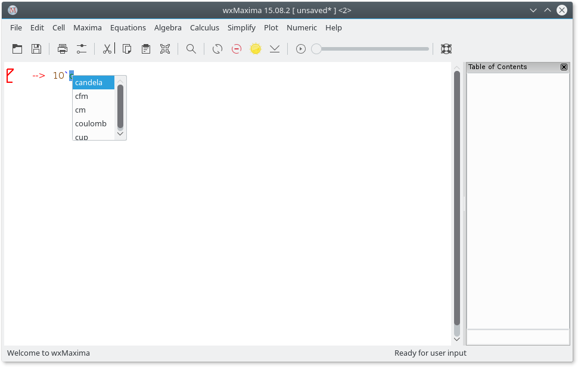

# Посібник користувача wxMaxima

WxMaxima — це графічний інтерфейс користувача (GUI) до системи комп'ютерної
алгебри (СКА) _Maxima_. WxMaxima дає змогу використовувати всі функції
_Maxima_. Крім того, програма пропонує зручні майстри для доступу до
найуживаніших можливостей. У цьому посібнику описано деякі з можливостей,
завдяки яким wxMaxima є одним із найпопулярніших графічних інтерфейсів до
_Maxima_.

{ id=img_wxMaximaLogo }

______________________________________________________________________

# Вступ до wxMaxima

## _Maxima_ і wxMaxima

У світі відкритого програмного забезпечення великі системи зазвичай
поділяють на менші проєкти, з якими легше впоратися невеликим групам
розробників. Наприклад, програма для запису компакт-дисків складатиметься з
консольного інструмента, який власне записує диск, і графічного інтерфейсу,
що дає змогу користуватися ним, не вивчаючи всіх параметрів командного рядка
і взагалі не працюючи з командним рядком. Однією з переваг такого підходу є
те, що працю, вкладену в розробку консольної програми, можуть
використовувати багато програм: та сама консольна програма запису може
слугувати додатком «надіслати на диск» у файловому менеджері, функцією
«записати на диск» у музичному програвачі та засобом запису в програмі
резервного копіювання на DVD. Ще одна перевага полягає в тому, що поділ
однієї великої задачі на менші частини дає змогу розробникам створювати
кілька інтерфейсів користувача для однієї програми.

Система комп'ютерної алгебри (СКА), подібна до _Maxima_, дуже добре
вкладається у цю схему. СКА може надавати логіку до програми-калькулятора із
довільною точністю обчислень або може виконувати автоматичні перетворення
форму у фоновому режимі для більших систем (наприклад,
[Sage](https://www.sagemath.org/)). Крім того, нею можна користуватися і
безпосередньо, як самостійною системою. Доступ до _Maxima_ можна отримати з
командного рядка. Втім, часто інтерфейси, подібні до _wxMaxima_, є набагато
ефективнішим способом доступу до програмного забезпечення, особливо для
початківців.

### _Maxima_

_Maxima_ є повноцінною системою комп'ютерної алгебри (СКА). СКА — програма,
яка може розв'язувати математичні задачі перетворенням формул і визначенням
формули, яка розв'язує задачу, замість простого виведення числової форми
результату. Іншими словами, _Maxima_ може слугувати калькулятором, який
визначає числові значення змінних, а може давати аналітичні розв'язки. Крім
того, у програмі передбачено багато обчислювальних методів для аналізу
рівнянь і систем рівнянь, які не може бути розв'язано аналітично.

{
id=img_maxima_screenshot }

Докладна документація з _Maxima_  [доступна в інтернеті](https://maxima.sourceforge.io/documentation.html). Частина цієї документації доступна також через меню довідки wxMaxima. Натискання клавіші довідки (у більшості систем це клавіша <kbd>F1</kbd>) змушує контекстну довідку _wxMaxima_ автоматично перейти до сторінки посібника _Maxima_, що описує команду під курсором.

### WxMaxima

_WxMaxima_ — графічний інтерфейс користувача, що надає всю функціональність
і гнучкість _Maxima_. WxMaxima пропонує користувачам графічне відображення
та багато можливостей, які полегшують роботу з _Maxima_. Наприклад,
_wxMaxima_ дає змогу простим клацанням правою кнопкою миші експортувати
вміст будь-якої комірки (або, якщо потрібно, будь-якої частини формули) як
текст, як LaTeX або як специфікацію MathML. Можна навіть експортувати цілий
робочий аркуш — як файл HTML або як файл LaTeX. Документація до _wxMaxima_,
зокрема робочі аркуші, що ілюструють різні аспекти роботи з програмою,
доступна в інтернеті на [сторінці
довідки](https://wxMaxima-developers.github.io/wxmaxima/help.html)
_wxMaxima_, а також через меню довідки.

{ id=img_wxMaximaWindow }

Обчислення, які ви наказуєте виконати _wxMaxima_ у фоновому режимі
передаються інструментам командного рядка _Maxima_.

## Основи роботи з робочим аркушем

Більша частина _wxMaxima_ зрозуміла без пояснень, але деякі подробиці
потребують уваги. [Цей
сайт](https://wxMaxima-developers.github.io/wxmaxima/help.html) містить
кілька робочих аркушів, присвячених різним аспектам _wxMaxima_. Опрацювання
деяких із них (особливо «10-хвилинного підручника з _(wx)Maxima_») допоможе
краще ознайомитися як із можливостями _Maxima_, так і з використанням
_wxMaxima_ для роботи з _Maxima_. Цей посібник зосереджується на тих
аспектах _wxMaxima_, які навряд чи очевидні і які можуть бути не охоплені
матеріалами в інтернеті.

### Підхід робочого аркуша

Одна з небагатьох нестандартних речей у _wxMaxima_ полягає в тому, що
програма впорядковує дані для _Maxima_ у комірки, які обчислюються (тобто
надсилаються до _Maxima_) лише тоді, коли цього просить користувач. Під час
обчислення комірки всі команди в цій і лише в цій комірці обчислюються як
пакет. (Попереднє твердження не зовсім точне: можна позначити кілька
сусідніх комірок і обчислити їх разом. Також можна наказати _Maxima_
обчислити всі комірки робочого аркуша за один прохід.) Спосіб, у який
_WxMaxima_ надсилає команди на виконання, спершу може здатися
незвичним. Проте він значно полегшує роботу з великими документами (де
користувач не хоче, щоб кожна зміна автоматично запускала повторне
обчислення всього документа). Крім того, такий підхід дуже зручний для
налагодження.

Якщо ви почнете вводити якийсь текст у вікні _wxMaxima_, програма
автоматично створить нову комірку робочого аркуша. Тип цієї комірки можна
вибрати за допомогою панелі інструментів. Якщо створено комірку з кодом, її
вміст може бути надіслано до _Maxima_. Результат обчислень буде показано під
рядком коду. Пару таких команд показано нижче.

{ id=img_InputCell }

Під час обчислення вмісту комірки введення _Maxima_ призначає введенню мітку
(типово показану червоним і впізнавану за `%i`), за якою на нього можна
посилатися пізніше в сеансі _wxMaxima_. Результат, створений _Maxima_, також
отримує мітку, що починається з `%o`; типово вона прихована, якщо тільки
користувач не надав результату назву. У цьому разі типово показується мітка,
визначена користувачем. Проте автоматично створена _Maxima_ мітка у стилі
`%o` теж залишається доступною.

Окрім комірок для вхідних даних, у _wxMaxima_ передбачено комірки для
документації, комірки зображень, комірки заголовків, комірки глав та комірки
розділів. У кожної комірки є власний буфер скасовування дій, тому дуже
просто діагностувати проблеми, змінюючи значення у комірках і поступово
скасовуючи внесені зміни у різних комірках. Крім того, у самого робочого
аркуша також є власний буфер скасовування дій, яким може скористатися для
скасовування редагувань у комірках, додавання і вилучення комірок.

На рисунку нижче показано різні типи комірок (комірки заголовків, комірки
розділів, комірки підрозділів, текстові комірки, комірки введення-виведення
та комірки зображення).

{ id=img_cell-example
}

### Комірки

Робочий аркуш складається з комірок. У wxMaxima передбачено такі типи
комірок:

- Математичні комірки, у яких міститься один або декілька рядків вхідних
  даних _Maxima_.
- Виведені дані або питання від _Maxima_
- Комірки зображень.
- Текстові комірки, які можуть бути, наприклад, документацією
- Заголовок, розділ або підрозділ. Передбачено 6 різних рівнів заголовків.
- Межі сторінок.

Типовою поведінкою _wxMaxima_ при введенні тексту є автоматичне створення
комірки формули. Комірки інших типів можна створити за допомогою меню
«Комірка», натискання клавіатурних скорочень для пунктів з цього меню або за
допомогою спадного списку на панелі інструментів. Після створення
нематематичної комірки усе, що введено у файл, вважатиметься текстом.

[Текст
коментаря](https://maxima.sourceforge.io/docs/manual/maxima_singlepage.html#Comments)
(у стилі C) може бути частиною математичної комірки ось так: `/* Цей
коментар буде проігноровано Maxima */`

«`/*`» позначає початок коментаря, «`*/`» — його кінець.

### Горизонтальний і вертикальний курсори

Якщо користувач намагається позначити ціле речення, текстовий процесор
намагається розширити позначений фрагмент так, щоб він автоматично
завершувався на початку і наприкінці слів. Так само, _wxMaxima_, якщо
позначено декілька комірок, доповнюватиме позначений фрагмент до меж
комірок.

Нестандартним є те, що _wxMaxima_ забезпечує гнучкість перетягування,
визначаючи два типи курсорів. _WxMaxima_ автоматично перемикається між ними,
коли потрібно:

- Курсор буде намальовано горизонтально, якщо його пересунуто до проміжку
  між двома комірками, або якщо користувач клацнув кнопкою миші у проміжку
  між двома комірками.
- Вертикальний курсор, що діє всередині комірки. Цей курсор вмикається, коли
  курсор переміщують усередину комірки за допомогою вказівника миші або
  клавіш керування курсором, і працює майже так само, як курсор у текстовому
  редакторі.

Після запуску wxMaxima ви побачите лише блимаючий горизонтальний курсор. Щойно ви почнете набирати текст, автоматично буде створено математичну комірку, а курсор стане звичайним вертикальним (як запрошення ви побачите стрілку праворуч, а після обчислення математичної комірки (<kbd>CTRL</kbd>+<kbd>ENTER</kbd>) — мітки, наприклад `(%i1)`, `(%o1)`).

{ id=img_horizontal_cursor_only }

Ви можете створити комірки іншого типу (за допомогою меню «Комірка»),
можливо, комірку заголовка та текстову комірку, яка описуватиме виконану
математичну дію, коли почнете створення вашого робочого аркуша.

Якщо ви переходитимете між різними комірками програма також показуватиме
горизонтальний курсор, що блиматиме. На місці курсора ви можете вставити
комірку до робочого аркуша (математичну комірку простим введенням формули
або комірку іншого типу за допомогою меню).

{
id=img_horizontal_cursor_between_cells }

### Надсилання комірок до Maxima

Команду в комірці коду виконують натисканням <kbd>CTRL</kbd>+<kbd>ENTER</kbd>, <kbd>SHIFT</kbd>+<kbd>ENTER</kbd> або клавіші <kbd>ENTER</kbd> на цифровому блоці клавіатури. Типово _wxMaxima_ надсилає команди після натискання <kbd>CTRL</kbd>+<kbd>ENTER</kbd> або <kbd>SHIFT</kbd>+<kbd>ENTER</kbd>, але _wxMaxima_ можна налаштувати так, щоб команди виконувалися після натискання <kbd>ENTER</kbd>.

### Автодоповнення команд

_WxMaxima_ має функцію автодоповнення, яку викликають через меню (Комірка/Завершити слово) або натисканням комбінації клавіш <kbd>CTRL</kbd>+<kbd>SPACE</kbd>. Автодоповнення враховує контекст. Наприклад, якщо викликати його всередині визначення одиниць для ezUnits, воно запропонує список придатних одиниць.

{ id=img_ezUnits }

Окрім доповнення назви файла, назви одиниці або назви поточної команди чи змінної, автодоповнення може показати для більшості команд шаблон, що вказує тип (і значення) параметрів, на які очікує команда. Щоб скористатися цією можливістю, натисніть <kbd>SHIFT</kbd>+<kbd>CTRL</kbd>+<kbd>SPACE</kbd> або виберіть відповідний пункт меню (Комірка/Показати шаблон).

#### Грецькі літери

Комп'ютери традиційно зберігають символи у форматі 8-бітових значень. Це
уможливлює існування наборів, що складаються лише із 256 різних символів. У
такий набір може бути включено усі літери, цифри та символи керування
(завершення передавання, кінець рядка, лінії та кутики для малювання меню
_тощо_) майже будь-якої європейської мови.

Втім, у більшості мов до вибраної кодової сторінки із 256 символів не можна
включити додаткові символи, зокрема літери грецької абетки, які широко
використовуються у математичних формулах. Щоб подолати обмеження подібного
типу, було винайдено [Юнікод](https://home.unicode.org/) — кодування, яке
працює для латиниці, але використовує набагато більше за 256 символів.

_Maxima_ підтримує Юнікод, якщо її скомпільовано компілятором Lisp, який або
підтримує Юнікод, або не зважає на кодування символів. Принаймні одна з цих
умов, найімовірніше, виконується. _WxMaxima_ надає спосіб уведення грецьких
літер з клавіатури:

- Грецьку літеру можна ввести, натиснувши клавішу <kbd>ESC</kbd> і почавши
  набирати назву грецької літери.
- Або ж її можна ввести, натиснувши <kbd>ESC</kbd>, одну літеру (або дві для
  грецької літери омікрон) і знову <kbd>ESC</kbd>. У цьому разі
  підтримуються такі літери:

| клавіша | грецька літера | клавіша | грецька літера | клавіша | грецька літера |
| :-: | :----------: | :-: | :----------: | :-: | :----------: |
|  a  |    альфа     |  i  |     йота     |  r  |      ро      |
|  b  |     бета     |  k  |    каппа     |  s  |    сигма     |
|  g  |    гамма     |  l  |    лямбда    |  t  |     тау      |
|  d  |    дельта    |  m  |      мю      |  u  |   іпсилон    |
|  e  |   епсилон    |  n  |      ню      |  f  |      фі      |
|  z  |     дзета    |  x  |      ксі     |  c  |      хі      |
|  h  |      ета     | om  |   омікрон    |  y  |      псі     |
|  q  |     тета     |  p  |      пі      |  o  |    омега     |
|  A  |    Альфа     |  I  |     Йота     |  R  |      Ро      |
|  B  |     Бета     |  K  |    Каппа     |  S  |    Сигма     |
|  G  |    Гамма     |  L  |    Лямбда    |  T  |     Тау      |
|  D  |    Дельта    |  M  |      Мю      |  U  |   Іпсилон    |
|  E  |   Епсилон    |  N  |      Ню      |  P  |      Фі      |
|  Z  |     Дзета    |  X  |      Ксі     |  C  |      Хі      |
|  H  |      Ета     | Om  |   Омікрон    |  Y  |      Псі     |
|  T  |     Тета     |  P  |      Пі      |  O  |    Омега     |

Грецькі літери можна вводити також за допомогою бічної панелі «Грецькі
літери».

##### Увага: схожі на вигляд символи

Деякі латинські літери схожі на грецькі, наприклад латинська літера «A» і
грецька літера «Альфа». Хоча вони виглядають однаково, це два різні символи
Юнікоду, представлені різними кодовими позиціями (числами) Юнікоду.

Це може спричинити проблеми, якщо присвоїти значення змінній A, а згодом
використати грецьку літеру Альфа, щоб щось зробити з цією змінною, особливо
в роздруківках.  Для грецької літери мю (яку також використовують як префікс
«мікро») теж існують дві різні кодові позиції Юнікоду.

Тому бічна панель «Грецькі літери» має параметр, який приховує схожі на
вигляд символи (його можна змінити через контекстне меню правої кнопки
миші).

У той самий спосіб можна вводити різноманітні математичні символи:

| клавіші для введення | математичний символ                            |
| -------------- | ----------------------------------------------------- |
| hbar           | стала Планка: літера h з горизонтальною рискою над нею |
| Hbar           | літера H з горизонтальною рискою над нею              |
| 2              | у квадраті                                            |
| 3              | у кубі                                                |
| /2             | 1/2                                                   |
| partial        | знак частинної похідної (d у dx/dt)                    |
| integral       | знак інтеграла                                        |
| sq             | квадратний корінь                                     |
| ii             | уявна одиниця                                         |
| ee             | елемент                                               |
| in             | належить                                              |
| impl implies   | випливає                                              |
| inf            | нескінченність                                        |
| empty          | порожня множина                                       |
| TB             | великий трикутник праворуч                            |
| tb             | малий трикутник праворуч                              |
| and            | і (and)                                               |
| or             | або (or)                                              |
| xor            | xor                                                   |
| nand           | nand                                                  |
| nor            | nor                                                   |
| equiv          | еквівалентно                                          |
| not            | не (not)                                              |
| union          | об'єднання                                            |
| inter          | перетин                                               |
| subseteq       | підмножина або дорівнює                               |
| subset         | підмножина                                            |
| notsubseteq    | не підмножина і не дорівнює                           |
| notsubset      | не підмножина                                         |
| approx         | приблизно дорівнює                                    |
| propto         | пропорційно                                           |
| neq != /= or # | не дорівнює                                           |
| +/- or pm      | знак плюс-мінус                                       |
| \<= or leq     | менше або дорівнює                                    |
| >= or geq      | більше або дорівнює                                   |
| \<\< or ll     | набагато менше                                        |
| >> or gg       | набагато більше                                       |
| qed            | кінець доведення                                      |
| nabla          | оператор набла                                        |
| sum            | знак суми                                             |
| prod           | знак добутку                                          |
| exists         | знак «існує»                                          |
| nexists        | знак «не існує»                                       |
| parallel       | знак паралельності                                    |
| perp           | знак перпендикулярності                               |
| leadsto        | знак «призводить до»                                  |
| ->             | стрілка праворуч                                      |
| -->            | довга стрілка праворуч                                |

Ці математичні символи можна вводити також за допомогою бічної панелі
«Символи».

Якщо потрібного спеціального символу немає у списку, будь-який символ Юнікоду можна ввести, натиснувши <kbd>ESC</kbd> \[номер символу (шістнадцятковий)\] <kbd>ESC</kbd>. Крім того, бічна панель «Символи» має контекстне меню правої кнопки миші, яке показує список усіх доступних символів Юнікоду; їх можна додати на цю панель або до робочого аркуша.

<kbd>ESC</kbd><kbd>6</kbd><kbd>1</kbd><kbd>ESC</kbd> therefore results in an `a`. While you type the number, the list of symbols shows the character it stands for and its Unicode name.

If the number also is the beginning of a symbol's name (`be` could be the start of `beta`, or the character ¾ with the number `be`), the name wins. A leading `0` or `u+` makes it a number: <kbd>ESC</kbd>`u+be`<kbd>ESC</kbd> and <kbd>ESC</kbd>`00be`<kbd>ESC</kbd> both result in a `¾`.

A letter with an accent that Unicode has no character of its own for, like a t with a bar on top of it, is a letter followed by a "combining" accent: <kbd>t</kbd><kbd>ESC</kbd><kbd>3</kbd><kbd>0</kbd><kbd>4</kbd><kbd>ESC</kbd> results in `t̄`, which _Maxima_ treats as a variable name like any other.

Symbols one needs often can be added to the "Symbols" sidebar in the "Options" tab of the configuration dialog (Edit -> Configure), where they can also be given a keyboard shortcut. A letter with accents counts as one symbol there and gets one button. The Greek letters and the symbols the sidebars show anyway can be given a keyboard shortcut there, too, or by right-clicking their button in the sidebar. A shortcut has to contain <kbd>Ctrl</kbd> or <kbd>Alt</kbd> or be a function key, and types its symbol while the worksheet has the keyboard focus. The configuration dialog warns if a menu entry already uses the same keys.

Зауважте, що більшість цих символів (помітний виняток — логічні символи) не
мають особливого значення в _Maxima_ і тому сприйматимуться як звичайні
символи. Якщо _Maxima_ скомпільовано за допомогою Lisp без підтримки
символів Юнікоду, вони можуть спричинити повідомлення про помилку.

Може статися, що, наприклад, грецьких літер або математичних символів немає у вибраному шрифті; тоді їх не вдасться показати.
Щоб розв'язати цю проблему, виберіть інші шрифти (через: Зміни -> Налаштувати -> Стиль).

### Заміна символів Юнікоду

wxMaxima will replace several Unicode characters with their respective Maxima expressions, e.g. `²` with `^2`, `³` with `^3`, `≠` with `#` or `≤` with `<=`.

Unicode characters that stand for a Maxima name are instead defined as
_Maxima_ aliases of that name when wxMaxima starts _Maxima_: `π` for `%pi`,
`ⅈ` for `%i`, `ⅇ` for `%e`, `∞` for `inf`, the (mathematical) Sigma sign
(which is not the same Unicode character as the corresponding Greek letter)
for `sum`, `∏` for `product`, `∫` for `integrate`, the square root sign for
`sqrt` and `⋀`, `⋁`, `⊻`, `⊼`, `⊽`, `⇒`, `⇔` and `¬` for `and`, `or`, `xor`,
`nand`, `nor`, `implies`, `equiv` and `not`. This means they work in files
loaded by `batch()` or `load()`, too, and `aliases` lists the names they
stand for. As _Maxima_ reads these characters as letters they need to be
separated from neighbouring names by spaces in such a file: `a⋀b` is a
variable name, `a ⋀ b` means `a and b`. In an input cell wxMaxima adds these
spaces automatically. It also puts parenthesis around a number or a variable
that directly follows the square root sign, so `√2` means `sqrt(2)`.

У Юнікоді кілька «поширених» дробів закодовано однією кодовою позицією: `¼,
½, ¾, ⅐, ⅑, ⅒, ⅓, ⅔, ⅕, ⅖, ⅗, ⅘, ⅙, ⅚, ⅛, ⅜, ⅝, ⅞`

wxMaxima замінює їх відповідниками в Maxima, наприклад `(1/4)`, перш ніж
надіслати введене до Maxima. Є також `⅟`, який замінюється на `1/`, і `↉`
(використовується в бейсболі), який замінюється на `(0/3)`.

У комірках введення рекомендовано використовувати **код Maxima** (а не ці
кодові позиції Юнікоду). Причини: (a) шрифт для математичного введення може
їх не містити; (b) якщо зберегти документ як файл `wxm`, його зазвичай може
прочитати Maxima (у командному рядку), де ці заміни, звісно, не
працюють. Проте вони можуть з'явитися, якщо скопіювати й вставити формулу з
іншого документа.

### Бічні панелі

Доступ до найважливіших команд _Maxima_ або речей, подібних до таблиці
змісту, вікон із діагностичними повідомленнями або журналу останніх виданих
команд можна отримати за допомогою бічних панелей. Увімкнути бічні панелі
можна за допомогою меню «Перегляд». Панелі можна пересувати як всередині
вікна _wxMaxima_, так і ззовні. Ще однією корисною панеллю є панель введення
грецьких літер за допомогою вказівника миші.

{ id=img_SidePanes }

За допомогою бічної панелі «Зміст» можна збільшити або зменшити рівень
заголовка: просто клацніть на заголовку правою кнопкою миші і виберіть
наступний більший або менший рівень заголовка.

{
id=Sidepane-TOC-convert-headings }

### Виведення MathML

Кілька текстових процесорів і подібних програм розпізнають уведення
[MathML](https://www.w3.org/Math/) і автоматично вставляють його як
редаговане двовимірне рівняння — або (як LibreOffice) мають редактор формул
із функцією «імпортувати MathML з буфера обміну». Інші підтримують формули
RTF. Тому _WxMaxima_ пропонує кілька пунктів у контекстному меню правої
кнопки миші.

### Pasting LaTeX or MathML formulas

**Edit → Paste LaTeX/MathML as Maxima Code** (also in the right-click menu) converts a formula from the clipboard into a _Maxima_ command, for example one copied from a paper, a web page or an equation editor. LaTeX may come with or without `$…$`, `\(…\)` or `\[…\]` around it, so `\int_0^1 \frac{\sin x}{x}\,dx` becomes `integrate(sin(x)/x,x,0,1)`. The command goes where the cursor is, or into a new code cell. MathML pasted into a code cell with the ordinary **Paste** is converted the same way, since nobody wants the XML in a code cell. If MathML copied with **Copy as MathML** is pasted back, the result is the original command: _wxMaxima_ adds it to the MathML as an annotation.

LaTeX and MathML describe what a formula looks like, not what it means, so
the conversion has to interpret it. Fractions, roots, powers, subscripts
(`x_1` becomes the name `x_1`, `a_{n+1}` the array element `a[n+1]`),
functions with or without parentheses (`\sin 2x`), `\frac{d}{dx}`, `f'(x)`,
integrals ending in `dx`, sums and products with limits, `\lim_{x\to 0}`,
`|x|` and matrices are understood. An `e` is Euler’s number, but an `i` is
only the imaginary unit when set upright (`\mathrm{i}`), as it more often is
an index. A product of a name and parentheses, like `x(y+1)`, is taken as a
product unless the name is `f`, `g`, `h` or longer than one letter. Anything
without a single meaning, like `\pm`, `\dots` or text, isn’t guessed at:
_wxMaxima_ says what it couldn’t convert instead. Check the command before
evaluating it.

### Підтримка Markdown

_WxMaxima_ підтримує набір стандартних правил
[Markdown](https://en.wikipedia.org/wiki/Markdown), які не конфліктують із
математичними позначеннями. Одним із таких елементів є марковані списки.

```text
Звичайний текст
 * Один пункт, рівень відступу 1
 * Ще один пункт на рівні відступу 1
   * Пункт на другому рівні відступу
   * Другий пункт на другому рівні відступу
 * Третій пункт на першому рівні відступу
Звичайний текст
```

_WxMaxima_ розпізнає текст, що починається із символів `>`, як блок цитати:

```text
Звичайний текст
> цитата цитата цитата цитата
> цитата цитата цитата цитата
> цитата цитата цитата цитата
Звичайний текст
```

Виведення _WxMaxima_ у TeX і HTML також розпізнає `=>` і замінює його відповідним знаком Юнікоду:

```text
cogito => sum.
```

Інші символи, які розпізнає експорт у HTML і TeX: `<=` і `>=` для порівнянь, подвійна стрілка з двома вістрями (`<=>`), одинарні стрілки (`<->`, `->` і `<-`) і `+/-` як відповідний знак. У виведенні TeX розпізнаються також `<<` і `>>`.

### Links in text cells

A web address in a text cell that starts with `http://`, `https://` or `mailto:` is shown as a link. Since clicking into a text cell places the cursor there, a link is followed by <kbd>CTRL</kbd>+clicking it (<kbd>CMD</kbd>+clicking on macOS), or by right-clicking it and choosing "Open Link"; hovering over it shows where it leads. The HTML export turns it into a link, the TeX export into a `\url{}`. Links are always recognized from the text itself, so nothing about them is stored in the file.

Links in a code cell's comments (`/* ... */`) work the same way. Elsewhere
in code, for example inside a string, an address is Maxima syntax and is not
a link.

The same goes for web addresses in _Maxima_'s output, for example in a string printed by `print("See https://wxmaxima-developers.github.io/wxmaxima/")`: <kbd>CTRL</kbd>+clicking the address or choosing "Open Link" from its context menu opens it, while a plain click still selects the output.

### Bold, italic, underlined and struck-through text

Text in a text cell, a title or a section heading can be made bold, italic,
underlined or struck through. Select the text and press the respective
button in the toolbar; pressing the button again removes that formatting
from the selection. With nothing selected the button switches the formatting
on or off for what is typed next. The buttons are hidden by right-clicking
the toolbar and unchecking "Text formatting buttons". Code cells cannot be
formatted: their colors already show the syntax of the code.

Superscript and subscript buttons work the same way: they make the text
smaller and raise it above or lower it below the line, as in E = mc² or
H₂O. A character cannot be both, so switching one of them on switches the
other off. A line that contains a superscript, a subscript or a character
that is taller than the font's usual ones, for example an emoji, gets as
much additional room as it needs.

The formatting is saved in `.wxmx` files. Older versions of _wxMaxima_ open
such a file without the formatting but keep all of the text. `.wxm` files,
the exports and the clipboard contain the text without its formatting.

### Комбінації клавіш

Більшість клавіатурних скорочень можна знайти у тексті відповідних
меню. Оскільки їх взято з тексту меню і, отже, може бути змінено під час
перекладу _wxMaxima_ так, щоб вони відповідали потребам користувачів
локалізованих клавіатур, ми не наводимо їх у цьому підручнику. Втім,
декілька клавіатурних скорочень все ж не документовано у меню:

- <kbd>CTRL</kbd>+<kbd>SHIFT</kbd>+<kbd>DELETE</kbd> вилучає увесь вміст
  комірки.
- <kbd>CTRL</kbd>+<kbd>TAB</kbd> або
  <kbd>CTRL</kbd>+<kbd>SHIFT</kbd>+<kbd>TAB</kbd> запускає механізм
  автодоповнення.
- <kbd>SHIFT</kbd>+<kbd>ПРОБІЛ</kbd> вставляє нерозривний пробіл.

### Exploring output with the keyboard

A cell's output can be selected, and explored part by part, without a mouse:

- <kbd>DOWN</kbd> at the end of a cell's input selects the first result of
  its output. Further presses of <kbd>DOWN</kbd> and <kbd>UP</kbd> step
  through the results; past the last one the cursor leaves the cell. If you
  prefer <kbd>DOWN</kbd> to skip over the output, switch on "Up/Down keys
  skip over output" in the Worksheet tab of the configuration dialog.
- <kbd>ENTER</kbd> goes into the selected expression and selects its first
  part: the expression without its label, the numerator of a fraction, the
  name of a function, the first entry of a matrix, ... If the selection has
  no parts, <kbd>ENTER</kbd> opens a new input cell holding it, as it always
  did.
- <kbd>ESCAPE</kbd> selects what the selection is a part of. From a whole
  result it goes back into the cell's input.
- <kbd>LEFT</kbd> and <kbd>RIGHT</kbd> select the previous or next part at
  the same level. In a matrix all four arrow keys move from entry to entry.
- <kbd>SHIFT</kbd>+<kbd>LEFT</kbd> and <kbd>SHIFT</kbd>+<kbd>RIGHT</kbd>
  grow or shrink the selection over the neighbouring parts; in a matrix,
  <kbd>SHIFT</kbd> and any arrow key grow the selected entry into a block of
  entries.
- The context-menu key or <kbd>SHIFT</kbd>+<kbd>F10</kbd> opens the
  right-click menu for the selection, so it can be copied in any format.

### Необроблений TeX під час експорту в TeX

Якщо текстову комірку буде розпочато з `TeX:` у експортованих у форматі TeX
даних буде буквально відтворено текст, який вказано після позначки
`TeX:`. За допомогою цієї можливості можна використовувати розмітку TeX у
робочій книзі _wxMaxima_.

## Формати файлів

Матеріал, який було отримано під час сеансу роботи у _wxMaxima_ може бути
збережено для наступного використання у три способи:

### .mac

Файли `.mac` — звичайні текстові файли, що містять команди _Maxima_. Їх
можна прочитати командою _Maxima_ `batch()` або `load()` чи пунктом меню
_wxMaxima_ Файл/Пакетний файл.

Один з прикладів наведено нижче. `Quadratic.mac` визначає функцію і після
цього створює креслення за допомогою `wxdraw2d()`. Далі, буде виведено вміст
файла `Quadratic.mac` і виконано обчислення нової визначеної функції `f()`.

{
id=img_BatchImage }

Увага: хоча файл `Quadratic.mac` має звичайний для _Maxima_ суфікс (`.mac`),
прочитати його може лише _wxMaxima_, оскільки команда `wxdraw2d()` є
розширенням _Maxima_ від wxMaxima. Maxima (у командному рядку) проігнорує
невідому команду `wxdraw2d()` і знову виведе її як результат.

Файли `.mac` можна використовувати для створення власної бібліотеки
макросів. Але оскільки вони не містять достатньо відомостей про структуру,
їх не можна прочитати назад як сеанс _wxMaxima_.

### .wxm

Файли `.wxm` містять робочий аркуш без результатів _Maxima_. У версіях Maxima >5.38 їх можна прочитати функцією _Maxima_ `load()`, так само як файли .mac. Ну, здебільшого. Питання (наприклад, `asksign(x)`) створюють проблеми, оскільки відповідь записується до файла `.wxm` (щоб її можна було запропонувати після завантаження), а Maxima не може її обчислити.
Щоб Maxima не ставила питань, можна оголосити за допомогою `assume()` властивості, які Maxima хоче знати.

У цьому простому текстовому форматі іноді неминуче, що робочі аркуші, які
використовують нові можливості, будуть несумісними зі старішими версіями
_wxMaxima_.

#### Формат файлів wxm

Це звичайний текстовий файл (його можна відкрити текстовим редактором), що
містить вміст комірок у вигляді спеціальних коментарів Maxima.

Він починається з такого коментаря:

```maxima
/* [wxMaxima batch file version 1] [ DO NOT EDIT BY HAND! ]*/
/* [ Created with wxMaxima version 24.02.2_DevelopmentSnapshot ] */
```

Далі йдуть комірки, закодовані як коментарі Maxima, наприклад комірка
розділу:

```maxima
/* [wxMaxima: section start ]
Title of the section
   [wxMaxima: section end   ] */
```

або (у математичній комірці введення, звісно, *не* закоментоване; результати
у файлі `wxm` не зберігаються):

```maxima
/* [wxMaxima: input   start ] */
f(x):=x^2+1$
f(2);
/* [wxMaxima: input   end   ] */
```

Зображення [закодовано в Base64](https://en.wikipedia.org/wiki/Base64), а
тип зображення вказано в першому рядку:

```maxima
/* [wxMaxima: image   start ]
jpg
[very chaotic looking character sequence]
   [wxMaxima: image   end   ] */
```

Розрив сторінки — це просто один рядок такого вмісту:

```maxima
/* [wxMaxima: page break    ] */
```

А згорнуті комірки позначено так:

```maxima
/* [wxMaxima: fold    start ] */
...
/* [wxMaxima: fold    end   ] */
```

### .wxmx

У цьому заснованому на XML форматі файлів зберігається увесь робочий аркуш,
включно із даними щодо масштабу та списком спостереження. Цей формат файлів
є рекомендованим.

#### Формат файлів wxmx

Файл `wxmx` здається двійковим форматом, але з ним можна працювати
інструментами, що входять до складу вашої операційної системи. Це zip-файл,
який можна розпакувати за допомогою `unzip` (можливо, його доведеться спершу
перейменувати, щоб програма розпакування вашої ОС його розпізнала).  Ми не
використовуємо стиснення, а лише можливість об'єднати кілька файлів в один:
зображення вже стиснені, а решта — простий текст (імовірно, набагато менший
за великі вбудовані зображення).

Він містить такі файли:

- `mimetype`: цей файл містить тип MIME файлів wxMaxima: `text/x-wxmathml`
- `format.txt`: короткий опис wxMaxima та формату файлів wxmx
- Зображення (наприклад, png, jpeg): вбудовані графіки, створені в сеансі
  wxMaxima, і вставлені зображення.
- `content.xml`: документ XML, що містить різні комірки вашого документа у
  форматі XML.

Отже, якщо щось піде не так, можна розпакувати документ wxMaxima (можливо,
спершу перейменувавши його на файл `zip`), внести зміни до файла
`content.xml` у текстовому редакторі або замінити пошкоджене зображення,
знову запакувати файли й перейменувати `zip` на файл `wxmx` — і ви отримаєте
змінений файл `wxmx`.

## Параметри налаштування

Для деяких типових змінних налаштувань у _wxMaxima_ передбачено два способи
налаштовування:

- За допомогою діалогової панелі налаштовування, знімок якої наведено нижче,
  ви можете змінити типові значення для поточного і наступних сеансі роботи
  програми.
- Крім того, значення більшості змінних налаштування можна змінити лише для
  поточного сеансу, перевизначивши їх у робочому аркуші, як показано нижче.

{
id=img_wxMaxima_configuration_001 }

### Типова частота кадрів анімації

Частота кадрів анімації, яка використовуватиметься для нових анімацій,
зберігається у змінній `wxanimate_framerate`. Початкове значення цієї
змінної, яке міститиметься у новому робочому аркуші, можна змінити за
допомогою діалогового вікна налаштовування.

### Типовий розмір графіків для нових сеансів _maxima_

Після наступного запуску вбудовані до робочого аркуша графіки
створюватимуться з цим розміром, якщо значення `wxplot_size` не змінено в
_maxima_.

Щоб задати розмір лише одного графіка, можна скористатися таким записом,
який встановлює значення змінної лише для однієї команди:

```maxima
wxdraw2d(
   explicit(
       x^2,
       x,-5,5
   )
), wxplot_size=[480,480]$
```

### Автоматичне закриття дужок у текстових полях

За допомогою цього пункту можна увімкнути дві речі:

- Якщо ввести відкривну круглу чи квадратну дужку або подвійні лапки,
  _wxMaxima_ вставить після них закривну.
- In a code cell a comment opened by `/*` is closed by an inserted
  `*/`. Typing `*/` in front of it moves the cursor past it instead.
- Якщо при натисканні якоїсь із цих комбінацій клавіш було позначено
  фрагмент тексту, цей текст буде вставлено між відповідними символами.

### Не зберігати робочий аркуш автоматично

Якщо позначено цей пункт, файл, у якому зберігається робочий аркуш, буде
перезаписано лише за запит користувача. Втім, у випадку аварії, втрати
живлення тощо, у каталозі тимчасових даних завжди лишатиметься резервна
копія.

Якщо цей параметр не встановлено, _wxMaxima_ поводиться більше як сучасна
програма для мобільного телефона:

- Файли автоматично зберігаються під час виходу з програми
- І файл автоматично зберігатиметься кожні 3 хвилини.

### Arranging the toolbar

The toolbar is made of sections, like the "Open" and "Save" buttons, the
evaluation buttons or the drop-down list that sets the type of a cell. The
"Toolbar" tab of the configuration dialog lists them in the order the
toolbar shows them in: drag a section to another place, or select it and
press "Up" or "Down", to move it, and uncheck it to hide it. The flexible
space pushes every section after it to the right edge of the
window. "Default order" restores the original arrangement. Sections can also
be shown or hidden by right-clicking the toolbar.

### Де зберігаються налаштування?

У Unix/Linux налаштування зберігаються у файлі `.wxMaxima` у вашому домашньому каталозі (якщо використовується wxWidgets \< 3.1.1) або в `.config/wxMaxima.conf` ((стандарт XDG) якщо використовується wxWidgets >= 3.1.1). Версію wxWidgets можна дізнатися командою `wxbuild_info();` або через пункт меню Довідка->Про програму. [wxWidgets](https://www.wxwidgets.org/) — це багатоплатформна бібліотека графічного інтерфейсу, на якій ґрунтується _wxMaxima_ (звідси `wx` у назві).
(Оскільки назва файла починається з крапки, `.wxMaxima` або `.config` будуть прихованими.)

Якщо ви користуєтеся Windows, налаштування буде збережено у реєстрі. Записи
_wxMaxima_ можна знайти у цій гілці: `HKEY_CURRENT_USER\Software\wxMaxima`

______________________________________________________________________

# Розширення _Maxima_

_WxMaxima_ — насамперед графічний інтерфейс користувача до _Maxima_. Тож її
основне завдання — передавати команди до _Maxima_ і показувати результати їх
виконання. Проте в деяких випадках _wxMaxima_ додає до _Maxima_ нові
можливості. Вже згадувалося, що _WxMaxima_ може створювати звіти,
експортуючи вміст робочого аркуша до файлів HTML і LaTeX. У цьому розділі
розглянуто деякі способи, якими _wxMaxima_ покращує включення графіки до
сеансу.

## Змінні з нижніми індексами

<div id="wxsubscripts"></div>

`wxsubscripts` визначає, чи _wxMaxima_ виконуватиме автоматичне перетворення
нижніх індексів у назвах змінних (і як вона це робитиме):

Якщо має значення `false`, функціональну можливість буде вимкнено, wxMaxima
не виконуватиме автоматичного перетворення частини назв змінної після
символу підкреслення.

Якщо встановлено значення `'all`, усе, що йде після символу підкреслення,
буде переведено в нижній індекс.

Якщо встановлено значення `true` для `wxsubscripts`, назви змінних у форматі
`x_y` буде показано як літеру із нижнім індексом, якщо

- `x` або `y` є одинарною літерою або
- `y` — ціле число (може містити більше однієї цифри).

{ id=img_wxsubscripts }

<div id="wxdeclare_subscripted"></div>

A variable the rules above don’t cover can still be declared as "to be
subscripted" using the command `wxdeclare_subscripted(variable_name);` or
`wxdeclare_subscripted([variable_name1,variable_name2,...]);` Declaring a
variable as subscripted can be reverted using the following command:
`wxdeclare_subscripted(variable_name,false);`, which also keeps a variable
the rules above do cover from being subscripted.

<div id="wxdeclare_subscript"></div>

`wxdeclare_subscript(text_snippet);` or
`wxdeclare_subscript([text_snippet1,text_snippet2,...]);` instead declares a
text snippet: every variable whose name ends in an underscore followed by
that snippet is subscripted, however long the two parts are.

Задати ці значення можна також за допомогою меню «Перегляд->Автоматичне переведення у нижній індекс».

## Повідомлення для користувача на смужці стану

<div id="wxstatusbar"></div>

Команди, що виконуються довго, можуть показувати повідомлення для
користувача на смужці стану. Таке повідомлення замінюється будь-яким новим
повідомленням (тож його можна використовувати як індикатор поступу) і
вилучається, щойно поточна надіслана до _Maxima_ команда
завершиться. `wxstatusbar()` можна безпечно використовувати навіть у
бібліотеках, які можуть працювати зі звичайною _Maxima_ (а не з _wxMaxima_):
якщо _wxMaxima_ немає, команда `wxstatusbar()` просто залишиться
необчисленою.

```maxima
for i:1 thru 10 do (
    /* Повідомити користувача, наскільки ми просунулися */
    wxstatusbar(concat("Pass ",i)),
    /* (sleep n) — функція Lisp, яку можна викликати, */
    /* поставивши перед нею символ "?". Вона затримує */
    /* виконання програми (тут: на 3 секунди) */
    ?sleep(3)
)$
```

## Експорт робочого аркуша з Maxima

<div id="wxworksheettohtml"></div>

Команда `wxworksheettohtml()` експортує поточний робочий аркуш до файла HTML
безпосередньо із запущеного сеансу _Maxima_, що зручно для експорту за
допомогою скриптів або в пакетному режимі. Як і `wxstatusbar()`, її можна
безпечно використовувати в коді, який може виконуватися й у звичайній
(консольній) _Maxima_: якщо _wxMaxima_ немає, команда просто залишається
необчисленою.

```maxima
wxworksheettohtml("report.html")$
wxworksheettohtml("report.html", flavor="svg", wxmx=true)$
```

Відносна назва файла відраховується від робочого каталогу
_Maxima_. Необов'язкові іменовані параметри:

| параметр | значення                                        | призначення                                         |
| -------- | ----------------------------------------------- | --------------------------------------------------- |
| `flavor` | `mathml` (типово), `mathjax`, `svg`, `bitmap`   | як показуються рівняння на експортованій сторінці   |
| `wxmx`   | `false` (типово), `true`                        | вбудувати копію сеансу у форматі `.wxmx` для звантаження |

The images and the `.wxmx` copy are written into a folder named after the
HTML file, with `_htmlimg` appended. If "Embed images into the .html file"
is checked in the Export tab of the configuration dialog, they are embedded
into the HTML file instead, so it can be mailed as a single file.

Значення `flavor` відповідають форматам рівнянь, які пропонує графічне вікно
**Файл → Експорт**: `mathml` створює самодостатню сторінку, якій не потрібне
з'єднання з інтернетом, `mathjax` додає запасний варіант на MathJaX для
браузерів, що ще не підтримують MathML, а `svg`/`bitmap` перетворюють кожне
рівняння на зображення.

<div id="wxworksheettotex"></div>

Супутня команда `wxworksheettotex()` так само експортує до файла LaTeX
(`.tex`):

```maxima
wxworksheettotex("report.tex")$
wxworksheettotex("report.tex", documentclass="report", documentclassoptions="12pt,a4paper")$
```

| параметр               | призначення                                                          |
| ---------------------- | -------------------------------------------------------------------- |
| `documentclass`        | перевизначає `\documentclass` LaTeX (наприклад, `"article"`, `"report"`) |
| `documentclassoptions` | перевизначає його параметри (наприклад, `"12pt,a4paper"`)            |

Підтримку `wxworksheettopdf()` заплановано.

## Графіки

Креслення (яке фундаментально пов'язано із графікою) є місцем, де графічний
інтерфейс користувача має надавати якісь додаткові можливості до
оригінальної програми.

### Вбудовування графіка до робочого аркуша

<div id="wxplot2d"></div>
<div id="wxplot3d"></div>
<div id="wximplicit_plot"></div>
<div id="wxcontour_plot"></div>

Зазвичай _Maxima_ доручає зовнішній програмі _Gnuplot_ відкрити окреме вікно
для кожної створеної діаграми. Оскільки часто зручніше вбудовувати графіки
до робочого аркуша, _wxMaxima_ надає власний набір функцій побудови
графіків, які відрізняються від відповідних функцій _maxima_ лише назвою:
усі вони мають префікс «wx».

Такі функції побудови графіків мають відповідники з префіксом wx:

| функція побудови wxMaxima | функція побудови Maxima                                                                       |
| ------------------------ | ----------------------------------------------------------------------------------------------- |
| `wxplot2d()`             | [plot2d](https://maxima.sourceforge.io/docs/manual/maxima_singlepage.html#plot2d)               |
| `wxplot3d()`             | [plot3d](https://maxima.sourceforge.io/docs/manual/maxima_singlepage.html#plot3d)               |
| `wxdraw2d()`             | [draw2d](https://maxima.sourceforge.io/docs/manual/maxima_singlepage.html#draw2d)               |
| `wxdraw3d()`             | [draw2d](https://maxima.sourceforge.io/docs/manual/maxima_singlepage.html#draw3d)               |
| `wxdraw()`               | [draw](https://maxima.sourceforge.io/docs/manual/maxima_singlepage.html#draw)                   |
| `wximplicit_plot()`      | [implicit_plot](https://maxima.sourceforge.io/docs/manual/maxima_singlepage.html#implicit_plot) |
| `wxhistogram()`          | [histogram](https://maxima.sourceforge.io/docs/manual/maxima_singlepage.html#histogram)         |
| `wxscatterplot()`        | [scatterplot](https://maxima.sourceforge.io/docs/manual/maxima_singlepage.html#scatterplot)     |
| `wxbarsplot()`           | [barsplot](https://maxima.sourceforge.io/docs/manual/maxima_singlepage.html#barsplot)           |
| `wxpiechart()`           | [piechart](https://maxima.sourceforge.io/docs/manual/maxima_singlepage.html#piechart)           |
| `wxboxplot()`            | [boxplot](https://maxima.sourceforge.io/docs/manual/maxima_singlepage.html#boxplot)             |

Якщо файл `wxm` читає (консольна) Maxima, ці функції ігноруються (і, як інші
невідомі функції в Maxima, виводяться як результат).

Якщо у вас виникли проблеми з однією з цих функцій, перевірте, чи є ця
проблема і з функцією Maxima (наприклад, якщо `wxplot2d()` повідомляє про
помилку, спробуйте той самий графік із командою Maxima `plot2d()`, яка
відкриває графік в окремому вікні). Якщо проблема не зникає, найімовірніше,
це проблема Maxima, і про неї слід повідомити у [системі відстеження вад
Maxima](https://sourceforge.net/p/maxima/bugs/). Або, можливо, це проблема
Gnuplot.

### Збільшення і зменшення вбудованих графіків

<div id="wxplot_size"></div>

Як ми вже згадували вище, діалогове вікно налаштовування надає змогу змінити
типові розміри креслень. Унаслідок застосування цього способу змінюється
початкове значення `wxplot_size`. Підпрограми створення креслень _wxMaxima_
враховують це значення, яке визначає розмір креслення у пікселях. Це
значення завжди можна отримати або використати для встановлення розмірів
наступних креслень:

```maxima
wxplot_size:[1200,800]$
wxdraw2d(
    explicit(
        sin(x),
        x,1,10
    )
)$
```

Якщо потрібно змінити розміри лише одного креслення, у _Maxima_ передбачено
канонічний спосіб зміни атрибута лише для поточної комірки. У цьому випадку
до команди wxdraw2d( ) додається специфікація wxplot_size = [значення1,
значення2], яка не є частиною команди wxdraw2d.

```maxima
wxdraw2d(
    explicit(
        sin(x),
        x,1,10
    )
),wxplot_size=[1600,800]$
```

Встановлення розміру вбудованого креслення за допомогою `wxplot_size` працює
для вбудованих креслень, які використовують, наприклад, команди `wxplot`,
`wxdraw`, `wxcontour_plot` і `wximplicit_plot`, і для вбудованих анімацій,
які використовують команди `with_slider_draw` і `wxanimate`.

<div id="wxplot_scale"></div>

`wxplot_size` tells _Gnuplot_ how many pixels to draw. If a plot is wider
than the window, _wxMaxima_ shrinks it until it fits. If one specific plot
is meant to be shown larger, even if that means it no longer fits on the
screen, or smaller than that, the variable `wxplot_scale` (default: `1`)
tells _wxMaxima_ to show it that many times as large as it would otherwise:

```maxima
wxdraw2d(
    explicit(
        sin(x),
        x,1,10
    )
),wxplot_scale=2$
```

Unlike a bigger `wxplot_size`, which makes the text and lines of a plot
smaller in relation to the plot, `wxplot_scale` makes everything larger, the
text included. The factor is stored in the worksheet with the plot, so it
survives saving and re-opening the file. It is respected by the same
commands as `wxplot_size`. If _wxMaxima_ shows plots as scalable vector
graphics (see "Create scalable plots" in the configuration dialog) they stay
sharp at any scale; a bitmap plot gets blurry if it is enlarged a lot.

A plot that should be wide but not high, for example a waveform, is better
made with `wxplot_size`: a wider `wxplot_size` gives more room for the data,
at the same height and with text of the same size. As such a plot would
normally be shrunk to fit into the window, which makes its text tiny again,
`wxplot_scale='native` tells _wxMaxima_ to show it at exactly the size
`wxplot_size` asks for, even if that is wider than the window:

```maxima
wxdraw2d(
    explicit(
        sin(10*x)*exp(-x/3),
        x,0,10
    )
),wxplot_size=[1600,300],wxplot_scale='native$
```

### Графіки кращої якості

Здається, _Gnuplot_ не надає переносного способу визначити, чи підтримує він
високоякісне растрове виведення, яке забезпечує бібліотека Cairo. У
системах, де _Gnuplot_ скомпільовано з цією бібліотекою, параметр pngCairo у
меню налаштувань (його можна перевизначити змінною `wxplot_pngcairo`) вмикає
згладжування та додаткові стилі ліній. Якщо встановити `wxplot_pngCairo`, а
_Gnuplot_ цього не підтримує, замість графіки ви побачите повідомлення про
помилки.

### Відкриття вбудованих графіків в інтерактивних вікнах _Gnuplot_

Якщо графік створено командами типу `wxdraw` (`wxplot2d` і `wxplot3d` ця
можливість не підтримує) і розмір файла відповідного проєкту _Gnuplot_ не
надто великий, _wxMaxima_ пропонує в контекстному меню правої кнопки миші
пункт, що відкриває графік в інтерактивному вікні _Gnuplot_.

### Відкриття командної консолі Gnuplot у вікнах `plot`

У MS Windows є дві програми Gnuplot: `gnuplot.exe` і `wgnuplot.exe`.  Яку з
них використовувати, можна налаштувати в меню налаштувань. `wgnuplot.exe`
дає змогу відкрити вікно консолі, у якому можна вводити команди _gnuplot_, а
`gnuplot.exe` такої можливості не має. На жаль, через `wgnuplot.exe`
_Gnuplot_ щоразу під час підготовки графіка ненадовго «перехоплює» фокус
клавіатури.

### Вбудовування анімацій до робочого аркуша {#embedding-animations-into-the-spreadsheet}

На просторових креслення доволі важко читати кількісні дані. Альтернативним
рішенням є прив'язка третього параметра до коліщатка миші. Команда
`with_slider_draw` є версією `wxdraw2d`, яка готує декілька креслень і надає
змогу перемикатися між ними пересуванням повзунка у верхній частині
вікна. _WxMaxima_ надає змогу експортувати анімацію у форматі анімації gif.

Першими двома аргументами `with_slider_draw` є назва змінної, яка покроково
змінюватиметься між кресленнями, і список значень цієї змінної. Наступними
аргументами є звичайні аргументи `wxdraw2d`:

```maxima
with_slider_draw(
    f,[1,2,3,4,5,6,7,10],
    title=concat("f=",f,"Hz"),
    explicit(
        sin(2*%pi*f*x),
        x,0,1
    ),grid=true
);
```

Доступ до тих самих можливостей для просторових креслень можна отримати за
допомогою функції `with_slider_draw3d`, яка надає можливість обертати
просторові креслення:

```maxima
wxanimate_autoplay:true;
wxanimate_framerate:20;
with_slider_draw3d(
    α,makelist(i,i,1,360,3),
    title=sconcat("α=",α),
    surface_hide=true,
    contour=both,
    view=[60,α],
    explicit(
        sin(x)*sin(y),
        x,-π,π,
        y,-π,π
    )
)$
```

Якщо важливою є загальна форма креслення, може бути достатнім трошки
пересунути креслення з метою зробити його просторову природу інтуїтивно
зрозумілою:

```maxima
wxanimate_autoplay:true;
wxanimate_framerate:20;
with_slider_draw3d(
    t,makelist(i,i,0,2*π,.05*π),
    title=sconcat("α=",α),
    surface_hide=true,
    contour=both,
    view=[60,30+5*sin(t)],
    explicit(
        sin(x)*y^2,
        x,-2*π,2*π,
        y,-2*π,2*π
    )
)$
```

`with_slider_draw` and `with_slider_draw3d` make each frame out of a single
2D or 3D scene. `with_slider_draw_bare` instead hands the arguments that
follow the variable and its values to a plain `draw` command. Each frame can
therefore consist of several `gr2d` and `gr3d` scenes, and `draw`'s global
options like `columns` or `dimensions` can be used as well:

```maxima
with_slider_draw_bare(
    f,[1,2,3,4,5],
    columns=2,
    gr2d(
        title=concat("f=",f),
        explicit(sin(f*x),x,0,2*π)
    ),
    gr3d(
        explicit(sin(f*x)*cos(y),x,0,2*π,y,0,2*π)
    )
);
```

Like `with_slider_draw`, `with_slider_draw_bare` accepts `file_name="name"`,
which saves the animation as `name.gif` in Maxima's working directory. As
`draw` cannot turn a frame of several scenes into a single frame of a gif,
wxMaxima assembles that gif from the frames it shows, and the animation is
still shown in the worksheet. The gif file is only written when the command
is evaluated in wxMaxima.

<div id="with_slider"></div>
<div id="wxanimate"></div>

Для тих, хто знайомий більше з `plot`, аніж з `draw`, другий набір функцій:

- `with_slider` і
- `wxanimate`.

<div id="wxanimate_framerate"></div>

Зазвичай, анімації відтворюються і експортуються із частотою кадрів, яку
можна вибрати у налаштуваннях _wxMaxima_. Щоб встановити швидкість
відтворення окремої анімації, можна скористатися змінною
`wxanimate_framerate`:

```maxima
wxanimate(a, 10,
    sin(a*x), [x,-5,5]), wxanimate_framerate=6$
```

Функції анімації використовують команду _Maxima_ `makelist` і тому мають ту
саму пастку: значення змінної повзунка підставляється у вираз лише тоді,
коли змінна безпосередньо видима у виразі. Тому такий приклад не спрацює:

```maxima
f:sin(a*x);
with_slider_draw(
    a,makelist(i/2,i,1,10),
    title=concat("a=",float(a)),
    grid=true,
    explicit(f,x,0,10)
)$
```

Якщо ж явно попросити _Maxima_ підставити значення повзунка, побудова працює
як слід:

```maxima
f:sin(a*x);
with_slider_draw(
    b,makelist(i/2,i,1,10),
    title=concat("a=",float(b)),
    grid=true,
    explicit(
        subst(a=b,f),
        x,0,10
    )
)$
```

### Відкриття кількох графіків в одночасно відкритих вікнах

Хоча _wxMaxima_ не надає доступу до цієї можливості, ця функція _Maxima_ (у
конфігураціях, де передбачено її підтримку) іноді є дуже зручною. Наведений
нижче приклад походить із допису Маріо Родрігеса (Mario Rodriguez) у списку
листування _Maxima_:

```maxima
load(draw);

/* Парабола у вікні №1 */
draw2d(terminal=[wxt,1],explicit(x^2,x,-1,1));

/* Парабола у вікні №2 */
draw2d(terminal=[wxt,2],explicit(x^2,x,-1,1));

/* Параболоїд у вікні №3 */
draw3d(terminal=[wxt,3],explicit(x^2+y^2,x,-1,1,y,-1,1));
```

Можна також будувати кілька графіків в одному вікні (те саме можна зробити в
Maxima командного рядка за допомогою стандартної команди `draw()`):

```maxima
wxdraw(
  gr2d(
    key="sin (x)",grid=[2,2],
    explicit(sin(x),x,0,2*%pi)),
  gr2d(
    key="cos (x)",grid=[2,2],
    explicit(cos(x),x,0,2*%pi))
);
```

### Бічна панель «Накреслити за допомогою Draw»

Бічна панель «Накреслити за допомогою Draw» приховує простий генератор коду,
який уможливлює створення сцен, які використовують певну гнучкість пакунка
_draw_, з яким постачається _maxima_.

#### Двовимірний

Створює заготовку команди `draw()`, що креслить двовимірну сцену. Цю сцену
потім слід заповнити командами, що створюють її вміст, наприклад за
допомогою кнопок у рядках під кнопкою «2D».

Однією з корисних можливостей кнопки «Плоский» є те, що вона надає змогу
налаштувати сцену як анімацію, у якій змінна (типовою змінною є _t_) має
різне значення для кожного з кадрів: часто динамічне плоске креслення надає
змогу простіше інтерпретувати дані за ті самі у формі нерухомого
просторового креслення.

#### Тривимірний

Створює каркас команди `draw()`, яка малює просторову сцену. Якщо не
налаштовано ні двовимірну, ні тривимірну сцену, усі інші кнопки
налаштовуватимуть двовимірну сцену, яка містить команду, яку створює кнопка.

#### Вираз

Додає стандартне креслення виразу, подібного до `sin(x)`, `x*sin(x)` або
`x^2+2*x-4` до команди `draw()`, у якій зараз перебуває курсор. Якщо команди
draw немає, буде створено двовимірну сцену із кресленням. Кожну сцену можна
заповнити довільною кількістю креслень.

#### Неявний графік

Спробувати знайти усі точки, у яких справджуються вирази, подібні до
`y=sin(x)`, `y*sin(x)=3` або `x^2+y^2=4`, і накреслити криву-результат за
допомогою команди `draw()` у поточній позиції курсора. Якщо команди draw
виявлено не буде, буде створено плоску сцену із кресленням.

#### Графік параметричної функції

Покроково проходить змінну від нижньої межі до верхньої межі і використовує
два виразу, подібні до `t*sin(t)` і `t*cos(t)` для створення координат точок
x, y (у просторових кресленнях використовується і z) кривої, які буде
передано до поточної команди draw.

#### Точки

Малює точки, які, якщо вказано, буде з'єднано. Координати точок буде взято
зі списку списків, двовимірного масиву або списку масивів для кожної з осей.

#### Заголовок діаграми

Малює заголовок у верхній частині діаграми,

#### Вісь

Налаштовує вісі.

#### Контур

(Лише для просторових креслень) Додає контурні лінії, подібні до тих, які
можна знайти на карті висот, до команд креслення, які йдуть за нею у
поточній команді «draw()» і/або до площини основи діаграми. Крім того, цей
майстер надає змогу повністю пропустити малювання кривих і показати лише
контурне креслення.

#### Назва графіка

Додає до легенди діаграми запис із назвою наступного графіка. Порожня назва
вимикає створення записів легенди для наступних графіків.

#### Колір лінії

Встановлює колір лінії для наступних креслень у поточній команді малювання.

#### Колір заповнення

Встановлює колір заповнення для наступних креслень у поточній команді
малювання.

#### Сітка

Відкриває допоміжне вікно, за допомогою якого можна налаштувати лінії сітки.

#### Точність

Надає змогу вибрати адекватну позицію у компромісному питанні «швидкість чи
точність?», яке є частиною будь-якої програми для креслення.

### Зміна шрифту і розміру шрифту на графіках

Особливо на дисплеях із високою роздільністю типовий розмір шрифту може бути
дуже малим. Для команд на основі `draw` шрифт і його розмір можна задати
параметрами на зразок `font=...`, `font_size=...`, наприклад:

~~~maxima
wxdraw2d(
     font="Helvetica",
     font_size=30,
     explicit(sin(x),x,1,10));
~~~

Для команд `plot` (наприклад, `wxplot2d`, `wxplot3d`) шрифт і його розмір
можна задати за допомогою команди `gnuplot_preamble`, наприклад:

~~~maxima
wxplot2d(sin(x),[x,1,10],
         [gnuplot_preamble, "set tics font \"Arial, 30\"; set xlabel font \",20\"; set ylabel font \",20\";"]);
~~~

Так для чисел буде встановлено шрифт Arial розміром 30, а для підписів осей
x та y (xlabel і ylabel) — розмір 20 (типовим шрифтом).

Докладніше про це можна прочитати в документації до Maxima і Gnuplot.
Зауваження: здається, у Gnuplot є проблеми з великими розмірами шрифтів,
див. [ваду wxMaxima
1966](https://github.com/wxMaxima-developers/wxmaxima/issues/1966).

## Вбудовування зображень

Якщо використовується формат файлів `.wxmx`, вбудувати файли до проєкту
_wxMaxima_ можна просто перетягуванням. Але іноді (наприклад, якщо вміст
зображення може змінитися пізніше в сеансі) краще, щоб файл завантажував
зображення під час обчислення:

```maxima
show_image("man.png");
```

## Файли запуску

У діалоговому вікні налаштовування _wxMaxima_ передбачено можливість
редагування двох файлів із командами, які виконуються під час запуску
програми:

- Файла, у якому містяться команди, які виконуються під час запуску
  _Maxima_: `maxima-init.mac`
- файл додаткових команд, які виконуються, коли _wxMaxima_ запускає
  _Maxima_: `wxmaxima-init.mac`

Наприклад, якщо Gnuplot встановлено до `/opt` (можливо, на MacOS), можна
додати до цих файлів `gnuplot_command:"/opt/local/bin/gnuplot"$` (або
`/opt/gnuplot/bin/gnuplot` чи будь-який інший шлях).

Ці файли зберігаються в каталозі користувача Maxima (зазвичай
`%USERPROFILE%/maxima` у Windows, `$HOME/.maxima` в інших
системах). Розташування можна дізнатися командою: `maxima_userdir;`

## Спеціальні змінні wx...

<div id="wxfilename"></div>
<div id="wxdirname"></div>
<div id="wxplot_pngcairo"></div>
<div id="wxchangedir"></div>
<div id="wxanimate_autoplay"></div>
<div id="wxmaximaversion"></div>
<div id="wxwidgetsversion"></div>
<div id="wxdirs"></div>

- `wxsubscripts` вказує _Maxima_, чи слід перетворювати назви змінних, які
  містять символ підкреслювання (`R_150` або подібні змінні) на змінні із
  нижніми індексами. Див. `wxdeclare_subscript`, щоб дізнатися більше про
  те, які саме назви змінних буде перетворено автоматично.
- `wxfilename`: у цій змінній зберігається назва файла, який зараз відкрито
  у _wxMaxima_.
- `wxdirname`: у цій змінній зберігається назва каталогу, у якому
  зберігається поточний відкритий _wxMaxima_ файл.
- `wxplot_pngcairo` визначає, чи намагатиметься _wxMaxima_ використовувати
  термінал pngcairo _Gnuplot_, який надає більше стилів ліній і загалом
  кращу якість графіки.
- `wxplot_size` визначає роздільну здатність для вбудованих креслень.
- `wxchangedir`: у більшості операційних систем _wxMaxima_ автоматично
  встановлює робочим каталогом _Maxima_ каталог поточного файла. Це дає
  змогу виконувати файлове введення-виведення (наприклад, за допомогою
  `read_matrix`), не вказуючи повного шляху до файла, який слід прочитати
  або записати. У Windows ця можливість іноді призводить до повідомлень про
  помилки, тому у вікні налаштувань їй можна встановити значення `false`.
- `wxanimate_framerate`: частота у кадрах на секунду, із якою
  відтворюватимуться наступі анімації.
- `wxanimate_autoplay`: типово автоматично відтворювати анімації?
- `wxmaximaversion`: повертає номер версії _wxMaxima_.
- `wxwidgetsversion`: повертає версію wxWidgets, яку використано у
  _wxMaxima_.
- `wxdirs`: структура зі шляхами, які використовує сама _wxMaxima_, оскільки
  вони відрізняються залежно від супровідника, дистрибутива й операційної
  системи:
  - `wxdirs@userconfdir`: каталог, у якому зберігаються налаштування
    користувача. Це той самий каталог, що й `maxima_userdir` (див. вище) —
    обидві вказують на одне місце; `wxdirs@userconfdir` корисна лише тоді,
    коли з файла `.mac` до неї зручніше звернутися, ніж до змінної на боці
    Maxima.
  - `wxdirs@datadir`: каталог, до якого встановлено власні дані _wxMaxima_
    (піктограми, вбудований список автодоповнення, …).
  - `wxdirs@helpdir`: каталог, до якого встановлено локальну копію цього
    посібника.
  - `wxdirs@localedir`: каталог, до якого встановлено файли перекладів
    _wxMaxima_.
  - `wxdirs@maximalocation`: шлях до виконуваного файла _Maxima_, який
    _wxMaxima_ налаштовано запускати.

## Наочне двовимірне виведення

<div id="table_form"></div>

Функція `table_form()` показує двовимірний список у формі, яку легше читати,
ніж результат типової процедури виведення _Maxima_. Вхідними даними є список
з одного або кількох списків. Як і команда "print", ця команда показує
результат, навіть якщо її завершено знаком долара. Якщо завершити команду
крапкою з комою, буде показано ту саму таблицю і повідомлення "done".

```maxima
table_form(
    [
        [1,2],
        [3,4]
    ]
)$
```

Як показує наступний приклад, списки, які зібрано командою `table_form`,
можна створювати до виконання команди.

{
id=img_MatrixTableExample }

Крім того, оскільки матриця — список списків, матриці можна перетворювати на
таблиці у подібний же спосіб.

{
id=img_SecondTableExample }

<div id="wx_matrix"></div>

Функція `wx_matrix()` — обгортка навколо команди Maxima `matrix()`, яка дає
змогу гнучкіше форматувати матриці у wxMaxima:

**`wx_matrix( <matrix>, [options] )`**

- **`lines=true`**: креслить внутрішні лінії поділу між елементами. Це
  потрібно, щоб візуально відокремити заголовки від даних.
- **`rownames=true`**: повідомляє wxMaxima, що перший стовпчик матриці
  містить підписи.
- **`colnames=true`**: повідомляє wxMaxima, що перший рядок матриці містить
  підписи.
- **`parenstyle=<style>`**: задає тип дужок навколо матриці. Підтримувані
  стилі: `round` `()`, `square` `[]`, `angled` `<>`, `straight` `||` або
  `none`.
- **`oversized=<mode>`**: Decides how this one matrix is shown if it is too
  large for the window, whatever the option _Matrices too large for the
  window_ (see below) says: `full` draws it in full, `elide` leaves out its
  middle rows and columns, and `scroll` shows it in a box the size of the
  window, with scrollbars of its own.
- **`banding=<mode>`**: Decides whether every other row and column of this
  matrix is faintly shaded (see below): `true` always shades them, even if
  the matrix fits the window, `false` never does, not even in the window
  double-clicking opens, and `auto`, the default, shades them only if the
  matrix is too large for the window.

Приклад:

```maxima
wx_matrix(matrix(["Name", "Value"], ["X", 10], ["Y", 20]),
          lines=true, rownames=true, colnames=true, parenstyle=square);
```

`wx_matrix()` doesn't display anything itself: it returns the matrix with
the formatting attached, which is used whenever that value is displayed. So
it can be stored in a variable and displayed later, formatted, and a matrix
ended with `$` isn't displayed at all. A new matrix calculated from it, for
example by adding to it or transposing it, is displayed the normal way
again.

A matrix cannot be broken into lines the way a long sum can. So by default
wxMaxima leaves out the middle rows and columns of a matrix that is too
large for the window and marks the gap with `⋯`, `⋮` and `⋱`, the way a
large matrix is written by hand. The first and last rows and columns always
stay visible, and hovering the mouse over the matrix tells which rows and
columns are not shown. The option _Matrices too large for the window_ in the
_Worksheet_ tab of the configuration dialog can instead draw such a matrix
in full, which makes the whole worksheet scroll sideways, or show it in a
box the size of the window, with scrollbars of its own; there the mouse
wheel scrolls the worksheet, unless that matrix or something inside it is
selected, and such a matrix is printed with its middle rows and columns left
out. Whether it is elided or shown in a scrolling box, every other row and
column of such a matrix is faintly shaded, so that a row or a column is easy
to follow across it; a matrix that fits the window stays plain, unless
`wx_matrix()`'s `banding` option says otherwise. All of this affects only
what is shown on screen and printed: copying, saving and exporting the
matrix always include every entry. `wx_matrix()`'s `oversized` option
overrides that option for a single matrix; a matrix it asks to scroll is
still elided on paper, and exporting a matrix as an image still always shows
all of it. Double-clicking a matrix that is elided or shown in a scrolling
box opens a window of its own that shows all of it; the window can be
resized and scrolled, and _Escape_ closes it. _Ctrl+F_ in that window
searches the matrix: each match selects the entry it is in and scrolls it
into view, and searching again steps on to the next matching entry.

## Повідомлення про вади

<div id="wxbuild_info"></div>
<div id="wxbug_report"></div>

У _wxMaxima_ передбачено декілька функцій, які збирають дані щодо поточної
системи для звітування щодо вад:

- `wxbuild_info()` збирає відомості про поточну запущену версію _wxMaxima_
- `wxbug_report()` надає відомості щодо того, як і де слід повідомляти про
  вади

## Позначення частин результату червоним кольором

Команда _Maxima_ `box()` змушує _wxMaxima_ виводити її аргумент червоним
кольором, якщо другим аргументом команди є текст `highlight`.

## Показ результатів.

За допомогою `set_display()` можна визначити, як wxMaxima показуватиме
результати.

`set_display('xml)` — типове значення. У цьому разі Maxima спілкується з
wxMaxima на (придатному для машинного читання) діалекті XML (його можна
побачити на бічній панелі «Монітор коду XML»), і отримані формули
показуються в охайному вигляді: матриці, знаки кореня, дроби тощо.

<!--- Currently that does not work as it should, the line with the output label is shifted right (issue: #2006) -->
`set_display('ascii)` змушує wxMaxima виводити формули так, як це робить Maxima у командному рядку, — у вигляді ASCII-графіки.

`set_display('none)` дає «однорядкові» результати ASCII — так само, як
команда `display2d:false;` у Maxima командного рядка.

# Меню довідки

Меню довідки WxMaxima надає доступ до посібників Maxima і wxMaxima, порад,
кількох прикладів робочих аркушів і демонстрацій, що входять до складу
Maxima командного рядка (команда `demo()`).

Зауважте, що демонстрації виводять:

~~~text
At the ’_’ prompt, type ’;’ and <enter> to proceed with the demonstration.
~~~

Це стосується Maxima командного рядка; у wxMaxima ж типово демонстрацію слід продовжувати натисканням: <kbd>CTRL</kbd>+<kbd>ENTER</kbd>

(Це можна налаштувати в меню Налаштувати->Робочий аркуш->«Комбінації клавіш для надсилання команд maxima».)

______________________________________________________________________

# Усування проблем

## The troubleshooting dialog

_Help > Troubleshooting_ checks the things that most often keep _wxMaxima_ from working: whether it finds _Maxima_, whether _Maxima_ starts, connects to _wxMaxima_, sends its first prompt and proves that it is the _Maxima_ _wxMaxima_ started, whether it accepts _wxMaxima_'s Lisp code and can load packages and `draw`, whether its temp directory is usable for plots, whether _gnuplot_ can draw `png` and `pngcairo` plots, whether _wxMaxima_ can stop _Maxima_ again, and whether the manuals, the help sidebar, a web browser, the translations, text in SVG images and the AI sidebar are available. For that it starts a _Maxima_ of its own, so the worksheet's _Maxima_ and anything it is calculating are left alone. The checks are grouped into pages (_Maxima_, packages and plots, help and manuals, user interface), each marked with the symbol of its most important result: a green check mark if everything works, a red cross if something doesn't. Selecting a line tells what was found and, for a problem, what can be done about it; _Copy report_ puts all of it on the clipboard, ready to be pasted into a bug report.

## Не вдається з'єднатися з _Maxima_

_Maxima_ (програма, яка виконує власне математичні обчислення) і _wxMaxima_
(яка надає простий у користуванні інтерфейс) — окремі програми, що
спілкуються через локальне мережеве з'єднання. Тому найімовірніша причина
полягає в тому, що це з'єднання з якоїсь причини не працює. Наприклад,
брандмауер може бути налаштовано так, що він не лише запобігає
неуповноваженим з'єднанням з інтернету (і, можливо, перехоплює деякі
з'єднання з інтернетом), а й блокує обмін даними між процесами на одному
комп'ютері. Зауважте, що оскільки _Maxima_ виконується обробником Lisp,
процес, обмін даними якого блокується, не обов'язково називається
«maxima». Поширені назви програми, яка відкриває мережеве з'єднання, — sbcl,
gcl, ccl, lisp.exe або подібні.

На комп'ютерах з Unix ще однією можливою причиною може бути неправильне
налаштування петльової мережі (loopback), яка забезпечує мережеві з'єднання
між двома програмами на одному комп'ютері.

## Як врятувати дані з пошкодженого файла .wxmx

Внутрішньо більшість сучасних форматів на основі XML є звичайними
zip-файлами. _WxMaxima_ не вмикає стиснення, тому вміст файлів `.wxmx` можна
переглянути будь-яким текстовим редактором.

Якщо підпис zip наприкінці файла ще цілий, після перейменування пошкодженого
файла `.wxmx` на `.zip` більшість операційних систем дає змогу видобути
будь-яку частину збережених у ньому даних. Так можна зробити, наприклад,
коли потрібно відновити початкові файли зображень з документа текстового
процесора. Якщо підпис zip пошкоджено, це ще не кінець світу: якщо під час
збереження _wxMaxima_ виявила, що щось пішло не так, буде створено файл
`.wxmx~`, вміст якого може допомогти.

І навіть якщо такого файла немає: файл `.wxmx` має формат контейнера, а його частина XML зберігається без стиснення. Можна перейменувати файл `.wxmx` на `.txt` і за допомогою текстового редактора відновити частину XML його вмісту (вона починається з `<?xml version="1.0" encoding="UTF-8"?>` і завершується `</wxMaximaDocument>`. До і після цього тексту редактор покаже нечитабельні двійкові дані).

Якщо текстовий файл, що містить ці дані (наприклад скопійовані і вставлені
як текст до звичайного файла), збережено як файл із суфіксом назви .xml,
_wxMaxima_ відомий спосіб відновлення тексту документа з цього файла.

## Я хочу бачити діагностичні дані на екрані ще до завершення моєї команди

Зазвичай, _wxMaxima_ очікує, доки буде передано усю двовимірну формулу, перш
ніж починає виводити дані. Таким чином заощаджується час, який могло б бути
витрачено на постійні спроби вивести незавершену формулу. Втім, існує
команда `disp`, яка може виводити діагностичні дані негайно, не очікуючи на
завершення поточної команди _Maxima_:

```maxima
for i:1 thru 10 do (
   disp(i),
   /* (sleep n) — функція Lisp, яку можна викликати, */
   /* поставивши перед нею символ "?". Вона затримує */
   /* виконання програми (тут: на 3 секунди) */
   ?sleep(3)
)$
```

Інший варіант — скористатися описаною вище командою `wxstatusbar()`.

## Замість графіка показується лише закритий порожній конверт із повідомленням про помилку

Це означає, що _wxMaxima_ не вдалося прочитати файл, який _Maxima_ мала
доручити створити _Gnuplot_.

Можливими причинами цієї помилки є такі:

- Команда побудови належить до стороннього пакунка, наприклад
  `implicit_plot`, але цей пакунок не було завантажено командою _Maxima_
  `load()` перед спробою побудови.
- _Maxima_ спробувала зробити щось, чого не розуміє встановлена версія
  _Gnuplot_. У цьому разі файл із суфіксом `.gnuplot` у каталозі, на який
  вказує змінна _Maxima_ `maxima_userdir`, містить інструкції _Maxima_ для
  _Gnuplot_. Тож здебільшого вміст цього файла допомагає знайти причину
  проблеми.
- Gnuplot отримав наказ використовувати бібліотеку pngCairo, яка забезпечує
  згладжування і додаткові стилі ліній, але його не скомпільовано з її
  підтримкою. Розв'язання: зніміть позначку з пункту «Use the Cairo terminal
  for the plot» у вікні налаштувань і не встановлюйте в _Maxima_ значення
  true для `wxplot_pngcairo`.
- Gnuplot не вивів коректного файла `.png`.

## Побудова анімації призводить до «error: undefined variable»

Значення змінної повзунка, типово, буде підставлено до виразу для креслення,
лише якщо воно є видимим у цьому виразі. Використання команди `subst`, яка
підставляє змінну повзунка до рівняння, яке слід накреслити, має усунути
проблему. Наприкінці розділу [Вбудовування анімацій до робочого
аркуша](#embedding-animations-into-the-spreadsheet) наведено приклад.

## Я втратив вміст комірки, а скасування дії його не пам'ятає

У програмі передбачено окремі функції скасовування дій для дій з комірками і
для дій усередині комірок, тому така подія має бути дуже рідкісною. Якщо
таке все ж сталося, існує декілька способів відновити дані:

- У _wxMaxima_ є два списки скасовування дій: загальний буфер скасовування,
  який є активним, якщо не позначено жодної комірки, та окремі буфери
  комірок, які є активним, якщо курсор перебуває у відповідній
  комірці. Варто спробувати скористатися обома варіантами скасовування, щоб
  спробувати дістатися потрібного вам попереднього значення.
- Якщо у вас ще є спосіб дізнатися, яку мітку _Maxima_ призначила комірці,
  просто введіть мітку комірки, і її вміст з'явиться знову.
- Якщо ні — не панікуйте. У меню «Перегляд» можна показати панель журналу,
  де видно всі команди _Maxima_, надіслані останнім часом.
- Якщо ніщо інше не допомагає, у _Maxima_ є функція для відтворення усіх
  команд:

```maxima
playback();
```

## _WxMaxima_ запускається з повідомленням «Maxima process terminated.»

Однією з можливих причин є те, що _Maxima_ не вдається знайти в місці,
вказаному на вкладці «Maxima» вікна налаштувань _wxMaxima_, тож вона взагалі
не запускається. Визначення шляху до робочого виконуваного файла _Maxima_
має усунути цю проблему.

## Maxima обчислює без кінця і не реагує на введення

Теоретично можливо, що _wxMaxima_ не помічає, що _Maxima_ завершила
обчислення, і тому так і не дізнається, що може надсилати до _Maxima_ нові
дані. У цьому разі «Trigger evaluation» може повторно синхронізувати обидві
програми.

## Моїй _Maxima_ на основі SBCL не вистачає пам'яті

Компілятор Lisp SBCL типово позначається із обмеженням на використання
пам'яті, яке надає змогу запускати його на слабких комп'ютерах. При
компіляції великих пакунків програмного забезпечення, зокрема lapack, або
роботі з великими списками або формулами це обмеження може заважати
нормальній роботі. Щоб зняти обмеження, SBCL можна передати параметр
`--dynamic-space-size`, який вказуватиме SBCL, скільки мегабайтів пам'яті
слід зарезервувати. У 32-бітовому Windows-SBCL можна зарезервувати до 999
мегабайтів. У 64-бітовій версії SBCL, яку запущено у Windows, можна наказати
програмі використовувати понад близько 1280 мегабайтів, чого має бути
достатньо для збирання lapack.

Одним зі способів передати _Maxima_ (а отже й SBCL) параметри командного
рядка є поле «Додаткові параметри команди Maxima» у вікні налаштувань
_wxMaxima_.

{ id=img_sbclMemory }

## В Ubuntu введення іноді гальмує або пропускає натискання клавіш

Встановлення пакунка `ibus-gtk` має усунути проблему. Докладніше про це на
сторінці
([https://bugs.launchpad.net/ubuntu/+source/wxwidgets3.0/+bug/1421558](https://bugs.launchpad.net/ubuntu/+source/wxwidgets3.0/+bug/1421558)).

## _WxMaxima_ зупиняється, коли _Maxima_ обробляє грецькі літери або умлаути

Якщо вашу _Maxima_ засновано на SBCL, слід додати такі рядки до вашого файла
`.sbclrc`:

```commonlisp
(setf sb-impl::*default-external-format* :utf-8)
```

Тека, у якій має бути розташовано цей файл залежить від системи та способу
встановлення. Втім, будь-яка _Maxima_ на основі SBCL, яка вже виконала
обчислення у якійсь комірці протягом поточного сеансу, без проблем
повідомить, де його можна знайти, у відповідь на таку команду:

```maxima
:lisp (sb-impl::userinit-pathname)
```

## Зауваження щодо Wayland (сучасні дистрибутиви Linux/BSD)

Схоже, між сервером відображення Wayland і wxWidgets є проблеми.  Вони
можуть зачіпати й WxMaxima, наприклад бічні панелі може бути неможливо
пересунути.

Можна або вимкнути Wayland і використовувати натомість X11 (для всієї
системи), або лише вказати wxMaxima використовувати X Window System,
встановивши: `GDK_BACKEND=x11`

Наприклад, запустіть wxMaxima так:

`GDK_BACKEND=x11 wxmaxima`

## У KDE Plasma зникає смужка меню

У деяких встановленнях KDE Plasma глобальна смужка меню зникає після
клацання на ній.  Оскільки це вада проксі глобального меню, уникнути її
можна лише, вказавши wxMaxima використовувати власну смужку меню замість
глобальної.  Для цього встановіть: `UBUNTU_MENUPROXY=0`

Починаючи з версії 26.05.0, wxMaxima намагається встановити цю змінну
автоматично, якщо виявить уражену систему (KDE, Unity або Ubuntu зі
старішими версіями wxWidgets).

Якщо автоматичне виправлення не спрацює, можна запустити wxMaxima вручну
так:

`UBUNTU_MENUPROXY=0 wxmaxima`

## Чому на моєму ПК з Windows не пропонується вбудований переглядач посібника?

Або wxWidgets скомпільовано без підтримки webview2 від Microsoft, або
webview2 від Microsoft не встановлено.

_Help/About_ lists which of the things the integrated browser needs this
wxMaxima has and which it is missing; the log window (_View/Toggle log
window_) shows the same list.

## Чому зовнішній переглядач посібника не працює на моєму комп'ютері з Linux?

Можливо, ваш браузер HTML є версією у форматі snap, flatpak або
appimage. Усі вони зазвичай не мають доступу до файлів, встановлених у вашій
локальній системі. Іншою причиною може бути те, що maxima або wxMaxima
встановлено як snap, flatpak або в іншому форматі, який не дає основній
системі доступу до свого вмісту. Третьою причиною може бути те, що
HTML-посібник maxima не встановлено, а інтернет-версія недоступна.

## Чи може _wxMaxima_ одночасно виводити файли зображень і вбудовані графіки?

Робочий аркуш вбудовує файли `.png`. _WxMaxima_ дає змогу користувачеві
вказати, де їх слід створювати:

```maxima
wxdraw2d(
    file_name="test",  /* суфікс .png додається автоматично */
    explicit(sin(x),x,1,10)
);
```

Якщо має бути використано якийсь інший формат зображень, простіше створити
зображення окремо, а потім імпортувати їх до робочого аркуша:

```maxima
load("draw");
pngdraw(name,[contents]):=
(
    draw(
        append(
            [
                terminal=pngcairo,
                dimensions=wxplot_size,
                file_name=name
            ],
            contents
        )
    ),
    show_image(printf(false,"~a.png",name))
);
pngdraw2d(name,[contents]):=
    pngdraw(name,gr2d(contents));

pngdraw2d("Test",
        explicit(sin(x),x,1,10)
);
```

## Чи можна задати співвідношення сторін вбудованого графіка?

Скористайтеся змінною `wxplot_size`:

```maxima
wxdraw2d(
    explicit(sin(x),x,1,10)
),wxplot_size=[1000,1000];
```

## Після оновлення до MacOS 13.1 команди plot і/або draw виводять повідомлення про помилки на зразок

```text
1 HIToolbox 0x00007ff80cd91726 _ZN15MenuBarInstance22EnsureAutoShowObserverEv + 102
2 HIToolbox 0x00007ff80cd912b8 _ZN15MenuBarInstance14EnableAutoShowEv + 52
3 HIToolbox 0x00007ff80cd35908 SetMenuBarObscured + 408
...
```

Можливо, це проблема операційної системи. Вимкнення приховування смужки меню (Параметри системи => Робочий стіл і Dock => Смуга меню) може її усунути. Докладніше див. [ваду wxMaxima #1746](https://github.com/wxMaxima-developers/wxmaxima/issues/1746).

## On MacOS `plot2d` or `draw` open no window, but print “Broken pipe”

A message like

```text
WARNING:
   Couldn't write to #<SB-SYS:FD-STREAM for "descriptor 9" {1002FC5EF3}>:
     Broken pipe
```

means that _Gnuplot_ stopped before _Maxima_ could send it the plot. On MacOS the usual reason is that MacOS blocks a _Gnuplot_ that was downloaded from the internet: since _Maxima_ starts _Gnuplot_ in the background, MacOS can't ask whether it may run. Starting _Gnuplot_ once from a Terminal, or allowing it in System Settings => Privacy & Security, tells MacOS that it may; `xattr -r -d com.apple.quarantine` followed by the path of _Gnuplot_ (for example `Gnuplot.app`) does the same. See [wxMaxima issue #1461](https://github.com/wxMaxima-developers/wxmaxima/issues/1461).

_XQuartz_ isn't needed for plots in separate windows: neither _wxMaxima_ nor
_Maxima_ chooses a _Gnuplot_ terminal for them, so _Gnuplot_ uses its own
default one. That is `qt` for a _Gnuplot_ from Homebrew and `aqua`
(AquaTerm) for one from MacPorts, both of which draw without _XQuartz_. Only
a _Gnuplot_ that offers nothing but its `x11` terminal, or `GNUTERM` set to
`x11`, needs _XQuartz_. Embedded plots (`wxplot2d`, `wxdraw` and friends)
never open a window and don't need any of this.

## Журналювання

Повідомлення журналу можуть допомогти у діагностиці проблем. WxMaxima може записувати до журналу багато подій. Більшість записів журналу корисні для розробників, особливо у разі проблем або вад. Якщо ви запускаєте збірку «Release»,
вікно журналу типово не показується, а якщо ви запускаєте версію для розробки, воно типово показується як друге вікно. Увімкнути і вимкнути
це вікно можна за допомогою пункту меню «Перегляд->Toggle log window».

Повідомлення не «губляться», якщо вікно журналу не показано: якщо ви згодом
вирішите його показати, то побачите попередні повідомлення журналу (якщо ви
їх не очистили).

Такі повідомлення можуть знадобитися під час створення звітів про вади (або
коли ви намагаєтеся знайти ваду самостійно).

За допомогою параметра командного рядка «--logtostderr» повідомлення журналу
можна (додатково) виводити до STDERR. У Windows буде відкрито окрему
текстову консоль, оскільки до графічної програми Windows стандартне
введення-виведення не під'єднано.

______________________________________________________________________

# Поширені питання

## Чи можна вмістити більше тексту на сторінку LaTeX?

Так. Скористайтеся [пакунком LaTeX
«geometry»](https://ctan.org/pkg/geometry) для визначення розмірів полів.

Щоб задати поля шириною 1 см, можна додати до преамбули LaTeX такий рядок (наприклад, за допомогою відповідного поля у вікні налаштувань («Експорт»->«Додаткові рядки до преамбули TeX»)):

```latex
\usepackage[left=1cm,right=1cm,top=1cm,bottom=1cm]{geometry}
```

## Чи є темний режим?

Якщо бібліотека wxWidgets є достатньо новою, _wxMaxima_ автоматично
працюватиме у темному режимі, якщо у ньому працює решта операційної
системи. Сам робочий аркуш типово має світле тло. Втім, колір тла можна
змінити. Крім того, ви можете скористатися пунктом меню
«Перегляд/Інвертувати яскравість робочого аркуша», за допомогою якого можна
швидко перетворити робочий аркуш з темного на світлий, і навпаки.

Most images are drawn for a white background, and black line art with a
transparent background would be invisible on a dark worksheet. So by
default, if the worksheet background is dark, the transparent parts of
images are filled with a backdrop color. Its color is the style _Backdrop of
transparent images_ in the _Style_ tab of the configuration dialog, and the
option _Behind transparent parts of images_ in its _Worksheet_ tab can
switch the backdrop off, or draw it on a bright worksheet, too.

## _WxMaxima_ іноді один раз зависає на кілька секунд протягом першої хвилини

_WxMaxima_ передає деякі великі завдання, як-от обробку посібника _Maxima_ обсягом понад 1000 сторінок, фоновим завданням, що зазвичай відбувається зовсім непомітно. Проте якщо результат такого завдання потрібен саме зараз, _wxMaxima_ може знадобитися зачекати кілька секунд, перш ніж продовжити роботу.

## Особливо під час перевірки нових параметрів локалі з'являється вікно з повідомленням «locale ’xx_YY’ can not be set»

{ id=img_locale_warning}

(Та сама проблема може виникати й з іншими програмами.) Після натискання
«OK» переклади, здається, працюють. WxMaxima використовує не лише власні
переклади, а й переклади бібліотеки wxWidgets.

Локалі може не бути у системі. У системах Ubuntu/Debian локалі можна
створити за допомогою такої команди: `dpkg-reconfigure locales`

## Як використовувати символи для дійсних, натуральних чисел (ℝ, ℕ) тощо?

Ці символи можна знайти на бічній панелі Юнікоду (шукайте «double-struck
capital»). Але вибраний шрифт також має підтримувати ці символи. Якщо вони
показуються неправильно, виберіть інший шрифт.

## Як скрипт Maxima може визначити, чи працює він у wxMaxima, чи в Maxima командного рядка?

Якщо використовується wxMaxima, змінна Maxima `maxima_frontend` має значення
`wxmaxima`. У цьому разі змінна Maxima `maxima_frontend_version` містить
версію wxMaxima.

Якщо інтерфейс не використовується (ви працюєте з Maxima командного рядка),
ці змінні мають значення `false`.

### Is wxMaxima new enough for this worksheet?

<div id="wx_version_min"></div>

`wx_version_min("26.09.0")` returns `true` if the running _wxMaxima_ is at
least version 26.09.0, and `false` if it is older, or if the command runs in
command line _Maxima_. The parts of the version number are compared as
numbers, so 26.10.0 counts as newer than 26.9.0, and a part that is left out
counts as 0: `wx_version_min("26.9")` is the same as
`wx_version_min("26.09.0")`. A development version counts as the version it
will be released as.

_wxMaxima_ 26.08.0 and older don't know `wx_version_min()` yet. There, as
with any function _Maxima_ doesn't know, the call isn't an error: it just
returns itself, unevaluated, as `wx_version_min("26.09.0")`, which is
neither `true` nor `false`. So a plain `if wx_version_min("26.09.0") then
...` stays unevaluated on these versions, too. A worksheet that has to work
with them as well can compare the result with `true`, which gives `false`
there:

```maxima
if wx_version_min("26.09.0") = true then
    wx_matrix(M, oversized=scroll)
else
    M;
```

## Допоможіть! Я не можу зберегти свій документ!

Якщо збереження у файл wxmx не працює, спробуйте зберегти документ як файл wxm (і навпаки). Можна також спробувати вилучити всі результати (меню Комірка->Вилучити всі результати) і зберегти файл — можливо, проблеми під час збереження спричиняє якийсь неочікуваний результат.

______________________________________________________________________

# Аргументи командного рядка

Зазвичай програми з графічним інтерфейсом запускають простим клацанням на
піктограмі або пункті меню стільниці. Проте WxMaxima, якщо її запущено з
командного рядка, все ж надає кілька параметрів командного рядка.

- `-v` або `--version`: вивести дані щодо версії програми
- `-h` або `--help`: вивести короткий довідковий текст
- `-o` або `--open=<рядок>`: відкрити файл, який передано як аргумент до
  цього параметра командного рядка
- `-e` або `--eval`: обробити файл після його відкриття
- `-b` or `--batch`: If the command-line opens a file all cells in this file
  are evaluated and the file is saved afterward. This is for example useful
  if the session described in the file makes _Maxima_ generate output
  files. Batch-processing will be stopped if _wxMaxima_ detects that
  _Maxima_ has output an error and will exit if _Maxima_ asks a question no
  scripted answer exists for: Mathematics is somewhat interactive by nature
  so a completely interaction-free batch processing cannot always be
  guaranteed.
- `-d` or `--diff`: Compare 2 or 3 files side-by-side using the Diff viewer.
- `--single_process`: Open all worksheets from within the same process.
- `--single_thread`: Run all background tasks from within the main thread.
- `--logtostderr`:                 Log all "debug messages" sidebar messages to stderr, too.
- `--pipe`:                        Pipe messages from Maxima to stderr.
- `--debug`: Enable costly debug checks.
- `--exit-on-error`:               Close the program on any maxima error.
- `--language=<lang>`: Use this language for the user interface instead of the one configured in the settings, for example `de`, `pt_BR` or `zh_CN`. The setting is not saved. Useful for checking a translation, or for making screenshots for a translated manual.
- `-f` or `--ini=<str>`: Use the init file that was given as an argument to this command-line switch
- `-u`, `--use-version=<str>`:     Use maxima version `<str>`.
- `-l`, `--lisp=<str>`:              Use a Maxima compiled with Lisp compiler `<str>`.
- `-X`, `--extra-args=<str>`:        Allows to specify extra Maxima arguments
- `-m` or `--maxima=<str>`:    allows specifying the location of the _maxima_ binary
- `--enableipc`: Lets Maxima control wxMaxima via interprocess communications. Use this option with care.
- `--screenshot=<file>`: Evaluate the file that is opened, save a screenshot as `<file>` once _Maxima_ is idle and exit. What the screenshot shows is read from the `[Screenshot]` group of the configuration file given by `--ini`. Used for making the screenshots in this manual; see `info/screenshots/README.md` in wxMaxima's source code.
- `--wxmathml-lisp=<str>`:   Location of wxMathML.lisp (if not the built-in should be used, mainly for developers).

Замість символу мінуса у деяких операційних системах перед перемикачами
командного рядка використовується тире.

On Linux and other Unix-like systems wxMaxima installs completions for bash, zsh and fish, so the <kbd>Tab</kbd> key completes these options and the names of the files wxMaxima can open.

A successful run exits with status 0. A batch run that had to stop before
finishing exits with one of the following statuses instead, so a script that
calls _wxMaxima_ can tell why it stopped without reading its log:

- `90`: _Maxima_ reported an error and `--exit-on-error` was given.
- `91`: _Maxima_ asked a question no scripted answer exists for.
- `92`: The file named on the command line could not be opened.
- `93`: Saving the worksheet failed.
- `94`: The data of an image in the worksheet could not be loaded.
- `95`: An image in the worksheet could not be decoded (only checked with
  `--debug`).

______________________________________________________________________

# Про програму, участь у розробці wxMaxima

wxMaxima розробляється переважно мовою програмування C++ із використанням
[бібліотеки wxWidgets](https://www.wxwidgets.org); як систему збирання ми
використовуємо [CMake](https://www.cmake.org), а невелику частину написано
мовою Lisp. Якщо ви знаєте ці мови програмування і хочете допомогти і
зробити внесок до проєкту з відкритим кодом wxMaxima, долучайтеся до проєкту
wxMaxima за адресою <https://github.com/wxMaxima-developers/wxmaxima>.

Але потрібні не лише програмісти! Ви також можете долучитися до wxMaxima,
допомагаючи вдосконалювати документацію, знаходячи вади і повідомляючи про
них (а можливо, й виправляючи їх), пропонуючи нові можливості, допомагаючи
перекладати wxMaxima або посібник вашою мовою (про те, як перекладати
wxMaxima і посібник, читайте README.md у [підкаталозі
locale](https://github.com/wxMaxima-developers/wxmaxima/tree/main/locales)).

Або відповідайте на питання інших користувачів на форумі обговорень.

Початковий код wxMaxima документовано за допомогою системи Doxygen
[тут](https://wxmaxima-developers.github.io/wxmaxima/Doxygen-documentation/).

Програма є майже самодостатньою, тому, окрім системних бібліотек (та
бібліотеки wxWidgets), ніяких зовнішніх залежностей (зокрема графічних
файлів або частини Lisp (файла `wxmathML.lisp`) не потрібно, ці файли
включено до виконуваного файла програми.

Якщо ви розробник і хочете випробувати змінений файл `wxmathML.lisp` без повного перезбирання, можна скористатися параметром командного рядка `--wxmathml-lisp=<str>`, щоб використати інший файл Lisp замість вбудованого.
