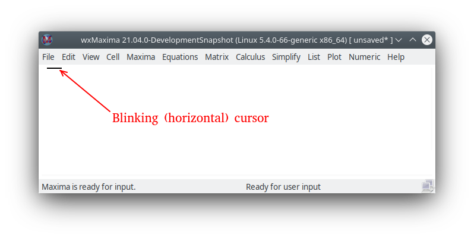
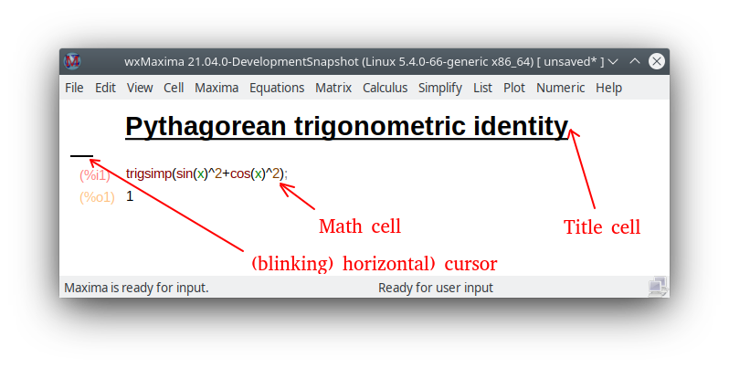
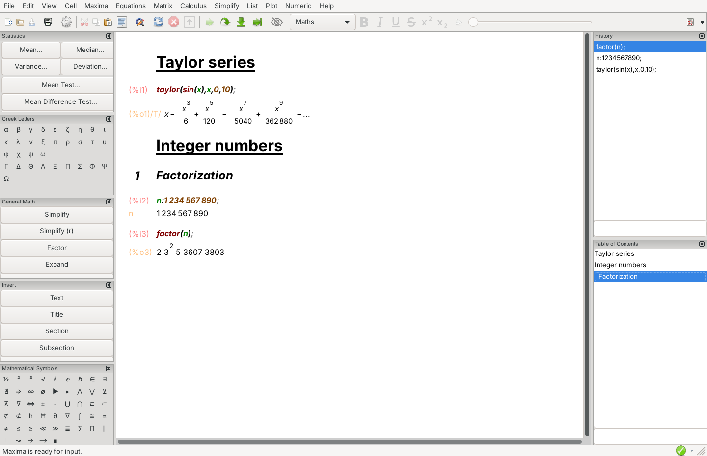
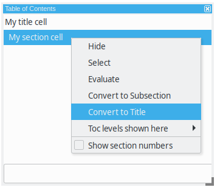
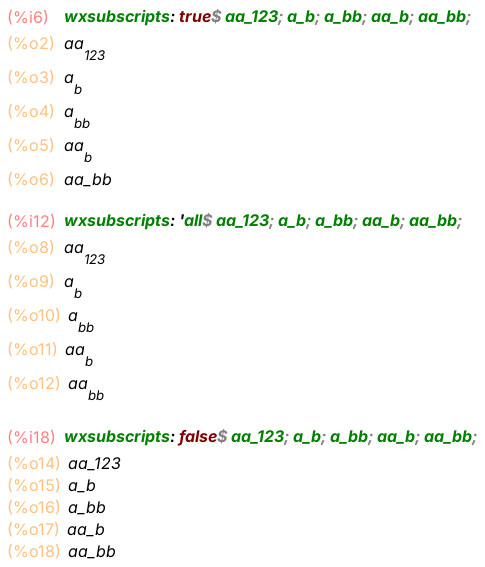

# wxMaxima 用户手册

WxMaxima 是计算机代数系统（CAS） _Maxima_ 的图形用户界面（GUI）。借助 WxMaxima 可以使用 _Maxima_
的全部功能。此外，它还为最常用的功能提供了方便的向导。本手册介绍了一些使 wxMaxima 成为 _Maxima_ 最受欢迎的图形界面之一的功能。

{ id=img_wxMaximaLogo }

______________________________________________________________________

# wxMaxima 简介

## _Maxima_ 与 wxMaxima

在开源领域，大型系统通常会被拆分为若干较小的项目，以便小型开发团队更容易管理。例如，一个光盘刻录程序会由一个真正负责刻录光盘的命令行工具和一个图形用户界面组成，后者让用户无需了解所有命令行开关、甚至完全不用命令行就能使用它。这种方式的一个优点是，投入到命令行程序中的开发工作可以被许多程序共享：同一个命令行刻录程序既可以用作文件管理器的“发送到光盘”插件，也可以用作音乐播放器的“刻录到光盘”功能，还可以用作
DVD 备份工具的刻录组件。另一个优点是，把一个大任务拆分为较小的部分，使开发者能够为同一个程序提供多种用户界面。

一个像 Maxima 这样的计算机代数系统（CAS，computer algebra system）也适合前述框架。Maxima
可以用作任意精度计算器程序的底层软件，也可以在更大计算系统中作为公式转换程序来帮助计算（例如
[Sage](https://www.sagemath.org/)）。Maxima
也可以直接作为独立的计算系统使用，它可以通过命令行来访问。然而，在通常情况下，像 wxMaxima 这样的用户界面是使用 Maxima
的一种更有效的方法，特别是对于新手而言更是如此。

### _Maxima_

Maxima 是一个功能齐全的计算机代数系统（CAS）。CAS
是一个程序，它可以通过对公式变形并找到问题的解来求解数学问题，而不是仅仅输出结果的数值。换言之，Maxima
可以作为一个计算器，给出变量的数值表示，也可以提供解析解。此外，它还提供了一系列数值分析方法，用于求解没有解析解的方程或方程组。

{ id=img_maxima_screenshot }

_Maxima_ 的详尽文档可以 [在互联网上获取](https://maxima.sourceforge.io/documentation.html)。其中一部分文档也可以通过 wxMaxima 的帮助菜单访问。按下帮助键（在大多数系统上是 <kbd>F1</kbd> 键）时， _wxMaxima_ 的上下文相关帮助会自动跳转到 _Maxima_ 手册中介绍光标所在命令的页面。

### WxMaxima

_WxMaxima_ 是一个图形用户界面，提供了 _Maxima_ 的全部功能和灵活性。WxMaxima 为用户提供图形化的显示以及许多让
_Maxima_ 更易于使用的功能。例如，只需单击鼠标右键， _wxMaxima_
就能把任意单元格的内容（如有需要，也可以是公式的任意部分）导出为文本、LaTeX 或 MathML。甚至可以把整个工作簿导出为 HTML 文件或
LaTeX 文件。 _wxMaxima_ 的文档（包括演示其用法各个方面的工作簿）可以在 _wxMaxima_ 的
[帮助网站](https://wxMaxima-developers.github.io/wxmaxima/help.html)
上在线获取，也可以通过帮助菜单访问。

{ id=img_wxMaximaWindow }

在 wxMaxima 中输入的计算式是由 Maxima 命令行工具在后台执行的。

## 工作簿基础

_wxMaxima_ 的大部分功能一看就懂，但有些细节需要注意。
[这个网站](https://wxMaxima-developers.github.io/wxmaxima/help.html) 提供了许多介绍
_wxMaxima_ 各方面功能的工作簿。学习其中的一些（尤其是“10 分钟 _(wx)Maxima_ 教程”）有助于熟悉 _Maxima_
的内容以及如何使用 _wxMaxima_ 与 _Maxima_ 交互。本手册着重介绍 _wxMaxima_
中那些不太直观、在线资料中也可能未涉及的方面。

### 工作簿的工作方式

_wxMaxima_ 为数不多的非标准之处之一，是它把交给 _Maxima_ 的数据组织成单元格，只有在用户要求时才对其求值（也就是发送给
_Maxima_）。对单元格求值时，该单元格中的所有命令（且仅限该单元格）会作为一批被求值。（这种说法并不完全准确：可以选中若干相邻的单元格一起求值，也可以让
_Maxima_ 一次性对工作簿中的所有单元格求值。） _WxMaxima_
提交命令执行的方式初看可能有些陌生。但它大大简化了大型文档的处理（用户并不希望每次修改都自动触发整个文档的重新求值）。此外，这种方式也非常便于调试。

如果输入文本到 wxMaxima
中，则会自动创建一个新的工作簿单元格。可以在工具栏中选择此单元格的类型。如果创建了一个（数学）代码单元格，则可以将该单元格发送到
Maxima，这将使得计算结果显示在代码下方。下面显示了一对这样的命令：

{ id=img_InputCell }

对输入单元格的内容求值时， _Maxima_ 会为该输入分配一个标签（默认以红色显示，可通过 `%i` 识别），之后在 _wxMaxima_
会话中可以通过这个标签引用它。 _Maxima_ 生成的输出也会得到一个以 `%o`
开头的标签，该标签默认隐藏，除非用户为输出指定了名称；此时默认显示用户定义的标签。不过 _Maxima_ 自动生成的 `%o` 式标签仍然可以使用。

除了（数学）输入单元格外，wxMaxima
中还可以使用文本单元格、图片单元格、标题单元格、节单元格和小节单元格等。每个单元格都有独立的撤消缓冲区，因此通过更改多个单元格的内容，然后逐步撤销不需要的更改来进行调试，是非常容易的。此外，工作簿本身有一个全局撤消缓冲区，可以撤消单元格编辑、添加和删除操作。

下图显示了不同的单元格类型（标题单元格、节单元格、小节单元格、文本单元格、输入/输出单元格和图片单元格）：

{ id=img_cell-example }

### 单元格

工作簿由单元格组成。WxMaxima 支持以下几种单元格类型：

- 数学单元格，包含一行或多行 _Maxima_ 输入。
- _Maxima_ 的输出或它提出的问题。
- 图像单元格。
- 文本单元格，例如可用于编写说明文档。
- 标题、节或小节。最多可以有 6 级不同的标题。
- 分页符。

当输入文本时，wxMaxima
的默认行为是自动创建一个数学单元格。可以使用“单元格”菜单、菜单中显示的热键或工具栏中的下拉列表创建其他类型的单元格。一旦创建了非数学单元格，输入到文档的任何内容都将被解释为文本。

数学单元格中可以包含（C 风格的）
[注释文本](https://maxima.sourceforge.io/docs/manual/maxima_singlepage.html#Comments)，写法如下：
`/* This comment will be ignored by Maxima */`

“`/*`”表示注释的开始，“`*/`”表示注释的结束。

### 水平光标与垂直光标

如果用户试图选中一个完整的句子，文字处理软件会尝试把选区自动扩展到以单词边界开始和结束。同样，如果选中了不止一个单元格， _wxMaxima_
会把选区扩展到完整的单元格。

不同寻常的是， _wxMaxima_ 通过定义两种光标来提供拖放的灵活性。 _WxMaxima_ 会在需要时自动在两者之间切换：

- 如果光标在两个单元格之间移动或单击，则会使用水平光标；
- 在单元格内部工作的垂直光标。用鼠标指针或方向键把光标移入单元格时，会启用这种光标，它的工作方式与文本编辑器中的光标非常相似。

启动 wxMaxima 时，只会看到闪烁的水平光标。开始输入后，会自动创建一个数学单元格，光标也会变成普通的垂直光标（作为提示符会显示一个向右的箭头；数学单元格求值（<kbd>CTRL</kbd>+<kbd>ENTER</kbd>）后，会显示标签，例如 `(%i1)`、 `(%o1)`）。

{
id=img_horizontal_cursor_only }

开始创建工作簿时，您也许想先创建另一种类型的单元格（使用“单元格”菜单），例如标题单元格或文本单元格，用来说明接下来要做什么。

在不同单元格之间移动时，也会看到（闪烁的）水平光标，可以在该位置向工作簿插入单元格（直接开始输入公式即可插入数学单元格，或者通过菜单插入其他类型的单元格）。

{
id=img_horizontal_cursor_between_cells }

### 将单元格发送给 Maxima

按下 <kbd>CTRL</kbd>+<kbd>ENTER</kbd>、 <kbd>SHIFT</kbd>+<kbd>ENTER</kbd> 或小键盘上的 <kbd>ENTER</kbd> 键，即可执行代码单元格中的命令。 _wxMaxima_ 默认在按下 <kbd>CTRL</kbd>+<kbd>ENTER</kbd> 或 <kbd>SHIFT</kbd>+<kbd>ENTER</kbd> 时发送命令，但也可以把 _wxMaxima_ 配置为按下 <kbd>ENTER</kbd> 即执行命令。

### 命令自动补全

_WxMaxima_ 具有自动补全功能，可通过菜单（单元格/自动补全）或按组合键 <kbd>CTRL</kbd>+<kbd>SPACE</kbd> 触发。自动补全会考虑上下文。例如，在 ezUnits 的单位说明中触发时，它会列出适用的单位。

{ id=img_ezUnits }

除了补全文件名、单位名或当前的命令名、变量名之外，自动补全还能为大多数命令显示一个模板，指明该命令所需参数的类型（和含义）。要使用此功能，请按 <kbd>SHIFT</kbd>+<kbd>CTRL</kbd>+<kbd>SPACE</kbd> 或选择相应的菜单项（单元格/显示模板）。

#### 希腊字母

计算机一般以 8 位值（8-bit）存储字符，所以最多可以储存 256
个不同字符。大部分语言中的所有字母、数字和控制符号（传输结束、字符串结束、为菜单绘制矩形的线条和边缘等）都符合该限制。

然而，对大多数国家而言，所选的 256 个字符的代码页并不包含数学中常用的希腊字母等字符。为了克服这类限制，人们发明了
[Unicode](https://home.unicode.org/)：这种编码让英文文本照常工作，同时又能使用远多于 256 个的字符。

如果 _Maxima_ 是用支持 Unicode 或者不在乎字符编码的 Lisp 编译器编译的，它就支持
Unicode。这两个条件中至少有一个很可能成立。 _WxMaxima_ 提供了一种用键盘输入希腊字母的方法：

- 按下 <kbd>ESC</kbd> 键，然后开始输入希腊字母的名称，即可输入希腊字母。
- 也可以依次按下 <kbd>ESC</kbd>、一个字母（希腊字母 omicron 为两个字母）和 <kbd>ESC</kbd>
  来输入。此时支持以下字母：

| 按键 | 希腊字母 | 按键 | 希腊字母 | 按键 | 希腊字母 |
| :-: | :----------: | :-: | :----------: | :-: | :----------: |
|  a  |    alpha     |  i  |     iota     |  r  |     rho      |
|  b  |     beta     |  k  |    kappa     |  s  |    sigma     |
|  g  |    gamma     |  l  |    lambda    |  t  |     tau      |
|  d  |    delta     |  m  |      mu      |  u  |   upsilon    |
|  e  |   epsilon    |  n  |      nu      |  f  |     phi      |
|  z  |     zeta     |  x  |      xi      |  c  |     chi      |
|  h  |     eta      | om  |   omicron    |  y  |     psi      |
|  q  |    theta     |  p  |      pi      |  o  |    omega     |
|  A  |    Alpha     |  I  |     Iota     |  R  |     Rho      |
|  B  |     Beta     |  K  |    Kappa     |  S  |    Sigma     |
|  G  |    Gamma     |  L  |    Lambda    |  T  |     Tau      |
|  D  |    Delta     |  M  |      Mu      |  U  |   Upsilon    |
|  E  |   Epsilon    |  N  |      Nu      |  P  |     Phi      |
|  Z  |     Zeta     |  X  |      Xi      |  C  |     Chi      |
|  H  |     Eta      | Om  |   Omicron    |  Y  |     Psi      |
|  T  |    Theta     |  P  |      Pi      |  O  |    Omega     |

也可以使用“希腊字母”侧边栏输入希腊字母。

##### 注意：外观相似的字符

有些拉丁字母看起来和希腊字母一样，例如拉丁字母“A”和希腊字母“Alpha”。虽然它们看起来完全相同，却是两个不同的 Unicode 字符，由不同的
Unicode 码位（数字）表示。

如果给变量 A 赋了值，之后又用希腊字母 Alpha 来操作这个变量，就可能出现问题，在打印输出中尤其如此。  希腊字母
mu（也用作“微”的词头）同样有两个不同的 Unicode 码位。

因此，“希腊字母”侧边栏提供了一个选项，可以不提供外观相似的字符（可通过右键菜单更改）。

用同样的方法还可以输入一些其他的数学符号：

| 输入的按键 | 数学符号                                         |
| -------------- | ----------------------------------------------------- |
| hbar           | 普朗克常数：上方带横线的 h                            |
| Hbar           | 上方带横线的 H                                        |
| 2              | 平方                                                  |
| 3              | 三次方                                                |
| /2             | 1/2                                                   |
| partial        | 偏导数符号（dx/dt 中的 d）                            |
| integral       | 积分号                                                |
| sq             | 平方根                                                |
| ii             | 虚数单位                                              |
| ee             | 元素                                                  |
| in             | 属于                                                  |
| impl implies   | 蕴含                                                  |
| inf            | 无穷大                                                |
| empty          | 空集                                                  |
| TB             | 向右的大三角形                                        |
| tb             | 向右的小三角形                                        |
| and            | 与（and）                                             |
| or             | 或（or）                                              |
| xor            | 异或（xor）                                           |
| nand           | 与非（nand）                                          |
| nor            | 或非（nor）                                           |
| equiv          | 等价于                                                |
| not            | 非（not）                                             |
| union          | 并集                                                  |
| inter          | 交集                                                  |
| subseteq       | 子集或相等                                            |
| subset         | 子集                                                  |
| notsubseteq    | 不是子集也不相等                                      |
| notsubset      | 不是子集                                              |
| approx         | 约等于                                                |
| propto         | 正比于                                                |
| neq != /= or # | 不等于                                                |
| +/- or pm      | 正负号                                                |
| \<= or leq     | 小于或等于                                            |
| >= or geq      | 大于或等于                                            |
| \<\< or ll     | 远小于                                                |
| >> or gg       | 远大于                                                |
| qed            | 证毕                                                  |
| nabla          | nabla 算子                                            |
| sum            | 求和号                                                |
| prod           | 求积号                                                |
| exists         | 存在符号                                              |
| nexists        | 不存在符号                                            |
| parallel       | 平行符号                                              |
| perp           | 垂直符号                                              |
| leadsto        | 导致符号                                              |
| ->             | 向右箭头                                              |
| -->            | 长向右箭头                                            |

也可以使用“数学符号”侧边栏输入这些数学符号。

如果某个特殊符号不在列表中，可以按 <kbd>ESC</kbd> \[字符编号（十六进制）\] <kbd>ESC</kbd> 输入任意 Unicode 字符。此外，“数学符号”侧边栏还有一个右键菜单，可以显示所有可用 Unicode 符号的列表，这些符号可以添加到该工具栏或工作簿中。

<kbd>ESC</kbd><kbd>6</kbd><kbd>1</kbd><kbd>ESC</kbd> therefore results in an `a`. While you type the number, the list of symbols shows the character it stands for and its Unicode name.

If the number also is the beginning of a symbol's name (`be` could be the start of `beta`, or the character ¾ with the number `be`), the name wins. A leading `0` or `u+` makes it a number: <kbd>ESC</kbd>`u+be`<kbd>ESC</kbd> and <kbd>ESC</kbd>`00be`<kbd>ESC</kbd> both result in a `¾`.

A letter with an accent that Unicode has no character of its own for, like a t with a bar on top of it, is a letter followed by a "combining" accent: <kbd>t</kbd><kbd>ESC</kbd><kbd>3</kbd><kbd>0</kbd><kbd>4</kbd><kbd>ESC</kbd> results in `t̄`, which _Maxima_ treats as a variable name like any other.

Symbols one needs often can be added to the "Symbols" sidebar in the "Options" tab of the configuration dialog (Edit -> Configure), where they can also be given a keyboard shortcut. A letter with accents counts as one symbol there and gets one button. The Greek letters and the symbols the sidebars show anyway can be given a keyboard shortcut there, too, or by right-clicking their button in the sidebar. A shortcut has to contain <kbd>Ctrl</kbd> or <kbd>Alt</kbd> or be a function key, and types its symbol while the worksheet has the keyboard focus. The configuration dialog warns if a menu entry already uses the same keys.

请注意，这些符号中的大多数（逻辑符号是明显的例外）在 _Maxima_ 中并没有特殊含义，因此会被当作普通字符处理。如果 _Maxima_ 是用不支持
Unicode 字符的 Lisp 编译的，这些符号可能会导致错误消息。

有可能出现所选字体不包含希腊字母或数学符号等字符的情况，此时这些字符无法显示。
要解决这个问题，请选择其他字体（通过：编辑 -> 设置 -> 样式）。

### Unicode 替换

wxMaxima will replace several Unicode characters with their respective Maxima expressions, e.g. `²` with `^2`, `³` with `^3`, `≠` with `#` or `≤` with `<=`.

Unicode characters that stand for a Maxima name are instead defined as
_Maxima_ aliases of that name when wxMaxima starts _Maxima_: `π` for `%pi`,
`ⅈ` for `%i`, `ⅇ` for `%e`, `∞` for `inf`, the (mathematical) Sigma sign
(which is not the same Unicode character as the corresponding Greek letter)
for `sum`, `∏` for `product`, `∫` for `integrate`, the square root sign for
`sqrt` and `⋀`, `⋁`, `⊻`, `⊼`, `⊽`, `⇒`, `⇔` and `¬` for `and`, `or`, `xor`,
`nand`, `nor`, `implies`, `equiv` and `not`. This means they work in files
loaded by `batch()` or `load()`, too, and `aliases` lists the names they
stand for. As _Maxima_ reads these characters as letters they need to be
separated from neighbouring names by spaces in such a file: `a⋀b` is a
variable name, `a ⋀ b` means `a and b`. In an input cell wxMaxima adds these
spaces automatically. It also puts parenthesis around a number or a variable
that directly follows the square root sign, so `√2` means `sqrt(2)`.

Unicode 中有几个“常用”分数被编码为单个码位： `¼, ½, ¾, ⅐, ⅑, ⅒, ⅓, ⅔, ⅕, ⅖, ⅗, ⅘, ⅙, ⅚, ⅛, ⅜,
⅝, ⅞`

在把输入发送给 Maxima 之前，wxMaxima 会把它们替换为 Maxima 中的表示形式，例如 `(1/4)`。此外还有 `⅟`，会被替换为
`1/`；以及 `↉`（用于棒球），会被替换为 `(0/3)`。

建议在输入单元格中使用 **Maxima 代码**（而不是这些 Unicode 码位）。理由：(a) 用于数学输入的字体可能不包含这些字符；(b)
如果把文档保存为 `wxm` 文件，通常可以被（命令行）Maxima 读取，而这些替换在命令行 Maxima
中当然不起作用。不过，从其他文档复制粘贴公式时，可能会出现这些字符。

### 侧边栏

通过侧边栏可以访问最重要的 _Maxima_
命令的快捷方式、目录、调试消息窗口或最近执行命令的历史记录等。可以通过“视图”菜单启用它们。它们都可以移动到 _wxMaxima_
窗口内外的其他位置。另一个有用的侧边栏可以用鼠标输入希腊字母。

{ id=img_SidePanes }

在“目录”侧边栏中，只需用鼠标右键单击某个标题，再选择更高一级或更低一级的标题类型，即可提升或降低该标题的级别。

{
id=Sidepane-TOC-convert-headings }

### MathML 输出

一些文字处理软件和类似的程序能够识别 [MathML](https://www.w3.org/Math/)
输入并自动把它插入为可编辑的二维公式，或者（如 LibreOffice）带有提供“从剪贴板导入 MathML”功能的公式编辑器。还有一些程序支持 RTF
数学公式。因此， _WxMaxima_ 在右键菜单中提供了多个相应的菜单项。

### Pasting LaTeX or MathML formulas

**Edit → Paste LaTeX/MathML as Maxima Code** (also in the right-click menu) converts a formula from the clipboard into a _Maxima_ command, for example one copied from a paper, a web page or an equation editor. LaTeX may come with or without `$…$`, `\(…\)` or `\[…\]` around it, so `\int_0^1 \frac{\sin x}{x}\,dx` becomes `integrate(sin(x)/x,x,0,1)`. The command goes where the cursor is, or into a new code cell. MathML pasted into a code cell with the ordinary **Paste** is converted the same way, since nobody wants the XML in a code cell. If MathML copied with **Copy as MathML** is pasted back, the result is the original command: _wxMaxima_ adds it to the MathML as an annotation.

LaTeX and MathML describe what a formula looks like, not what it means, so
the conversion has to interpret it. Fractions, roots, powers, subscripts
(`x_1` becomes the name `x_1`, `a_{n+1}` the array element `a[n+1]`),
functions with or without parentheses (`\sin 2x`), `\frac{d}{dx}`, `f'(x)`,
integrals ending in `dx`, sums and products with limits, `\lim_{x\to 0}`,
`|x|` and matrices are understood. An `e` is Euler’s number, but an `i` is
only the imaginary unit when set upright (`\mathrm{i}`), as it more often is
an index. A product of a name and parentheses, like `x(y+1)`, is taken as a
product unless the name is `f`, `g`, `h` or longer than one letter. Anything
without a single meaning, like `\pm`, `\dots` or text, isn’t guessed at:
_wxMaxima_ says what it couldn’t convert instead. Check the command before
evaluating it.

### Markdown 支持

_WxMaxima_ 支持一组不会与数学记号冲突的标准
[Markdown](https://en.wikipedia.org/wiki/Markdown) 约定，其中之一是项目符号列表。

```text
普通文本
 * 一个条目，缩进级别 1
 * 缩进级别 1 的另一个条目
   * 第二缩进级别的一个条目
   * 第二缩进级别的第二个条目
 * 第一缩进级别的第三个条目
普通文本
```

_WxMaxima_ 会把以 `>` 字符开头的文本识别为块引用：

```text
普通文本
> 引文 引文 引文 引文
> 引文 引文 引文 引文
> 引文 引文 引文 引文
普通文本
```

_WxMaxima_ 的 TeX 和 HTML 输出还会识别 `=>`，并把它替换为相应的 Unicode 符号：

```text
cogito => sum.
```

HTML 和 TeX 导出还能识别的其他符号有：用于比较的 `<=` 和 `>=`、双向双箭头（`<=>`）、单箭头（`<->`、 `->` 和 `<-`），以及表示相应符号的 `+/-`。TeX 输出还能识别 `<<` 和 `>>`。

### Links in text cells

A web address in a text cell that starts with `http://`, `https://` or `mailto:` is shown as a link. Since clicking into a text cell places the cursor there, a link is followed by <kbd>CTRL</kbd>+clicking it (<kbd>CMD</kbd>+clicking on macOS), or by right-clicking it and choosing "Open Link"; hovering over it shows where it leads. The HTML export turns it into a link, the TeX export into a `\url{}`. Links are always recognized from the text itself, so nothing about them is stored in the file.

Links in a code cell's comments (`/* ... */`) work the same way. Elsewhere
in code, for example inside a string, an address is Maxima syntax and is not
a link.

The same goes for web addresses in _Maxima_'s output, for example in a string printed by `print("See https://wxmaxima-developers.github.io/wxmaxima/")`: <kbd>CTRL</kbd>+clicking the address or choosing "Open Link" from its context menu opens it, while a plain click still selects the output.

### Bold, italic, underlined and struck-through text

Text in a text cell, a title or a section heading can be made bold, italic,
underlined or struck through. Select the text and press the respective
button in the toolbar; pressing the button again removes that formatting
from the selection. With nothing selected the button switches the formatting
on or off for what is typed next. The buttons are hidden by right-clicking
the toolbar and unchecking "Text formatting buttons". Code cells cannot be
formatted: their colors already show the syntax of the code.

Superscript and subscript buttons work the same way: they make the text
smaller and raise it above or lower it below the line, as in E = mc² or
H₂O. A character cannot be both, so switching one of them on switches the
other off. A line that contains a superscript, a subscript or a character
that is taller than the font's usual ones, for example an emoji, gets as
much additional room as it needs.

The formatting is saved in `.wxmx` files. Older versions of _wxMaxima_ open
such a file without the formatting but keep all of the text. `.wxm` files,
the exports and the clipboard contain the text without its formatting.

### 快捷键

大多数快捷键可以在相应菜单的文本中找到。由于它们实际上是从菜单文本中获取的，所以可以通过 wxMaxima
的翻译文本进行定制，以满足本地用户的需求，因此我们不在这里记录它们。但是，一些快捷键或其别名并没有记录在菜单中：

- <kbd>CTRL</kbd>+<kbd>SHIFT</kbd>+<kbd>DELETE</kbd> 删除一个单元格。
- <kbd>CTRL</kbd>+<kbd>TAB</kbd> 或
  <kbd>CTRL</kbd>+<kbd>SHIFT</kbd>+<kbd>TAB</kbd> 触发自动补全。
- <kbd>SHIFT</kbd>+<kbd>SPACE</kbd> 插入一个不可断行的空格。

### Exploring output with the keyboard

A cell's output can be selected, and explored part by part, without a mouse:

- <kbd>DOWN</kbd> at the end of a cell's input selects the first result of
  its output. Further presses of <kbd>DOWN</kbd> and <kbd>UP</kbd> step
  through the results; past the last one the cursor leaves the cell. If you
  prefer <kbd>DOWN</kbd> to skip over the output, switch on "Up/Down keys
  skip over output" in the Worksheet tab of the configuration dialog.
- <kbd>ENTER</kbd> goes into the selected expression and selects its first
  part: the expression without its label, the numerator of a fraction, the
  name of a function, the first entry of a matrix, ... If the selection has
  no parts, <kbd>ENTER</kbd> opens a new input cell holding it, as it always
  did.
- <kbd>ESCAPE</kbd> selects what the selection is a part of. From a whole
  result it goes back into the cell's input.
- <kbd>LEFT</kbd> and <kbd>RIGHT</kbd> select the previous or next part at
  the same level. In a matrix all four arrow keys move from entry to entry.
- <kbd>SHIFT</kbd>+<kbd>LEFT</kbd> and <kbd>SHIFT</kbd>+<kbd>RIGHT</kbd>
  grow or shrink the selection over the neighbouring parts; in a matrix,
  <kbd>SHIFT</kbd> and any arrow key grow the selected entry into a block of
  entries.
- The context-menu key or <kbd>SHIFT</kbd>+<kbd>F10</kbd> opens the
  right-click menu for the selection, so it can be copied in any format.

### TeX 导出中的原始 TeX

如果文本单元格以 `TeX: ` 开头，则导出 TeX 时，文件将包含 `TeX: ` 标记后面的文本。使用此功能可以在 wxMaxima 工作簿中输入
TeX 代码。

## 文件格式

在 wxMaxima 中输入的内容可以存为以下三种文件格式之一，以供以后使用：

### .mac

`.mac` 文件是包含 _Maxima_ 命令的普通文本文件。可以用 _Maxima_ 的 `batch()` 或 `load()` 命令，或者
_wxMaxima_ 的“文件/批处理文件”菜单项读取它们。

下面是一个例子。 `Quadratic.mac` 定义了一个函数，随后用 `wxdraw2d()` 生成一张图。  之后打印文件
`Quadratic.mac` 的内容，并对新定义的函数 `f()` 求值。

{ id=img_BatchImage }

注意：虽然文件 `Quadratic.mac` 使用的是 _Maxima_ 的常规扩展名（`.mac`），但它只能被 _wxMaxima_
读取，因为命令 `wxdraw2d()` 是 wxMaxima 对 _Maxima_ 的扩展。（命令行）Maxima 会忽略未知命令
`wxdraw2d()`，并把它原样作为输出打印出来。

可以用 `.mac` 文件编写自己的宏库。但由于它们不包含足够的结构信息，无法作为 _wxMaxima_ 会话读回。

### .wxm

`.wxm` 文件包含除 _Maxima_ 输出之外的整个工作簿。在 Maxima 5.38 以上版本中，可以像 .mac 文件一样用 _Maxima_ 的 `load()` 函数读取它们。嗯，大多数情况下可以。问题（例如 `asksign(x)`）会带来麻烦，因为答案会写入 `.wxm` 文件（以便加载后可以给出建议），但 Maxima 无法对其求值。
可以用 `assume()` 声明 Maxima 想要知道的属性，从而避免 Maxima 提问。

使用这种纯文本格式时，有时无法避免使用了新功能的工作簿与旧版本的 _wxMaxima_ 不兼容。

#### wxm 文件的文件格式

这只是一个纯文本文件（可以用文本编辑器打开），以特殊的 Maxima 注释的形式包含各单元格的内容。

它以如下注释开头：

```maxima
/* [wxMaxima batch file version 1] [ DO NOT EDIT BY HAND! ]*/
/* [ Created with wxMaxima version 24.02.2_DevelopmentSnapshot ] */
```

接下来是各个单元格，编码为 Maxima 注释，例如一个节单元格：

```maxima
/* [wxMaxima: section start ]
Title of the section
   [wxMaxima: section end   ] */
```

或者（在数学单元格中，输入当然 *没有* 被注释掉；输出不会保存在 `wxm` 文件中）：

```maxima
/* [wxMaxima: input   start ] */
f(x):=x^2+1$
f(2);
/* [wxMaxima: input   end   ] */
```

图像采用 [Base64 编码](https://en.wikipedia.org/wiki/Base64)，第一行是图像类型：

```maxima
/* [wxMaxima: image   start ]
jpg
[very chaotic looking character sequence]
   [wxMaxima: image   end   ] */
```

分页符只是一行，内容为：

```maxima
/* [wxMaxima: page break    ] */
```

折叠的单元格用以下标记：

```maxima
/* [wxMaxima: fold    start ] */
...
/* [wxMaxima: fold    end   ] */
```

### .wxmx

这种基于 XML 的文件格式保存了完整的工作簿内容，包括缩放因子和观察列表等内容。它是首选的文件格式。

#### wxmx 文件的文件格式

`wxmx` 文件看起来像二进制格式，但可以用操作系统自带的工具处理。它是一个 zip 文件，可以用 `unzip`
解压（也许需要先重命名，以便操作系统的解压程序能识别它）。
我们没有使用压缩功能，只是利用了把多个文件合并成一个文件的能力：图像本身已经压缩过，其余部分是简单的文本（很可能比包含的大图像小得多）。

它包含以下文件：

- `mimetype`：此文件包含 wxMaxima 文件的 MIME 类型： `text/x-wxmathml`
- `format.txt`：关于 wxMaxima 和 wxmx 文件格式的简短说明
- 图像（例如 png、jpeg）：在 wxMaxima 会话中生成的内嵌图形以及插入的图像。
- `content.xml`：一个 XML 文档，以 XML 格式包含文档的各个单元格。

因此，如果出了问题，可以解压 wxMaxima 文档（也许需要先重命名为 `zip` 文件），用文本编辑器修改 `content.xml`
文件，或者替换损坏的图像，再把文件重新压缩，并把 `zip` 重命名为 `wxmx` 文件，这样就得到了一个修改过的 `wxmx` 文件。

## 配置选项

对于一些常见的可设置变量，wxMaxima提供了两种设置方法：

- 下面的设置对话框允许用户更改当前和后续会话的默认值。
- 此外，大多数配置变量的值也可以只针对当前会话进行修改，方法是在工作簿中覆盖它们的值，如下所示。

{
id=img_wxMaxima_configuration_001 }

### 默认动画帧率

用于新生成动图的帧率保存在变量 `wxanimate_framerate` 中，可以使用设置对话框更改此变量在新工作簿中的初始值。

### 新 _maxima_ 会话的默认图形尺寸

下次启动后，如果 _maxima_ 没有修改 `wxplot_size` 的值，内嵌到工作簿中的图形将以此尺寸创建。

如果只想设置单个图形的尺寸，可以使用以下写法，它只针对一条命令设置变量的值：

```maxima
wxdraw2d(
   explicit(
       x^2,
       x,-5,5
   )
), wxplot_size=[480,480]$
```

### 在文本控件中匹配括号

该选项使以下两个功能生效：

- 如果输入了左圆括号、左方括号或双引号， _wxMaxima_ 会在其后插入相应的右括号或右引号。
- In a code cell a comment opened by `/*` is closed by an inserted
  `*/`. Typing `*/` in front of it moves the cursor past it instead.
- 如果在输入前述字符中的任何一个时选择了文本，则所选文本将被放在配对的两个字符之间。

### 不自动保存工作簿

如果设置了此选项，只有在用户要求时才会覆盖工作簿所在的文件。不过，如果发生崩溃、断电等情况，临时目录中仍会保留一份最新的备份。

如果未设置此选项， _wxMaxima_ 的行为更像一个现代手机应用：

- 文件在退出时被自动保存；
- 并且文件每 3 分钟自动保存一次。

### Arranging the toolbar

The toolbar is made of sections, like the "Open" and "Save" buttons, the
evaluation buttons or the drop-down list that sets the type of a cell. The
"Toolbar" tab of the configuration dialog lists them in the order the
toolbar shows them in: drag a section to another place, or select it and
press "Up" or "Down", to move it, and uncheck it to hide it. The flexible
space pushes every section after it to the right edge of the
window. "Default order" restores the original arrangement. Sections can also
be shown or hidden by right-clicking the toolbar.

### 配置保存在哪里？

在 Unix/Linux 上，配置信息保存在您主目录下的文件 `.wxMaxima` 中（如果使用的是 wxWidgets \< 3.1.1），或者保存在 `.config/wxMaxima.conf` 中（（XDG 标准）如果使用的是 wxWidgets >= 3.1.1）。可以通过命令 `wxbuild_info();` 或菜单项“帮助->关于”查看 wxWidgets 的版本。 [wxWidgets](https://www.wxwidgets.org/) 是 _wxMaxima_ 所基于的跨平台图形界面库（名称中的 `wx` 即来源于此）。
（由于文件名以点开头， `.wxMaxima` 或 `.config` 是隐藏的。）

当使用 Windows 系统时，配置信息将存储在注册表中。在注册表中的以下位置可以找到 wxMaxima
的相关条目：`HKEY_CURRENT_USER\Software\wxMaxima`。

______________________________________________________________________

# _Maxima_ 的扩展

_WxMaxima_ 主要是 _Maxima_ 的图形用户界面。因此，它的主要任务是把命令传递给 _Maxima_
并报告这些命令的执行结果。但在某些情况下， _wxMaxima_ 也为 _Maxima_ 增加了功能。前面已经提到， _WxMaxima_
能够把工作簿的内容导出为 HTML 和 LaTeX 文件来生成报告。本节介绍 _wxMaxima_ 在会话中更好地插入图形的一些方式。

## 带下标的变量

<div id="wxsubscripts"></div>

`wxsubscripts` 指定 _wxMaxima_ 是否（以及如何）自动把变量名的一部分显示为下标：

如果它的值为 `false`，则此功能关闭，wxMaxima 不会把变量名中下划线之后的部分自动显示为下标。

如果它的值为 `'all`，下划线之后的所有内容都会显示为下标。

如果它的值为 `true`，形如 `x_y` 的变量名在以下情况下以下标形式显示：

- `x` 或 `y` 是单个字母，或者
- `y` 是一个整数（可以包含多个字符）。

{ id=img_wxsubscripts }

<div id="wxdeclare_subscripted"></div>

A variable the rules above don’t cover can still be declared as "to be
subscripted" using the command `wxdeclare_subscripted(variable_name);` or
`wxdeclare_subscripted([variable_name1,variable_name2,...]);` Declaring a
variable as subscripted can be reverted using the following command:
`wxdeclare_subscripted(variable_name,false);`, which also keeps a variable
the rules above do cover from being subscripted.

<div id="wxdeclare_subscript"></div>

`wxdeclare_subscript(text_snippet);` or
`wxdeclare_subscript([text_snippet1,text_snippet2,...]);` instead declares a
text snippet: every variable whose name ends in an underscore followed by
that snippet is subscripted, however long the two parts are.

也可以使用菜单“视图->自动下标”设置这些值。

## 在状态栏中向用户反馈

<div id="wxstatusbar"></div>

运行时间较长的命令可以在状态栏中向用户反馈。放在那里的新反馈会替换旧的反馈（因此可以把它用作进度指示），并且当前发送给 _Maxima_
的命令一结束，反馈就会被删除。即使在可能与普通 _Maxima_（而不是 _wxMaxima_）一起使用的库中，也可以放心使用
`wxstatusbar()`：如果没有 _wxMaxima_， `wxstatusbar()` 命令只会保持未求值状态。

```maxima
for i:1 thru 10 do (
    /* 告诉用户我们进行到哪一步了 */
    wxstatusbar(concat("Pass ",i)),
    /* (sleep n) 是一个 Lisp 函数，前面加上 */
    /* 字符 "?" 即可使用。它会推迟程序的 */
    /* 执行（这里：推迟 3 秒） */
    ?sleep(3)
)$
```

## 在 Maxima 中导出工作簿

<div id="wxworksheettohtml"></div>

命令 `wxworksheettohtml()` 可以在运行中的 _Maxima_ 会话里把当前工作簿导出为 HTML
文件，便于用脚本或批处理方式导出。和 `wxstatusbar()` 一样，它可以放心地用在可能也会在普通（控制台） _Maxima_
中运行的代码里：如果没有 _wxMaxima_，该命令只会保持未求值状态。

```maxima
wxworksheettohtml("report.html")$
wxworksheettohtml("report.html", flavor="svg", wxmx=true)$
```

相对文件名以 _Maxima_ 的工作目录为基准解释。可选的关键字选项有：

| 选项     | 取值                                            | 含义                                                |
| -------- | ----------------------------------------------- | --------------------------------------------------- |
| `flavor` | `mathml`（默认）、 `mathjax`、 `svg`、 `bitmap` | 导出页面中公式的呈现方式                            |
| `wxmx`   | `false`（默认）、 `true`                        | 嵌入一份可下载的会话 `.wxmx` 副本                   |

The images and the `.wxmx` copy are written into a folder named after the
HTML file, with `_htmlimg` appended. If "Embed images into the .html file"
is checked in the Export tab of the configuration dialog, they are embedded
into the HTML file instead, so it can be mailed as a single file.

`flavor` 的取值与图形界面 **文件 → 导出** 对话框提供的公式格式相对应： `mathml` 生成无需联网的独立页面， `mathjax`
为尚不支持 MathML 的浏览器添加 MathJaX 备用方案，而 `svg`/`bitmap` 把每个公式渲染为图像。

<div id="wxworksheettotex"></div>

配套命令 `wxworksheettotex()` 以同样的方式导出为 LaTeX（`.tex`）文件：

```maxima
wxworksheettotex("report.tex")$
wxworksheettotex("report.tex", documentclass="report", documentclassoptions="12pt,a4paper")$
```

| 选项                   | 含义                                                                 |
| ---------------------- | -------------------------------------------------------------------- |
| `documentclass`        | 覆盖 LaTeX 的 `\documentclass`（例如 `"article"`、 `"report"`）      |
| `documentclassoptions` | 覆盖其选项（例如 `"12pt,a4paper"`）                                  |

计划支持 `wxworksheettopdf()`。

## 绘图

因为绘图功能与图形密切相关，所以图形用户界面理应为原始程序的绘图功能提供一些扩充内容。

### 在工作簿中嵌入图形

<div id="wxplot2d"></div>
<div id="wxplot3d"></div>
<div id="wximplicit_plot"></div>
<div id="wxcontour_plot"></div>

_Maxima_ 通常会让外部程序 _Gnuplot_ 为它创建的每张图打开一个单独的窗口。由于很多时候把图形嵌入工作簿更方便， _wxMaxima_
提供了自己的一套绘图函数，它们与相应的 _maxima_ 函数只有名称不同：都带有前缀“wx”。

以下绘图函数都有对应的 wx 版本：

| wxMaxima 的绘图函数      | Maxima 的绘图函数                                                                               |
| ------------------------ | ----------------------------------------------------------------------------------------------- |
| `wxplot2d()`             | [plot2d](https://maxima.sourceforge.io/docs/manual/maxima_singlepage.html#plot2d)               |
| `wxplot3d()`             | [plot3d](https://maxima.sourceforge.io/docs/manual/maxima_singlepage.html#plot3d)               |
| `wxdraw2d()`             | [draw2d](https://maxima.sourceforge.io/docs/manual/maxima_singlepage.html#draw2d)               |
| `wxdraw3d()`             | [draw2d](https://maxima.sourceforge.io/docs/manual/maxima_singlepage.html#draw3d)               |
| `wxdraw()`               | [draw](https://maxima.sourceforge.io/docs/manual/maxima_singlepage.html#draw)                   |
| `wximplicit_plot()`      | [implicit_plot](https://maxima.sourceforge.io/docs/manual/maxima_singlepage.html#implicit_plot) |
| `wxhistogram()`          | [histogram](https://maxima.sourceforge.io/docs/manual/maxima_singlepage.html#histogram)         |
| `wxscatterplot()`        | [scatterplot](https://maxima.sourceforge.io/docs/manual/maxima_singlepage.html#scatterplot)     |
| `wxbarsplot()`           | [barsplot](https://maxima.sourceforge.io/docs/manual/maxima_singlepage.html#barsplot)           |
| `wxpiechart()`           | [piechart](https://maxima.sourceforge.io/docs/manual/maxima_singlepage.html#piechart)           |
| `wxboxplot()`            | [boxplot](https://maxima.sourceforge.io/docs/manual/maxima_singlepage.html#boxplot)             |

如果 `wxm` 文件由（控制台）Maxima 读取，这些函数会被忽略（并像 Maxima 中其他未知函数一样作为输出打印出来）。

如果使用这些函数时遇到问题，请检查对应的 Maxima 函数是否也存在同样的问题（例如 `wxplot2d()` 报错时，用 Maxima 命令
`plot2d()`（会在单独的窗口中打开图形）绘制同一张图试试）。如果问题依然存在，那很可能是 Maxima 的问题，应当在 [Maxima
错误跟踪器](https://sourceforge.net/p/maxima/bugs/) 中报告。也可能是 Gnuplot 的问题。

### 放大或缩小内嵌图形

<div id="wxplot_size"></div>

如上所述，配置对话框提供了一种修改所创建图形默认尺寸的方法，它设置的是 `wxplot_size` 的初始值。 _wxMaxima_
的绘图例程遵循这个以像素为单位指定图形尺寸的变量。随时可以查询它，或用它设置后续图形的尺寸：

```maxima
wxplot_size:[1200,800]$
wxdraw2d(
    explicit(
        sin(x),
        x,1,10
    )
)$
```

如果只更改一个绘制图片的大小，wxMaxima 提供了一种只为当前单元格更改属性的方法。具体用法为，将
`wxplot_size=[value1,value2]` 附加到 `wxdraw2d()` 命令结尾，而不是作为该命令的一部分：

```maxima
wxdraw2d(
    explicit(
        sin(x),
        x,1,10
    )
),wxplot_size=[1600,800]$
```

用 `wxplot_size` 设置内嵌图形的尺寸，适用于使用 `wxplot`、 `wxdraw`、 `wxcontour_plot` 和
`wximplicit_plot` 等命令生成的内嵌图形，以及使用 `with_slider_draw` 和 `wxanimate`
命令生成的内嵌动画。

<div id="wxplot_scale"></div>

`wxplot_size` tells _Gnuplot_ how many pixels to draw. If a plot is wider
than the window, _wxMaxima_ shrinks it until it fits. If one specific plot
is meant to be shown larger, even if that means it no longer fits on the
screen, or smaller than that, the variable `wxplot_scale` (default: `1`)
tells _wxMaxima_ to show it that many times as large as it would otherwise:

```maxima
wxdraw2d(
    explicit(
        sin(x),
        x,1,10
    )
),wxplot_scale=2$
```

Unlike a bigger `wxplot_size`, which makes the text and lines of a plot
smaller in relation to the plot, `wxplot_scale` makes everything larger, the
text included. The factor is stored in the worksheet with the plot, so it
survives saving and re-opening the file. It is respected by the same
commands as `wxplot_size`. If _wxMaxima_ shows plots as scalable vector
graphics (see "Create scalable plots" in the configuration dialog) they stay
sharp at any scale; a bitmap plot gets blurry if it is enlarged a lot.

A plot that should be wide but not high, for example a waveform, is better
made with `wxplot_size`: a wider `wxplot_size` gives more room for the data,
at the same height and with text of the same size. As such a plot would
normally be shrunk to fit into the window, which makes its text tiny again,
`wxplot_scale='native` tells _wxMaxima_ to show it at exactly the size
`wxplot_size` asks for, even if that is wider than the window:

```maxima
wxdraw2d(
    explicit(
        sin(10*x)*exp(-x/3),
        x,0,10
    )
),wxplot_size=[1600,300],wxplot_scale='native$
```

### 更高质量的图形

_Gnuplot_ 似乎没有提供一种可移植的方法来判断它是否支持 Cairo 库提供的高质量位图输出。在 _Gnuplot_
编译时使用了该库的系统上，配置菜单中的 pngCairo 选项（可以用变量 `wxplot_pngcairo` 覆盖）会启用抗锯齿和额外的线型。如果在
_Gnuplot_ 不支持的情况下设置了 `wxplot_pngCairo`，得到的将是错误消息而不是图形。

### 在交互式 _Gnuplot_ 窗口中打开内嵌图形

如果图形是用 `wxdraw` 类命令生成的（此功能不支持 `wxplot2d` 和 `wxplot3d`），并且底层 _Gnuplot_
项目的文件不是特别大， _wxMaxima_ 会提供一个右键菜单，可以在交互式 _Gnuplot_ 窗口中打开该图形。

### 在 `plot` 窗口中打开 Gnuplot 的命令控制台

在 MS Windows 上有两个 Gnuplot 程序： `gnuplot.exe` 和 `wgnuplot.exe`。
可以在配置菜单中设置使用哪一个。 `wgnuplot.exe` 可以打开一个控制台窗口，在其中输入 _gnuplot_ 命令，而
`gnuplot.exe` 没有这个功能。遗憾的是，使用 `wgnuplot.exe` 时，每次准备绘图都会使 _Gnuplot_
短暂地“抢走”键盘焦点。

### 在工作簿中嵌入动画 {#embedding-animations-into-the-spreadsheet}

三维图形往往让人难以读出定量数据。一个可行的替代方案是把第三个参数交给鼠标滚轮。 `with_slider_draw` 命令是 `wxdraw2d`
的一个变体，它会预先生成多幅图形，并允许通过移动屏幕上方的滑块在它们之间切换。 _WxMaxima_ 可以把这个动画导出为 GIF 动图。

`with_slider_draw` 命令的前两个参数是用于控制绘图的变量名称和变量值的列表，接下来的参数与 `wxdraw2d` 命令的参数相同：

```maxima
with_slider_draw(
    f,[1,2,3,4,5,6,7,10],
    title=concat("f=",f,"Hz"),
    explicit(
        sin(2*%pi*f*x),
        x,0,1
    ),grid=true
);
```

对三维绘图而言，类似的功能由命令 `with_slider_draw3d` 提供，可用参数来旋转三维图形：

```maxima
wxanimate_autoplay:true;
wxanimate_framerate:20;
with_slider_draw3d(
    α,makelist(i,i,1,360,3),
    title=sconcat("α=",α),
    surface_hide=true,
    contour=both,
    view=[60,α],
    explicit(
        sin(x)*sin(y),
        x,-π,π,
        y,-π,π
    )
)$
```

如果重要的是图的大致形状，那么只要稍微移动一点，就可以直观地看出它的三维特征：

```maxima
wxanimate_autoplay:true;
wxanimate_framerate:20;
with_slider_draw3d(
    t,makelist(i,i,0,2*π,.05*π),
    title=sconcat("α=",α),
    surface_hide=true,
    contour=both,
    view=[60,30+5*sin(t)],
    explicit(
        sin(x)*y^2,
        x,-2*π,2*π,
        y,-2*π,2*π
    )
)$
```

`with_slider_draw` and `with_slider_draw3d` make each frame out of a single
2D or 3D scene. `with_slider_draw_bare` instead hands the arguments that
follow the variable and its values to a plain `draw` command. Each frame can
therefore consist of several `gr2d` and `gr3d` scenes, and `draw`'s global
options like `columns` or `dimensions` can be used as well:

```maxima
with_slider_draw_bare(
    f,[1,2,3,4,5],
    columns=2,
    gr2d(
        title=concat("f=",f),
        explicit(sin(f*x),x,0,2*π)
    ),
    gr3d(
        explicit(sin(f*x)*cos(y),x,0,2*π,y,0,2*π)
    )
);
```

Like `with_slider_draw`, `with_slider_draw_bare` accepts `file_name="name"`,
which saves the animation as `name.gif` in Maxima's working directory. As
`draw` cannot turn a frame of several scenes into a single frame of a gif,
wxMaxima assembles that gif from the frames it shows, and the animation is
still shown in the worksheet. The gif file is only written when the command
is evaluated in wxMaxima.

<div id="with_slider"></div>
<div id="wxanimate"></div>

对于更熟悉 `plot` 而不是 `draw` 的用户，还有第二组函数：

- `with_slider` 和
- `wxanimate`。

<div id="wxanimate_framerate"></div>

通常，动画以 _wxMaxima_ 设置中选定的帧率回放或导出。要设置单个动画的回放速度，可以使用变量 `wxanimate_framerate`：

```maxima
wxanimate(a, 10,
    sin(a*x), [x,-5,5]), wxanimate_framerate=6$
```

动画函数使用 _Maxima_ 的 `makelist`
命令，因此也有同样的陷阱：只有当滑块变量直接出现在表达式中时，它的值才会被代入表达式。因此下面的例子会失败：

```maxima
f:sin(a*x);
with_slider_draw(
    a,makelist(i/2,i,1,10),
    title=concat("a=",float(a)),
    grid=true,
    explicit(f,x,0,10)
)$
```

如果明确要求 _Maxima_ 代入滑块的值，绘图就能正常进行：

```maxima
f:sin(a*x);
with_slider_draw(
    b,makelist(i/2,i,1,10),
    title=concat("a=",float(b)),
    grid=true,
    explicit(
        subst(a=b,f),
        x,0,10
    )
)$
```

### 同时在多个窗口中打开图形

这是 _Maxima_ 的一个特性（在支持它的环境中），并不是由 _wxMaxima_ 提供的，但有时会很方便。下面的例子来自 Mario
Rodriguez 发到 _Maxima_ 邮件列表的一篇帖子：

```maxima
load(draw);

/* 在第 1 个窗口中绘制抛物线 */
draw2d(terminal=[wxt,1],explicit(x^2,x,-1,1));

/* 在第 2 个窗口中绘制抛物线 */
draw2d(terminal=[wxt,2],explicit(x^2,x,-1,1));

/* 在第 3 个窗口中绘制旋转抛物面 */
draw3d(terminal=[wxt,3],explicit(x^2+y^2,x,-1,1,y,-1,1));
```

也可以在同一个窗口中绘制多幅图形（在命令行 Maxima 中用标准的 `draw()` 命令同样可以做到）：

```maxima
wxdraw(
  gr2d(
    key="sin (x)",grid=[2,2],
    explicit(sin(x),x,0,2*%pi)),
  gr2d(
    key="cos (x)",grid=[2,2],
    explicit(cos(x),x,0,2*%pi))
);
```

### “使用 draw() 函数绘图”侧边栏

“使用 draw() 函数绘图”侧边栏中隐藏着一个简单的代码生成器，用它可以生成场景，从而利用 _maxima_ 自带的 _draw_
程序包的一部分灵活性。

#### 二维绘图

生成绘制二维场景的 `draw()` 命令的框架。之后需要用生成场景内容的命令来填充这个场景，例如使用“二维绘图”按钮下面几行中的按钮。

“二维绘图”按钮的一个实用功能是，它可以把场景设置为动画，其中某个变量（默认是 _t_
）在每一帧中取不同的值：与静止的三维图形中的相同数据相比，运动的二维图形往往更容易解读。

#### 三维绘图

生成绘制三维场景的 `draw()` 命令的框架。如果既没有设置二维场景也没有设置三维场景，其他所有按钮都会设置一个二维场景，其中包含该按钮生成的命令。

#### 表达式

在光标当前所在的 `draw()` 命令中添加绘图函数表达式，如 `sin(x)`, `x*sin(x)` 或者 `x^2+2*x-4` 等
。每个图中可以绘制任意数量的图形。如果没有 `draw()` 命令，将调用绘制二维图形的模板。

#### 隐式绘图

尝试寻找满足 `y=sin(x)`，`y*sin(x)=3` 或 `x^2+y^2=4` 之类的表达式的所有解，并在光标当前所在的 `draw()`
命令中绘制对应曲线。如果没有 `draw()` 命令，将调用绘制二维图形的模板。

#### 参数式绘图

将变量（如 t）从下限变化到上限，并在当前绘图命令中使用两个表达式（如 `t*sin(t)` 和 `t*cos(t)`），以生成曲线上点的横、纵坐标
(x,y)（在三维图形中，第三个表达式生成竖坐标 z）。

#### 点

绘制多个点，并且可以选择顺次连接它们。点的坐标取自列表的列表、二维数组或为每个轴指定的一个列表或数组。

#### 图表标题

在图形上方绘制标题。

#### 坐标轴

设置坐标轴。

#### 等高线

（仅用于三维图形）为当前 `draw()`
命令中随后的绘图命令和/或图形的底面添加类似于山地地图上的等高线。此外，这个向导也可以完全不绘制曲面，只显示等高线图。

#### 图形名称

在图形的图例中添加一项，显示下一个图形的名称。空名称会使后续的图形不再生成图例项。

#### 线条颜色

为当前 `draw()` 命令所绘图形设置线条颜色。

#### 填充颜色

为当前 `draw()` 命令所绘图形设置填充颜色。

#### 网格

弹出设置网格线的向导。

#### 精度

允许选择适当数目的点，以兼顾速度与精度（任何绘图程序都会权衡两者）。

### 修改图形的字体和字号

尤其是在使用高分辨率显示器时，默认字号可能非常小。对于基于 `draw` 的命令，可以用 `font=...`、 `font_size=...`
之类的选项设置字体和字号，例如：

~~~maxima
wxdraw2d(
     font="Helvetica",
     font_size=30,
     explicit(sin(x),x,1,10));
~~~

对于 `plot` 类命令（例如 `wxplot2d`、 `wxplot3d`），可以用 `gnuplot_preamble`
命令设置字体和字号，例如：

~~~maxima
wxplot2d(sin(x),[x,1,10],
         [gnuplot_preamble, "set tics font \"Arial, 30\"; set xlabel font \",20\"; set ylabel font \",20\";"]);
~~~

这会把数字的字体设为字号 30 的 Arial，并把 xlabel 和 ylabel 的字号设为 20（使用默认字体）。

更多信息请阅读 Maxima 和 Gnuplot 的文档。注意：Gnuplot 在较大的字号下似乎有问题，参见 [wxMaxima issue
1966](https://github.com/wxMaxima-developers/wxmaxima/issues/1966)。

## 嵌入图片

如果使用 `.wxmx` 文件格式，把文件嵌入 _wxMaxima_
项目就像拖放一样简单。但有时（例如图片的内容可能在会话中稍后改变时）更好的做法是让文件在求值时加载图片：

```maxima
show_image("man.png");
```

## 启动文件

在 wxMaxima 的设置对话框中可以编辑两个文件的命令，这些命令在启动时被执行：

- 文件 `maxima-init.mac` 中包含每次启动 Maxima 时被执行的命令；
- 一个附加命令文件，在 _wxMaxima_ 启动 _Maxima_ 时执行： `wxmaxima-init.mac`

例如，如果 Gnuplot 安装在 `/opt` 中（在 MacOS 上可能如此），可以在这些文件中加入
`gnuplot_command:"/opt/local/bin/gnuplot"$` （或 `/opt/gnuplot/bin/gnuplot`
或其他任何路径）。

这些文件位于 Maxima 用户目录中（在 Windows 上通常是 `%USERPROFILE%/maxima`，在其他系统上是
`$HOME/.maxima`）。可以用以下命令查出它的位置： `maxima_userdir;`

## 特殊变量 wx...

<div id="wxfilename"></div>
<div id="wxdirname"></div>
<div id="wxplot_pngcairo"></div>
<div id="wxchangedir"></div>
<div id="wxanimate_autoplay"></div>
<div id="wxmaximaversion"></div>
<div id="wxwidgetsversion"></div>
<div id="wxdirs"></div>

- `wxsubscripts` ：告诉 Maxima 是否应将包含下划线的变量名（例如
  `R_150`）转换为带下标的变量名。有关自动转换哪些变量名的详细信息，请参见 `wxdeclare_subscript`。
- `wxfilename`：此变量包含当前在 wxMaxima 中打开的文件的名称。
- `wxdirname`：此变量包含当前在 _wxMaxima_ 中打开的文件所在目录的名称。
- `wxplot_pngcairo` 表示 _wxMaxima_ 是否尝试使用 _Gnuplot_ 的 pngcairo
  终端，它提供更多的线条样式和更好的整体图形质量。
- `wxplot_size`：定义嵌入绘图的分辨率。
- `wxchangedir`：在大多数操作系统上， _wxMaxima_ 会自动把 _Maxima_
  的工作目录设置为当前文件所在的目录。这样文件输入输出（例如 `read_matrix`）就无需给出要读写文件的完整路径。在 Windows
  上，此功能有时会导致错误消息，因此可以在设置对话框中把它设为 `false`。
- `wxanimate_framerate`：下一个动图回放的帧率。
- `wxanimate_autoplay`：是否在默认情况下自动播放动图。
- `wxmaximaversion`：返回 _wxMaxima_ 的版本号。
- `wxwidgetsversion`：返回 _wxMaxima_ 所使用的 wxWidgets 版本。
- `wxdirs`：一个结构体，包含 _wxMaxima_ 自己使用的路径，因为这些路径因维护者、发行版和操作系统而异：
  - `wxdirs@userconfdir`：存放用户配置的目录。与 `maxima_userdir`
    （见上文）是同一个目录——两者指向同一位置，只有当在 `.mac` 文件中使用 `wxdirs@userconfdir` 比使用 Maxima
    一侧的变量更方便时，它才有用。
  - `wxdirs@datadir`： _wxMaxima_ 自身数据（图标、内置的自动补全列表等）的安装目录。
  - `wxdirs@helpdir`：本手册离线副本的安装目录。
  - `wxdirs@localedir`： _wxMaxima_ 翻译文件的安装目录。
  - `wxdirs@maximalocation`： _wxMaxima_ 被设置为启动的 _Maxima_ 可执行文件的路径。

## 美观地输出二维内容

<div id="table_form"></div>

函数 `table_form()` 以比 _Maxima_ 默认输出例程更易读的形式显示二维列表。输入是一个包含一个或多个列表的列表。与 "print"
命令一样，即使以美元符号结尾，此命令也会显示输出。以分号结束命令时，会得到同样的表格，外加一个 "done"。

```maxima
table_form(
    [
        [1,2],
        [3,4]
    ]
)$
```

正如下一个例子所示，可以在执行 `table_form` 命令之前创建需要显示的列表。

{ id=img_MatrixTableExample }

此外，由于矩阵是含列表的列表，它也可以用类似的方式转换为表格。

{ id=img_SecondTableExample }

<div id="wx_matrix"></div>

函数 `wx_matrix()` 是 Maxima 的 `matrix()` 命令的包装，它允许在 wxMaxima 中更灵活地排版矩阵：

**`wx_matrix( <matrix>, [options] )`**

- **`lines=true`**：在单元之间绘制内部分隔线。要在视觉上把标题和数据分开，就需要它。
- **`rownames=true`**：告诉 wxMaxima 矩阵的第一列是标签。
- **`colnames=true`**：告诉 wxMaxima 矩阵的第一行是标签。
- **`parenstyle=<style>`**：设置矩阵周围的括号类型。支持的样式有： `round` `()`、 `square` `[]`、
  `angled` `<>`、 `straight` `||` 或 `none`。
- **`oversized=<mode>`**: Decides how this one matrix is shown if it is too
  large for the window, whatever the option _Matrices too large for the
  window_ (see below) says: `full` draws it in full, `elide` leaves out its
  middle rows and columns, and `scroll` shows it in a box the size of the
  window, with scrollbars of its own.
- **`banding=<mode>`**: Decides whether every other row and column of this
  matrix is faintly shaded (see below): `true` always shades them, even if
  the matrix fits the window, `false` never does, not even in the window
  double-clicking opens, and `auto`, the default, shades them only if the
  matrix is too large for the window.

示例：

```maxima
wx_matrix(matrix(["Name", "Value"], ["X", 10], ["Y", 20]),
          lines=true, rownames=true, colnames=true, parenstyle=square);
```

`wx_matrix()` doesn't display anything itself: it returns the matrix with
the formatting attached, which is used whenever that value is displayed. So
it can be stored in a variable and displayed later, formatted, and a matrix
ended with `$` isn't displayed at all. A new matrix calculated from it, for
example by adding to it or transposing it, is displayed the normal way
again.

A matrix cannot be broken into lines the way a long sum can. So by default
wxMaxima leaves out the middle rows and columns of a matrix that is too
large for the window and marks the gap with `⋯`, `⋮` and `⋱`, the way a
large matrix is written by hand. The first and last rows and columns always
stay visible, and hovering the mouse over the matrix tells which rows and
columns are not shown. The option _Matrices too large for the window_ in the
_Worksheet_ tab of the configuration dialog can instead draw such a matrix
in full, which makes the whole worksheet scroll sideways, or show it in a
box the size of the window, with scrollbars of its own; there the mouse
wheel scrolls the worksheet, unless that matrix or something inside it is
selected, and such a matrix is printed with its middle rows and columns left
out. Whether it is elided or shown in a scrolling box, every other row and
column of such a matrix is faintly shaded, so that a row or a column is easy
to follow across it; a matrix that fits the window stays plain, unless
`wx_matrix()`'s `banding` option says otherwise. All of this affects only
what is shown on screen and printed: copying, saving and exporting the
matrix always include every entry. `wx_matrix()`'s `oversized` option
overrides that option for a single matrix; a matrix it asks to scroll is
still elided on paper, and exporting a matrix as an image still always shows
all of it. Double-clicking a matrix that is elided or shown in a scrolling
box opens a window of its own that shows all of it; the window can be
resized and scrolled, and _Escape_ closes it. _Ctrl+F_ in that window
searches the matrix: each match selects the entry it is in and scrolls it
into view, and searching again steps on to the next matching entry.

## 报告错误

<div id="wxbuild_info"></div>
<div id="wxbug_report"></div>

_WxMaxima_ 提供了几个函数，用来收集有关当前系统的错误报告信息：

- `wxbuild_info()` 收集当前运行的 _wxMaxima_ 版本的信息
- `wxbug_report()` 说明如何以及在何处提交错误报告。

## 把输出标记为红色

如果 _Maxima_ 的 `box()` 命令的第二个参数是文本 `highlight`， _wxMaxima_ 会用红色前景色显示它的参数。

## 输出渲染。

用 `set_display()` 可以设置 wxMaxima 如何渲染输出。

`set_display('xml)` 是默认值。此时 Maxima 用一种（机器可读的）XML 方言与 wxMaxima 通信（可以在“原始 XML
内容监视器”侧边栏中看到），并输出排版美观的公式，例如漂亮的矩阵、根号、分数等。

<!--- Currently that does not work as it should, the line with the output label is shifted right (issue: #2006) -->
`set_display('ascii)` 使 wxMaxima 像命令行 Maxima 那样以 ASCII 艺术的形式输出公式。

`set_display('none)` 产生“单行”的 ASCII 结果——与命令行 Maxima 中的命令 `display2d:false;`
效果相同。

# 帮助菜单

WxMaxima 的帮助菜单提供对 Maxima 和 wxMaxima 手册、提示、一些示例工作簿以及命令行 Maxima 自带演示（ `demo()`
命令）的访问。

请注意，演示中会写道：

~~~text
At the ’_’ prompt, type ’;’ and <enter> to proceed with the demonstration.
~~~

这对命令行 Maxima 是适用的，但在 wxMaxima 中，默认需要用以下按键继续演示： <kbd>CTRL</kbd>+<kbd>ENTER</kbd>

（这可以在 设置->工作簿->“将命令发送至 Maxima 的快捷键” 中配置。）

______________________________________________________________________

# 故障排除

## The troubleshooting dialog

_Help > Troubleshooting_ checks the things that most often keep _wxMaxima_ from working: whether it finds _Maxima_, whether _Maxima_ starts, connects to _wxMaxima_, sends its first prompt and proves that it is the _Maxima_ _wxMaxima_ started, whether it accepts _wxMaxima_'s Lisp code and can load packages and `draw`, whether its temp directory is usable for plots, whether _gnuplot_ can draw `png` and `pngcairo` plots, whether _wxMaxima_ can stop _Maxima_ again, and whether the manuals, the help sidebar, a web browser, the translations, text in SVG images and the AI sidebar are available. For that it starts a _Maxima_ of its own, so the worksheet's _Maxima_ and anything it is calculating are left alone. The checks are grouped into pages (_Maxima_, packages and plots, help and manuals, user interface), each marked with the symbol of its most important result: a green check mark if everything works, a red cross if something doesn't. Selecting a line tells what was found and, for a problem, what can be done about it; _Copy report_ puts all of it on the clipboard, ready to be pasted into a bug report.

## 无法连接到 _Maxima_

_Maxima_ （进行实际数学运算的程序）和 _wxMaxima_
（提供易用的用户界面）是两个独立的程序，它们通过本地网络连接进行通信。因此，最可能的原因是这个连接由于某种原因无法工作。例如，防火墙的设置可能不仅阻止来自互联网的未授权连接（或许还会拦截一些通往互联网的连接），还阻止了同一台计算机内部的进程间通信。注意，由于
_Maxima_ 是由 Lisp 处理器运行的，被阻止通信的进程不一定叫做 "maxima"。打开网络连接的程序的常见名称有
sbcl、gcl、ccl、lisp.exe 或类似名称。

在 Unix 计算机上，另一个可能的原因是为同一台计算机上两个程序之间提供网络连接的回环网络没有正确配置。

## 如何从损坏的 .wxmx 文件中挽救数据

在内部，大多数现代的基于 XML 的格式都是普通的 zip 文件。 _WxMaxima_ 不开启压缩，因此 `.wxmx`
文件的内容可以用任何文本编辑器查看。

如果把损坏的 `.wxmx` 文件重命名为 `.zip` 之后，文件末尾的 zip
签名仍然完好，大多数操作系统都提供了提取其中所存储信息的任意部分的方法。当需要从文字处理文档中恢复原始图片文件时，也可以这样做。即使 zip
签名已经损坏，也不必绝望：如果 _wxMaxima_ 在保存时发现出了问题，会留下一个 `.wxmx~` 文件，其内容可能会有帮助。

即使没有这样的文件： `.wxmx` 文件是一种容器格式，其中的 XML 部分是未经压缩存储的。可以把 `.wxmx` 文件重命名为 `.txt` 文件，然后用文本编辑器恢复文件内容中的 XML 部分（它以 `<?xml version="1.0" encoding="UTF-8"?>` 开头，以 `</wxMaximaDocument>` 结尾。在这段文本前后，文本编辑器中会显示一些无法阅读的二进制内容）。

如果把只包含这些内容的文本文件（例如把这段文本复制粘贴到一个新文件中）保存为以 `.xml` 结尾的文件， _wxMaxima_
就能从该文档中恢复文本。

## 我希望在命令结束之前就在屏幕上显示一些调试信息

通常 wxMaxima 会等待最后的公式形成后才开始输出，这节省了多次尝试输出部分公式的时间。不过， `disp()`
命令可以立即输出调试信息，而不必等待当前的 Maxima 命令完成：

```maxima
for i:1 thru 10 do (
   disp(i),
   /* (sleep n) 是一个 Lisp 函数，前面加上 */
   /* 字符 "?" 即可使用。它会推迟程序的 */
   /* 执行（这里：推迟 3 秒） */
   ?sleep(3)
)$
```

另外，也可以参考上文介绍的 `wxstatusbar()` 命令。

## 绘图只显示一个带有错误消息的封闭空信封

这意味着 _wxMaxima_ 无法读取 _Maxima_ 本应指示 _Gnuplot_ 创建的文件。

这个错误的可能原因如下：

- 绘图命令属于第三方程序包（例如 `implicit_plot`），但在尝试绘图之前没有用 _Maxima_ 的 `load()` 命令加载该程序包。
- _Maxima_ 尝试做了当前安装的 _Gnuplot_ 版本无法理解的事情。这种情况下， _Maxima_ 的变量
  `maxima_userdir` 所指向的目录中有一个以 `.gnuplot` 结尾的文件，其中包含 _Maxima_ 发给 _Gnuplot_
  的指令。因此在排查问题时，这个文件的内容大多数时候都会有帮助。
- Gnuplot 被指示使用提供抗锯齿和额外线条样式的 pngCairo
  库，但它在编译时没有启用这项支持。解决方法：在设置对话框中取消勾选“为嵌入式绘图使用 gnuplot 的 pngcairo
  驱动程序”复选框，并且不要在 _Maxima_ 中把 `wxplot_pngcairo` 设为 true。
- Gnuplot 没有输出有效的 `.png` 文件。

## 绘制动画时出现“error: undefined variable”

默认情况下，只有当滑块变量出现在要绘制的表达式中时，它的值才会被代入。使用 `subst` 命令把滑块变量代入要绘制的方程即可解决这个问题。在
[在工作簿中嵌入动画](#embedding-animations-into-the-spreadsheet) 一节的末尾可以看到一个例子。

## 单元格内容丢失了，撤销也找不回来

对单元格的操作和单元格内部的更改均有单独的撤消函数，因此发生这种情况的可能性很低。如果确实是这样，有如下方法可以恢复数据：

- _WxMaxima_
  实际上有两种撤销功能：没有选中单元格时起作用的全局撤销缓冲区，以及光标位于单元格内时起作用的单元格撤销缓冲区。值得把两种撤销都试一试，看看能否找回旧的内容。
- 如果还能查到 _Maxima_ 给该单元格分配的标签，只需输入该单元格的标签，它的内容就会重新出现。
- 如果查不到：别慌。“视图”菜单中可以打开“历史记录”面板，其中显示最近执行过的所有 _Maxima_ 命令。
- 如果以上都没有帮助，可以调用 Maxima 的回放功能：

```maxima
playback();
```

## _WxMaxima_ 启动时显示消息“Maxima process terminated.”

一个可能的原因是，在 _wxMaxima_ 设置对话框的“Maxima”选项卡中设置的位置找不到
_Maxima_，因此它根本无法运行。把路径设置为一个可用的 _Maxima_ 可执行文件应该就能解决这个问题。

## Maxima 一直在计算，不响应输入

理论上， _wxMaxima_ 可能没有察觉到 _Maxima_ 已经计算完毕，因此永远得不到可以向 _Maxima_
发送新数据的通知。如果是这种情况，“触发求值”（Trigger evaluation）可能会让两个程序重新同步。

## 基于 SBCL 的 _Maxima_ 内存不足

Lisp 编译器 SBCL 默认带有一个内存限制，使它即使在低端计算机上也能运行。在编译 Lapack
这样的大型软件包或处理极其庞大的方程列表时，这个限制可能太低了。要放宽限制，可以给 SBCL 传递命令行参数
`--dynamic-space-size`，告诉它应该预留多少兆字节。32 位 Windows 版 SBCL 最多可以预留 999 MB。在
Windows 上运行的 64 位 SBCL 可以被指示使用超过编译 Lapack 所需的约 1280 MB 内存。

给 _Maxima_ （从而也给 SBCL）传递命令行参数的一种方法是 _wxMaxima_ 设置对话框中的“Maxima 的附加参数”字段。

{ id=img_sbclMemory }

## 在 Ubuntu 上输入有时迟钝或会丢失按键

安装软件包 `ibus-gtk` 应该可以解决此问题. 详情见
[https://bugs.launchpad.net/ubuntu/+source/wxwidgets3.0/+bug/1421558](https://bugs.launchpad.net/ubuntu/+source/wxwidgets3.0/+bug/1421558)。

## _Maxima_ 处理希腊字母或变音字母时 _WxMaxima_ 停止响应

如果所使用的 Maxima 基于SBCL，则必须将以下行添加到 `.sbclrc` 文件中：

```commonlisp
(setf sb-impl::*default-external-format* :utf-8)
```

这个文件应该放在哪个文件夹取决于系统和安装方式。不过，任何一个基于 SBCL、在当前会话中已经计算过一个单元格的
_Maxima_，在收到下面的命令后都会乐于告诉你它的位置：

```maxima
:lisp (sb-impl::userinit-pathname)
```

## 关于 Wayland 的说明（较新的 Linux/BSD 发行版）

Wayland 显示服务器与 wxWidgets 之间似乎存在一些问题。WxMaxima 可能受到影响，例如侧边栏无法移动。

可以（全局）禁用 Wayland 改用 X11，或者只让 wxMaxima 使用 X 窗口系统，方法是设置： `GDK_BACKEND=x11`

例如，这样启动 wxMaxima：

`GDK_BACKEND=x11 wxmaxima`

## 在 KDE Plasma 上菜单栏消失

在某些 KDE Plasma 系统上，全局菜单栏在被点击时会消失。由于这是全局菜单代理的缺陷，避免它的唯一方法是让 wxMaxima
使用自己的菜单栏而不是全局菜单栏。方法是设置： `UBUNTU_MENUPROXY=0`

从 26.05.0 版开始，如果 wxMaxima 检测到受影响的系统（KDE、Unity 或使用较旧 wxWidgets 版本的
Ubuntu），会尝试自动设置这个变量。

如果自动修复失败，可以手动这样启动 wxMaxima：

`UBUNTU_MENUPROXY=0 wxmaxima`

## 为什么在我的 Windows 电脑上没有提供内置的手册浏览器？

要么 wxWidgets 编译时没有启用对 Microsoft webview2 的支持，要么没有安装 Microsoft webview2。

_Help/About_ lists which of the things the integrated browser needs this
wxMaxima has and which it is missing; the log window (_View/Toggle log
window_) shows the same list.

## 为什么外部手册浏览器在我的 Linux 电脑上无法工作？

HTML 浏览器可能是 snap、flatpak 或 AppImage 版本，这些版本通常都无法访问安装在本地系统上的文件。另一个原因可能是
maxima 或 wxMaxima 以 snap、flatpak 或其他不允许宿主系统访问其内容的方式安装。第三个原因可能是没有安装 maxima 的
HTML 手册，而在线手册又无法访问。

## 能让 _wxMaxima_ 同时输出图片文件和嵌入的图形吗？

工作簿中嵌入的是 `.png` 文件。 _WxMaxima_ 允许用户指定在哪里生成它们：

```maxima
wxdraw2d(
    file_name="test",  /* 会自动加上扩展名 .png */
    explicit(sin(x),x,1,10)
);
```

如果要使用其他格式，更简单的做法是先生成图片，再把它们导入工作簿：

```maxima
load("draw");
pngdraw(name,[contents]):=
(
    draw(
        append(
            [
                terminal=pngcairo,
                dimensions=wxplot_size,
                file_name=name
            ],
            contents
        )
    ),
    show_image(printf(false,"~a.png",name))
);
pngdraw2d(name,[contents]):=
    pngdraw(name,gr2d(contents));

pngdraw2d("Test",
        explicit(sin(x),x,1,10)
);
```

## 能设置嵌入图形的宽高比吗？

使用变量 `wxplot_size`：

```maxima
wxdraw2d(
    explicit(sin(x),x,1,10)
),wxplot_size=[1000,1000];
```

## 升级到 MacOS 13.1 之后，plot 和/或 draw 命令输出类似下面的错误消息

```text
1 HIToolbox 0x00007ff80cd91726 _ZN15MenuBarInstance22EnsureAutoShowObserverEv + 102
2 HIToolbox 0x00007ff80cd912b8 _ZN15MenuBarInstance14EnableAutoShowEv + 52
3 HIToolbox 0x00007ff80cd35908 SetMenuBarObscured + 408
...
```

这可能是操作系统的问题。禁用菜单栏的自动隐藏（系统设置 => 桌面与程序坞 => 菜单栏）也许能解决问题。更多信息参见 [wxMaxima issue #1746](https://github.com/wxMaxima-developers/wxmaxima/issues/1746)。

## On MacOS `plot2d` or `draw` open no window, but print “Broken pipe”

A message like

```text
WARNING:
   Couldn't write to #<SB-SYS:FD-STREAM for "descriptor 9" {1002FC5EF3}>:
     Broken pipe
```

means that _Gnuplot_ stopped before _Maxima_ could send it the plot. On MacOS the usual reason is that MacOS blocks a _Gnuplot_ that was downloaded from the internet: since _Maxima_ starts _Gnuplot_ in the background, MacOS can't ask whether it may run. Starting _Gnuplot_ once from a Terminal, or allowing it in System Settings => Privacy & Security, tells MacOS that it may; `xattr -r -d com.apple.quarantine` followed by the path of _Gnuplot_ (for example `Gnuplot.app`) does the same. See [wxMaxima issue #1461](https://github.com/wxMaxima-developers/wxmaxima/issues/1461).

_XQuartz_ isn't needed for plots in separate windows: neither _wxMaxima_ nor
_Maxima_ chooses a _Gnuplot_ terminal for them, so _Gnuplot_ uses its own
default one. That is `qt` for a _Gnuplot_ from Homebrew and `aqua`
(AquaTerm) for one from MacPorts, both of which draw without _XQuartz_. Only
a _Gnuplot_ that offers nothing but its `x11` terminal, or `GNUTERM` set to
`x11`, needs _XQuartz_. Embedded plots (`wxplot2d`, `wxdraw` and friends)
never open a window and don't need any of this.

## 日志

日志消息有助于排查问题。WxMaxima 可以记录许多事件。大多数日志条目对开发者有用，尤其是在出现问题或缺陷时。如果运行的是“Release”版本，
日志窗口默认不显示；如果运行的是开发版本，它默认作为第二个窗口显示。可以通过菜单项“视图->Toggle log window”
打开或关闭这个窗口。

日志窗口不显示时，消息并不会“丢失”：如果之后选择显示日志窗口，就能看到以前的日志消息（只要没有清除它们）。

在提交错误报告（或自己查找缺陷）时，这些消息可能会有帮助。

使用命令行选项“--logtostderr”时，日志消息还可以（额外）输出到 STDERR。在 Windows 上会为此打开一个单独的文本控制台，因为
Windows 图形界面程序没有连接标准输入输出。

______________________________________________________________________

# 常见问题

## 有没有办法让 LaTeX 页面容纳更多文字？

有。使用 [LaTeX 宏包 "geometry"](https://ctan.org/pkg/geometry) 指定页边距的大小。

可以把下面这一行加入 LaTeX 导言区（例如使用设置对话框中的相应字段：“导出”->“LaTeX 导言区的附加内容”），把页边距设为 1cm：

```latex
\usepackage[left=1cm,right=1cm,top=1cm,bottom=1cm]{geometry}
```

## 有暗色模式吗？

如果 wxWidgets 足够新，当操作系统的其余部分处于暗色模式时， _wxMaxima_
会自动进入暗色模式。工作簿本身默认使用明亮的背景，但可以另行设置。此外，还有一个 `View/Invert worksheet brightness`
菜单项，可以快速在暗色与明亮的工作簿之间切换。

Most images are drawn for a white background, and black line art with a
transparent background would be invisible on a dark worksheet. So by
default, if the worksheet background is dark, the transparent parts of
images are filled with a backdrop color. Its color is the style _Backdrop of
transparent images_ in the _Style_ tab of the configuration dialog, and the
option _Behind transparent parts of images_ in its _Worksheet_ tab can
switch the backdrop off, or draw it on a bright worksheet, too.

## _WxMaxima_ 有时在启动后的第一分钟内停顿几秒钟

_WxMaxima_ 会把一些大任务（例如解析 _Maxima_ 一千多页的手册）交给后台任务处理，这通常完全不会被察觉。但在需要这类任务结果的那一刻， _wxMaxima_ 可能需要等待几秒钟才能继续工作。

## 尤其是在测试新的区域设置时，会出现消息框“locale ’xx_YY’ can not be set”

{ id=img_locale_warning}

（其他应用程序也可能出现同样的问题。）点击“OK”之后翻译似乎正常。WxMaxima 不仅使用自己的翻译，也使用 wxWidgets 框架的翻译。

系统中可能没有这些区域设置。在 Ubuntu/Debian 系统上可以用以下命令生成它们： `dpkg-reconfigure locales`

## 如何使用表示实数、自然数等的符号（ℝ、ℕ）？

可以在 Unicode 侧边栏中找到这些符号（搜索“double-struck
capital”）。但所选字体也必须支持这些符号。如果它们显示不正确，请选择其他字体。

## Maxima 脚本如何判断自己是在 wxMaxima 中运行还是在命令行 Maxima 中运行？

如果使用的是 wxMaxima，Maxima 变量 `maxima_frontend` 被设置为 `wxmaxima`。此时 Maxima 变量
`maxima_frontend_version` 包含 wxMaxima 的版本。

如果没有使用前端（即使用的是命令行 Maxima），这两个变量的值为 `false`。

### Is wxMaxima new enough for this worksheet?

<div id="wx_version_min"></div>

`wx_version_min("26.09.0")` returns `true` if the running _wxMaxima_ is at
least version 26.09.0, and `false` if it is older, or if the command runs in
command line _Maxima_. The parts of the version number are compared as
numbers, so 26.10.0 counts as newer than 26.9.0, and a part that is left out
counts as 0: `wx_version_min("26.9")` is the same as
`wx_version_min("26.09.0")`. A development version counts as the version it
will be released as.

_wxMaxima_ 26.08.0 and older don't know `wx_version_min()` yet. There, as
with any function _Maxima_ doesn't know, the call isn't an error: it just
returns itself, unevaluated, as `wx_version_min("26.09.0")`, which is
neither `true` nor `false`. So a plain `if wx_version_min("26.09.0") then
...` stays unevaluated on these versions, too. A worksheet that has to work
with them as well can compare the result with `true`, which gives `false`
there:

```maxima
if wx_version_min("26.09.0") = true then
    wx_matrix(M, oversized=scroll)
else
    M;
```

## 救命！我无法保存文档！

如果保存为 wxmx 文件不成功，可以尝试把文档保存为 wxm 文件（反之亦然）。也可以尝试移除所有输出（菜单 单元格->移除所有输出）后再保存，也许是某些意外的输出在保存过程中造成了问题。

______________________________________________________________________

# 命令行参数

通常，只需点击桌面图标或桌面菜单项就可以启动带有图形用户界面的程序。不过，WxMaxima 从命令行启动时仍提供一些命令行开关。

- `-v` 或 `--version`：输出版本信息。
- `-h` 或 `--help`: 输出简短的帮助文本。
- `-o` 或 `--open=<str>`：打开作为此命令行开关参数给出的文件名
- `-e` 或 `--eval`：打开文件后对公式单元格求值。
- `-b` or `--batch`: If the command-line opens a file all cells in this file
  are evaluated and the file is saved afterward. This is for example useful
  if the session described in the file makes _Maxima_ generate output
  files. Batch-processing will be stopped if _wxMaxima_ detects that
  _Maxima_ has output an error and will exit if _Maxima_ asks a question no
  scripted answer exists for: Mathematics is somewhat interactive by nature
  so a completely interaction-free batch processing cannot always be
  guaranteed.
- `-d` or `--diff`: Compare 2 or 3 files side-by-side using the Diff viewer.
- `--single_process`: Open all worksheets from within the same process.
- `--single_thread`: Run all background tasks from within the main thread.
- `--logtostderr`:                 Log all "debug messages" sidebar messages to stderr, too.
- `--pipe`:                        Pipe messages from Maxima to stderr.
- `--debug`: Enable costly debug checks.
- `--exit-on-error`:               Close the program on any maxima error.
- `--language=<lang>`: Use this language for the user interface instead of the one configured in the settings, for example `de`, `pt_BR` or `zh_CN`. The setting is not saved. Useful for checking a translation, or for making screenshots for a translated manual.
- `-f` or `--ini=<str>`: Use the init file that was given as an argument to this command-line switch
- `-u`, `--use-version=<str>`:     Use maxima version `<str>`.
- `-l`, `--lisp=<str>`:              Use a Maxima compiled with Lisp compiler `<str>`.
- `-X`, `--extra-args=<str>`:        Allows to specify extra Maxima arguments
- `-m` or `--maxima=<str>`:    allows specifying the location of the _maxima_ binary
- `--enableipc`: Lets Maxima control wxMaxima via interprocess communications. Use this option with care.
- `--screenshot=<file>`: Evaluate the file that is opened, save a screenshot as `<file>` once _Maxima_ is idle and exit. What the screenshot shows is read from the `[Screenshot]` group of the configuration file given by `--ini`. Used for making the screenshots in this manual; see `info/screenshots/README.md` in wxMaxima's source code.
- `--wxmathml-lisp=<str>`:   Location of wxMathML.lisp (if not the built-in should be used, mainly for developers).

某些操作系统可能在命令行开关前使用破折号而不是减号。

On Linux and other Unix-like systems wxMaxima installs completions for bash, zsh and fish, so the <kbd>Tab</kbd> key completes these options and the names of the files wxMaxima can open.

A successful run exits with status 0. A batch run that had to stop before
finishing exits with one of the following statuses instead, so a script that
calls _wxMaxima_ can tell why it stopped without reading its log:

- `90`: _Maxima_ reported an error and `--exit-on-error` was given.
- `91`: _Maxima_ asked a question no scripted answer exists for.
- `92`: The file named on the command line could not be opened.
- `93`: Saving the worksheet failed.
- `94`: The data of an image in the worksheet could not be loaded.
- `95`: An image in the worksheet could not be decoded (only checked with
  `--debug`).

______________________________________________________________________

# 关于本程序，为 wxMaxima 做贡献

wxMaxima 主要使用 C++ 编程语言和 [wxWidgets 框架](https://www.wxwidgets.org) 开发，构建系统使用
[CMake](https://www.cmake.org)，还有一小部分用 Lisp 编写。如果你了解这些编程语言，并且想为开源项目 wxMaxima
提供帮助和贡献，欢迎在 <https://github.com/wxMaxima-developers/wxmaxima> 加入 wxMaxima
项目。

但需要的不只是程序员！你还可以通过以下方式为 wxMaxima 做贡献：帮助改进文档、发现并报告缺陷（或许还能提供修复）、建议新功能、帮助把
wxMaxima 或手册翻译成你的语言（关于如何翻译 wxMaxima 和手册，请阅读 [locale
子目录](https://github.com/wxMaxima-developers/wxmaxima/tree/main/locales) 中的
README.md）。

或者在讨论论坛中回答其他用户的问题。

wxMaxima 的源代码使用 Doxygen 编写了文档，见
[这里](https://wxmaxima-developers.github.io/wxmaxima/Doxygen-documentation/)。

本程序几乎是自包含的：除了系统库（以及 wxWidgets 库）之外，不需要任何外部依赖（例如图形文件或 Lisp 部分，即
`wxmathML.lisp` 文件），这些文件都已包含在可执行文件中。

如果你是开发者，想在不重新编译整个程序的情况下试用修改过的 `wxmathML.lisp` 文件，可以使用命令行选项 `--wxmathml-lisp=<str>` 来使用另一个 Lisp 文件，而不是内置的文件。
